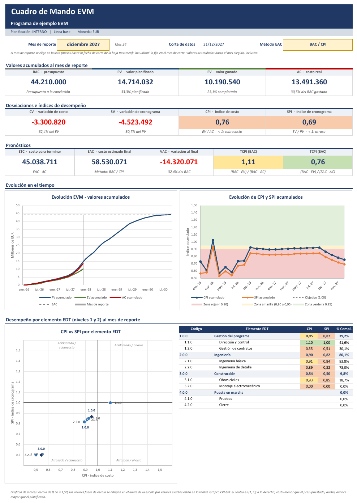
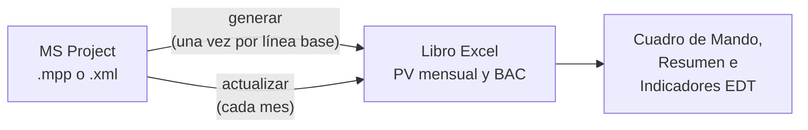

# Exportador EVM desde MS Project

Programa en Python que lee un cronograma de **MS Project** y genera un libro **Excel** para gestionar el
**Valor Ganado (EVM)**: PV mensual de cada elemento de la EDT, carga mensual de EV y AC, indicadores y
un Cuadro de Mando con gráficos, todo calculado con fórmulas de Excel.



*Cuadro de Mando del [proyecto de ejemplo](docs/ejemplo-paso-a-paso.md) después de 24 meses de avance
simulado.*

---

## Qué hace

- **PV mensual** de cada elemento de la EDT hasta el nivel 3 del código EDT (`2.0.0`, `2.1.0`,
  `2.1.1`), durante 120 meses, a partir del costo de línea base escalonado de MS Project.
- Selección de la **planificación** a exportar cuando el proyecto tiene varias (por ejemplo `INTERNO` y
  `CLIENTE`).
- Cálculo del **EV y el AC** de cada paquete a la fecha de corte, según su **método de medición**
  (0/100, 50/50, hitos ponderados, % completado, % físico completado, unidades, LOE o CPTR de
  MS Project), y carga del valor del mes en el libro.
- **Cuadro de Mando** con el mes de reporte seleccionable: BAC, PV, EV, AC, desviaciones, índices con
  semáforo, pronósticos (ETC, EAC, VAC, TCPI) y tres gráficos nativos de Excel.
- **Indicadores** del proyecto y de cada elemento de la EDT, incluido el **Cronograma Ganado**.
- **Semáforo** de CPI y SPI con umbrales inferiores y superiores configurables, indicados en el Cuadro
  de Mando.
- **Análisis de desviaciones**: cada mes, la lista de paquetes con SPI o CPI fuera de umbral, con
  columnas para la causa, el impacto, la acción correctiva, el responsable y la fecha, que se conservan
  de un mes a otro.
- Opcional: **multi-empresa**, con el PV, el EV y el AC de dos empresas por separado.
- Opcional: **varios archivos de MS Project** en un mismo informe, cada uno con sus códigos EDT (por
  ejemplo, `1.0.0` a `8.0.0` en un archivo y `9.0.0` en otro).
- Montos en **euros (EUR)** por defecto.



---

## Requisitos e instalación

- Windows con **Python 3.11 o posterior** (probado con Python 3.13 y 3.14.8).
- Para leer archivos **`.mpp`**: **MS Project de escritorio** instalado en la misma PC: Standard o
  Professional 2016 o posterior, incluida la versión de suscripción que Windows muestra como
  *Microsoft Project Online Desktop Client*. El programa lo controla por automatización COM.
- Sin MS Project en la PC, se debe guardar el proyecto como **XML** desde MS Project
  (*Archivo > Guardar como*, tipo XML) y usar ese archivo.

```powershell
git clone https://github.com/MarceloSalazar/evm-automation.git
cd evm-automation
python -m venv .venv
.venv\Scripts\Activate.ps1
python -m pip install -r requirements.txt
copy config.ejemplo.toml config.toml
```

Si PowerShell no permite ejecutar `Activate.ps1` ("la ejecución de scripts está deshabilitada"), se
debe habilitar una vez para el usuario con `Set-ExecutionPolicy -Scope CurrentUser RemoteSigned`.
Otra opción es no activar el entorno y usar `.venv\Scripts\python.exe` en lugar de `python` en todos
los comandos. Si hay varias versiones de Python instaladas, el entorno se puede crear con
`py -3.14 -m venv .venv`.

Dependencias: `openpyxl` (libro Excel) y `pywin32` 311 o posterior (COM con MS Project; la versión 311
es la primera compatible con Python 3.14).

---

## Uso rápido

```powershell
# 1) Una vez (y con cada nueva línea base): crear el libro con el PV mensual
python evm_export.py generar --origen "C:\Programa\Programa.mpp" --config config.toml --salida EVM_Programa.xlsx

# 2) Cada mes, con el avance registrado y la fecha de estado en el último día del mes:
#    calcular EV y AC a la fecha de corte y cargarlos en el libro
python evm_export.py actualizar --origen "C:\Programa\Programa.mpp" --config config.toml --libro EVM_Programa.xlsx --fecha-corte 2026-10-31
```

Los indicadores y los gráficos se consultan en las hojas `Cuadro de Mando`, `Resumen` e
`Indicadores EDT` del libro. Antes del primer uso con un proyecto real conviene revisar
[Preparación en MS Project](docs/preparacion-ms-project.md).

**Prueba sin MS Project**, con el proyecto de ejemplo incluido (planificaciones `INTERNO` y `CLIENTE`).
En `config.toml` se indican `metodo = "Método EVM"` y `peso_hito = "Peso hito"` en la sección `[campos]`:

```powershell
python evm_export.py generar --origen ejemplos\programa_ejemplo.xml --config config.toml --salida ejemplo.xlsx
python ejemplos\generar_ejemplo.py --fecha-estado 2027-06-30 --salida avance.xml
python evm_export.py actualizar --origen avance.xml --config config.toml --libro ejemplo.xlsx
```

El [tutorial](docs/ejemplo-paso-a-paso.md) recorre el ciclo completo con 24 meses de avance simulado.

---

## Documentación

| Tema | Documento |
|---|---|
| Ciclo completo con el proyecto de ejemplo | [Tutorial](docs/ejemplo-paso-a-paso.md) |
| Sesión de 30 minutos para el equipo de proyecto, con notas para el presentador | [Presentación](docs/presentacion-jefes-de-proyecto.pptx) ([PDF](docs/presentacion-jefes-de-proyecto.pdf)) |
| Puesta en marcha, cierre mensual, cambios de línea base y buenas prácticas | [Proceso de reporte EVM](docs/proceso-reporte-evm.md) |
| Código EDT, campos personalizados, línea base, fecha de estado y avance | [Preparación en MS Project](docs/preparacion-ms-project.md) |
| Recursos de trabajo, materiales y de costo, costo fijo y línea base | [Presupuesto (BAC) de cada tarea](docs/presupuesto-bac.md) |
| 0/100, fórmulas fijas, hitos ponderados, % físico, LOE y valor acumulado de MS Project | [Métodos de medición](docs/metodos-de-medicion.md) |
| PV, EV y AC de dos empresas | [Multi-empresa (opcional)](docs/multiempresa.md) |
| Varios archivos de MS Project en un mismo informe | [Varios archivos (opcional)](docs/varios-archivos.md) |
| Origen del PV mensual y estructura de filas | [Cálculo del PV](docs/calculo-pv.md) |
| EV por método, AC, valor del mes y controles | [Cálculo de EV y AC](docs/calculo-ev-ac.md) |
| Hojas del libro, reglas de uso y `--migrar-desde` | [El libro Excel](docs/libro-excel.md) |
| Tablero, gráficos, fórmulas e interpretación | [Cuadro de Mando e indicadores](docs/cuadro-de-mando.md) |
| Paquetes fuera de umbral: causa, impacto y acción correctiva | [Análisis de desviaciones](docs/analisis-desviaciones.md) |
| `generar`, `actualizar` y sus opciones | [Comandos y opciones](docs/comandos.md) |
| `config.toml` | [Configuración](docs/configuracion.md) |
| Hoja `Validación`, limitaciones y mensajes de error | [Validaciones y solución de problemas](docs/validaciones-y-problemas.md) |
| Siglas EVM y campos de MS Project en español | [Glosario](docs/glosario.md) |
| Microsoft, PMI, GAO y otras referencias | [Recursos externos](docs/recursos-externos.md) |
| Pruebas, estructura del código y flujo del repositorio | [Desarrollo](docs/desarrollo.md) |
| Cambios de cada versión | [Registro de cambios](CHANGELOG.md) |

Índice completo: [docs/README.md](docs/README.md).

---

## Contribuciones

Las contribuciones son bienvenidas: informes de problemas, correcciones y propuestas de mejora.

### Informar un problema

Los problemas y errores se informan abriendo un
[ticket](https://github.com/MarceloSalazar/evm-automation/issues/new/choose) (*issue*) con la plantilla
**Informar un problema**, que pide los datos necesarios. Antes de abrirlo se recomienda revisar
[Validaciones y solución de problemas](docs/validaciones-y-problemas.md) y buscar si ya existe un ticket
sobre el mismo tema. Un buen informe incluye:

- la versión del programa (`python evm_export.py --version`), la de Python y la de MS Project, o si se
  usa el XML;
- el comando ejecutado, con sus opciones;
- el mensaje completo; con `-v` antes del comando se obtiene el detalle técnico
  (`python evm_export.py -v actualizar ...`);
- qué se esperaba y qué ocurrió;
- si es posible, los pasos para reproducirlo con el [proyecto de ejemplo](docs/ejemplo-paso-a-paso.md)
  o con un XML reducido.

> **El repositorio es público.** No se deben adjuntar archivos `.mpp`, `.xml`, libros Excel ni
> `config.toml` de proyectos reales con información confidencial (costos, nombres, clientes o
> proveedores). Se recomienda reproducir el problema con el proyecto de ejemplo o reemplazar los datos
> sensibles antes de adjuntar un archivo.

### Proponer una mejora

Las mejoras se proponen también con un ticket, con la plantilla **Proponer una mejora**: qué necesidad
resuelven y en qué parte del proceso de reporte (preparación en MS Project, `generar`, cierre mensual,
análisis). Para cambios grandes conviene acordar el enfoque en el ticket antes de programarlos.

### Enviar un Pull Request

Se aceptan Pull Requests con correcciones de problemas o con mejoras. Al abrirlo, la descripción se
completa con la plantilla del repositorio, que incluye una lista de control con estas buenas prácticas:

- **Un propósito por Pull Request**, en una rama propia creada desde `main`. Quien no tiene permiso de
  escritura en el repositorio trabaja en un *fork* y abre el Pull Request desde allí. `main` contiene
  solo versiones estables y no admite commits directos.
- **Pruebas:** `python -m pytest` debe pasar. Cada corrección o función nueva se acompaña de pruebas; en
  una corrección, una prueba que falle sin ella. Las pruebas y la estructura del código se describen en
  [Desarrollo](docs/desarrollo.md).
- **Compatibilidad:** los libros generados con versiones anteriores deben seguir funcionando con
  `actualizar`. Si un cambio exige regenerarlos o cambiar la configuración, se indica en el Pull
  Request.
- **Documentación:** se actualiza el documento de `docs/` que corresponda (el README solo resume) y, si
  cambia el libro, las capturas. El cambio se anota en la sección *Sin publicar* de
  [CHANGELOG.md](CHANGELOG.md).
- **Redacción:** los textos (documentación, mensajes y notas del libro) se escriben en español y en forma
  impersonal ("se debe revisar"); las siglas EVM se escriben en inglés (SV, CV, SPI, CPI, EAC). El
  código sigue el estilo del código existente.
- **Datos:** no se suben libros generados, configuraciones personales ni archivos de proyectos reales.
- **Descripción:** qué cambia, por qué y cómo se probó, con el ticket relacionado si lo hay
  (`Closes #<número>`).

Todos los Pull Requests se revisan antes de incorporarse a `main`, y se pueden pedir cambios. El
responsable del repositorio define el número de versión y publica cada versión con sus notas
([proceso de versiones](docs/desarrollo.md#31-versiones-y-publicaciones)). Al contribuir, se acepta que el
aporte se distribuya bajo la licencia MIT del proyecto.

---

## Licencia

Este programa se distribuye bajo la **licencia MIT** (ver el archivo [LICENSE](LICENSE)): se puede
usar, copiar, modificar y distribuir libremente, también con fines comerciales, siempre que se
conserve el aviso de copyright. Se entrega "tal cual", sin garantía de ningún tipo y sin
responsabilidad de los autores.
