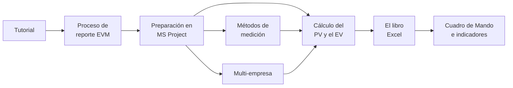

# Documentación

[Inicio](../README.md) › Documentación

Documentación detallada del Exportador EVM desde MS Project. La presentación, la instalación y el uso
rápido están en el [README principal](../README.md).

---

## Por dónde empezar

| Si se necesita... | Leer |
|---|---|
| Ver el programa funcionando sin MS Project | [Tutorial con el proyecto de ejemplo](ejemplo-paso-a-paso.md) |
| Preparar un proyecto real por primera vez | [Cálculo del PV y el EV](calculo-pv-ev.md) → [Preparación en MS Project](preparacion-ms-project.md) → [Métodos de medición](metodos-de-medicion.md) |
| Organizar el cierre mensual | [Proceso de reporte EVM](proceso-reporte-evm.md) |
| Revisar el archivo de MS Project antes de generar o actualizar el libro | [Comando `validar`](comandos.md#validar-revisa-el-archivo-de-ms-project) |
| Entregar al cliente las fichas de tareas | [Comando `generar-fichas`](comandos.md#generar-fichas-fichas-de-tareas-para-el-cliente) |
| Reunir varios archivos de MS Project en un informe | [Varios archivos de MS Project](varios-archivos.md) |
| Alinear el cronograma con el plan de costes de una empresa | [Depuración de costes](depuracion-costes.md) |
| Interpretar los indicadores y los gráficos | [Cuadro de Mando e indicadores](cuadro-de-mando.md) |
| Saber si un atraso afecta la fecha de fin, o cómo evolucionó el desempeño desde el informe anterior | [Tendencia y plazo](cuadro-de-mando.md#4-tendencia-y-plazo) |
| Definir las filas del libro con una lista de códigos EDT, sin marcar el cronograma | [Lista EDT](calculo-pv-ev.md#34-lista-edt-filas-definidas-en-un-archivo) |
| Explicar las desviaciones del mes | [Análisis de desviaciones](analisis-desviaciones.md) |
| Entender un valor del libro | [Cálculo del PV y el EV](calculo-pv-ev.md) |
| Resolver un mensaje de error | [Validaciones y solución de problemas](validaciones-y-problemas.md) |
| Presentar el programa al equipo de proyecto | [Presentación de 30 minutos](presentacion-jefes-de-proyecto.pptx) ([PDF](presentacion-jefes-de-proyecto.pdf)) |

---

## Índice

**Uso del programa**

| Documento | Contenido |
|---|---|
| [Tutorial con el proyecto de ejemplo](ejemplo-paso-a-paso.md) | Ciclo completo con el XML de ejemplo: generar el libro, ingresar el BAC, simular 24 meses de avance y revisar el resultado. |
| [Proceso de reporte EVM](proceso-reporte-evm.md) | Puesta en marcha, cierre mensual, cambios de línea base, roles, calendario, buenas prácticas y lista de control. |
| [Comandos y opciones](comandos.md) | `validar`, `generar`, `actualizar`, `analizar` y `generar-fichas` (fichas de tareas para el cliente en Markdown), todas sus opciones y ejemplos de salida. |
| [Configuración](configuracion.md) | Claves del archivo `config.toml` y ejemplos. |
| [Presentación para el equipo de proyecto](presentacion-jefes-de-proyecto.pptx) ([PDF](presentacion-jefes-de-proyecto.pdf)) | 37 diapositivas para unos 30 minutos, con notas para el presentador: conceptos EVM y semáforo, preparación en MS Project (incluidas la línea base y la definición del método de medición), `validar`, `generar` y `actualizar`, Cuadro de Mando, análisis de desviaciones y cierre mensual. Se abre con PowerPoint o LibreOffice Impress. |

**Preparación en MS Project**

| Documento | Contenido |
|---|---|
| [Preparación del proyecto en MS Project](preparacion-ms-project.md) | Lista de control, código EDT, campos personalizados, línea base, fecha de estado, registro del avance y XML. |
| [Métodos de medición](metodos-de-medicion.md) | 0/100, fórmulas fijas, hitos ponderados, % completado, % físico, unidades y LOE; dónde se define el método y dónde se calcula el EV; guía y proceso para definir el método de cada paquete. |
| [Multi-empresa (opcional)](multiempresa.md) | PV, EV y AC de dos empresas: preparación, reparto, cálculo y ejemplo. |
| [Varios archivos de MS Project (opcional)](varios-archivos.md) | Un informe con los elementos EDT de varios archivos: códigos EDT, `[[proyectos]]`, cierre mensual, cambios de archivos y ejemplo. |
| [Depuración de costes (opcional)](depuracion-costes.md) | PV planificado de una empresa frente a la previsión de su plan de costes, pegada en el libro; filas «(coste)», reglas de asignación, indicador de alineamiento, gráfico por elemento EDT y ciclo de ajuste. |

**Cálculos y libro**

| Documento | Contenido |
|---|---|
| [Cálculo del PV y el EV](calculo-pv-ev.md) | PV y EV = BAC ingresado en el libro × % planificado y % ganado de MS Project: datos que se leen, filas del libro (planificación, niveles por código EDT, campo `Visible`, tareas sin código), peso de tareas e hitos, horizonte, métodos de medición, valor del mes, fecha de corte, AC, multi-empresa, cierre mensual y controles. |
| [El libro Excel](libro-excel.md) | Hojas, reglas de uso y `--migrar-desde`. |
| [Cuadro de Mando e indicadores](cuadro-de-mando.md) | Tablero, gráficos, fórmulas, Cronograma Ganado y cómo leer los indicadores. |
| [Análisis de desviaciones](analisis-desviaciones.md) | Paquetes fuera de umbral de cada mes, causa, impacto y acción correctiva; comando `analizar`. |

**Referencia**

| Documento | Contenido |
|---|---|
| [Validaciones y solución de problemas](validaciones-y-problemas.md) | Controles de la hoja `Validación` y del comando `validar` (códigos EDT, fechas, pesos, método, avance y lógica del cronograma), limitaciones conocidas y mensajes frecuentes. |
| [Glosario](glosario.md) | Siglas EVM y su equivalencia con los campos de MS Project en español (CPTP, CPTR, CRTR...). |
| [Registro de cambios](../CHANGELOG.md) | Cambios de cada versión: nuevas funciones, correcciones y otros. |
| [Recursos externos](recursos-externos.md) | Documentación de Microsoft, estándares y guías de buenas prácticas. |
| [Desarrollo](desarrollo.md) | Pruebas automáticas, estructura del código, flujo del repositorio, versiones, instalador de Windows e imágenes de la documentación. |

---

## Mapa de la documentación

