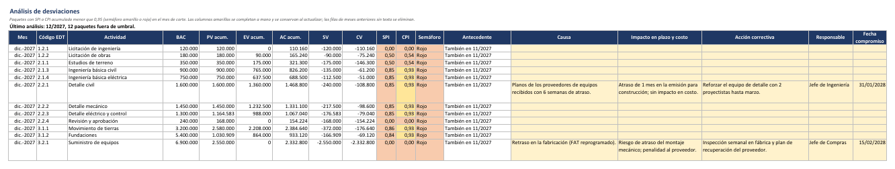
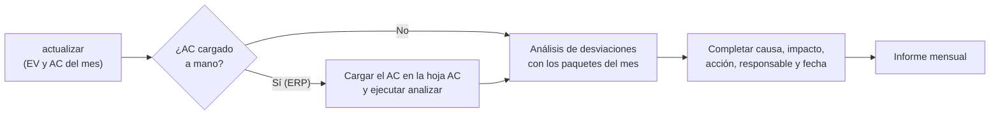

# Análisis de desviaciones

[Inicio](../README.md) › [Documentación](README.md) › Análisis de desviaciones

La hoja **Análisis de desviaciones** lista cada mes los paquetes de trabajo fuera de umbral (SPI o CPI
en amarillo o rojo) y tiene columnas para explicar cada desviación: causa, impacto, acción correctiva,
responsable y fecha compromiso. Así, el análisis que acompaña al informe mensual queda en el mismo libro
que los datos, y lo escrito se conserva al actualizar el libro y al regenerarlo por un cambio de línea
base.



*Análisis de diciembre de 2027 del [proyecto de ejemplo](ejemplo-paso-a-paso.md), con el texto de dos
paquetes como ejemplo.*

---

## Contenido

1. [Qué paquetes se listan](#1-qué-paquetes-se-listan)
2. [Columnas](#2-columnas)
3. [Cierre mensual](#3-cierre-mensual)
4. [Qué se conserva de un mes a otro](#4-qué-se-conserva-de-un-mes-a-otro)
5. [Cambios de línea base](#5-cambios-de-línea-base)
6. [Filtrar e imprimir](#6-filtrar-e-imprimir)
7. [Preguntas frecuentes](#7-preguntas-frecuentes)

---

## 1. Qué paquetes se listan

`actualizar` agrega a la hoja las **filas de ingreso** (paquetes de trabajo y filas de otros costos `-D`)
cuyo **SPI o CPI acumulado** al mes de la fecha de corte es menor que el umbral **amarillo** del
semáforo (`[semaforo] amarillo`, 0,95 por defecto): es decir, los paquetes con semáforo amarillo o rojo
en `Indicadores EDT`.

- El SPI y el CPI se calculan igual que en `Indicadores EDT`. Un índice sin valor (por ejemplo, el CPI
  de un paquete sin AC) no se considera.
- Los umbrales son los mismos con los que se **generó** el libro (los del semáforo del `Cuadro de
  Mando`).
- Los elementos de nivel 1 y 2 (subtotales) no se listan: su desviación se explica con la de sus
  paquetes.
- Con [varios archivos de MS Project](varios-archivos.md), se listan los paquetes de todos los
  archivos.

La pantalla también muestra la lista al terminar `actualizar`, incluso con `--simular`:

```text
Paquetes fuera de umbral (SPI o CPI menor que 0.95): 8 (hoja 'Análisis de desviaciones')
  1.2.1      Licitación de ingeniería                  SPI  0.00  CPI  0.00
  1.2.2      Licitación de obras                       SPI  0.50  CPI  0.54
  2.1.1      Estudios de terreno                       SPI  0.50  CPI  0.54
  ...
```

---

## 2. Columnas

| Columna | Contenido |
|---|---|
| Mes | Mes analizado (el de la fecha de corte). |
| Código EDT, Actividad | Paquete de trabajo. |
| BAC, PV, EV y AC acumulados, SV, CV, SPI, CPI | **Fórmulas** sobre las hojas `PV`, `EV` y `AC`, acumuladas hasta el mes de la fila. Si se corrige un valor en esas hojas, el análisis se recalcula. |
| Semáforo | `Rojo`, `Amarillo` o `Verde`, según el menor de los dos índices. Una fila puede quedar en `Verde` si se corrigieron los datos después de agregarla. |
| Antecedente | `Nuevo` (primer mes fuera de umbral), `También en MM/AAAA` (estaba fuera de umbral el mes anterior, sin texto) o `Texto copiado de MM/AAAA: se debe revisar` (ver la [sección 4](#4-qué-se-conserva-de-un-mes-a-otro)). |
| **Causa**, **Impacto en plazo y costo**, **Acción correctiva**, **Responsable**, **Fecha compromiso** | Celdas amarillas: se completan a mano. |

La columna oculta `clave` asocia cada fila con su paquete (el *Id. único* de la tarea en MS Project). No
se debe modificar.

---

## 3. Cierre mensual



1. `actualizar` agrega los paquetes fuera de umbral del mes de corte.
2. Si el AC del mes se carga **a mano** después de `actualizar` (por ejemplo, desde el ERP con
   `--solo ev`, o en multi-empresa), al cargarlo todavía no se conocían los paquetes con CPI bajo. Se
   ejecuta entonces `analizar`, que vuelve a calcular la lista con los valores del libro, **sin leer MS
   Project**:

   ```powershell
   python evm_export.py analizar --libro EVM_Programa.xlsx
   ```

   El libro debe estar cerrado en Excel. Como `actualizar`, guarda antes una copia de respaldo (salvo
   con `--sin-respaldo`).
3. Se completan las columnas amarillas de los paquetes del mes, con los responsables de cada paquete
   ([Proceso de reporte](proceso-reporte-evm.md#43-pasos-detallados)).

---

## 4. Qué se conserva de un mes a otro

- **Mismo mes.** Repetir `actualizar` (o `analizar`) para el mismo mes conserva el texto de cada
  paquete. Se agregan los paquetes que pasaron a estar fuera de umbral y se quitan los que volvieron
  dentro del umbral **si no tienen texto**; los que tienen texto se conservan.
- **Mes siguiente.** Al actualizar un mes nuevo:
  - las filas de los meses anteriores **con texto** se conservan, como registro de lo informado;
  - las filas de los meses anteriores **sin texto** se eliminan;
  - si un paquete sigue fuera de umbral y tenía texto, el texto se **copia** a la fila del mes nuevo,
    con el antecedente `Texto copiado de MM/AAAA: se debe revisar`, para actualizarlo en lugar de
    escribirlo de nuevo.
- **Filas agregadas a mano.** Una fila escrita a mano debajo de la lista (por ejemplo, el comentario de
  un elemento de nivel 2) se conserva, sin fórmulas.

No se deben insertar ni eliminar columnas. Las filas se pueden ordenar o filtrar con los botones del
encabezado.

---

## 5. Cambios de línea base

`generar --migrar-desde` traslada el análisis del libro anterior al libro nuevo
([El libro Excel](libro-excel.md#4-cambios-de-línea-base-o-de-edt---migrar-desde)):

- Cada fila pasa a la fila nueva de su paquete, y sus fórmulas usan los valores del libro nuevo. Como el
  PV corresponde a la nueva línea base, los índices de los meses ya informados pueden cambiar: el
  registro de lo informado con la línea base anterior es el libro anterior.
- Si el paquete ya no existe en el libro nuevo, el texto se conserva en una fila sin valores
  (antecedente `Fila inexistente en el libro nuevo`) y se advierte en `Validación`.

Los libros generados con versiones anteriores a la 1.5.0 no tienen la hoja: `actualizar` (o `analizar`)
la crea a continuación de `Indicadores EDT`, con el semáforo de la configuración.

---

## 6. Filtrar e imprimir

- El encabezado tiene **filtros**: por ejemplo, se filtra la columna `Mes` para ver solo el mes del
  informe, o `Semáforo` para ver solo los rojos.
- La hoja se imprime en horizontal, con el ancho ajustado a una página y el encabezado repetido en cada
  página, para adjuntarla al informe mensual junto con el `Cuadro de Mando`.

---

## 7. Preguntas frecuentes

**¿Se puede cambiar el umbral?** El umbral es el amarillo del semáforo (`[semaforo] amarillo`) con que
se generó el libro. Para usar otro se cambia la configuración y se regenera el libro con
`--migrar-desde`, que conserva el análisis.

**¿Por qué aparece un paquete de nivel de esfuerzo (LOE) con SPI 1?** Porque su CPI está por debajo del
umbral: el SPI de un paquete LOE siempre es 1, pero su costo puede desviarse.

**¿Qué pasa si borro una fila del análisis?** Si el paquete sigue fuera de umbral en el mes de corte,
vuelve a aparecer (sin texto) la próxima vez que se ejecute `actualizar` o `analizar` para ese mes.

**¿Se puede analizar un mes anterior?** `actualizar` con la fecha de corte de ese mes (y `--forzar` si hay
meses posteriores cargados) vuelve a calcular la lista de ese mes, y conserva su texto. Las filas sin
texto de los demás meses se eliminan.
