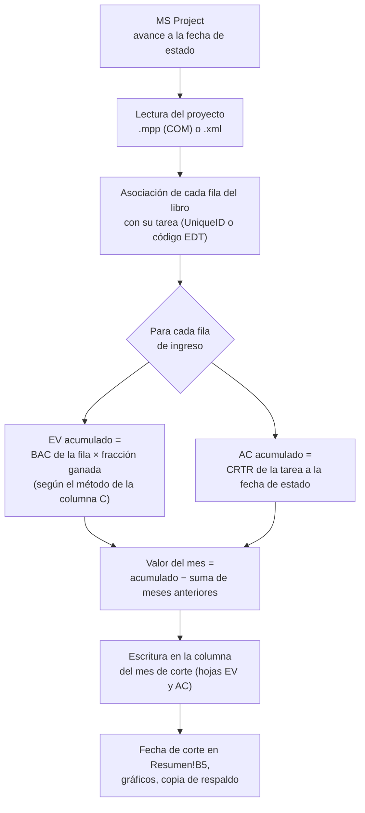
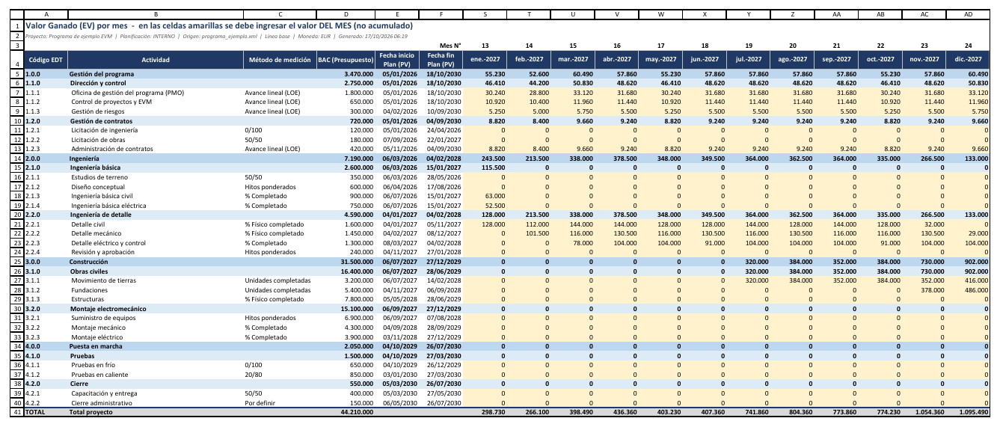

# Cómo se calculan EV y AC

[Inicio](../README.md) › [Documentación](README.md) › Cálculo de EV y AC

El comando `actualizar` lee el proyecto de MS Project con el avance registrado a la fecha de corte,
calcula para cada fila del libro el **valor ganado (EV)** y el **costo real (AC)** acumulados, y
escribe en la columna del mes de corte el **valor del mes**: la diferencia entre el acumulado y lo
cargado en los meses anteriores.

Este documento explica qué datos se leen, cómo se obtiene cada valor y qué controles se aplican. Las
reglas de cada método de medición se detallan en [Métodos de medición](metodos-de-medicion.md).

---

## Contenido

1. [Resumen del proceso](#1-resumen-del-proceso)
2. [Datos que se leen de MS Project](#2-datos-que-se-leen-de-ms-project)
3. [EV acumulado de cada fila](#3-ev-acumulado-de-cada-fila)
4. [AC acumulado de cada fila](#4-ac-acumulado-de-cada-fila)
5. [Del valor acumulado al valor del mes](#5-del-valor-acumulado-al-valor-del-mes)
6. [Fecha de corte y fecha de estado](#6-fecha-de-corte-y-fecha-de-estado)
7. [Controles de consistencia](#7-controles-de-consistencia)
8. [Opciones de `actualizar`](#8-opciones-de-actualizar)
9. [Recomendaciones](#9-recomendaciones)

---

## 1. Resumen del proceso



Las **filas de ingreso** son las filas de nivel 3 del código EDT (paquetes de trabajo), las filas de
niveles 1 o 2 sin subelementos y las filas `-D Otros costos`. Las filas de nivel 1 y 2 con
subelementos son subtotales con fórmulas y no se escriben.

---

## 2. Datos que se leen de MS Project

| Campo de MS Project (nombre en inglés) | Uso en el cálculo |
|---|---|
| *% completado* (`PercentComplete`) | Métodos `% Completado`, `0/100` y `X/Y`; método de respaldo cuando falta otro dato. |
| *% físico completado* (`PhysicalPercentComplete`) | Métodos `% Físico completado`, `Unidades completadas` y respaldo de `Hitos ponderados`. |
| *Comienzo real* (`ActualStart`) | Indica que la tarea comenzó (métodos `X/Y`). |
| *Fin real* (`ActualFinish`) | Indica que la tarea terminó (con *% completado* ≥ 99,5 %). |
| *Costo previsto* (`BaselineCost`) de las subtareas | Ponderación del avance de las subtareas de un paquete. |
| *Hito* (`Milestone`) y campo `peso_hito` | Método `Hitos ponderados`. |
| *CPTR* (`BCWP`) | Método `CPTR de MS Project`. |
| *CRTR* (`ACWP`) | AC de cada fila. Si MS Project no lo informa, se usa *Costo real* (`ActualCost`). |
| *Fecha de estado* (`StatusDate`) | Fecha de corte por defecto. |

Criterios comunes a todos los métodos:

- **Tarea comenzada:** tiene *Comienzo real*, o *% completado* > 0, o *% físico completado* > 0.
- **Tarea terminada:** *% completado* = 100, o tiene *Fin real* y *% completado* ≥ 99,5.

> Con archivos `.mpp`, MS Project calcula el CPTR y el CRTR en el momento de la lectura, a la fecha
> de corte. Con archivos `.xml`, esos valores son los que MS Project calculó al guardar el archivo:
> el XML se debe guardar **después** de fijar la fecha de estado
> ([Preparación en MS Project](preparacion-ms-project.md#7-fecha-de-estado-y-registro-del-avance)).

---

## 3. EV acumulado de cada fila

```text
EV acumulado de la fila = BAC de la fila × fracción ganada (entre 0 y 1)
```

El **BAC de la fila** es el de la columna D de la hoja `PV`. La **fracción ganada** depende del método
de la columna C de la hoja `PV`, que se puede modificar en Excel:

| Método (columna C) | Fracción ganada a la fecha de corte |
|---|---|
| `0/100` | 0 hasta terminar; 1 al terminar. |
| `50/50`, `25/75`, `20/80` (cualquier `X/Y` con X + Y = 100) | X % al comenzar; 100 % al terminar. |
| `Hitos ponderados` | Σ pesos de los hitos cumplidos / Σ pesos de todos los hitos de la fila. |
| `% Completado` | *% completado* de las subtareas, ponderado por su costo de línea base. |
| `% Físico completado` | *% físico completado* de las subtareas, ponderado por su costo de línea base. |
| `Unidades completadas` | Igual que `% Físico completado` (allí se registra unidades hechas / unidades totales). |
| `Avance lineal (LOE)` | PV acumulado de la fila / BAC de la fila (EV = PV). |
| `CPTR de MS Project` | CPTR de MS Project / costo de línea base (limitado a 1). |
| `Por definir` u otro texto | Se usa `% Completado` y se informa en pantalla. |

Las fórmulas fijas se reconocen también escritas con `%` o con espacios (`50%/50%`, `0 / 100`).

### 3.1 Avance ponderado por costo

Para los métodos de porcentaje, el avance de un paquete con subtareas es el promedio de las tareas de
detalle (las que no tienen subtareas), ponderado por su **costo de línea base**:

```text
avance = Σ (costo previsto de la subtarea × % de la subtarea) / Σ costo previsto de las subtareas
```

Si ninguna subtarea tiene costo de línea base, se usa el *% completado* de la tarea del paquete (el que
MS Project acumula por duración) o, con *% físico completado*, el promedio simple de las subtareas.

**Ejemplo.** Paquete `2.1.3 Ingeniería básica civil`, BAC 900.000 €, con tres subtareas:

| Subtarea | Costo previsto | % completado | Peso × % |
|---|---:|---:|---:|
| Memoria de cálculo | 300.000 | 100 % | 300.000 |
| Planos generales | 400.000 | 50 % | 200.000 |
| Especificaciones | 200.000 | 0 % | 0 |
| **Total** | **900.000** | | **500.000** |

Avance ponderado = 500.000 / 900.000 = 55,6 %. EV acumulado con cada método:

| Método | EV acumulado | Motivo |
|---|---:|---|
| `% Completado` | 500.000 | 55,6 % × 900.000 |
| `0/100` | 0 | El paquete no terminó. |
| `50/50` | 450.000 | El paquete comenzó: 50 % × 900.000. |
| `20/80` | 180.000 | El paquete comenzó: 20 % × 900.000. |
| `Hitos ponderados` (pesos 30/30/40, dos hitos cumplidos) | 540.000 | 60 % × 900.000 |

### 3.2 Particularidades de algunos métodos

- **Hitos ponderados:** se consideran todos los hitos que dependen de la fila, en cualquier nivel. Un
  peso negativo se toma como 0; si ningún hito tiene peso positivo, todos pesan igual. Si la fila no
  tiene hitos, se usa *% físico completado*
  cuando alguna subtarea lo tiene registrado y, si no, *% completado*. Cada caso se informa en pantalla.
- **CPTR de MS Project:** el EV no puede superar el BAC de la fila; si el CPTR lo supera, se limita y
  se informa. Si MS Project calcula el valor acumulado con una línea base distinta de la del informe,
  se usa la fracción CPTR / costo de esa línea base y se advierte. Si MS Project no informa el CPTR,
  se usa `% Completado`.
- **Avance lineal (LOE):** el EV es igual al PV acumulado de la fila, por lo que la fila nunca tiene
  variación de cronograma (SV = 0, SPI = 1). Sí puede tener variación de costo.
- **Filas `-D Otros costos`:** el avance se mide solo con las tareas que forman la fila (las que
  dependen de la tarea resumen sin tener fila propia), no con toda la rama de la tarea resumen. Con las
  fórmulas fijas, la fila comienza cuando comienza alguna de esas tareas y termina cuando terminan todas.
  Si la fila solo tiene costo propio de la tarea resumen, se usa el avance de la tarea resumen.

### 3.3 Diferencia con el valor acumulado de MS Project

`% Completado` aplica el porcentaje sobre el BAC. MS Project, en cambio, calcula su CPTR con el
*% completado* aplicado sobre la **duración de la línea base** y suma el costo de línea base escalonado
hasta ese punto. Si la línea base no es lineal (por ejemplo, con costos fijos al comienzo o perfiles de
trabajo), ambos valores pueden diferir. Para obtener exactamente el valor de MS Project se usa el método
`CPTR de MS Project` ([Métodos de medición](metodos-de-medicion.md#38-cptr-de-ms-project)).

---

## 4. AC acumulado de cada fila

```text
AC acumulado de la fila = CRTR (costo real del trabajo realizado) de su tarea a la fecha de estado
```

- **Filas de paquete (nivel 3):** el CRTR de la tarea del paquete, que MS Project acumula desde todas
  sus subtareas.
- **Filas `-D Otros costos`:** el CRTR de la tarea resumen menos el de sus filas hijas. Así se registra
  el costo real cargado directamente en una tarea resumen de nivel 1 o 2, o en tareas sin código EDT
  que dependen de ella.
- Si MS Project no informa el CRTR de una tarea, se usa su *Costo real*.

### 4.1 Origen del costo real

| Origen del AC | Cómo se carga | Opción de `actualizar` |
|---|---|---|
| **Calculado por MS Project** con el trabajo real y las tarifas, más los costos fijos y los recursos de costo | Se registra el avance (trabajo real, % completado) y MS Project calcula el *Costo real*. | `actualizar` (EV y AC) |
| **Costos reales escritos en MS Project** (por ejemplo, los del ERP) | Se desmarca *Los costos reales siempre se calculan por Project* y se escribe el costo real de cada tarea ([Preparación en MS Project](preparacion-ms-project.md#72-costo-real)). | `actualizar` (EV y AC) |
| **ERP o contabilidad, cargado en Excel** | Se carga a mano el AC del mes en las celdas amarillas de la hoja `AC`. | `actualizar --solo ev` |

Cuando el AC proviene del ERP o de contabilidad, se recomienda usar el **costo devengado** del período
(trabajo realizado y materiales recibidos), no los pagos ni los compromisos (pedidos emitidos), y
aplicar la misma fecha de corte que el EV. Si el AC llega con un mes de retraso, conviene estimar el
costo devengado no facturado del mes para no distorsionar el CPI.

### 4.2 Multi-empresa

En modo multi-empresa el AC de cada empresa se carga, por defecto, a mano en las hojas `AC-EmpresaA` y
`AC-EmpresaB`. Con `ac_desde_project = true`, `actualizar` reparte el CRTR de cada tarea según la parte
de cada empresa. Ver [Multi-empresa](multiempresa.md#6-cálculo-del-ev-y-el-ac-por-empresa).

---

## 5. Del valor acumulado al valor del mes

Las hojas `EV` y `AC` guardan **valores del mes**, no acumulados. `actualizar` calcula el valor del mes
como la diferencia entre el acumulado a la fecha de corte y la suma de lo cargado en los meses
anteriores de la misma fila:

```text
valor del mes = acumulado a la fecha de corte − Σ valores de los meses anteriores
```

**Ejemplo.** Paquete con método `% Completado` y BAC 900.000 €:

| Mes de corte | Avance ponderado | EV acumulado | Meses anteriores | **EV del mes** (se escribe) |
|---|---:|---:|---:|---:|
| enero | 10 % | 90.000 | 0 | **90.000** |
| febrero | 30 % | 270.000 | 90.000 | **180.000** |
| marzo | 28 % (corrección del avance) | 252.000 | 270.000 | **−18.000** |
| abril | 45 % | 405.000 | 252.000 | **153.000** |

- Un valor del mes **negativo** indica una corrección del avance o del costo real registrados: se
  informa en pantalla para revisarlo.
- **Repetir** `actualizar` para el mismo mes **reemplaza** el valor de ese mes; no lo duplica.
- Si hay valores en **meses posteriores** a la fecha de corte, `actualizar` se detiene. Se deben borrar
  esos valores o usar `--forzar`. Con `--forzar` esos meses no se recalculan: se avisa cuáles quedaron
  con un acumulado que ya no coincide con MS Project, para revisarlos o volver a cargarlos en orden.
- **Primer `actualizar` con el proyecto ya en ejecución:** todo el EV y el AC acumulados quedan en el
  mes de corte. Si se dispone del historial mensual, se debe cargar antes a mano en los meses
  anteriores; `actualizar` respeta esos valores y solo escribe la diferencia.
- Las celdas de ingreso con números guardados como texto o con fórmulas se reemplazan por su valor
  numérico (Excel no suma texto y la biblioteca que escribe el libro no recalcula fórmulas).



*Hoja `EV` del [proyecto de ejemplo](ejemplo-paso-a-paso.md) después de 24 actualizaciones mensuales
(se ocultaron los meses 1 a 12). Las celdas amarillas contienen el EV de cada mes; las filas de nivel 1
y 2 son subtotales.*

---

## 6. Fecha de corte y fecha de estado

- La **fecha de corte** es, por defecto, la *fecha de estado* del proyecto en MS Project. Con
  `--fecha-corte AAAA-MM-DD` se puede indicar otra.
- Con archivos `.mpp`, el programa fija la fecha de corte como fecha de estado **en la copia abierta**
  (no guarda el archivo), de modo que MS Project calcula el CPTR y el CRTR a esa fecha.
- Con archivos `.xml` no se puede recalcular: si la fecha de estado del XML difiere de la fecha de
  corte, se advierte que el CPTR y el CRTR corresponden a la fecha de estado del archivo.
- Se debe usar el **último día del mes**. El PV acumulado a la fecha de corte incluye el mes completo;
  si la fecha de corte es otro día, se advierte.
- Si la fecha de corte es anterior a la última cargada en el libro, se advierte.

---

## 7. Controles de consistencia

`actualizar` informa en pantalla:

| Control | Qué indica |
|---|---|
| Fila cuya tarea ya no existe o está inactiva | La tarea se eliminó, se desactivó o cambió de UniqueID en MS Project: la fila se omite y se conservan los valores ya cargados. Si cambió la EDT, se debe regenerar el libro con `--migrar-desde` ([El libro Excel](libro-excel.md#4-cambios-de-línea-base-o-de-edt---migrar-desde)). |
| Tarea con costo real sin fila en el libro | Costo real de tareas de la planificación que no queda en ninguna fila, incluidos los paquetes con código EDT agregados en MS Project después de generar el libro. No se incluye en el AC: se debe regenerar el libro con `--migrar-desde`. |
| AC total distinto del CRTR del proyecto | Diferencia entre el AC cargado y el costo real del proyecto (o de la planificación) en MS Project. |
| Libro de otro proyecto | Si el nombre del proyecto no coincide con el del libro, las filas se asocian por código EDT y se recomienda verificar los resultados. |
| Planificación distinta | `actualizar` usa siempre la planificación con la que se generó el libro. |
| Celdas convertidas | Celdas de ingreso con texto o fórmulas que se reemplazaron por su valor numérico. |
| Celdas sin la fórmula del libro | Subtotales, fila TOTAL o suma de las empresas que perdieron su fórmula (por ejemplo, porque se escribió un valor encima): se informan para restaurarlas. |

Antes de leer MS Project, `actualizar` **verifica el libro**: si falta o se renombró una hoja, si se
insertaron, eliminaron u ordenaron filas en las hojas mensuales (los códigos EDT de la columna A no
coinciden con los del libro generado) o si se modificaron las hojas ocultas, se detiene sin modificar
el libro e indica cómo corregirlo. También avisa de inmediato si el libro está abierto en Excel.

El libro se guarda primero en un archivo temporal y luego reemplaza al anterior: si el guardado falla
(libro abierto en Excel, disco lleno, interrupción), el libro anterior queda intacto.

Al terminar, se muestran los indicadores del proyecto a la fecha de corte, con los mismos cálculos
que la hoja `Resumen`.

---

## 8. Opciones de `actualizar`

| Opción | Uso |
|---|---|
| `--solo ev` | Actualiza solo el EV (el AC se carga a mano, por ejemplo desde el ERP). |
| `--solo ac` | Actualiza solo el AC. En multi-empresa requiere `ac_desde_project = true`. |
| `--simular` | Muestra el EV y el AC calculados para cada fila y los indicadores resultantes, sin modificar el libro. |
| `--forzar` | Permite actualizar aunque haya valores en meses posteriores. Esos meses no se recalculan: se avisa cuáles quedaron con un acumulado que ya no coincide con MS Project, para revisarlos o volver a cargarlos en orden. |
| `--sin-respaldo` | No crea la copia de respaldo del libro. |

Ejemplo de `--simular` con el proyecto de ejemplo (extracto):

```text
Fecha de corte: 31/12/2027 (mes 24 del horizonte)
Código           EV del mes     EV acumulado       AC del mes     AC acumulado
1.1.1                33,120          748,800           19,440          680,400
1.2.1                     0                0                0          110,160
2.1.2                     0          600,000                0          550,800
2.2.2                29,000        1,232,500           31,320        1,331,100
3.1.1               416,000        2,208,000          449,280        2,384,640
...
Observaciones por fila:
  4.2.2 Cierre administrativo: método no definido: se usó % completado

BAC (EUR)              44,210,000
PV acumulado             14,714,032   % planificado 33.3 %
EV acumulado             10,190,540   % completado  23.1 %
AC acumulado             13,491,360   % gastado     30.5 %
SV = EV - PV             -4,523,492   SPI = 0.69
CV = EV - AC             -3,300,820   CPI = 0.76
EAC = BAC/CPI            58,530,071   VAC = -14,320,071
TCPI                           1.11
ES (meses)                    21.67   AT = 24  SV(t) = -2.33  SPI(t) = 0.90
Simulación: no se modificó el libro.
```

En el extracto, la fila `1.2.1` (método `0/100`) tiene costo real pero EV 0 porque el paquete aún no
terminó: es el comportamiento esperado de ese método. La lista completa de opciones está en
[Comandos y opciones](comandos.md#actualizar-carga-ev-y-ac-del-mes).

---

## 9. Recomendaciones

- El *% completado* de MS Project mide el **% de la duración** transcurrida, no del trabajo realizado.
  Para medir el avance físico se recomienda *% físico completado* o `Hitos ponderados`
  ([Métodos de medición](metodos-de-medicion.md)).
- Se recomienda ejecutar `actualizar --simular` antes de la actualización definitiva y revisar las
  observaciones por fila.
- El EV y el AC de cada mes deben corresponder a la **misma fecha de corte**: el avance registrado en
  MS Project y el costo real del ERP deben cerrar el mismo día.
- Aunque el informe sea bimestral, se recomienda actualizar **todos los meses**: la curva S y los
  métodos `0/100` y `50/50` se miden con el período mensual.
- Las correcciones de meses ya informados no se hacen reescribiendo el pasado: el mes actual absorbe la
  diferencia (valor del mes negativo o mayor), y se documenta en el informe.
