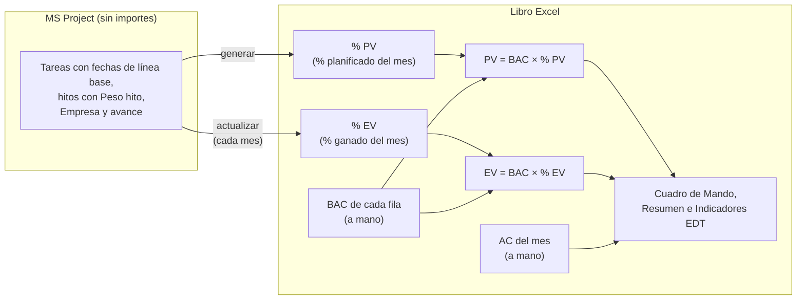
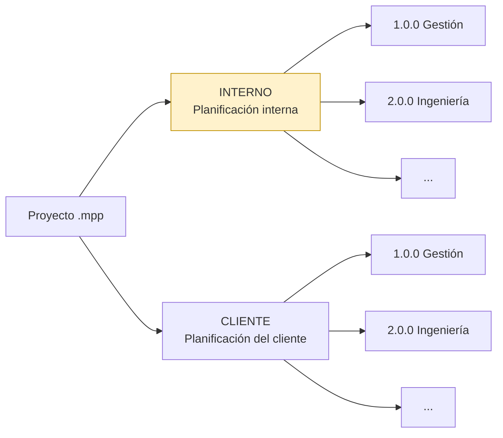
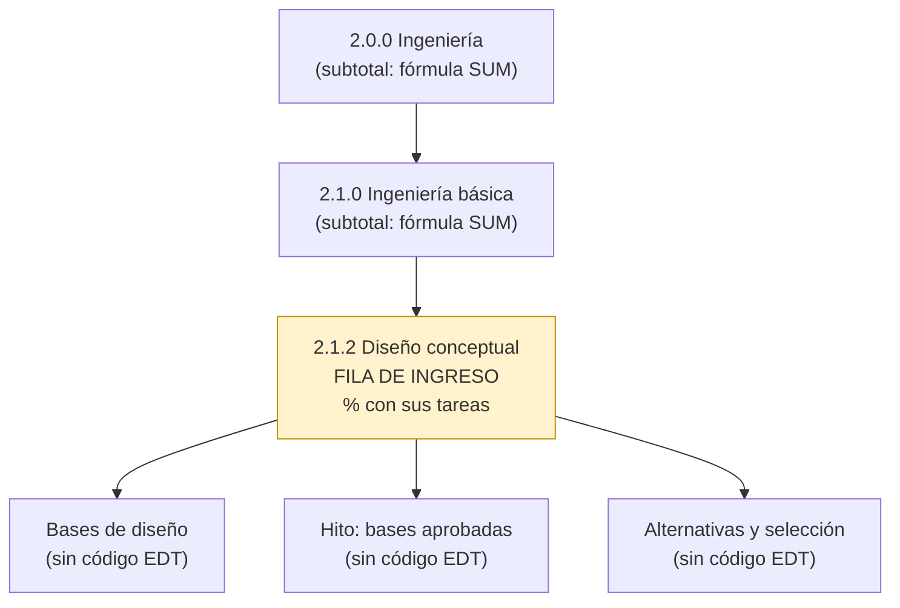
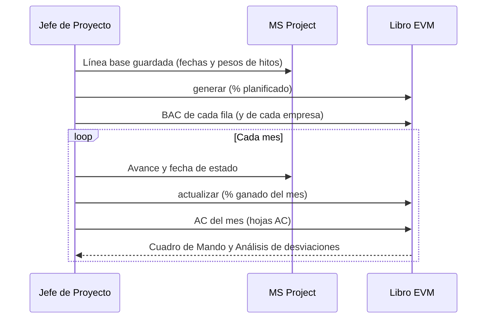

# Cálculo del PV y el EV

[Inicio](../README.md) › [Documentación](README.md) › Cálculo del PV y el EV

El cronograma de MS Project **no necesita importes**. Para cada fila del libro (paquete de trabajo), el
programa calcula desde MS Project el **% planificado** de cada mes y el **% ganado** a la fecha de corte.
El PV y el EV son el **BAC que se ingresa en el libro** multiplicado por ese %. El AC se carga a mano.

> Las versiones 1.x calculaban el PV y el BAC con los costos cargados en MS Project y podían leer el
> costo real. Esa forma de cálculo se eliminó en la versión 2.0.0: para usarla se debe instalar la versión
> 1.5.1. Los libros generados con la versión 1.x no se pueden actualizar con la 2.0.0.

---

## Contenido

1. [Cómo funciona](#1-cómo-funciona)
2. [Preparación en MS Project](#2-preparación-en-ms-project)
3. [Filas del libro](#3-filas-del-libro)
4. [% planificado: peso de cada tarea](#4--planificado-peso-de-cada-tarea)
5. [Horizonte de meses y proyecto sin línea base](#5-horizonte-de-meses-y-proyecto-sin-línea-base)
6. [% ganado: métodos de medición](#6--ganado-métodos-de-medición)
7. [Del % acumulado al % del mes](#7-del--acumulado-al--del-mes)
8. [Fecha de corte y fecha de estado](#8-fecha-de-corte-y-fecha-de-estado)
9. [AC: costo real](#9-ac-costo-real)
10. [Multi-empresa](#10-multi-empresa)
11. [Hojas del libro](#11-hojas-del-libro)
12. [Puesta en marcha y cierre mensual](#12-puesta-en-marcha-y-cierre-mensual)
13. [Cambios de BAC y de línea base](#13-cambios-de-bac-y-de-línea-base)
14. [Controles y validaciones](#14-controles-y-validaciones)
15. [Recomendaciones](#15-recomendaciones)
16. [Preguntas frecuentes](#16-preguntas-frecuentes)

---

## 1. Cómo funciona



```text
PV del mes = BAC de la fila × % planificado del mes   (hoja % PV)
EV del mes = BAC de la fila × % ganado del mes        (hoja % EV)
AC del mes = se ingresa a mano                        (hoja AC)
```

- `generar` calcula el % planificado de cada fila con las **fechas de la línea base** de sus tareas y el
  **peso** de sus hitos. La suma del % planificado de una fila es 100 %.
- `actualizar` calcula el % ganado acumulado de cada fila a la fecha de corte, según su método de
  medición, y escribe el **% del mes**: la diferencia con lo cargado en los meses anteriores.
- El PV y el EV son **fórmulas de Excel**: al escribir o cambiar el BAC de una fila, se recalculan
  todos sus meses.
- El BAC y el AC deben estar en la **misma base** (por ejemplo, ambos a precio de contrato), para que el
  CPI compare valores comparables.

Así, el cronograma se puede **compartir** (con el cliente o entre las empresas que ejecutan el proyecto)
sin importes, y el presupuesto de cada paquete puede venir de otra fuente (contrato, oferta, presupuesto
de cada empresa). Si el proyecto tiene recursos o costos cargados en MS Project, no se usan.

---

## 2. Preparación en MS Project

La preparación completa está en [Preparación en MS Project](preparacion-ms-project.md). Lo que usa el
cálculo:

| Paso | Qué se necesita |
|---|---|
| Código EDT | Cada fila del libro es un elemento EDT hasta el nivel máximo, o el detalle que indique el campo `Visible` de cada tarea ([sección 3](#3-filas-del-libro)). |
| Línea base | Guardada (*Proyecto > Establecer línea base*): el % planificado usa sus **fechas**. |
| Tareas de detalle | Su **duración** define su peso dentro del paquete: conviene que las tareas representen el trabajo del paquete. Una tarea larga de poco valor pesa más que una corta de mucho valor. |
| Hitos | Con el campo `Peso hito` (*Número1*): el % del BAC del paquete que se gana al cumplir el hito ([sección 4](#4--planificado-peso-de-cada-tarea)). |
| Método de medición | Campo `Método EVM` (*Texto10*) ([Métodos de medición](metodos-de-medicion.md)). |
| Avance | *% completado*, *% físico completado*, comienzo y fin reales, y la fecha de estado. |
| Multi-empresa | Columnas `Empresa` y `% Reparto` ([sección 10](#10-multi-empresa)). |

Datos que se leen de cada tarea:

| Campo de MS Project | Uso en el cálculo |
|---|---|
| *Comienzo previsto* y *Fin previsto* (fechas de la línea base) | % planificado: duración y reparto en los meses. Sin línea base, las fechas actuales ([sección 5](#5-horizonte-de-meses-y-proyecto-sin-línea-base)). |
| *Hito* y campo `Peso hito` | % planificado del hito y método `Hitos ponderados`. |
| *% completado* | Métodos `% Completado`, `0/100` y `X/Y`; método de respaldo cuando falta otro dato. |
| *% físico completado* | Métodos `% Físico completado` y `Unidades completadas`, y respaldo de `Hitos ponderados`. |
| *Comienzo real* | Indica que la tarea comenzó (métodos `X/Y`). |
| *Fin real* | Indica que la tarea terminó (con *% completado* ≥ 99,5 %). |
| *Fecha de estado* | Fecha de corte por defecto. |

Criterios comunes a todos los métodos:

- **Tarea comenzada:** tiene *Comienzo real*, o *% completado* > 0, o *% físico completado* > 0.
- **Tarea terminada:** *% completado* = 100, o tiene *Fin real* y *% completado* ≥ 99,5.

> **Pesos visibles.** El cronograma no tiene importes, pero sí los `Peso hito`. Si quien recibe el
> cronograma conoce también el BAC del paquete, puede calcular el valor de cada hito. Cuando eso no se
> debe saber, se deja el peso vacío: los hitos no tienen valor propio y, con el método
> `Hitos ponderados`, pesan igual.

---

## 3. Filas del libro

### 3.1 Planificación exportada

Un mismo archivo de MS Project puede contener varias planificaciones del mismo proyecto, por ejemplo
`INTERNO` (planificación de ejecución) y `CLIENTE` (planificación contractual), cada una bajo una tarea de
primer nivel con ese código EDT.

Si se indica `planificacion` (por ejemplo `INTERNO`), solo se exportan las tareas que dependen de la
tarea con ese código EDT. Esa tarea contenedora no tiene fila propia. Si los códigos de sus tareas
incluyen el prefijo de la planificación (por ejemplo `INTERNO.1.1`), el prefijo se quita.



*Con `planificacion = "INTERNO"` el libro contiene solo la rama resaltada.*

`actualizar` usa siempre la planificación con la que se generó el libro. Si no se elige una
planificación y ambas usan los mismos códigos EDT, `Validación` informa códigos duplicados.

### 3.2 Niveles por código EDT

El nivel de cada tarea se toma de su **código EDT**, no de su posición en el esquema de MS Project: los
ceros finales no cuentan.

| Código EDT | Nivel | Fila en el libro |
|---|---|---|
| `2.0.0` | 1 | Subtotal (suma de sus hijos) o fila de ingreso si no tiene hijos. |
| `2.1.0` | 2 | Subtotal o fila de ingreso si no tiene hijos. |
| `2.1.1` | 3 | Fila de ingreso: paquete de trabajo. |
| `2.1.1.1` | 4 | Sin fila propia: forma parte de `2.1.1`. |

- Tienen fila propia las tareas con código EDT hasta el nivel máximo (`nivel_maximo`, 3 por defecto).
- El % planificado y el % ganado de una fila de nivel 3 se calculan con todas las tareas de detalle que
  dependen de ella.
- Las filas de nivel 1 y 2 suman a sus hijos con fórmulas de Excel.
- Con `rellenar_edt = true` (por defecto), los códigos se completan con ceros: `1` → `1.0.0`,
  `1.2` → `1.2.0`.
- El código EDT se lee del campo indicado en `[campos] edt`: el campo *EDT* de MS Project, el *número
  de esquema* o un campo personalizado de texto ([Preparación en MS Project](preparacion-ms-project.md#2-estructura-y-código-edt)).
- El campo `Visible` permite cambiar esta regla tarea por tarea ([3.3](#33-campo-visible-más-o-menos-detalle-en-cada-rama)).



### 3.3 Campo Visible: más o menos detalle en cada rama

`nivel_maximo` fija el mismo nivel de detalle para todo el proyecto. Con el campo de texto `Visible`
(*Texto5* o el que indique `[campos] visible`), se decide tarea por tarea qué información económica
muestra el libro:

| Visible | Resultado |
|---|---|
| `Sí` (también Si, SI, S, X, 1) | **Fila propia**, aunque su código EDT sea más detallado que `nivel_maximo` (por ejemplo `2.1.1.4` con nivel 3). Su tarea superior pasa a ser subtotal. La tarea necesita código EDT. |
| `No` (también NO, N, 0) | **Fuera del cálculo**: la tarea y toda su rama no forman parte del PV, el EV ni el AC, y no aparecen en el libro. |
| Vacío | Según `nivel_maximo`. |

- Si **todas** las subtareas de una tarea tienen `No`, la tarea las representa: no tienen fila propia,
  pero se calculan con ella. Si la tarea tiene fila, pasa a ser el paquete de trabajo con toda su rama.
  En MS Project una tarea resumen acumula las fechas y el avance de sus subtareas.
- Si solo **algunas** tienen `No`, esas quedan fuera del cálculo y las demás siguen como siempre. No se
  crea ninguna fila `-D` por ellas.
- Dentro de un paquete se aplica igual: una subtarea con `No` no pesa en su % planificado ni en su %
  ganado, salvo que todas las subtareas del paquete tengan `No`.
- Un elemento de nivel 1 con `No` queda fuera del libro. Si todos los elementos de nivel 1 tienen `No`,
  se ignora en ellos (el libro no tendría filas).
- `No` prevalece sobre un `Sí` en su rama.
- La hoja `Validación` lista las tareas que quedan fuera del cálculo, las tareas que representan a sus
  subtareas, los valores no reconocidos y los `Sí` que no se pueden aplicar.

Ejemplo con `nivel_maximo = 3`:

| Tarea | Visible | Resultado |
|---|---|---|
| `1.1.1 PMO` y `1.1.2 Control` | `No` en las dos | Sin filas propias: `1.1.0 Dirección` es el paquete de trabajo, con las dos tareas. |
| `1.2.2 Obras` | `No` | Fuera del cálculo: `1.2.0 Contratos` suma solo `1.2.1`. |
| `1.2.1.1 Pliegos` (nivel 4) | `Sí` | Fila propia de nivel 4; `1.2.1` pasa a ser subtotal y su otra subtarea forma `1.2.1-D`. |

**BAC y AC de lo que queda fuera.** El BAC y el AC que se ingresan en el libro no deben incluir las
tareas con `No`.

El campo se aplica al generar el libro. Si `Visible` cambia después, el libro conserva sus filas
(`actualizar` lo informa) y se debe regenerar con `--migrar-desde`:
- el historial de las filas cuyas subtareas pasan todas a `No` se suma en la fila que las representa;
- el de una fila que queda fuera del cálculo, o de un paquete que se divide por un `Sí` nuevo, no se
  puede trasladar y se informa en `Validación` para cargarlo a mano
  ([El libro Excel](libro-excel.md#4-cambios-de-línea-base-o-de-edt---migrar-desde)).

Si se omite `[campos] visible`, se lee el campo con alias `Visible` cuando el proyecto lo tiene. Con
`visible = ""` no se lee; así se puede generar, del mismo cronograma, un libro con todo el detalle hasta
`nivel_maximo` y otro con el detalle que indica `Visible`.

### 3.4 Tareas sin código EDT

Las tareas sin código EDT no tienen fila propia. Si dependen de un elemento EDT, forman parte de ese
elemento:

- dentro de un paquete de nivel 3, del propio paquete;
- directamente bajo un elemento de nivel 1 o 2, de la fila `<código>-D Otras tareas de «tarea»`, que
  tiene su propio BAC.

Si no dependen de ningún elemento EDT (por ejemplo, un hito suelto bajo la planificación), se omiten y
se informan en `Validación`. Un hito sin peso no forma una fila `-D` por sí solo.

---

## 4. % planificado: peso de cada tarea

Cada tarea de detalle de la fila recibe un peso (una fracción del BAC de la fila):

| Tarea | Peso | Reparto en el tiempo |
|---|---|---|
| Tarea con duración | Su **duración laborable de la línea base**. Los pesos de las tareas se reparten el % que no tienen los hitos. | Proporcional al tiempo laborable de cada mes entre su comienzo y su fin (`distribucion = "habiles"`), o a los días corridos (`"calendario"`). |
| Hito con `Peso hito` | Ese **% del BAC** de la fila. | Entero en el mes de su fecha. |
| Hito sin peso | Ninguno: es solo un evento. | — |

El calendario es el del proyecto (XML) o de lunes a viernes con los `feriados` de la configuración
(`.mpp`).

Casos especiales (se informan en `Validación`):

| Caso | Tratamiento |
|---|---|
| Los pesos de los hitos suman 100 | Los hitos se reparten todo el BAC; las tareas no reciben % planificado (sin aviso). |
| Los pesos de los hitos suman más de 100 | Se escalan a 100 % y las tareas no reciben % planificado. |
| Los pesos suman menos de 100 y la fila no tiene tareas con duración | Se escalan a 100 %. |
| `Peso hito` negativo | Se toma como 0. |
| Ninguna tarea con duración ni hito con peso | Todas las tareas pesan igual. |
| Tarea sin fechas de línea base (agregada después de guardarla) | Se usan sus fechas actuales y se advierte. |
| Ninguna tarea de la fila tiene fechas | La fila no tiene % planificado: su BAC no se puede repartir en el tiempo. |

**Ejemplo.** Paquete `3.2.1 Suministro de equipos`, BAC 1.000.000:

| Tarea | Duración | Peso hito | Peso | PV |
|---|---:|---:|---:|---:|
| Fabricación | 200 días | – | 70 % × 200 / 240 = 58,3 % | 583.333, repartido en sus meses |
| Transporte | 40 días | – | 70 % × 40 / 240 = 11,7 % | 116.667, repartido en sus meses |
| Hito FAT | – | 10 | 10 % | 100.000 en el mes del hito |
| Hito equipos en obra | – | 20 | 20 % | 200.000 en el mes del hito |
| **Total** | | **30** | **100 %** | **1.000.000** |

Con pesos 40 y 60 (suman 100), los hitos se reparten todo el BAC: 400.000 en el mes del FAT y 600.000
en el de la llegada a obra, y la fabricación y el transporte no tienen PV.

Para comparar la curva planificada de cada paquete con la previsión mensual del plan de costes de una
empresa, y ajustar con ella las tareas y el peso de los hitos, se usa la
[depuración de costes](depuracion-costes.md).


*Hoja `% PV` del [proyecto de ejemplo](ejemplo-paso-a-paso.md): % planificado de cada paquete y mes.
Las filas de nivel 1 y 2 muestran el % ponderado por el BAC.*

---

## 5. Horizonte de meses y proyecto sin línea base

- El libro tiene 120 columnas mensuales por defecto (10 años); se cambia con `meses` o `--meses`.
- El **mes 1** es, por defecto, el mes de inicio de la línea base; se cambia con `mes_inicio` o
  `--mes-inicio AAAA-MM`. Con varios archivos ([Varios archivos](varios-archivos.md)), es el primer mes
  con % planificado de cualquiera de ellos.
- Si se elige un mes de inicio posterior, el % planificado de los meses anteriores se **acumula en el
  mes 1** para que la curva acumulada sea correcta.
- El % planificado posterior al último mes no aparece en las columnas y se informa en `Validación`; en
  ese caso se debe aumentar `meses`. La columna *Total horizonte* de la hoja `PV` se muestra en rojo si
  no coincide con el BAC, y la de la hoja `% PV` si una fila de ingreso no suma 100 %.

La línea base que define el % planificado es, por defecto, la que el proyecto usa para el valor
acumulado (*Archivo > Opciones > Avanzadas*). Se puede elegir otra con `--linea-base N` o con
`linea_base` en el [archivo de configuración](configuracion.md).

**Proyecto sin línea base.** Si el proyecto no tiene guardada la línea base elegida, se usan las
**fechas actuales** de las tareas y se advierte en `Validación` y en el título de las hojas. Sirve para
una primera revisión, pero el % planificado cambiará cada vez que cambie el programa: antes de informar
el EVM se debe guardar la línea base
([Preparación en MS Project](preparacion-ms-project.md#6-línea-base)).

---

## 6. % ganado: métodos de medición

El método de cada fila es el de la columna C de la hoja `PV`, que se puede modificar en Excel
([Métodos de medición](metodos-de-medicion.md)). Los pesos de las tareas y los hitos son los del %
planificado:

| Método | % ganado acumulado |
|---|---|
| `0/100` | 0 hasta terminar; 100 % cuando terminan todas las tareas. |
| `50/50`, `25/75`, `20/80` (cualquier `X/Y` con X + Y = 100) | X % cuando comienza alguna tarea; 100 % cuando terminan todas. |
| `Hitos ponderados` | Σ `Peso hito` de los hitos cumplidos / Σ pesos de todos los hitos de la fila. |
| `% Completado` | Σ peso de cada tarea × su *% completado*. Un hito cuenta su peso cuando está cumplido. |
| `% Físico completado` | Igual, con el *% físico completado*. |
| `Unidades completadas` | Igual que `% Físico completado` (allí se registra unidades hechas / unidades totales). |
| `Avance lineal (LOE)` | El % planificado acumulado a la fecha de corte (EV = PV). |
| `Por definir` u otro texto | Se usa `% Completado` y se informa. |

Las fórmulas fijas se reconocen también escritas con `%` o con espacios (`50%/50%`, `0 / 100`).

**Ejemplo** con el suministro de la [sección 4](#4--planificado-peso-de-cada-tarea) (pesos 10 y 20), a
la fecha de corte: FAT cumplido, fabricación terminada y transporte al 50 %, método `% Completado`:

```text
% ganado = 10 % (FAT) + 58,3 % × 100 % + 11,7 % × 50 % = 74,2 %
EV       = 1.000.000 × 74,2 % = 741.667
```

Particularidades:

- **Hitos ponderados:** se consideran todos los hitos de la fila, en cualquier nivel. Un peso negativo se
  toma como 0; si ningún hito tiene peso positivo, todos pesan igual. Si la fila no tiene hitos, se usa
  *% físico completado* cuando alguna tarea lo tiene registrado y, si no, *% completado*. Cada caso se
  informa en pantalla.
- **Avance lineal (LOE):** el EV es igual al PV acumulado de la fila, por lo que la fila nunca tiene
  variación de cronograma (SV = 0, SPI = 1). Sí puede tener variación de costo.
- **Tareas sin fechas** (sin pesos): el avance de la fila es el promedio simple de sus tareas.
- **Filas `-D Otras tareas`:** el avance se mide solo con las tareas que forman la fila (las que
  dependen de la tarea resumen sin tener fila propia), no con toda la rama de la tarea resumen. Con las
  fórmulas fijas, la fila comienza cuando comienza alguna de esas tareas y termina cuando terminan todas.
- El método `CPTR de MS Project` de la versión 1.x ya no existe: se informa como método no reconocido y
  se usa `% Completado`.

---

## 7. Del % acumulado al % del mes

La hoja `% EV` guarda el **% ganado de cada mes**, no el acumulado. `actualizar` escribe la diferencia
entre el % acumulado a la fecha de corte y la suma de lo cargado en los meses anteriores de la misma
fila:

```text
% del mes = % acumulado a la fecha de corte − Σ % de los meses anteriores
```

**Ejemplo.** Paquete con método `% Completado` y BAC 900.000 €:

| Mes de corte | % ganado acumulado | Meses anteriores | **% del mes** (se escribe) | EV del mes |
|---|---:|---:|---:|---:|
| enero | 10 % | 0 % | **10 %** | 90.000 |
| febrero | 30 % | 10 % | **20 %** | 180.000 |
| marzo | 28 % (corrección del avance) | 30 % | **−2 %** | −18.000 |
| abril | 45 % | 28 % | **17 %** | 153.000 |

- Un % del mes **negativo** indica una corrección del avance registrado: se informa en pantalla para
  revisarlo.
- **Repetir** `actualizar` para el mismo mes **reemplaza** el valor de ese mes; no lo duplica.
- Si hay valores en **meses posteriores** a la fecha de corte, `actualizar` se detiene. Se deben borrar
  esos valores o usar `--forzar`. Con `--forzar` esos meses no se recalculan: se avisa cuáles quedaron
  con un acumulado que ya no coincide con MS Project, para revisarlos o volver a cargarlos en orden.
- **Primer `actualizar` con el proyecto ya en ejecución:** todo el % ganado acumulado queda en el mes de
  corte. Si se dispone del historial mensual, se puede cargar antes a mano en la hoja `% EV`;
  `actualizar` respeta esos valores y solo escribe la diferencia.
- Las celdas de ingreso con números guardados como texto o con fórmulas se reemplazan por su valor
  numérico (Excel no suma texto y la biblioteca que escribe el libro no recalcula fórmulas).


*Hoja `% EV` del [proyecto de ejemplo](ejemplo-paso-a-paso.md): % ganado de cada mes; la columna final
es el % ganado acumulado.*

---

## 8. Fecha de corte y fecha de estado

- La **fecha de corte** es, por defecto, la *fecha de estado* del proyecto en MS Project. Con
  `--fecha-corte AAAA-MM-DD` se puede indicar otra.
- Con archivos `.mpp`, el programa fija la fecha de corte como fecha de estado **en la copia abierta**
  (no guarda el archivo).
- Con archivos `.xml`, si la fecha de estado del XML difiere de la fecha de corte, se advierte: el avance
  registrado en MS Project debe corresponder a la fecha de corte. El XML se debe guardar **después** de
  registrar el avance y fijar la fecha de estado
  ([Preparación en MS Project](preparacion-ms-project.md#7-fecha-de-estado-y-registro-del-avance)).
- Se debe usar el **último día del mes**. El PV acumulado a la fecha de corte incluye el mes completo;
  si la fecha de corte es otro día, se advierte.
- Si la fecha de corte es anterior a la última cargada en el libro, se advierte.
- Con varios archivos, sin `--fecha-corte` todos deben tener la misma fecha de estado; con
  `--fecha-corte`, se advierte qué archivos tienen otra ([Varios archivos](varios-archivos.md#6-cierre-mensual)).

---

## 9. AC: costo real

El AC no se lee de MS Project: se carga a mano el **AC de cada mes** en las celdas amarillas de la hoja
`AC` (en multi-empresa, en `AC-EmpresaA` y `AC-EmpresaB`). `actualizar` no lo modifica, y el AC y el %
ganado se pueden cargar en cualquier orden.

- Se recomienda usar el **costo devengado** del período (trabajo realizado y materiales recibidos), no
  los pagos ni los compromisos (pedidos emitidos), con la misma fecha de corte que el EV.
- Si el AC llega con un mes de retraso, conviene estimar el costo devengado no facturado del mes para no
  distorsionar el CPI.
- Si el AC se carga después de `actualizar`, se ejecuta `analizar` para actualizar el Análisis de
  desviaciones con el AC cargado ([Comandos](comandos.md)).


*Hoja `AC` del [proyecto de ejemplo](ejemplo-paso-a-paso.md): el AC de cada mes se ingresa en las celdas
amarillas.*

---

## 10. Multi-empresa

Con `[multiempresa] activar = true` ([Multi-empresa](multiempresa.md)):

- El **BAC de cada empresa** se ingresa en su hoja (`PV-EmpresaA` y `PV-EmpresaB`); el BAC de la hoja
  `PV` es la suma.
- Cada empresa tiene **su % planificado y su % ganado** en cada fila, con las tareas en las que
  participa según la columna `Empresa`:

  | Columna `Empresa` | Peso de la tarea para la empresa A (la empresa B recibe el resto) |
  |---|---|
  | Empresa A | Toda su duración. |
  | Empresa B | Nada. |
  | `Ambas` | Su duración × `% Reparto`; si está vacío, 50 %. |
  | Vacía | La de su tarea superior. |

- Un **hito** vale su `Peso hito` para cada empresa que participa en él: el `% Reparto` reparte la
  duración de las tareas, no el peso de los hitos.
- Los métodos `0/100`, `X/Y` y `Hitos ponderados` también se miden **por empresa**, con sus tareas y sus
  hitos: una empresa que terminó su parte no espera a la otra.
- Si una empresa **no participa** en ninguna tarea de la fila y se le asigna BAC, se usan el % planificado
  y el avance de la fila completa (se informa en `Validación` y en `actualizar`).
- El **AC** de cada empresa se carga a mano en `AC-EmpresaA` y `AC-EmpresaB`.

**Ejemplo.** Paquete `3.1.1 Movimiento de tierras`:

- Excavación, de la empresa A: 20 días hábiles en febrero.
- Estructura, `Ambas` con `% Reparto` = 40: 30 días hábiles, 10 en marzo y 20 en abril.

| | Pesos (días) | Febrero | Marzo | Abril |
|---|---|---:|---:|---:|
| % planificado A | Excavación 20, Estructura 30 × 40 % = 12 | 62,5 % | 12,5 % | 25 % |
| % planificado B | Estructura 30 × 60 % = 18 | – | 33,3 % | 66,7 % |
| PV A (BAC 300.000) | | 187.500 | 37.500 | 75.000 |
| PV B (BAC 700.000) | | – | 233.333 | 466.667 |

A 31 de marzo, con la excavación al 100 % y la estructura al 30 % (método `% Completado`):

| Empresa | % ganado | EV | PV acumulado | SPI |
|---|---:|---:|---:|---:|
| A | (20 × 100 % + 12 × 30 %) / 32 = 73,75 % | 221.250 | 225.000 | 0,98 |
| B | 30 % | 210.000 | 233.333 | 0,90 |
| **Total** | | **431.250** | **458.333** | **0,94** |

---

## 11. Hojas del libro

| Hoja | Contenido | Celdas amarillas |
|---|---|---|
| `PV` (o `PV-EmpresaA` y `PV-EmpresaB`) | Columna D: BAC de cada fila. Meses: BAC × % planificado. | **El BAC** |
| `% PV` (o `% PV-EmpresaA` y `% PV-EmpresaB`) | % planificado de cada mes, que calcula `generar`. No se edita. | — |
| `EV` (o `EV-EmpresaA` y `EV-EmpresaB`) | Meses: BAC × % ganado. | — |
| `% EV` (o `% EV-EmpresaA` y `% EV-EmpresaB`) | % ganado de cada mes (no acumulado), que calcula `actualizar`. La columna final es el % ganado acumulado. | — |
| `AC` (o `AC-EmpresaA` y `AC-EmpresaB`) | AC de cada mes. | **El AC del mes** |
| `PV`, `EV` y `AC` en multi-empresa | Suma de las dos empresas. | — |

- En las hojas `%`, las filas de nivel 1 y 2 y la fila TOTAL muestran el % ponderado por el BAC (importe
  / BAC).
- El Cuadro de Mando, el Resumen, los Indicadores EDT, la Evolución mensual y el Análisis de desviaciones
  se describen en [El libro Excel](libro-excel.md).


*Hoja `PV`: el BAC de cada paquete (columna D, celdas amarillas) se ingresa a mano; los meses son el
BAC × el % de la hoja `% PV`. Las filas de nivel 1 y 2 (fondo azul) son subtotales.*


*Hoja `EV`: el BAC × el % ganado de cada mes de la hoja `% EV`.*

---

## 12. Puesta en marcha y cierre mensual



1. **Una vez:** `generar` y escribir el BAC de cada fila en la columna D de la hoja `PV` (o de
   `PV-EmpresaA` y `PV-EmpresaB`).
2. **Cada mes:**
   - Registrar el avance en MS Project y fijar la fecha de estado.
   - Ejecutar `actualizar --simular`, revisar las observaciones por fila y luego `actualizar`, que
     escribe el % ganado del mes.
   - Cargar el AC del mes en las celdas amarillas de la hoja `AC`.
   - Si el AC se carga después de `actualizar`, ejecutar `analizar`.

Opciones de `actualizar` ([Comandos y opciones](comandos.md)):

| Opción | Uso |
|---|---|
| `--simular` | Muestra el EV calculado para cada fila y los indicadores resultantes, sin modificar el libro. |
| `--fecha-corte AAAA-MM-DD` | Fecha de corte distinta de la fecha de estado del proyecto. |
| `--forzar` | Permite actualizar aunque haya valores en meses posteriores ([sección 7](#7-del--acumulado-al--del-mes)). |
| `--sin-respaldo` | No crea la copia de respaldo del libro. |

Ejemplo de `--simular` con el proyecto de ejemplo a diciembre de 2027 (extracto; el AC está cargado
hasta noviembre):

```text
Fecha de corte: 31/12/2027 (mes 24 del horizonte)
Código           EV del mes     EV acumulado
1.1.1                33,120          748,800
1.2.1                     0                0
2.1.2                     0          600,000
2.2.2                29,000        1,232,500
3.1.1               416,000        2,208,000
...
Observaciones por fila:
  4.2.2 Cierre administrativo: método no definido: se usó % completado
  [i] El AC se carga a mano en la hoja 'AC'; los indicadores de costo usan los valores cargados.
...
BAC (EUR)              44,210,000
PV acumulado             12,092,032   % planificado 27.4 %
EV acumulado             10,190,540   % completado  23.1 %
AC acumulado             11,602,548   % gastado     26.2 %
SV = EV - PV             -1,901,492   SPI = 0.84
CV = EV - AC             -1,412,008   CPI = 0.88
EAC = BAC/CPI            50,335,767   VAC = -6,125,767
TCPI                           1.04
ES (meses)                    22.56   AT = 24  SV(t) = -1.44  SPI(t) = 0.94
Simulación: no se modificó el libro.
```

En el extracto, la fila `1.2.1` (método `0/100`) tiene EV 0 porque el paquete aún no terminó: es el
comportamiento esperado de ese método.

---

## 13. Cambios de BAC y de línea base

| Cambio | Qué hacer | Efecto |
|---|---|---|
| Cambio aprobado del BAC de una fila | Escribir el nuevo BAC en la columna D. | El PV y el EV de **todos los meses** de la fila se recalculan con el nuevo BAC (el SPI de la fila en los meses anteriores no cambia). El AC no cambia. Lo informado en cada mes queda en la copia de respaldo de cada `actualizar`. |
| Nueva línea base o cambio de EDT en MS Project | Generar un libro nuevo con `--migrar-desde` ([El libro Excel](libro-excel.md#4-cambios-de-línea-base-o-de-edt---migrar-desde)). | Se traslada el **BAC escrito**, el % ganado, el AC, los métodos y el análisis de desviaciones. Si varias filas anteriores pasan a una, el % ganado se combina ponderado por su BAC. |

---

## 14. Controles y validaciones

`generar` informa en la hoja `Validación`, además de las [validaciones comunes](validaciones-y-problemas.md):

| Mensaje | Significado |
|---|---|
| El PV y el EV de cada fila son el BAC × ... | Recordatorio de dónde se ingresa el BAC. |
| N tareas no tienen fechas de línea base | Se agregaron después de guardar la línea base: se usaron sus fechas actuales. |
| Los pesos de los hitos suman X % | Pesos mayores que 100, o menores sin tareas con duración: se escalaron a 100 %. |
| Las tareas no tienen duración ni hitos con peso | Todas las tareas de la fila pesan igual. |
| Ninguna tarea de la fila tiene fechas | La fila no tiene % planificado: su BAC no se puede repartir. |
| EmpresaX no participa en las tareas de N filas | Si se le asigna BAC en esas filas, se usa la curva de la fila completa. |
| % planificado anterior al mes 1 / posterior al último mes | Revisar `mes_inicio` y `meses`. |

`actualizar` informa en pantalla:

| Control | Qué indica |
|---|---|
| Filas con % ganado y sin BAC | Su EV no se puede valorar hasta ingresar el BAC. Si ninguna fila tiene BAC, los indicadores quedan en 0. |
| Fila cuya tarea ya no existe o está inactiva | La tarea se eliminó, se desactivó o cambió de UniqueID en MS Project: la fila se omite y se conservan los valores ya cargados. Si cambió la EDT, se debe regenerar el libro con `--migrar-desde` ([El libro Excel](libro-excel.md#4-cambios-de-línea-base-o-de-edt---migrar-desde)). |
| Tarea con código EDT sin fila en el libro | Paquetes con código EDT agregados en MS Project después de generar el libro: su avance no se incluye en el % ganado. Se debe regenerar el libro con `--migrar-desde`. |
| Campo `Visible` distinto de las filas del libro | `Visible` cambió después de generar el libro: el libro conserva sus filas hasta regenerarlo. |
| Libro de otro proyecto | Si el nombre del proyecto no coincide con el del libro, las filas se asocian por código EDT y se recomienda verificar los resultados. |
| Planificación distinta | `actualizar` usa siempre la planificación con la que se generó el libro. |
| Celdas convertidas | Celdas de ingreso con texto o fórmulas que se reemplazaron por su valor numérico. |
| Celdas sin la fórmula del libro | Subtotales, fila TOTAL o suma de las empresas que perdieron su fórmula (por ejemplo, porque se escribió un valor encima): se informan para restaurarlas. |

Antes de leer MS Project, `actualizar` **verifica el libro**: si falta o se renombró una hoja, si se
insertaron, eliminaron u ordenaron filas en las hojas mensuales (los códigos EDT de la columna A no
coinciden con los del libro generado), si se modificaron las hojas ocultas o si el libro es de la versión
1.x, se detiene sin modificar el libro e indica cómo corregirlo. También avisa de inmediato si el libro
está abierto en Excel.

El libro se guarda primero en un archivo temporal y luego reemplaza al anterior: si el guardado falla
(libro abierto en Excel, disco lleno, interrupción), el libro anterior queda intacto.

Al terminar, se muestran los indicadores del proyecto a la fecha de corte, con los mismos cálculos
que la hoja `Resumen`.

---

## 15. Recomendaciones

- El *% completado* de MS Project mide el **% de la duración** transcurrida, no del trabajo realizado.
  Para medir el avance físico se recomienda *% físico completado* o `Hitos ponderados`
  ([Métodos de medición](metodos-de-medicion.md)).
- Se recomienda ejecutar `actualizar --simular` antes de la actualización definitiva y revisar las
  observaciones por fila.
- El EV y el AC de cada mes deben corresponder a la **misma fecha de corte**: el avance registrado en
  MS Project y el costo real del ERP deben cerrar el mismo día.
- Aunque el informe sea bimestral, se recomienda actualizar **todos los meses**: la curva S y los
  métodos `0/100` y `50/50` se miden con el período mensual.
- Las correcciones de meses ya informados no se hacen reescribiendo el pasado: el mes actual absorbe la
  diferencia (valor del mes negativo o mayor), y se documenta en el informe.

---

## 16. Preguntas frecuentes

**¿Se puede ver el avance en % en lugar de importes?** Sí: las hojas `% PV` y `% EV` muestran el % de
cada mes, y su última columna el total o el acumulado.

**¿Qué pasa si no se ingresa el BAC?** El PV y el EV de la fila quedan en 0. `actualizar` carga igual el
% ganado y advierte; al ingresar el BAC, los importes se calculan solos.

**¿Sirven los pesos relativos de hitos (1, 2, 3)?** El `Peso hito` es un % del BAC: pesos 1, 2 y 3 suman
6 % y el 94 % restante se reparte entre las tareas por duración. Para un paquete medido con
`Hitos ponderados`, los pesos deben sumar 100.

**¿Se pueden usar los costos de MS Project?** No en la versión 2.x. Para calcular el PV y el EV con los
costos de línea base de MS Project se debe usar la versión 1.5.1.
