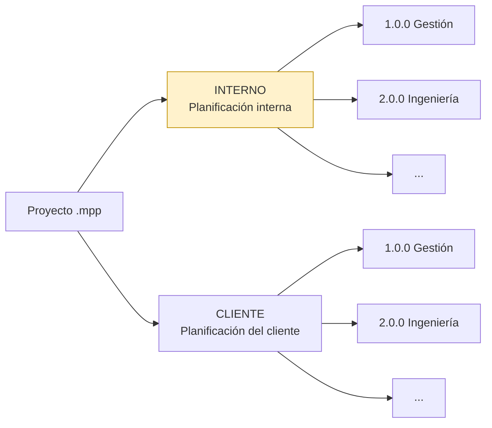
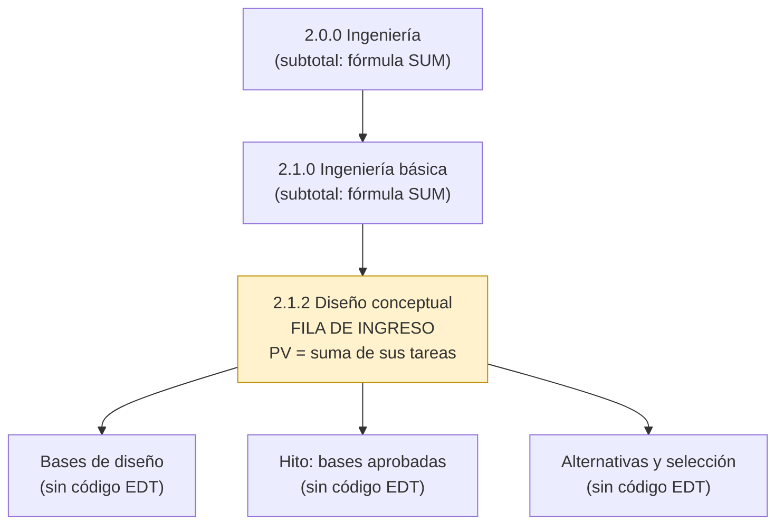

# Cómo se calcula el PV

[Inicio](../README.md) › [Documentación](README.md) › Cálculo del PV

> **Modo costo.** Las secciones 1 y 6 se aplican con `modo = "costo"`. En el modo porcentaje, que es el
> modo por defecto, el PV de cada mes es el BAC ingresado en el libro × el % planificado, que se calcula con
> la duración de la línea base de las tareas y el peso de los hitos ([Modo porcentaje](modo-porcentaje.md)).
> La planificación exportada, las filas por código EDT, las tareas sin código y el horizonte (secciones 2 a
> 5) son iguales en los dos modos.

El comando `generar` crea la hoja `PV` con el **valor planificado (PV) de cada mes** para cada elemento
de la EDT. En el modo costo, el PV mensual es el **costo de línea base escalonado en el tiempo** que
calcula MS Project, y el **BAC** de cada fila es la suma de su PV. Cómo se carga ese presupuesto en MS Project se explica en
[Presupuesto (BAC) de cada tarea](presupuesto-bac.md).

---

## Contenido

1. [Origen de los montos mensuales](#1-origen-de-los-montos-mensuales)
2. [Planificación exportada](#2-planificación-exportada)
3. [Filas del libro: niveles por código EDT](#3-filas-del-libro-niveles-por-código-edt)
4. [Tareas sin código EDT y costos en tareas resumen](#4-tareas-sin-código-edt-y-costos-en-tareas-resumen)
5. [Horizonte de meses](#5-horizonte-de-meses)
6. [Proyecto sin línea base](#6-proyecto-sin-línea-base)
7. [Verificación del PV](#7-verificación-del-pv)

---

## 1. Origen de los montos mensuales

| Motor | Origen del PV mensual |
|---|---|
| `.mpp` (COM) | MS Project entrega el **costo de línea base por mes** de cada tarea (datos escalonados en el tiempo). Es la misma distribución que muestra la vista *Uso de tareas* con el detalle *Costo previsto*: respeta calendarios, perfiles de trabajo, tablas de tasas de costo y acumulación de costos fijos y de recursos. |
| `.xml` | El XML trae el costo de línea base escalonado en tramos. Los tramos que cruzan de un mes a otro se reparten según el **calendario del proyecto** incluido en el XML. |
| Tareas sin datos mensuales | Si MS Project no tiene la distribución de una tarea (por ejemplo, un costo de línea base escrito a mano), el BAC se reparte en forma lineal entre el inicio y el fin de la línea base, por tiempo laborable (`distribucion = "habiles"`) o por días corridos (`"calendario"`). Un hito o una tarea con solo costo fijo acumulado al comienzo o al final se asigna entero al mes correspondiente. La hoja `Validación` informa cuántas tareas se repartieron así. |

Si la distribución mensual de MS Project no suma el costo de línea base de la tarea (costo de línea base
editado a mano), se ajusta en forma proporcional y se informa en `Validación`.

La línea base que define el PV es, por defecto, la que el proyecto usa para el valor acumulado
(*Archivo > Opciones > Avanzadas*). Se puede elegir otra con `--linea-base N` o con `linea_base` en el
[archivo de configuración](configuracion.md).

---

## 2. Planificación exportada

Un mismo archivo de MS Project puede contener varias planificaciones del mismo proyecto, por ejemplo
`INTERNO` (presupuesto de ejecución) y `CLIENTE` (presupuesto contractual), cada una bajo una tarea de
primer nivel con ese código EDT.

Si se indica `planificacion` (por ejemplo `INTERNO`), solo se exportan las tareas que dependen de la
tarea con ese código EDT. Esa tarea contenedora no tiene fila propia. Si los códigos de sus tareas
incluyen el prefijo de la planificación (por ejemplo `INTERNO.1.1`), el prefijo se quita.

*Con `planificacion = "INTERNO"` el libro contiene solo la rama resaltada.*

`actualizar` usa siempre la planificación con la que se generó el libro. Si no se elige una
planificación y ambas usan los mismos códigos EDT, `Validación` informa códigos duplicados.

---

## 3. Filas del libro: niveles por código EDT

El nivel de cada tarea se toma de su **código EDT**, no de su posición en el esquema de MS Project: los
ceros finales no cuentan.

| Código EDT | Nivel | Fila en el libro |
|---|---|---|
| `2.0.0` | 1 | Subtotal (suma de sus hijos) o fila de ingreso si no tiene hijos. |
| `2.1.0` | 2 | Subtotal o fila de ingreso si no tiene hijos. |
| `2.1.1` | 3 | Fila de ingreso: paquete de trabajo. |
| `2.1.1.1` | 4 | Sin fila propia: su PV se suma en `2.1.1`. |

- Tienen fila propia las tareas con código EDT hasta el nivel máximo (`nivel_maximo`, 3 por defecto).
- El PV de una fila de nivel 3 es la suma del PV de todas las tareas que dependen de ella.
- Las filas de nivel 1 y 2 suman a sus hijos con fórmulas de Excel.
- Con `rellenar_edt = true` (por defecto), los códigos se completan con ceros: `1` → `1.0.0`,
  `1.2` → `1.2.0`.
- El código EDT se lee del campo indicado en `[campos] edt`: el campo *EDT* de MS Project, el *número
  de esquema* o un campo personalizado de texto ([Preparación en MS Project](preparacion-ms-project.md#2-estructura-y-código-edt)).
- El campo `Visible` permite cambiar esta regla tarea por tarea ([3.1](#31-campo-visible-más-o-menos-detalle-en-cada-rama)).

### 3.1 Campo Visible: más o menos detalle en cada rama

`nivel_maximo` fija el mismo nivel de detalle para todo el proyecto. Con el campo de texto `Visible`
(*Texto5* o el que indique `[campos] visible`), se decide tarea por tarea qué información económica
muestra el libro:

| Visible | Resultado |
|---|---|
| `Sí` (también Si, SI, S, X, 1) | **Fila propia**, aunque su código EDT sea más detallado que `nivel_maximo` (por ejemplo `2.1.1.4` con nivel 3). Su tarea superior pasa a ser subtotal. La tarea necesita código EDT. |
| `No` (también NO, N, 0) | **Fuera del cálculo**: la tarea y toda su rama no forman parte del PV, el EV ni el AC, y no aparecen en el libro. |
| Vacío | Según `nivel_maximo`, como hasta ahora. |

- Si **todas** las subtareas de una tarea tienen `No`, la tarea las representa: no tienen fila propia,
  pero se calculan con ella. Si la tarea tiene fila, pasa a ser el paquete de trabajo con toda su rama.
  En MS Project una tarea resumen acumula las fechas, el avance y el costo de sus subtareas.
- Si solo **algunas** tienen `No`, esas quedan fuera del cálculo y las demás siguen como siempre. No se
  crea ninguna fila `-D` por ellas.
- Dentro de un paquete se aplica igual: una subtarea con `No` no pesa en su % planificado ni en su %
  ganado (ni, en el modo costo, en su BAC, su EV y su AC), salvo que todas las subtareas del paquete
  tengan `No`.
- Un elemento de nivel 1 con `No` queda fuera del libro. Si todos los elementos de nivel 1 tienen `No`,
  se ignora en ellos (el libro no tendría filas).
- `No` prevalece sobre un `Sí` en su rama.
- La hoja `Validación` lista las tareas que quedan fuera del cálculo (en el modo costo, con su costo de
  línea base), las tareas que representan a sus subtareas, los valores no reconocidos y los `Sí` que no
  se pueden aplicar.

Ejemplo con `nivel_maximo = 3`:

| Tarea | Visible | Resultado |
|---|---|---|
| `1.1.1 PMO` y `1.1.2 Control` | `No` en las dos | Sin filas propias: `1.1.0 Dirección` es el paquete de trabajo, con las dos tareas. |
| `1.2.2 Obras` | `No` | Fuera del cálculo: `1.2.0 Contratos` suma solo `1.2.1`. |
| `1.2.1.1 Pliegos` (nivel 4) | `Sí` | Fila propia de nivel 4; `1.2.1` pasa a ser subtotal y su otra subtarea forma `1.2.1-D`. |

**BAC y AC de lo que queda fuera.** En el modo porcentaje, el BAC y el AC que se ingresan en el libro
no deben incluir las tareas con `No`. En el modo costo, el BAC del libro queda por debajo del de
MS Project y `actualizar` no carga su costo real; los controles de `generar` y `actualizar` descuentan lo
excluido.

El campo se aplica al generar el libro. Si `Visible` cambia después, el libro conserva sus filas
(`actualizar` lo informa) y se debe regenerar con `--migrar-desde`:
- el historial de las filas cuyas subtareas pasan todas a `No` se suma en la fila que las representa;
- el de una fila que queda fuera del cálculo, o de un paquete que se divide por un `Sí` nuevo, no se
  puede trasladar y se informa en `Validación` para cargarlo a mano
  ([El libro Excel](libro-excel.md#4-cambios-de-línea-base-o-de-edt---migrar-desde)).

Si se omite `[campos] visible`, se lee el campo con alias `Visible` cuando el proyecto lo tiene. Con
`visible = ""` no se lee; así se puede generar, del mismo cronograma, un libro con todo el detalle hasta
`nivel_maximo` y otro con el detalle que indica `Visible`.

---

## 4. Tareas sin código EDT y costos en tareas resumen

**Tareas sin código EDT:** no tienen fila propia. Si dependen de un elemento EDT, su costo se suma en
ese elemento:

- dentro de un paquete de nivel 3, en el propio paquete;
- directamente bajo un elemento de nivel 1 o 2, en la fila `<código>-D Otros costos de «tarea»`.

Si no dependen de ningún elemento EDT (por ejemplo, un hito suelto bajo la planificación), se omiten y
se informan en `Validación` con su costo.

**Costos asignados a tareas resumen:** si una tarea resumen tiene costo propio (un costo fijo o un
recurso asignado directamente a la tarea resumen), ese costo también se registra en la fila
`<código>-D Otros costos de «tarea»`, para no perder ese presupuesto, y se informa en `Validación`. Se
recomienda asignar los costos solo a tareas de detalle ([Presupuesto](presupuesto-bac.md#8-errores-frecuentes)).

---

## 5. Horizonte de meses

- El libro tiene 120 columnas mensuales por defecto (10 años); se cambia con `meses` o `--meses`.
- El **mes 1** es, por defecto, el mes de inicio de la línea base; se cambia con `mes_inicio` o
  `--mes-inicio AAAA-MM`. Con varios archivos ([Varios archivos](varios-archivos.md)), es el primer mes
  con PV de cualquiera de ellos.
- Si se elige un mes de inicio posterior, el PV de los meses anteriores se **acumula en el mes 1** para
  que la curva acumulada sea correcta.
- El PV posterior al último mes no aparece en las columnas y se informa en `Validación`; en ese caso se
  debe aumentar `meses`. La columna **Total horizonte** de la hoja `PV` se muestra en rojo si no
  coincide con el BAC.

---

## 6. Proyecto sin línea base

Si el proyecto no tiene guardada la línea base elegida, se usa el **programa actual** (costo y fechas
actuales) y se advierte en `Validación` y en el título de las hojas. Sirve para una primera revisión,
pero el PV cambiará cada vez que cambie el programa: antes de informar el EVM se debe guardar la línea
base ([Presupuesto](presupuesto-bac.md#6-guardar-la-línea-base)).

Las tareas con costo agregadas después de guardar la línea base no tienen costo de línea base: no
aportan PV ni BAC y se informan en `Validación`.

---

## 7. Verificación del PV

Después de `generar` se recomienda:

1. Revisar la hoja **Validación** ([Validaciones](validaciones-y-problemas.md#1-validaciones)).
2. Comparar el **BAC total** (fila TOTAL de la hoja `PV`) con el *Costo previsto* de la tarea resumen
   del proyecto o de la planificación en MS Project (tabla *Costo*).
3. Comparar el PV de algunos meses con la vista *Uso de tareas* de MS Project, con el detalle *Costo
   previsto* y la escala temporal en meses ([Presupuesto](presupuesto-bac.md#7-verificar-el-bac-y-el-pv-en-ms-project)).

*Hoja `PV` del proyecto de ejemplo: código EDT, actividad, método de medición, BAC, fechas de la línea
base y PV de los primeros meses. Las filas de nivel 1 y 2 (fondo azul) son subtotales.*
