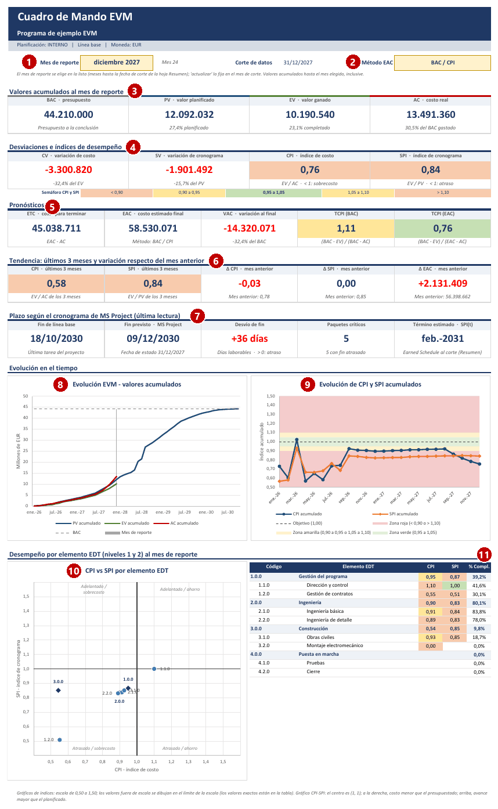
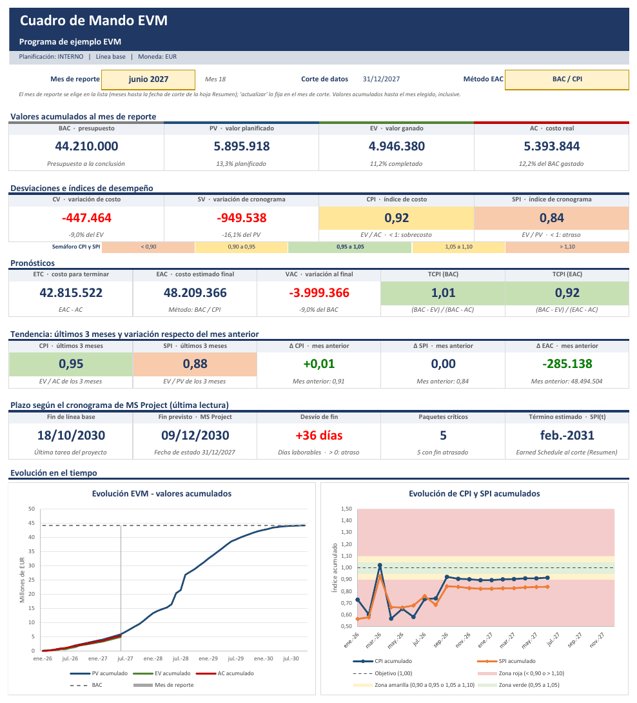
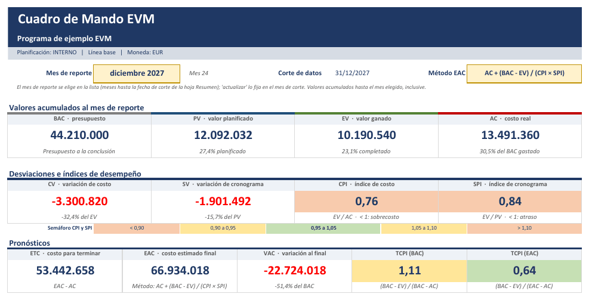
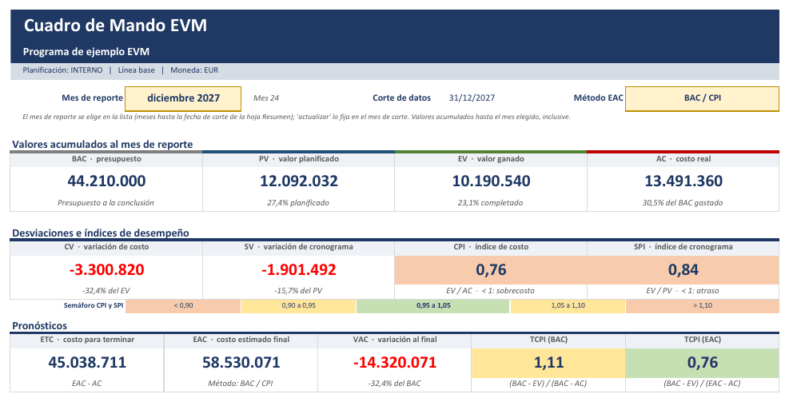
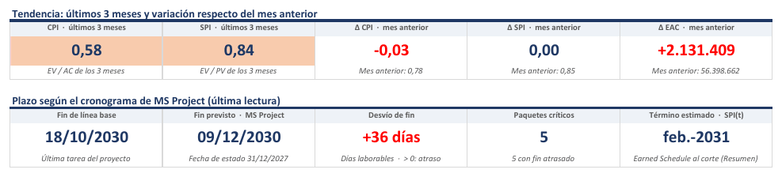
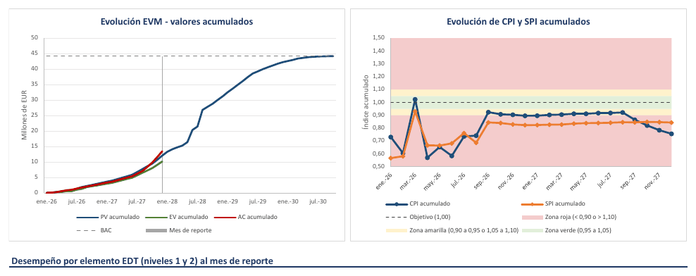
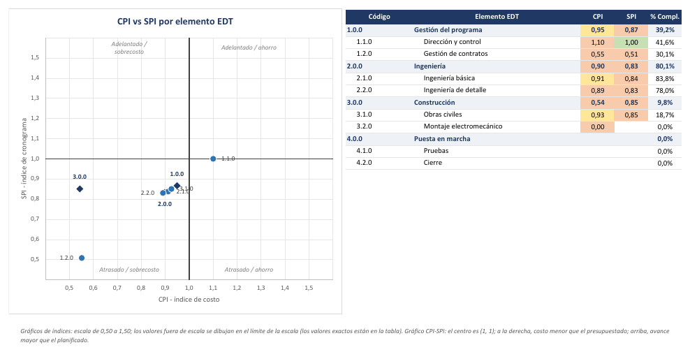
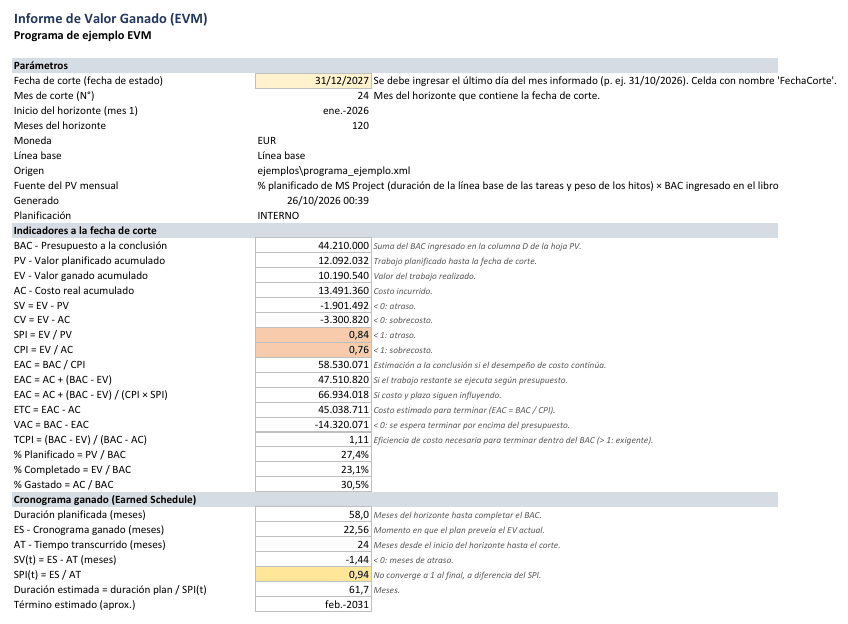
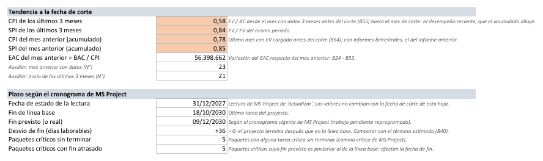

# Cuadro de Mando e indicadores

[Inicio](../README.md) › [Documentación](README.md) › Cuadro de Mando e indicadores

El libro calcula los indicadores EVM con fórmulas de Excel en tres hojas: **Cuadro de Mando** (tablero
del mes de reporte con gráficos), **Resumen** (indicadores del proyecto a la fecha de corte) e
**Indicadores EDT** (indicadores de cada elemento de la EDT). Todo se recalcula al cargar datos o al
cambiar la fecha de corte o el mes de reporte.

Las imágenes de este documento corresponden al [proyecto de ejemplo](ejemplo-paso-a-paso.md) con
24 meses de avance simulado (atraso y sobrecosto).

---

## Contenido

1. [Vista general](#1-vista-general)
2. [Mes de reporte y método EAC](#2-mes-de-reporte-y-método-eac)
3. [Valores, desviaciones, índices y pronósticos](#3-valores-desviaciones-índices-y-pronósticos)
4. [Tendencia y plazo](#4-tendencia-y-plazo)
5. [Gráficos](#5-gráficos)
6. [Hoja Resumen: fórmulas de los indicadores](#6-hoja-resumen-fórmulas-de-los-indicadores)
7. [Cronograma Ganado (Earned Schedule)](#7-cronograma-ganado-earned-schedule)
8. [Cómo leer los indicadores](#8-cómo-leer-los-indicadores)

---

## 1. Vista general

| N° | Zona | Contenido |
|---|---|---|
| 1 | **Mes de reporte** | Celda amarilla `E5`: mes cuyos valores acumulados se muestran. |
| 2 | **Método EAC** | Celda amarilla `R5`: fórmula de la estimación a la conclusión. |
| 3 | **Valores acumulados** | BAC, PV, EV y AC acumulados hasta el final del mes de reporte, con su % del BAC. |
| 4 | **Desviaciones e índices** | CV y SV (con su %), CPI y SPI con semáforo, y la escala del semáforo con los umbrales del libro. |
| 5 | **Pronósticos** | ETC, EAC, VAC, TCPI (BAC) y TCPI (EAC). |
| 6 | **Tendencia** | CPI y SPI de los últimos 3 meses y variación del CPI, el SPI y el EAC respecto del mes anterior ([sección 4](#4-tendencia-y-plazo)). |
| 7 | **Plazo** | Fin de línea base y fin previsto según MS Project, desvío de fin, paquetes críticos y término estimado con el SPI(t). |
| 8 | **Evolución EVM** | Curva S: PV, EV y AC acumulados y BAC. |
| 9 | **Evolución de CPI y SPI** | Índices acumulados mes a mes sobre zonas de alarma. |
| 10 | **CPI vs SPI por elemento EDT** | Un punto por cada elemento de nivel 1 y 2. |
| 11 | **Tabla por elemento EDT** | CPI, SPI y % completado de los elementos de nivel 1 y 2. |

La hoja se imprime en vertical, en una página de ancho, lista para adjuntar al informe mensual.

---

## 2. Mes de reporte y método EAC

**Mes de reporte (`E5`).** El desplegable ofrece los meses hasta la fecha de corte de la hoja
`Resumen`. `actualizar` (y `analizar`) lo fijan en el mes de corte. Para revisar un informe anterior se elige otro mes:
todos los valores, la tabla por elemento EDT y la línea vertical del gráfico de evolución pasan a ese
mes.

*El mismo libro con junio de 2027 como mes de reporte: CPI 0,92 y SPI 0,84. En diciembre de 2027 el CPI
cayó a 0,76 y el SPI se mantuvo en 0,84.*

**Método EAC (`R5`).** Define el EAC y, con él, ETC, VAC y TCPI (EAC):

| Método | Supuesto | Cuándo usarlo |
|---|---|---|
| `BAC / CPI` (por defecto) | El trabajo restante tendrá la misma eficiencia de costo que hasta ahora. | Desempeño estable; es el pronóstico más usado. |
| `AC + (BAC - EV)` | El trabajo restante se ejecutará según presupuesto: la desviación fue puntual. | Desviaciones atípicas ya resueltas y justificadas. |
| `AC + (BAC - EV) / (CPI × SPI)` | El atraso también encarece el trabajo restante. | Proyectos atrasados con fecha de fin exigida; suele ser el más pesimista. |

*Con el método `AC + (BAC - EV) / (CPI × SPI)` el EAC del ejemplo pasa de 58,5 a 66,9 millones.*

Estos pronósticos son estadísticos. Las buenas prácticas recomiendan contrastarlos con un **EAC por
estimación detallada** del trabajo restante, preparado por los responsables de cada paquete, y explicar
las diferencias en el informe.

---

## 3. Valores, desviaciones, índices y pronósticos

| Indicador | Fórmula | Lectura |
|---|---|---|
| CV, CV % | EV − AC; CV / EV | < 0: sobrecosto. |
| SV, SV % | EV − PV; SV / PV | < 0: atraso (en valor, no en tiempo). |
| CPI | EV / AC | < 1: cada euro gastado produce menos de un euro de valor ganado (trabajo realizado, valorado a precio de presupuesto). |
| SPI | EV / PV | < 1: se realizó menos trabajo que el planificado. |
| ETC | EAC − AC | Costo estimado para terminar. |
| EAC | Según el método elegido | Costo estimado a la conclusión. |
| VAC | BAC − EAC | < 0: se espera terminar por encima del presupuesto. |
| TCPI (BAC) | (BAC − EV) / (BAC − AC) | Eficiencia necesaria en el trabajo restante para terminar dentro del BAC. |
| TCPI (EAC) | (BAC − EV) / (EAC − AC) | Eficiencia necesaria para terminar dentro del EAC. Con el método `BAC / CPI` es igual al CPI. |

**Semáforos.** Los umbrales son comunes para el CPI y el SPI, con un límite **inferior** y otro
**superior** para el amarillo y para el rojo (sección `[semaforo]` de la
[configuración](configuracion.md)). Debajo de las tarjetas de índices, la fila **Semáforo CPI y SPI**
muestra los umbrales con que se generó el libro:

| Indicador | Verde | Amarillo | Rojo |
|---|---|---|---|
| CPI, SPI, SPI(t) | De `amarillo_inferior` a `amarillo_superior` (0,95 a 1,05) | De `rojo_inferior` a `amarillo_inferior` (0,90 a 0,95) y de `amarillo_superior` a `rojo_superior` (1,05 a 1,10) | Menor que `rojo_inferior` (0,90) o mayor que `rojo_superior` (1,10) |
| TCPI | ≤ 1 / `amarillo_inferior` (1,05) | Hasta 1 / `rojo_inferior` (1,11) | > 1 / `rojo_inferior` o negativo |

- En los umbrales exactos se aplica el color más favorable: con los valores por defecto, 0,95 y 1,05
  son verdes, y 0,90 y 1,10, amarillos.
- Un índice **por encima** del rango verde también es una alerta. Un CPI alto puede indicar un AC
  incompleto (costos devengados aún no registrados) o un presupuesto holgado. Un SPI alto puede indicar
  un avance informado de más o una línea base poco exigente. En ambos casos conviene confirmar los datos
  antes de informar un buen desempeño.
- El TCPI usa solo los umbrales inferiores: un TCPI menor que 1 indica que alcanza con una eficiencia
  menor que la lograda hasta ahora, y no es una alerta.

Mientras no hay AC cargado (el AC se ingresa a mano en la hoja `AC`), los indicadores de costo del
`Cuadro de Mando` (CV, CPI, ETC, EAC, VAC y TCPI) quedan vacíos.

---

## 4. Tendencia y plazo

Debajo de los pronósticos, dos filas de tarjetas responden a dos preguntas del informe mensual: si el
desempeño reciente es mejor o peor que el acumulado, y si el atraso afecta la fecha de fin.

**Tendencia** (sigue el mes de reporte elegido):

| Tarjeta | Contenido |
|---|---|
| CPI · últimos 3 meses | EV / AC de los 3 meses que terminan en el mes de reporte. El CPI acumulado se mueve poco cuando el proyecto avanza: un acumulado de 0,95 puede ocultar que los últimos meses rondan 0,80. |
| SPI · últimos 3 meses | EV / PV del mismo período. |
| Δ CPI, Δ SPI · mes anterior | Variación del índice acumulado respecto del mes anterior con datos, que se muestra debajo. En verde si mejora y en rojo si empeora. |
| Δ EAC · mes anterior | Variación del EAC (con el método elegido) respecto del mes anterior: en rojo si aumenta. Es el dato de "el EAC subió X desde el informe anterior". |

- El **mes anterior** es el último mes con EV cargado antes del mes de reporte: con informes bimestrales,
  el del informe anterior. Los **últimos 3 meses** empiezan en el último mes con datos hasta 3 meses
  antes; con informes bimestrales abarcan 4 meses.
- Las tarjetas quedan vacías mientras no hay un mes anterior con datos (por ejemplo, en el primer
  `actualizar`), y las de costo, mientras no hay AC cargado.
- La hoja `Resumen` tiene los mismos indicadores a la fecha de corte, y `actualizar` los muestra en
  pantalla.

**Plazo según el cronograma de MS Project** (valores de la última lectura de `generar` o `actualizar`;
no cambian con el mes de reporte):

| Tarjeta | Contenido |
|---|---|
| Fin de línea base | Fin de la última tarea del proyecto según la línea base. |
| Fin previsto · MS Project | Fin de la última tarea según el cronograma vigente, con la fecha de estado de la lectura. |
| Desvío de fin | Días laborables entre los dos: > 0 = atraso. |
| Paquetes críticos | Paquetes con alguna tarea crítica sin terminar y, debajo, cuántos tienen el fin atrasado. |
| Término estimado · SPI(t) | Estimación estadística del [Cronograma Ganado](#7-cronograma-ganado-earned-schedule) a la fecha de corte, para compararla con la previsión del cronograma. |

*Diciembre de 2027 en el ejemplo: el CPI de los últimos 3 meses (0,58) es mucho menor que el acumulado
(0,76), y el EAC subió 2,1 millones respecto de noviembre. Según el cronograma vigente, el proyecto
termina 36 días laborables después que en la línea base, con 5 paquetes críticos atrasados; el término
estimado con el SPI(t) es posterior.*

El detalle por elemento EDT está en las columnas Q a U de la hoja
[Indicadores EDT](libro-excel.md#indicadores-edt) y en el
[Análisis de desviaciones](analisis-desviaciones.md#2-columnas).

> Los libros de versiones anteriores a la 2.3.0 conservan su Cuadro de Mando, sin estas tarjetas: se
> agregan al regenerar el libro con `--migrar-desde`.

---

## 5. Gráficos

Los tres gráficos son nativos de Excel y se calculan con fórmulas (datos en la hoja oculta
`_graficos`). No requieren ninguna acción: se actualizan al cargar valores, al cambiar la fecha de corte
o el mes de reporte.

| Gráfico | Contenido | Qué observar |
|---|---|---|
| **Evolución EVM** | PV, EV y AC acumulados y BAC. El PV abarca hasta el fin del plan (o hasta la fecha de corte, si es posterior); EV y AC, hasta el mes de reporte, marcado con una línea vertical. | La distancia vertical entre EV y PV es el SV; entre EV y AC, el CV. Si la curva AC queda por encima de EV, hay sobrecosto. |
| **Evolución de CPI y SPI** | CPI y SPI acumulados mes a mes hasta el mes de reporte (el eje abarca hasta la fecha de corte), sobre las zonas del semáforo (de abajo hacia arriba: roja, amarilla, verde, amarilla y roja) y la línea objetivo 1,00. | Tendencia más que valor puntual. En los primeros meses los índices acumulados oscilan mucho porque los montos son pequeños (en el ejemplo, de enero a agosto de 2026). |

| Gráfico | Contenido | Qué observar |
|---|---|---|
| **CPI vs SPI por elemento EDT** | Un punto por cada elemento EDT de nivel 1 (rombo) y 2 (círculo) en el mes de reporte. Eje X: CPI; eje Y: SPI; el centro es (1, 1). | Arriba a la derecha: adelantado y con ahorro. Abajo a la izquierda: atrasado y con sobrecosto. Los elementos alejados del centro son los que explican la desviación del proyecto. |

Junto al gráfico, una tabla muestra el CPI, el SPI y el % completado de cada elemento.

Los gráficos de índices usan una escala fija de 0,5 a 1,5, igual en todos los informes para poder
compararlos. Los valores fuera de escala se dibujan en el límite y su valor exacto está en la tabla.

> En el ejemplo, `3.2.0 Montaje electromecánico` no aparece en el gráfico: el paquete `3.2.1 Suministro
> de equipos` (método `Hitos ponderados`, con pesos que suman 100) tiene costo real, pero su PV está en
> los meses de sus hitos, en 2028, y aún no cumplió ninguno. Su SPI no tiene valor y su CPI es 0. Es el
> comportamiento esperado del método; la tabla y la hoja `Indicadores EDT` muestran los valores.

---

## 6. Hoja Resumen: fórmulas de los indicadores

La hoja `Resumen` contiene la **fecha de corte** (celda amarilla `B5`, con nombre `FechaCorte`), los
parámetros de la exportación y los indicadores del proyecto, todos acumulados a la fecha de corte:

| Indicador | Fórmula |
|---|---|
| SV, CV | EV − PV, EV − AC |
| SPI, CPI | EV / PV, EV / AC |
| EAC | BAC / CPI; AC + (BAC − EV); AC + (BAC − EV) / (CPI × SPI) |
| ETC, VAC | EAC − AC, BAC − EAC (con EAC = BAC / CPI) |
| TCPI | (BAC − EV) / (BAC − AC) |
| % planificado, completado y gastado | PV / BAC, EV / BAC, AC / BAC |
| ES | Meses del plan en que el PV acumulado alcanza el EV actual (interpolación lineal). Si el EV coincide con meses sin PV planificado, se toma el momento de ese tramo más cercano a AT. |
| SV(t), SPI(t) | ES − AT, ES / AT (AT = meses transcurridos hasta la fecha de corte) |
| Duración y término estimados | Duración planificada / SPI(t), y el mes correspondiente |
| CPI y SPI de los últimos 3 meses | (EV − EV₃) / (AC − AC₃) y (EV − EV₃) / (PV − PV₃), con los acumulados al inicio de los 3 meses (filas 49 y 50) |
| CPI, SPI y EAC del mes anterior | Acumulados del último mes con EV cargado antes del corte; EAC = BAC / CPI (filas 51 a 53) |
| Plazo según MS Project | Fecha de estado de la lectura, fin de línea base, fin previsto, desvío de fin y paquetes críticos (filas 58 a 63; valores de la última lectura) |

`actualizar` muestra en pantalla los mismos indicadores al terminar.

---

## 7. Cronograma Ganado (Earned Schedule)

El SPI compara valores, no tiempos, y al final de un proyecto atrasado tiende a 1 (al terminar, EV =
PV = BAC). El **Cronograma Ganado** mide el atraso en meses:

- **ES** (cronograma ganado): momento del plan en que el PV acumulado era igual al EV actual.
- **AT** (tiempo real): meses transcurridos hasta la fecha de corte.
- **SV(t) = ES − AT**: meses de adelanto (> 0) o atraso (< 0).
- **SPI(t) = ES / AT**: eficiencia de cronograma en tiempo; a diferencia del SPI, no converge a 1.

**Ejemplo.** En diciembre de 2027 (AT = 24) el EV acumulado del ejemplo es 10,19 millones. El plan
preveía ese valor a los 22,56 meses: ES = 22,56, SV(t) = −1,44 meses y SPI(t) = 0,94. Con una duración
planificada de 58 meses, la duración estimada es 58 / 0,94 ≈ 62 meses.

Si la curva PV no alcanza el BAC dentro del horizonte, la duración planificada, la duración estimada y
el término estimado quedan vacíos (el ES, el SV(t) y el SPI(t) se calculan igual); en ese caso se debe
aumentar `meses`.

---

## 8. Cómo leer los indicadores

| Situación | Lectura habitual | Acción sugerida |
|---|---|---|
| CPI < 0,90 sostenido | El sobrecosto no es puntual. Los estudios sobre grandes contratos muestran que, superado el 20 % de avance, el CPI acumulado rara vez mejora de forma significativa. | Revisar el EAC y las causas por paquete (hojas `Indicadores EDT` y [`Análisis de desviaciones`](analisis-desviaciones.md)); plan de acción de costo. |
| SPI < 0,90 y SV(t) creciente | Atraso que se acumula. | El SPI no indica si el atraso afecta la fecha de fin: revisar el desvío de fin y los paquetes críticos (tarjetas de plazo y columnas Q a U de `Indicadores EDT`). |
| CPI de los últimos 3 meses menor que el acumulado | El desempeño de costo empeora: el acumulado todavía no lo refleja. | Revisar las causas recientes por paquete (`Tendencia` en `Análisis de desviaciones`) y el EAC. |
| Paquete con SPI bajo y crítico con fin atrasado | El atraso afecta la fecha de fin del proyecto. | Acción correctiva prioritaria; informar el desvío de fin. |
| SPI ≈ 1 al final con SV(t) < 0 | El SPI convergió a 1, pero el proyecto sigue atrasado. | Informar SV(t) y SPI(t). |
| TCPI (BAC) mucho mayor que el CPI | Terminar dentro del BAC exige una eficiencia muy superior a la histórica. Una regla práctica habitual: si la diferencia supera 0,05–0,10, el BAC es poco realista. | Informar el EAC y evaluar un cambio de línea base o de alcance. |
| CPI y SPI > 1 | Adelanto y ahorro. | Verificar que no se deba a métodos subjetivos o a un AC incompleto (costos no registrados). |
| CPI o SPI por encima del rango verde (> 1,05) | Desempeño mejor que el planificado, que el semáforo marca en amarillo o rojo para que se confirme. | Revisar el AC devengado, el avance informado y si el presupuesto o la línea base del paquete son demasiado holgados; explicarlo en `Análisis de desviaciones`. |
| EV > 0 con AC = 0 en una fila | Costo real aún no registrado (facturas pendientes o AC del mes sin cargar en la hoja `AC`). | Completar el AC devengado del mes. |
| Mucho LOE en el BAC | El LOE no genera variación de cronograma y "diluye" el SPI. | Revisar los métodos ([Métodos de medición](metodos-de-medicion.md#4-guía-para-elegir-el-método)). |

Los indicadores acumulados reflejan toda la historia del proyecto. Para detectar cambios recientes
conviene observar también la tendencia de los últimos meses en la hoja `Evolución mensual` y en el
gráfico de CPI y SPI.
