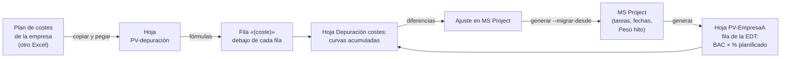
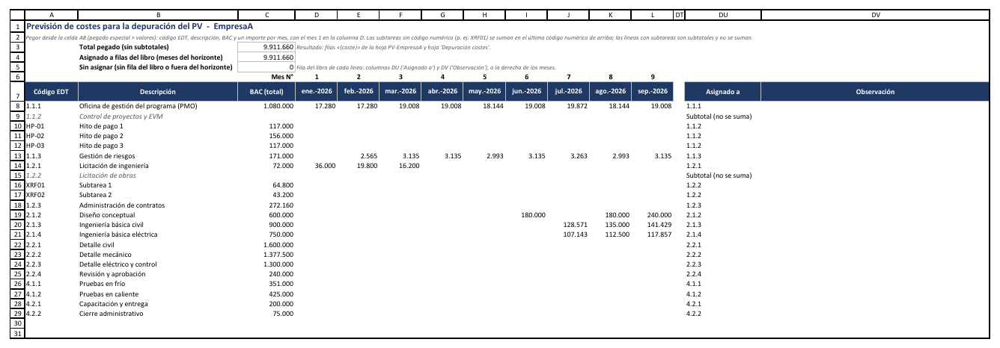
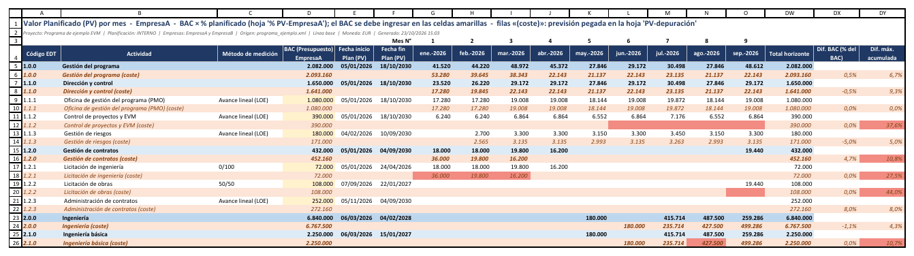
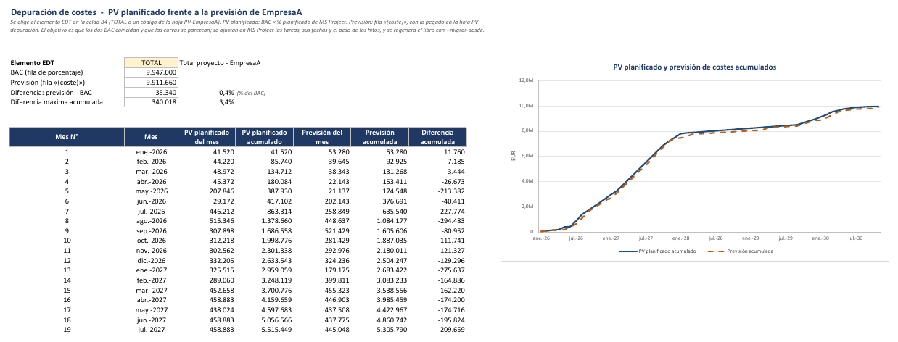
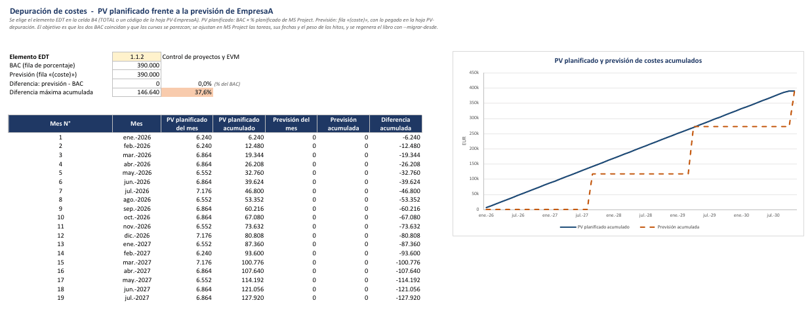

# Depuración de costes (opcional)

[Inicio](../README.md) › [Documentación](README.md) › Depuración de costes

La **depuración de costes** compara, paquete por paquete, el **PV planificado** de una empresa (BAC × %
planificado de MS Project) con la **previsión mensual de su plan de costes**. Sirve para ajustar en
MS Project las tareas, sus fechas y el peso de sus hitos hasta que la curva S del cronograma se parezca a
la previsión de la empresa.

Se activa solo mientras dura ese ajuste. Para los libros que se entregan y para las actualizaciones
mensuales posteriores, el libro se genera sin depuración.

---

## Contenido

1. [Cuándo usarla](#1-cuándo-usarla)
2. [Cómo funciona](#2-cómo-funciona)
3. [Configuración](#3-configuración)
4. [Hoja PV-depuración: la previsión pegada](#4-hoja-pv-depuración-la-previsión-pegada)
5. [Filas «(coste)» de la hoja PV](#5-filas-coste-de-la-hoja-pv)
6. [Indicador de alineamiento (opcional)](#6-indicador-de-alineamiento-opcional)
7. [Hoja Depuración costes: el gráfico](#7-hoja-depuración-costes-el-gráfico)
8. [Ciclo de ajuste](#8-ciclo-de-ajuste)
9. [Validaciones y limitaciones](#9-validaciones-y-limitaciones)
10. [Preguntas frecuentes](#10-preguntas-frecuentes)

---

## 1. Cuándo usarla

- El cronograma de MS Project **no tiene importes** ([Cálculo del PV y el EV](calculo-pv-ev.md)), pero
  la empresa tiene un **plan de costes o precios** con el importe de cada mes y quiere que el PV del libro
  siga ese perfil.
- Al **preparar la línea base**: antes de aprobarla, se revisa que las fechas de las tareas y el peso de
  los hitos reflejen cuándo se ejecuta (y se cobra) cada parte del trabajo.
- En **multi-empresa**, cada empresa depura su parte por separado, una a la vez, sin compartir su plan de
  costes con la otra.

---

## 2. Cómo funciona



- La empresa **pega** su previsión mensual en la hoja `PV-depuración`, tal como sale de su plan de
  costes: EDT cliente, actividad, EDT interna, actividad interna, BAC y un importe por mes.
- Con **fórmulas de Excel**, cada línea pegada se asigna a una fila del libro. En la hoja PV de la
  empresa, debajo de cada fila de la EDT, la fila **«(coste)»** muestra la previsión de esa fila. Al
  pegar o cambiar la previsión, el libro se actualiza al instante, sin ejecutar el programa.
- El BAC de cada fila sigue siendo el que se **ingresa a mano** en la columna D (celdas amarillas). El
  BAC de la fila «(coste)» es la **suma de sus meses**. El objetivo es que los dos BAC coincidan y que las
  dos curvas se parezcan.
- La hoja `Depuración costes` muestra las **dos curvas acumuladas** del elemento EDT elegido.
- Las filas «(coste)» **no forman parte** del PV, del EV ni de los indicadores: `actualizar`, `analizar`
  y el Cuadro de Mando dan los mismos resultados que en un libro sin depuración.

---

## 3. Configuración

En la sección `[exportacion]` del archivo de configuración:

```toml
[exportacion]
depuracion_costes = true          # activa la depuración (por defecto, false)
depuracion_empresa = "EmpresaA"   # multi-empresa: empresa que se depura (empresa_a o empresa_b)
depuracion_alineamiento = true    # indicador de alineamiento (opcional; por defecto, false)
depuracion_umbral = 10            # % del BAC a partir del cual se resalta un mes (por defecto, 10)
```

| Clave | Por defecto | Uso |
|---|---|---|
| `depuracion_costes` | `false` | Agrega las hojas `PV-depuración` y `Depuración costes` y las filas «(coste)». |
| `depuracion_empresa` | `empresa_a` | En multi-empresa, la empresa que se depura: el valor de `empresa_a` o de `empresa_b` (sin distinguir mayúsculas). En un libro de una sola empresa se depura la hoja `PV` y la clave no se usa. |
| `depuracion_alineamiento` | `false` | Columnas con la diferencia de BAC y la diferencia máxima acumulada en las filas «(coste)», y resaltado de los meses fuera de umbral ([6](#6-indicador-de-alineamiento-opcional)). |
| `depuracion_umbral` | `10` | Umbral del indicador, en % del BAC de la fila (mayor que 0 y hasta 100). |

Se recomienda usar un archivo de configuración aparte para la depuración (por ejemplo
`config_depuracion.toml`), para no generar por error un libro de entrega con depuración.

---

## 4. Hoja PV-depuración: la previsión pegada



### 4.1 Formato

La hoja tiene el mismo formato que el plan de costes de la empresa, para pegar el bloque tal cual,
**desde la celda A8** y con *Pegado especial > Valores*:

| Columna | Contenido |
|---|---|
| A · EDT cliente | Código EDT del elemento en el cronograma (`2.3.4.1`). |
| B · Actividad | Descripción de la EDT cliente. |
| C · EDT interna | Código del concepto de coste interno de la empresa que corresponde a la EDT cliente: partidas, subtareas o hitos de pago, con códigos no numéricos (`ABC01`, `XRF01`, `HP-01`). Vacía en la línea de la EDT cliente. |
| D · Actividad interna | Descripción del concepto interno. |
| E · BAC | Importe total de la línea; en la línea de la EDT cliente, la suma de sus líneas de EDT interna. Solo se usa como control: se compara con la suma de sus meses. |
| F en adelante | Importe de cada mes, del mes 1 al 120 (o hasta el último mes del horizonte, si tiene más). |

Ejemplo de una EDT cliente con dos conceptos internos:

| A · EDT cliente | B · Actividad | C · EDT interna | D · Actividad interna | E · BAC | F · mes 1 | G · mes 2 | Se suma |
|---|---|---|---|---:|---:|---:|---|
| `1.1.1` | Oficina del programa | | | 1.000 | 500 | 500 | No: es el subtotal |
| | | `ABC01` | Personal propio | 700 | 350 | 350 | Sí, en la fila `1.1.1` |
| | | `ABC02` | Subcontratas | 300 | 150 | 150 | Sí, en la fila `1.1.1` |

La columna A de las líneas de EDT interna puede ir vacía (como en el ejemplo) o repetir la EDT cliente;
en los dos casos, cada línea se suma en su EDT cliente. Si el plan de costes no tiene la línea de
subtotal de la EDT cliente, se pegan solo las líneas de EDT interna, con la EDT cliente en la columna A.

- Encima de cada columna de meses, el programa escribe el **N° de mes** y su **fecha**: el mes 1 de la
  previsión debe ser el mes 1 del libro (`[horizonte] mes_inicio`). Si el plan de costes empieza en otro
  mes, se pega el bloque de meses desplazado.
- Los meses posteriores al horizonte del libro tienen el encabezado gris: sus importes no se asignan.
- Admite hasta **2.000 líneas** (filas 8 a 2007).
- La previsión debe estar en la **misma base** que el BAC (por ejemplo, a precio de contrato).

### 4.2 Cómo se asigna cada línea

| Línea pegada | Se suma en |
|---|---|
| EDT cliente igual al código de una fila del libro (`2.1.3`), sin EDT interna | Esa fila. Los ceros finales no cuentan: `1.2` es `1.2.0`. |
| EDT cliente más detallada que el libro (`1.2.2.9`) | La fila de la que depende (`1.2.2`). |
| Línea de EDT interna (`ABC01` en la columna C) con la columna A vacía | La fila de la **última EDT cliente de las líneas anteriores**. |
| Línea de EDT interna con la EDT cliente en la columna A | La fila de esa EDT cliente (o de la que depende, si es más detallada que el libro). |
| EDT cliente sin EDT interna, con líneas de EDT interna o códigos más detallados debajo | **No se suma**: es un subtotal. Se suman sus líneas, para no contar dos veces el mismo importe. Una línea de EDT interna nunca es un subtotal. |
| EDT cliente de un resumen del libro (`1.2` cuando el libro tiene `1.2.1` y `1.2.2`) | No se asigna: el importe se debe pegar con el código de cada paquete. Si el resumen tiene fila «Otras tareas», sus líneas de EDT interna van a esa fila. |
| EDT cliente que no está en el libro | No se asigna. |
| Código no numérico en la columna A (`XRF01`) | Igual que una línea de EDT interna: la fila de la última EDT cliente de las líneas anteriores. |
| Línea vacía o solo con descripción | Se ignora. |

Una línea es de EDT interna si tiene algo en la columna C o en la D.

> Excel convierte en número un código como `1.10` (que queda `1.1`). Para evitarlo, la columna del código
> en el plan de costes debe tener formato de texto. Las columnas A y C de `PV-depuración` ya tienen
> formato de texto.

### 4.3 Controles

| Control | Dónde | Qué indica |
|---|---|---|
| **Total pegado (sin subtotales)** | Celda E3 | Suma de las líneas que se suman. |
| **Asignado a filas del libro** | Celda E4 | Parte del total pegado que llegó a filas del libro, dentro del horizonte. |
| **Sin asignar** | Celda E5 (en rojo si no es 0) | Códigos sin fila en el libro, códigos de resúmenes sin fila propia, líneas de EDT interna sin EDT cliente encima o meses fuera del horizonte. |
| **Asignado a** | Columna a la derecha de los meses (DW con 120 meses) | La fila del libro de cada línea, `Subtotal (no se suma)`, `Resumen sin fila propia` o `Sin fila del libro` (en rojo). |
| **Observación** | Columna siguiente (DX) | `BAC distinto de la suma de los meses`, `Sin EDT cliente en las líneas anteriores` (línea de EDT interna antes de la primera EDT cliente), `Subtotal distinto de la suma de sus líneas` (la línea de la EDT cliente tenía importes que no son la suma de sus líneas), `Importes fuera del horizonte del libro` o `Importes guardados como texto: no se suman`. |

Las líneas que son subtotales se muestran en gris.

---

## 5. Filas «(coste)» de la hoja PV



En la hoja PV de la empresa que se depura (`PV-EmpresaA`, `PV-EmpresaB` o, en un libro de una sola
empresa, `PV`), debajo de **cada fila de la EDT** y de la fila TOTAL va su fila
«(coste)», con fondo naranja claro:

| Fila | Meses | BAC (columna D) |
|---|---|---|
| Paquete de trabajo (fila de ingreso, también «Otras tareas») | Suma de las líneas pegadas asignadas a la fila. | Suma de sus meses. |
| Subtotal (nivel 1 y 2) y TOTAL | Suma de las filas «(coste)» de sus hijos. | Suma de sus meses. |

- Las filas «(coste)» tienen un **nivel de esquema** propio: con el botón del último nivel del esquema
  (a la izquierda de los números de fila) se muestran u ocultan todas a la vez.
- En las demás hojas (`PV`, `% PV`, `EV`, `AC`, `Indicadores EDT`...), las filas que corresponden a las
  filas «(coste)» quedan **vacías y ocultas**: así cada fila de la EDT está en la misma posición en todas
  las hojas, como necesitan `actualizar` y `--migrar-desde`.
- Las filas «(coste)» son fórmulas: no se escriben a mano. La previsión se cambia en `PV-depuración`.

---

## 6. Indicador de alineamiento (opcional)

Con `depuracion_alineamiento = true`, cada fila «(coste)» tiene dos columnas más, a la derecha de
`Total horizonte`:

| Columna | Cálculo |
|---|---|
| **Dif. BAC (% del BAC)** | (BAC de la fila «(coste)» − BAC de la fila) / BAC de la fila. |
| **Dif. máx. acumulada** | Mayor diferencia, en valor absoluto, entre la previsión acumulada y el PV planificado acumulado de algún mes, dividida por el BAC de la fila. |

Se resaltan en rojo:

- los **meses** de la fila «(coste)» en que la diferencia acumulada supera `depuracion_umbral` (por
  defecto, el 10 % del BAC de la fila);
- las dos columnas del indicador cuando superan el umbral.

Así se ve enseguida qué paquetes y qué meses hay que revisar en MS Project. Las filas sin BAC no tienen
indicador.

---

## 7. Hoja Depuración costes: el gráfico



- En la celda **B4** (amarilla) se elige el elemento EDT: `TOTAL` (por defecto) o el código de cualquier
  fila del libro, con la lista desplegable. Sirve para ajustar **paquete por paquete**.
- Debajo: el BAC de la fila, el total de la previsión, su diferencia y la diferencia máxima acumulada (con
  su % del BAC, en rojo si supera `depuracion_umbral`).
- La tabla muestra, mes a mes, el PV planificado y la previsión, del mes y acumulados, y su diferencia
  acumulada. El gráfico muestra las dos curvas acumuladas.



En el ejemplo, el paquete `1.1.2` tiene el mismo BAC en las dos filas, pero la previsión son tres hitos de
pago y el PV planificado es casi lineal (una tarea continua de 2026 a 2030): la diferencia acumulada llega
al 37,6 % del BAC. Para alinearlo, se agregan en MS Project hitos con su `Peso hito` en esos meses, o se
acepta la diferencia si el PV debe seguir el avance del trabajo y no los pagos.

> El gráfico abarca hasta el último mes con PV planificado o con previsión. Si después se pega una
> previsión más larga, el gráfico se amplía al ejecutar `analizar` o `actualizar`, o al regenerar el libro.

---

## 8. Ciclo de ajuste

1. **Generar el libro de depuración**, con la configuración de depuración:

   ```powershell
   python evm_export.py generar --origen "C:\Programa\Programa.mpp" --config config_depuracion.toml `
       --salida EVM_Depuracion_v1.xlsx
   ```

2. **Ingresar el BAC** de cada fila en la columna D de la hoja PV de la empresa (celdas amarillas).
3. **Pegar la previsión** del plan de costes en `PV-depuración`, desde la celda A8, y revisar los
   controles: `Sin asignar` debe ser 0 y la columna `Asignado a` no debe tener líneas en rojo.
4. **Comparar** en `Depuración costes`, empezando por `TOTAL` y siguiendo con los paquetes de mayor
   diferencia (o con el indicador de alineamiento de la hoja PV).
5. **Ajustar MS Project**: fechas y duraciones de las tareas, hitos y su `Peso hito`, división de tareas
   (ver [% planificado: peso de cada tarea](calculo-pv-ev.md#4--planificado-peso-de-cada-tarea)).
   El % planificado se calcula con las **fechas de la línea base**: después de cambiar las fechas, se
   debe volver a guardar la línea base de las tareas modificadas. Si la diferencia está en el BAC, se
   corrige el BAC del libro o la previsión.
6. **Regenerar** el libro con `--migrar-desde`, que conserva el BAC y el contenido de `PV-depuración`:

   ```powershell
   python evm_export.py generar --origen "C:\Programa\Programa.mpp" --config config_depuracion.toml `
       --salida EVM_Depuracion_v2.xlsx --migrar-desde EVM_Depuracion_v1.xlsx
   ```

   Se repiten los pasos 4 a 6 hasta que las curvas queden alineadas.
7. **Aprobar la línea base** ajustada, según el [proceso de reporte](proceso-reporte-evm.md#5-cambios-de-línea-base).
8. **Generar el libro de entrega** sin depuración (`depuracion_costes = false`, por ejemplo con el
   `config.toml` habitual) y con `--migrar-desde`, que conserva el BAC:

   ```powershell
   python evm_export.py generar --origen "C:\Programa\Programa.mpp" --config config.toml `
       --salida EVM_Programa.xlsx --migrar-desde EVM_Depuracion_v2.xlsx
   ```

   El libro nuevo no tiene `PV-depuración` ni filas «(coste)»: la hoja `Validación` indica que la
   previsión no se trasladó. Desde ahí sigue el
   [cierre mensual](calculo-pv-ev.md#12-puesta-en-marcha-y-cierre-mensual) habitual.

Sobre `--migrar-desde` en la depuración:

- La previsión pegada se traslada solo si el libro nuevo también tiene depuración **de la misma empresa**;
  si no, la hoja `Validación` lo indica y se debe pegar de nuevo.
- Si cambió el mes 1 del horizonte, los meses de `PV-depuración` se desplazan para conservar su fecha;
  lo que queda antes del mes 1 se informa en `Validación`.
- Las líneas se asignan de nuevo con los códigos EDT del libro nuevo, aunque la EDT haya cambiado.
- Si el libro anterior tiene la hoja sin las columnas de EDT interna (código, descripción, BAC y meses
  desde la columna D), la previsión se pasa al formato actual: los códigos numéricos quedan como EDT
  cliente y los demás (`XRF01`), como EDT interna.

---

## 9. Validaciones y limitaciones

| Mensaje en `Validación` | Significado |
|---|---|
| `Depuración de costes de EmpresaA: se debe pegar la previsión...` (Info) | Recordatorio de la hoja que se depura y de generar el libro de entrega sin depuración. |
| `... filas tienen código EDT no numérico ... no pueden recibir la previsión` (Advertencia) | Las filas con códigos como `INTERNO` o `A1` no se pueden asignar: la previsión solo se asocia por códigos numéricos. |
| `códigos EDT repetidos en el libro ...` (Advertencia) | Un código está en dos filas: la previsión se asigna a la primera. |
| `Se conservó el contenido de la hoja PV-depuración ...` (Info) | `--migrar-desde` trasladó la previsión. |
| `La hoja PV-depuración del libro anterior tenía el formato sin EDT interna ...` (Info) | La previsión trasladada se pasó al formato con las columnas de EDT interna. |
| `La hoja PV-depuración del libro anterior ... no se trasladó` (Info o Advertencia) | El libro nuevo no tiene depuración, o depura otra empresa. |

Limitaciones:

- Una empresa a la vez: para depurar la otra, se genera otro libro con `depuracion_empresa`.
- El libro de depuración pesa más (unas 30.000 fórmulas de asignación en una hoja oculta) y tarda unos
  segundos más en calcularse.
- Las filas «(coste)» y las hojas `PV-depuración`, `Depuración costes` y la oculta `_depuracion` no se
  deben modificar fuera de la zona de pegado: son fórmulas.

---

## 10. Preguntas frecuentes

**¿La depuración cambia el PV o el EV del libro?** No. Las filas «(coste)» solo se comparan con el PV
planificado; los indicadores, el Cuadro de Mando y `actualizar` usan las mismas filas que un libro sin
depuración.

**¿Se pueden cargar los cierres mensuales en el libro de depuración?** Sí, `actualizar` y `analizar`
funcionan igual. Pero el libro muestra la previsión de costes de la empresa: para entregar o compartir
el libro, se genera sin depuración.

**¿Qué pasa con la línea de la EDT cliente que trae el total de sus líneas de EDT interna?** Se ignora
y se suman sus líneas de EDT interna. Si la línea de la EDT cliente tenía además importes propios, esos
importes no se suman; la columna `Observación` lo marca para corregir el plan de costes o pegarlos en una
línea de EDT interna.

**¿Y si el plan de costes tiene más detalle que el libro?** Los códigos más detallados se suman en su
fila del libro (`2.3.4.1.5` en `2.3.4.1`), y las líneas de EDT interna en su EDT cliente.

**¿Se puede depurar con un libro de una sola empresa?** Sí: se depura la hoja `PV`.

**¿Cómo se prueba la función sin un proyecto real?** Con el [proyecto de ejemplo](ejemplo-paso-a-paso.md):
se genera el libro multi-empresa con `depuracion_costes = true` y se ejecuta
`python ejemplos\generar_ejemplo.py --libro EVM_Depuracion.xlsx`, que escribe el BAC de cada fila y una
previsión ficticia de EmpresaA en `PV-depuración`: cada EDT cliente con sus líneas de EDT interna
(personal propio y subcontratas, hitos de pago o subtareas), con algunos meses desplazados.
