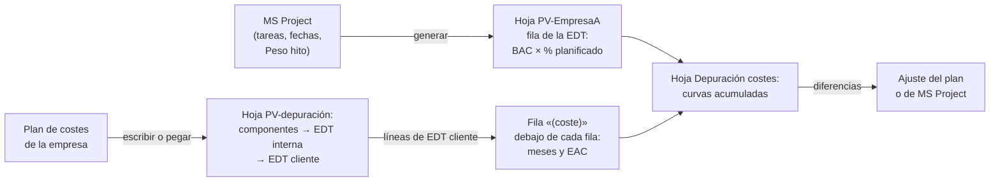

# Depuración de costes (opcional)

[Inicio](../README.md) › [Documentación](README.md) › Depuración de costes

La **depuración de costes** compara, paquete por paquete, el **PV planificado** de una empresa (BAC × %
planificado de MS Project) con la **previsión mensual de su plan de costes**: en la hoja PV de la empresa,
debajo de cada fila va su fila «(coste)» con el plan. Sirve para ajustar el plan o MS Project (las tareas,
sus fechas y el peso de sus hitos) hasta que las dos curvas se parezcan. El % planificado es siempre el de
MS Project: la depuración no lo modifica.

Se activa solo mientras dura ese ajuste. Para los libros que se entregan y para las actualizaciones
mensuales posteriores, el libro se genera sin depuración (conserva el BAC).

---

## Contenido

1. [Cuándo usarla](#1-cuándo-usarla)
2. [Cómo funciona](#2-cómo-funciona)
3. [Configuración](#3-configuración)
4. [Hoja PV-depuración: la previsión pegada](#4-hoja-pv-depuración-la-previsión-pegada)
5. [Filas «(coste)» de la hoja PV](#5-filas-coste-de-la-hoja-pv)
6. [Indicador de alineamiento (opcional)](#6-indicador-de-alineamiento-opcional)
7. [Hoja Depuración costes: el gráfico](#7-hoja-depuración-costes-el-gráfico)
8. [Revisión y cálculos del plan (procesar-costes)](#8-revisión-y-cálculos-del-plan-procesar-costes)
9. [Ciclo de ajuste](#9-ciclo-de-ajuste)
10. [Validaciones y limitaciones](#10-validaciones-y-limitaciones)
11. [Preguntas frecuentes](#11-preguntas-frecuentes)

---

## 1. Cuándo usarla

- El cronograma de MS Project **no tiene importes** ([Cálculo del PV y el EV](calculo-pv-ev.md)), pero
  la empresa tiene un **plan de costes o precios** con el importe de cada mes y quiere comprobar que el PV
  del libro sigue ese perfil.
- Al **preparar la línea base**: antes de aprobarla, se revisa que las fechas de las tareas y el peso de
  los hitos reflejen cuándo se ejecuta (y se cobra) cada parte del trabajo.
- En **multi-empresa**, cada empresa depura su parte por separado, una a la vez, sin compartir su plan de
  costes con la otra.

---

## 2. Cómo funciona



- La empresa escribe o pega su **plan de costes** en la hoja `PV-depuración`, en tres niveles: **EDT
  cliente**, **EDT interna** y **componente de coste**, con el BAC, el EAC y un importe por mes. Las
  celdas amarillas son datos y las naranjas, cálculos.
- Los importes se suman hacia arriba: los componentes en su EDT interna, las EDT interna en su EDT
  cliente y cada EDT cliente en la de su código superior. Esos cálculos los hace la empresa con fórmulas,
  o `procesar-costes --calculos` ([4.3](#43-cálculos-del-plan-celdas-naranjas)).
- Si el plan de la empresa está **a coste** y el BAC a precio, con `[depuracion_precio]` cada EDT interna
  con componentes pasa a su **precio**, con los recargos de la tabla `Recargos` de la misma hoja
  ([4.4](#44-precio-de-las-edt-interna-tabla-recargos)).
- Solo se leen las **líneas de EDT cliente** cuyo código es el de una fila de ingreso de la hoja PV de la
  empresa. Con **fórmulas de Excel**, la fila **«(coste)»** de debajo de cada fila muestra los meses y el
  **EAC** de esa línea. Al cambiar el plan, el libro se actualiza al instante, sin ejecutar el programa.
- El BAC de cada fila se **ingresa a mano** en la columna D de la hoja PV de la empresa (celdas
  amarillas); la fila «(coste)» muestra el EAC en esa misma columna. El objetivo es que el EAC coincida con
  el BAC y que las dos curvas se parezcan.
- La hoja `Depuración costes` muestra las **dos curvas acumuladas** del elemento EDT elegido.
- Las filas «(coste)» **no forman parte** del PV, del EV ni de los indicadores: `actualizar`, `analizar`
  y el Cuadro de Mando dan los mismos resultados que en un libro sin depuración.
- El % planificado es siempre el de MS Project. `procesar-costes` revisa el plan de costes en la consola y
  escribe sus cálculos, sin modificar el % planificado ([8](#8-revisión-y-cálculos-del-plan-procesar-costes)).

---

## 3. Configuración

En la sección `[exportacion]` del archivo de configuración:

```toml
[exportacion]
depuracion_costes = true          # activa la depuración (por defecto, false)
depuracion_empresa = "EmpresaA"   # multi-empresa: empresa que se depura (empresa_a o empresa_b)
depuracion_alineamiento = true    # indicador de alineamiento (opcional; por defecto, false)
depuracion_umbral = 10            # % del BAC a partir del cual se resalta un mes (por defecto, 10)
depuracion_calculos = false       # procesar-costes escribe los cálculos del plan (por defecto, false)
```

| Clave | Por defecto | Uso |
|---|---|---|
| `depuracion_costes` | `false` | Agrega las hojas `PV-depuración` y `Depuración costes` y las filas «(coste)». |
| `depuracion_empresa` | `empresa_a` | En multi-empresa, la empresa que se depura: el valor de `empresa_a` o de `empresa_b` (sin distinguir mayúsculas). En un libro de una sola empresa se depura la hoja `PV` y la clave no se usa. Las filas «(coste)» solo están en la hoja de esa empresa. |
| `depuracion_alineamiento` | `false` | Columnas con la diferencia entre el EAC y el BAC y la diferencia máxima acumulada en las filas «(coste)», y resaltado de los meses fuera de umbral ([6](#6-indicador-de-alineamiento-opcional)). |
| `depuracion_umbral` | `10` | Umbral del indicador, en % del BAC de la fila (mayor que 0 y hasta 100). |
| `depuracion_calculos` | `false` | `true` = `procesar-costes` escribe siempre los cálculos del plan en la hoja `PV-depuración` ([4.3](#43-cálculos-del-plan-celdas-naranjas)). Para hacerlo una sola vez, se usa `procesar-costes --calculos`. |

Se recomienda usar un archivo de configuración aparte para la depuración (por ejemplo
`config_depuracion.toml`), para no generar por error un libro de entrega con depuración.

Si el plan de la empresa está a coste, la sección `[depuracion_precio]` (opcional) indica cómo se calcula
el precio de cada EDT interna ([4.4](#44-precio-de-las-edt-interna-tabla-recargos)):

```toml
[depuracion_precio]
calculo_precio = "(A*(1+KA)+B*(1+KB)+C*(1+KC)+D*(1+KD)+E)*(1+KG)*(1+BE)"

[depuracion_precio.componentes]   # nombre = texto de la columna D de PV-depuración
A = "Costes indirectos de Producción"
B = "Costes indirectos de Gestión de Materiales"
C = "Costes indirectos de Gestión de Subcontrataciones"
D = "Costes indirectos de Entregas de Producción"
E = "Otros costes"

[depuracion_precio.recargos]      # nombre = texto de la fila de la tabla Recargos
KA = "Costes indirectos de Producción"
KB = "Costes indirectos de Gestión de Materiales"
KC = "Costes indirectos de Gestión de Subcontrataciones"
KD = "Costes indirectos de Entregas de Producción"
KG = "Costes Generales y Administrativos"
BE = "Beneficio"
```

| Clave | Uso |
|---|---|
| `calculo_precio` | Expresión del precio de un mes. Admite números (con punto decimal: `0.5`), los nombres de las dos listas, `+ - * /` y paréntesis. |
| `[depuracion_precio.componentes]` | Un nombre por componente de coste, con el texto que lleva en la columna D. Los textos no distinguen mayúsculas, tildes ni espacios de más. |
| `[depuracion_precio.recargos]` | Un nombre por coeficiente (hasta 8), con el texto de su fila en la tabla `Recargos`. Los coeficientes son porcentajes: `1 %` = `0.01`. |

Los nombres empiezan con una letra y tienen solo letras sin tilde, números y `_`; no distinguen
mayúsculas. Sin la sección, las EDT interna suman sus componentes. Un error en la sección detiene el
programa ([CFG-055](codigos.md#cfg-055)).

---

## 4. Hoja PV-depuración: la previsión pegada


### 4.1 Formato

La hoja tiene la misma disposición que la plantilla del plan de costes de la empresa:

| Zona | Contenido |
|---|---|
| A1 | Título, con la empresa que se depura. |
| A2:C4 | Controles de la lectura ([4.5](#45-controles)). |
| Desde D1 | Tabla `Recargos`, con `[depuracion_precio]`: un coeficiente por fila (desde D2) y un año por columna (desde E1) ([4.4](#44-precio-de-las-edt-interna-tabla-recargos)). |
| Filas 8 y 9 | Instrucciones. |
| Fila 10 | N° de mes. |
| Fila 11 | Encabezados de las columnas y fecha de cada mes. |
| Desde A12 | El plan de costes. |

Los datos del plan se escriben o se pegan **desde la celda A12** (con *Pegado especial > Valores* si
vienen de otro libro):

| Columna | Contenido |
|---|---|
| A · EDT cliente | Código EDT del elemento en el cronograma (`2.3.4.1`). Es la clave con la que cada línea se lee en una fila del libro. |
| B · Actividad EDT | Descripción de la EDT cliente. |
| C · EDT interna | Código del concepto de coste interno de la empresa que corresponde a la EDT cliente: partidas, subtareas o hitos de pago, con códigos no numéricos (`GPR01`, `XRF01`, `HP-01`). Vacía en la línea de la EDT cliente y en las de componentes de coste. |
| D · Actividad interna / componente de coste | Descripción de la EDT interna o, en una línea sin código en C, el **componente de coste** de la EDT interna de arriba (`Costes indirectos`, `Otros`...). |
| E · BAC | En los componentes y en las EDT interna sin componentes, un dato; en la EDT interna con componentes, la suma de sus componentes; en la EDT cliente, el BAC de su fila de la hoja PV de la empresa. |
| F · EAC | La suma de los meses de la línea. |
| G en adelante | Importe de cada mes, del mes 1 al 120 (o hasta el último mes del horizonte, si tiene más). |

Ejemplo de una EDT cliente con una EDT interna y sus componentes de coste, y otra EDT interna sin
componentes (en negrita, los cálculos: celdas naranjas):

| A · EDT cliente | B · Actividad EDT | C · EDT interna | D · Actividad interna / componente | E · BAC | F · EAC | G · mes 1 | H · mes 2 | Se lee |
|---|---|---|---|---:|---:|---:|---:|---|
| `1.1.0` | Lanzamiento | | | **1.300** | **1.300** | **600** | **700** | Sí, en la fila `1.1.0` |
| | | `GPR00` | Gestión del lanzamiento | **1.000** | **1.000** | **500** | **500** | No: se suma en la EDT cliente |
| | | | Costes indirectos X | 700 | **700** | 350 | 350 | No: se suma en `GPR00` |
| | | | Otros | 300 | **300** | 150 | 150 | No: se suma en `GPR00` |
| | | `GPR05` | Infraestructura | 300 | **300** | 100 | 200 | No: se suma en la EDT cliente |

- Encima de cada columna de meses, el programa escribe el **N° de mes** y su **fecha**: el mes 1 del plan
  debe ser el mes 1 del libro (`[horizonte] mes_inicio`). Si el plan de costes empieza en otro mes, se
  pega el bloque de meses desplazado.
- Los meses posteriores al horizonte del libro tienen el encabezado gris: no forman parte del PV.
- Admite hasta **2.000 líneas** (filas 12 a 2011).
- El plan debe estar en la **misma base** que el BAC (por ejemplo, a precio de contrato). Si está a
  coste, con `[depuracion_precio]` cada EDT interna pasa a su precio ([4.4](#44-precio-de-las-edt-interna-tabla-recargos)).

### 4.2 Qué líneas se leen

| Línea | Columna `Asignado a` | Se lee |
|---|---|---|
| EDT cliente (código en A, nada en C ni en D) con el código de una fila de ingreso del libro (`2.1.3`). Los ceros finales no cuentan: `1.2` es `1.2.0` | El código de la fila | **Sí**: sus meses y su EAC van a la fila «(coste)». |
| EDT cliente de un resumen del libro (`1.2.0`, con filas `1.2.1` y `1.2.2`) | `Resumen: suma de sus filas` (gris) | No: el libro suma las filas de sus códigos inferiores. |
| EDT cliente de un resumen sin ninguna línea de un código inferior que se lea | `Resumen sin detalle en el plan` (rojo) | No: su importe no llega a ninguna fila. Se debe detallar con las EDT cliente de las filas del libro. |
| EDT cliente más detallada que el libro (`1.2.2.9`), con la línea de un código superior que se lee | `Incluida en su EDT cliente superior` (gris) | No: su importe ya está en la línea superior (con los cálculos del plan). |
| EDT cliente sin fila del libro (`9.9`) | `Sin fila del libro` (rojo) | No. |
| EDT interna, componente de coste, línea vacía o solo con descripción | (vacía) | No: se suman en su EDT cliente con los cálculos del plan. |

- Una línea con algo en C o en D no es de EDT cliente, aunque repita el código en la columna A.
- Las filas «Otras tareas» (`-D`) del libro no tienen EDT cliente propia: no reciben el plan de costes.
- Si dos líneas de EDT cliente tienen el mismo código, se suman las dos (la columna `Observación` lo
  indica).

> Excel convierte en número un código como `1.10` (que queda `1.1`). Para evitarlo, la columna del código
> en el plan de costes debe tener formato de texto. Las columnas A y C de `PV-depuración` ya tienen
> formato de texto.

### 4.3 Cálculos del plan (celdas naranjas)

| Línea | E · BAC | F · EAC | Meses |
|---|---|---|---|
| Componente de coste (solo la columna D) | Dato | Suma de sus meses | Datos |
| EDT interna con componentes debajo | Suma de sus componentes | Suma de sus meses | Suma de sus componentes o, con `[depuracion_precio]`, su precio ([4.4](#44-precio-de-las-edt-interna-tabla-recargos)) |
| EDT interna sin componentes | Dato | Suma de sus meses | Datos |
| EDT cliente | El de su fila de la hoja PV de la empresa (vacío si no tiene fila) | Suma de sus meses | Suma de sus EDT interna, de los componentes que tenga directamente y de las EDT cliente de sus códigos inferiores (`1.0.0` = `1.1.0` + `1.2.0`). Sin líneas debajo, datos. |

- Cada componente pertenece a la **última EDT interna de arriba** de la misma EDT cliente (o a la EDT
  cliente, si no tiene EDT interna), y cada EDT interna, a la **última EDT cliente de arriba**.
- La empresa hace estos cálculos con fórmulas. `procesar-costes --calculos` (o
  `depuracion_calculos = true`) los escribe por ella: fórmulas como `=SUM(G12:G15)` en las celdas
  naranjas y fondo amarillo en las de datos. Después las fórmulas se actualizan solas al cambiar los
  datos, sin volver a ejecutar el comando.
- Con los cálculos, una línea con solo la columna D debajo de una EDT cliente o interna es un componente:
  los meses de la línea de arriba pasan a ser su suma.

### 4.4 Precio de las EDT interna (tabla Recargos)

Si la empresa escribe su plan **a coste** y el BAC está a precio, con `[depuracion_precio]`
([3](#3-configuración)) cada mes de una EDT interna con componentes es su **precio**, en lugar de la suma
de sus componentes. La EDT cliente suma el precio de sus EDT interna, como siempre.

- La **tabla `Recargos`** está arriba de la hoja: en D1, el título; desde E1, un año por columna (los
  años de los meses de la hoja); desde D2, una fila por coeficiente de `[depuracion_precio.recargos]`, con
  su texto. Los coeficientes se escriben en las celdas amarillas, en %: un valor por año, que se aplica a
  los meses de ese año.
- Cada línea de componente (solo la columna D) es el componente de `[depuracion_precio.componentes]` con
  el mismo texto, sin distinguir mayúsculas, tildes ni espacios de más. Si una EDT interna tiene dos
  líneas del mismo componente, se suman.
- `procesar-costes --calculos` escribe en cada mes de la EDT interna la fórmula de `calculo_precio`, con
  las celdas de sus componentes y de los coeficientes del año. Por ejemplo, en el mes 1 (enero de 2026) de
  una EDT interna de la fila 14 con sus componentes en las filas 15 a 19:

  ```text
  =(G15*(1+$E$2)+G16*(1+$E$3)+G17*(1+$E$4)+G18*(1+$E$5)+G19)*(1+$E$6)*(1+$E$7)
  ```

  Con 10, 10, 11, 5 y 5 de coste y los recargos 1 %, 0,5 %, 0,6 %, 2 %, 3 % y 2,5 %, el precio es 43,62.
  En los meses de 2027, la fórmula usa la columna F de la tabla, y así sucesivamente. Las fórmulas se
  actualizan solas al cambiar los costes o los recargos.
- El **BAC** de la EDT interna sigue siendo la suma del de sus componentes (a coste): el BAC de la EDT
  cliente es el de la hoja PV de la empresa.
- Una EDT interna **sin componentes** (por ejemplo, un hito de pago con sus importes) se toma tal cual,
  como ya a precio. Los componentes que están directamente debajo de una EDT cliente, sin EDT interna,
  también forman su precio.
- Un componente con un texto que **no está** en la lista no entra en el precio, y un coeficiente sin
  valor se toma como 0: `procesar-costes` los avisa ([DEP-022](codigos.md#dep-022) y
  [DEP-023](codigos.md#dep-023)). Si la hoja no tiene la tabla (el libro se generó sin
  `[depuracion_precio]`), `procesar-costes --calculos` la agrega vacía.

### 4.5 Controles

| Control | Dónde | Qué indica |
|---|---|---|
| **Leído en filas del libro** | Celda C2 | Suma de los meses del horizonte de las líneas de EDT cliente que se leen. |
| **Leído después del horizonte** | Celda C3 (en rojo si no es 0) | Importes de esas líneas en meses posteriores al horizonte: forman parte del EAC de la fila «(coste)», pero no de sus meses. |
| **Sin leer** | Celda C4 (en rojo si no es 0) | Importe de las EDT cliente sin fila del libro y de los resúmenes sin detalle en el plan. |
| **Asignado a** | Columna a la derecha de los meses (DX con 120 meses) | En cada línea de EDT cliente, la fila del libro que la lee o por qué no se lee ([4.2](#42-qué-líneas-se-leen)). |
| **Observación** | Columna siguiente (DY) | En las líneas que se leen: `EDT cliente repetida: se suman sus líneas`, `Importes fuera del horizonte del libro` o `Importes guardados como texto: no se suman`. |

El BAC y el EAC de cada línea no se comparan: el objetivo es que el plan reparta en el tiempo el BAC de
cada EDT cliente, y la hoja PV de la empresa los muestra uno debajo del otro.

---

## 5. Filas «(coste)» de la hoja PV


En la hoja PV de la empresa que se depura (`PV-EmpresaA`, `PV-EmpresaB` o, en un libro de una sola
empresa, `PV`), debajo de **cada fila de la EDT** y de la fila TOTAL va su fila
«(coste)», con fondo naranja claro:

| Fila | Meses | Columna D |
|---|---|---|
| Paquete de trabajo (fila de ingreso) | Los de su línea de EDT cliente en `PV-depuración`. | El **EAC** de esa línea, debajo del BAC de la fila. |
| Subtotal (nivel 1 y 2) y TOTAL | Suma de las filas «(coste)» de sus hijos. | Suma de sus hijos. |

- Las filas «(coste)» tienen un **nivel de esquema** propio: con el botón del último nivel del esquema
  (a la izquierda de los números de fila) se muestran u ocultan todas a la vez.
- En las demás hojas (`PV`, `% PV`, `EV`, `AC`, `Indicadores EDT`...), las filas que corresponden a las
  filas «(coste)» quedan **vacías y ocultas**: así cada fila de la EDT está en la misma posición en todas
  las hojas, como necesitan `actualizar` y `--migrar-desde`.
- Las filas «(coste)» son fórmulas: no se escriben a mano. El plan se cambia en `PV-depuración`.

---

## 6. Indicador de alineamiento (opcional)

Con `depuracion_alineamiento = true`, cada fila «(coste)» tiene dos columnas más, a la derecha de
`Total horizonte`:

| Columna | Cálculo |
|---|---|
| **Dif. EAC (% del BAC)** | (EAC de la fila «(coste)» − BAC de la fila) / BAC de la fila. |
| **Dif. máx. acumulada** | Mayor diferencia, en valor absoluto, entre la previsión acumulada y el PV planificado acumulado de algún mes, dividida por el BAC de la fila. |

Se resaltan en rojo:

- los **meses** de la fila «(coste)» en que la diferencia acumulada supera `depuracion_umbral` (por
  defecto, el 10 % del BAC de la fila);
- las dos columnas del indicador cuando superan el umbral.

Así se ve enseguida qué paquetes y qué meses hay que revisar en el plan o en MS Project. Las filas sin BAC
no tienen indicador.

---

## 7. Hoja Depuración costes: el gráfico


- En la celda **B4** (amarilla) se elige el elemento EDT: `TOTAL` (por defecto) o el código de cualquier
  fila del libro, con la lista desplegable. Sirve para ajustar **paquete por paquete**.
- Debajo: el BAC de la fila, el EAC de la fila «(coste)», su diferencia y la diferencia máxima acumulada
  (con su % del BAC, en rojo si supera `depuracion_umbral`).
- La tabla muestra, mes a mes, el PV planificado y la previsión, del mes y acumulados, y su diferencia
  acumulada. El gráfico muestra las dos curvas acumuladas.


En el ejemplo, el paquete `1.1.2` tiene el mismo BAC y EAC, pero la previsión son tres hitos de pago y el
PV planificado es casi lineal (una tarea continua de 2026 a 2030): la diferencia acumulada llega al
37,6 % del BAC. Para alinearlo, se agregan en MS Project hitos con su `Peso hito` en esos meses, o se
acepta la diferencia si el PV debe seguir el avance del trabajo y no los pagos.

> El gráfico abarca hasta el último mes con PV planificado o con previsión. Si después se escribe un plan
> más largo, el gráfico se amplía al ejecutar `analizar`, `actualizar` o `procesar-costes --calculos`, o al
> regenerar el libro.

---

## 8. Revisión y cálculos del plan (procesar-costes)

El comando `procesar-costes` revisa el plan de costes de la hoja `PV-depuración` y, con `--calculos`,
escribe sus cálculos. **No modifica el % planificado**: el PV de todas las filas es el de MS Project, y el
plan se compara con él en las filas «(coste)» y en la hoja `Depuración costes`.

```powershell
python evm_export.py procesar-costes --libro EVM_Depuracion.xlsx              # revisa el plan, sin modificar el libro
python evm_export.py procesar-costes --libro EVM_Depuracion.xlsx --calculos   # escribe los cálculos del plan
python evm_export.py procesar-costes --libro EVM_Depuracion.xlsx --calculos --config config_depuracion.toml
                                                                  # con el precio de [depuracion_precio]
```

- Lee las **líneas de EDT cliente** con el código de una fila de ingreso de la hoja PV de la empresa
  ([4.2](#42-qué-líneas-se-leen)), con las mismas reglas que las filas «(coste)».
- Muestra en la consola, para cada fila con plan, el **EAC** de su línea y el **BAC** de la fila. Avisa de
  las líneas de EDT cliente sin leer, los importes después del horizonte, las filas sin línea en el plan o
  sin importes, las EDT cliente repetidas y los importes guardados como texto
  ([10](#10-validaciones-y-limitaciones)).
- Con `--calculos` (o `depuracion_calculos = true`), escribe en `PV-depuración` las fórmulas de los
  cálculos del plan ([4.3](#43-cálculos-del-plan-celdas-naranjas)) y guarda el libro, con respaldo. Sin
  esa opción, usa los importes que tiene la hoja y no modifica el libro.
- Con `[depuracion_precio]` en la configuración (`--config`), las EDT interna con componentes llevan su
  precio ([4.4](#44-precio-de-las-edt-interna-tabla-recargos)), y avisa de los componentes que no están en
  la lista y de los coeficientes que faltan en la tabla `Recargos`. Si la hoja tiene la tabla y la
  configuración no tiene `[depuracion_precio]` (por ejemplo, sin `--config`), lo avisa
  ([DEP-026](codigos.md#dep-026)): con `--calculos`, las EDT interna volverían a sumar sus componentes.
- Una hoja de la versión 2.5 o anterior, con el plan desde la celda A8, se pasa al formato actual
  generando un libro nuevo con `--migrar-desde` ([DEP-024](codigos.md#dep-024)).
- No lee MS Project: se puede ejecutar cada vez que cambia el plan. Con `--calculos --simular`, muestra el
  resultado sin modificar el libro.

> Hasta la versión 2.5, `procesar-costes` reemplazaba el % planificado de MS Project de las filas con plan
> por el reparto del plan de costes, y en esas filas se perdía la comparación con MS Project. Desde la
> versión 2.6.0 no lo modifica. En un libro procesado con una versión anterior, `procesar-costes` y
> `actualizar` lo avisan ([DEP-021](codigos.md#dep-021)): para recuperar el % de MS Project, se genera un
> libro nuevo con `--migrar-desde`, que conserva el BAC, el % ganado y el AC
> ([DEP-020](codigos.md#dep-020)).

---

## 9. Ciclo de ajuste

1. **Generar el libro de depuración**, con la configuración de depuración:

   ```powershell
   python evm_export.py generar --origen "C:\Programa\Programa.mpp" --config config_depuracion.toml `
       --salida EVM_Depuracion_v1.xlsx
   ```

2. **Ingresar el BAC** de cada fila en la columna D de la hoja PV de la empresa (celdas amarillas).
3. **Escribir o pegar el plan de costes** en `PV-depuración`, desde la celda A12, con sus cálculos (o
   ejecutar `procesar-costes --calculos`), y revisar los controles: `Sin leer` debe ser 0 y la columna
   `Asignado a` no debe tener líneas en rojo. `procesar-costes` los informa también en la consola. Con
   `[depuracion_precio]`, escribir también los recargos de cada año en la tabla `Recargos`.
4. **Comparar** en `Depuración costes`, empezando por `TOTAL` y siguiendo con los paquetes de mayor
   diferencia (o con el indicador de alineamiento de la hoja PV).
5. **Ajustar** el plan de costes (para que el EAC de cada fila se acerque a su BAC) o MS Project: fechas y
   duraciones de las tareas, hitos y su `Peso hito`, división de tareas (ver
   [% planificado: peso de cada tarea](calculo-pv-ev.md#4--planificado-peso-de-cada-tarea)). El %
   planificado se calcula con las **fechas de la línea base**: después de cambiar las fechas, se debe
   volver a guardar la línea base de las tareas modificadas.
6. **Regenerar** el libro con `--migrar-desde` si cambió MS Project. Conserva el BAC y el contenido de
   `PV-depuración` (y vuelve a escribir las fórmulas de los cálculos del plan):

   ```powershell
   python evm_export.py generar --origen "C:\Programa\Programa.mpp" --config config_depuracion.toml `
       --salida EVM_Depuracion_v2.xlsx --migrar-desde EVM_Depuracion_v1.xlsx
   ```

   Se repiten los pasos 4 a 6 hasta que las curvas queden alineadas.
7. **Aprobar la línea base** ajustada, según el [proceso de reporte](proceso-reporte-evm.md#5-cambios-de-línea-base).
8. **Generar el libro de entrega** sin depuración (`depuracion_costes = false`, por ejemplo con el
   `config.toml` habitual) y con `--migrar-desde`, que conserva el BAC:

   ```powershell
   python evm_export.py generar --origen "C:\Programa\Programa.mpp" --config config.toml `
       --salida EVM_Programa.xlsx --migrar-desde EVM_Depuracion_v2.xlsx
   ```

   El libro nuevo no tiene `PV-depuración` ni filas «(coste)»: la hoja `Validación` indica que el plan no
   se trasladó. Desde ahí sigue el
   [cierre mensual](calculo-pv-ev.md#12-puesta-en-marcha-y-cierre-mensual) habitual.

Sobre `--migrar-desde` en la depuración:

- El plan de costes se traslada solo si el libro nuevo también tiene depuración **de la misma empresa**;
  si no, la hoja `Validación` lo indica y se debe escribir de nuevo.
- Las celdas con fórmula pasan con su valor, y las fórmulas de los cálculos del plan se vuelven a
  escribir en el libro nuevo.
- Si cambió el mes 1 del horizonte, los meses de `PV-depuración` se desplazan para conservar su fecha;
  lo que queda antes del mes 1 se informa en `Validación`.
- Las líneas se leen de nuevo con los códigos EDT del libro nuevo, aunque la EDT haya cambiado.
- Los recargos de la tabla `Recargos` pasan por el texto de su fila y por año, si el coeficiente sigue en
  `[depuracion_precio.recargos]`; los demás se informan en `Validación` ([DEP-025](codigos.md#dep-025)).
- Si el libro anterior tiene el plan desde la celda A8 (versión 2.5 o anterior), pasa a la celda A12.
- Si el libro anterior tiene la hoja sin la columna EAC (versión 2.4: meses desde la columna F), se
  agrega con la suma de los meses de cada línea. Si tiene la hoja sin las columnas de EDT interna
  (código, descripción, BAC y meses desde la columna D), el plan se pasa al formato actual: los
  códigos numéricos quedan como EDT cliente y los demás (`XRF01`), como EDT interna.

---

## 10. Validaciones y limitaciones

| Mensaje en `Validación` | Significado |
|---|---|
| `Depuración de costes de EmpresaA: se debe pegar la previsión...` (Info) | Recordatorio de la hoja que se depura y de generar el libro de entrega sin depuración. |
| `... filas tienen código EDT no numérico ... no pueden recibir la previsión` (Advertencia) | Las filas con códigos como `INTERNO` o `A1` no se pueden leer: el plan solo se asocia por códigos numéricos. |
| `códigos EDT repetidos en el libro ...` (Advertencia) | Un código está en dos filas: el plan se lee en la primera. |
| `Se conservó el contenido de la hoja PV-depuración ...` (Info) | `--migrar-desde` trasladó el plan y los recargos de la tabla `Recargos` (y volvió a escribir las fórmulas de los cálculos, si las tenía). Si el plan empezaba en la celda A8 (versión 2.5 o anterior), lo indica: pasa a la celda A12. |
| `Los recargos de la tabla Recargos del libro anterior de ... no se trasladaron` (Advertencia) | Esos coeficientes no están en `[depuracion_precio.recargos]` de la configuración nueva (por ejemplo, porque cambió su texto). |
| `La hoja PV-depuración del libro anterior tenía el formato sin EDT interna ...` (Info) | El plan trasladado se pasó al formato con las columnas de EDT interna. |
| `La hoja PV-depuración del libro anterior no tenía la columna EAC ...` (Info) | El plan trasladado se pasó al formato con la columna EAC. |
| `La hoja PV-depuración del libro anterior ... no se trasladó` (Info o Advertencia) | El libro nuevo no tiene depuración, o depura otra empresa. |
| `... filas de la hoja % PV-EmpresaA tenían en el libro anterior el reparto del plan de costes ...` (Info) | El libro anterior se procesó con `procesar-costes` en una versión anterior a la 2.6.0: esas filas vuelven a tener el % planificado de MS Project. |

`procesar-costes` informa en la consola las líneas de EDT cliente sin leer, los importes después del
horizonte, las filas sin línea en el plan o sin importes, las EDT cliente repetidas, los importes
guardados como texto, los componentes fuera del precio, los coeficientes que faltan en la tabla
`Recargos` y, en un libro procesado con una versión anterior, las filas con el reparto del plan de costes
([DEP-012 a DEP-024](codigos.md#413-dep--depuración-de-costes)).

Limitaciones:

- Una empresa a la vez: para depurar la otra, se genera otro libro con `depuracion_empresa`.
- El libro de depuración pesa más (unas 24.000 fórmulas de lectura en una hoja oculta) y tarda unos
  segundos más en calcularse.
- Las filas «(coste)» y las hojas `Depuración costes` y la oculta `_depuracion` no se deben modificar: son
  fórmulas. En `PV-depuración`, solo la zona del plan (desde la fila 12, hasta la columna del último mes) y
  los recargos de la tabla `Recargos`.

---

## 11. Preguntas frecuentes

**¿La depuración cambia el PV o el EV del libro?** No. Las filas «(coste)» solo se comparan con el PV
planificado; los indicadores, el Cuadro de Mando y `actualizar` usan las mismas filas que un libro sin
depuración. `procesar-costes` tampoco cambia el % planificado: revisa el plan y escribe sus cálculos.

**¿Por qué se lee solo la línea de la EDT cliente?** Porque es la que trae el total de sus EDT interna y
componentes (los cálculos del plan). Leer también esas líneas contaría dos veces el mismo importe.

**¿Hay que hacer coincidir el BAC y el EAC?** Es el objetivo, pero el programa no los corrige: la fila
«(coste)» muestra el EAC debajo del BAC (columna D), `procesar-costes` lista los dos para cada fila y el
indicador de alineamiento muestra su diferencia.

**¿Y si el PV debe seguir el plan de costes?** Se ajusta MS Project: fechas y duraciones de las tareas,
hitos con su `Peso hito` en los meses del plan o división de tareas ([9](#9-ciclo-de-ajuste)). Así el %
planificado sigue saliendo de la línea base y el SPI mide el avance frente al cronograma.

**¿Y si el plan de costes está a coste y el BAC a precio?** Se agrega `[depuracion_precio]` a la
configuración de la depuración ([3](#3-configuración)) y se escriben los recargos de cada año en la tabla
`Recargos`. `procesar-costes --calculos` escribe el precio de cada EDT interna con sus componentes
([4.4](#44-precio-de-las-edt-interna-tabla-recargos)).

**¿Se pueden cargar los cierres mensuales en el libro de depuración?** Sí, `actualizar` y `analizar`
funcionan igual. Pero el libro muestra el plan de costes de la empresa: para entregar o compartir el
libro, se genera sin depuración.

**¿Y si el plan de costes tiene más detalle que el libro?** Las EDT cliente más detalladas se suman en
la de su código superior con los cálculos del plan (`2.3.4.1.5` en `2.3.4.1`), que es la que se lee. Si
el libro tiene menos filas que el plan, también se puede generar con `lista_edt` para que tenga una fila
por EDT cliente del plan.

**¿Se puede depurar con un libro de una sola empresa?** Sí: se depura la hoja `PV`.

**¿Cómo se prueba la función sin un proyecto real?** Con el [proyecto de ejemplo](ejemplo-paso-a-paso.md):
se genera el libro multi-empresa con `depuracion_costes = true` y se ejecuta
`python ejemplos\generar_ejemplo.py --libro EVM_Depuracion.xlsx`, que escribe el BAC de cada fila y un
plan de costes ficticio de EmpresaA en `PV-depuración`: cada EDT cliente con sus líneas de EDT interna
(personal propio y subcontratas, hitos de pago, subtareas o una EDT interna con sus componentes de
coste), con algunos meses desplazados, y las EDT cliente de los resúmenes. Si el libro tiene la tabla
`Recargos` (con la sección `[depuracion_precio]` de `config.ejemplo.toml`), escribe también sus
coeficientes. Después se puede probar `procesar-costes` con ese libro.
