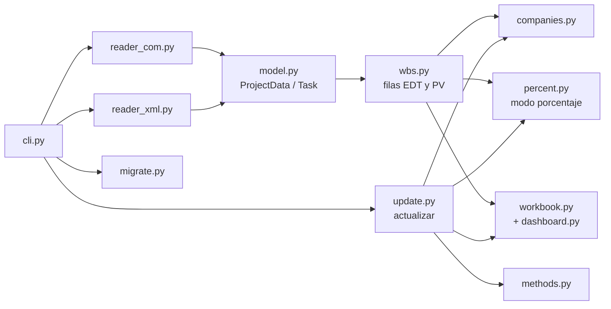

# Desarrollo, pruebas y repositorio

[Inicio](../README.md) › [Documentación](README.md) › Desarrollo

Información para quien modifica el programa o la documentación.

---

## Contenido

1. [Pruebas automáticas](#1-pruebas-automáticas)
2. [Estructura del código](#2-estructura-del-código)
3. [Flujo de trabajo del repositorio](#3-flujo-de-trabajo-del-repositorio) (incluye versiones,
   publicaciones e [instalador de Windows](#32-instalador-de-windows))
4. [Documentación e imágenes](#4-documentación-e-imágenes)

---

## 1. Pruebas automáticas

```powershell
python -m pip install -r requirements-dev.txt
python -m pytest                          # todas las pruebas
python -m pytest -m "not libreoffice"     # sin las que recalculan con LibreOffice (más rápido)
```

| Archivo de pruebas | Contenido |
|---|---|
| `test_modo_porcentaje.py` | Modo porcentaje (por defecto): pesos de tareas e hitos, % planificado por empresa, % ganado por método y empresa, hojas y fórmulas del libro, cambio de BAC, `actualizar`, `--migrar-desde`, varios archivos y recálculo de las fórmulas con LibreOffice. |
| `test_robustez_calculo.py` | Estructura EDT y PV, métodos de medición, multi-empresa, reparto en el tiempo, indicadores y configuración. Incluye reglas que se verifican sobre árboles EDT aleatorios. |
| `test_robustez_lectores.py` | Lectura del XML (campos, líneas base, calendarios y excepciones) y del `.mpp` con objetos que simulan MS Project. |
| `test_robustez_libro.py` | `actualizar`, `--migrar-desde`, libros modificados a mano, errores de la línea de comandos y del archivo de configuración. |
| `test_proyectos_aleatorios.py` | Proyectos aleatorios de punta a punta (`generar`, varias fechas de corte, migración y recálculo). |
| `test_analisis_desviaciones.py` | Hoja `Análisis de desviaciones`: lista calculada aparte, texto conservado y copiado al mes siguiente, `analizar` con AC cargado a mano, libros antiguos, `--migrar-desde` y recálculo de sus fórmulas con LibreOffice. |
| `test_varios_archivos.py` | Varios archivos de MS Project (`[[proyectos]]`): el libro combinado coincide, fila por fila, con el libro de cada archivo (también en multi-empresa, con UniqueID repetidos entre archivos); errores de configuración y de la línea de comandos, fechas de estado y `--migrar-desde`. |
| Resto | Casos del programa de ejemplo, Cuadro de Mando, multi-empresa y planificación. |

- **Modo de cálculo:** las pruebas de los cálculos con costos indican el modo costo con
  `pytestmark = pytest.mark.modo("costo")` al comienzo del archivo (o con la marca en cada prueba); la marca
  cambia el modo por defecto del programa durante la prueba. Las demás usan el modo por defecto
  (porcentaje).
- **LibreOffice:** si está instalado, las pruebas marcadas `libreoffice` recalculan las fórmulas del
  libro y las comparan con el cálculo en Python. Se usa un perfil propio de LibreOffice, por lo que
  funcionan aunque LibreOffice esté abierto. Si no está instalado, se omiten.
- **Proyectos aleatorios:** la cantidad de proyectos (y de árboles EDT aleatorios) se aumenta con la
  variable de entorno `EVM_SEMILLAS`, por ejemplo `$env:EVM_SEMILLAS = 50` antes de `python -m pytest`.
  Cada caso indica su semilla, de modo que un fallo se puede repetir.
- **Problemas conocidos:** las pruebas marcadas `xfail` documentan problemas detectados que aún no se
  corrigieron; aparecen como `xfailed` y no hacen fallar la ejecución. Cuando se corrige el problema,
  la prueba aparece como fallida (`XPASS(strict)`) para que se quite la marca.
- **Cobertura (opcional):** `python -m pip install coverage`, luego
  `python -m coverage run --branch --source=evm -m pytest` y `python -m coverage report -m`.

### 1.1 Pruebas con MS Project real (opcionales)

El lector `.mpp` se prueba con objetos que simulan MS Project. En un PC con MS Project, las pruebas
opcionales de `test_msproject_real.py` (marca `msproject`) leen un proyecto real por automatización COM
y comparan el resultado con el XML que MS Project guarda del mismo proyecto: estructura EDT, métodos,
BAC, PV mensual, EV y AC a la fecha de corte, y que MS Project quede como estaba (abierto o cerrado).
Estas pruebas usan el modo costo, aunque la configuración indique otro.

1. En MS Project se abre el proyecto, se define *Proyecto > Fecha de estado* y se guarda el `.mpp`.
2. Se guarda una copia en XML: *Archivo > Guardar como*, tipo XML.
3. Se ejecutan las pruebas:

```powershell
$env:EVM_MPP = "C:\Proyectos\Programa.mpp"
$env:EVM_MPP_XML = "C:\Proyectos\Programa.xml"
python -m pytest -m msproject -v
```

Opcionales: `EVM_CONFIG` (archivo de configuración; por defecto `config.toml`), `EVM_LINEA_BASE`
(línea base N) y `EVM_TOLERANCIA_PV` (diferencia admitida en el PV de cada mes, como fracción del BAC
de la fila; por defecto 0.005). Los mensajes de las pruebas solo muestran códigos EDT e importes.
Además, se recomienda comparar el BAC total y el PV de algunos meses con la vista *Uso de tareas*
(campo *Costo previsto* en la escala temporal mensual).

El proyecto de ejemplo (`ejemplos/programa_ejemplo.xml`) y su generador se describen en el
[tutorial](ejemplo-paso-a-paso.md). El segundo proyecto de ejemplo (`ejemplos/proyecto2_ejemplo.xml`,
para varios archivos) se genera con `python ejemplos\generar_ejemplo.py --proyecto 2`.

---

## 2. Estructura del código

| Archivo | Función |
|---|---|
| `evm_export.py` | Punto de entrada. |
| `evm/cli.py` | Comandos y opciones. |
| `evm/config.py` | Configuración TOML. |
| `evm/model.py` | Datos comunes: tareas y proyecto leídos de MS Project. |
| `evm/reader_com.py` | Lectura de `.mpp` con MS Project (COM). |
| `evm/reader_xml.py`, `evm/workcalendar.py` | Lectura del XML de MS Project y de su calendario. |
| `evm/fields.py` | Identificación de campos personalizados (Texto1..30, Número1..20 y alias). |
| `evm/wbs.py` | Estructura EDT hasta el nivel máximo y PV por fila (modo costo) o % planificado (modo porcentaje); combinación de varios archivos y horizonte. |
| `evm/percent.py` | Modo porcentaje: peso de cada tarea (duración de la línea base y `Peso hito`), % planificado y % ganado por empresa. |
| `evm/companies.py` | Multi-empresa: parte de cada empresa por tarea y reparto del EV y el AC. |
| `evm/timeline.py` | Horizonte mensual y repartos en el tiempo. |
| `evm/workbook.py` | Escritura del libro Excel y de sus indicadores. |
| `evm/dashboard.py` | Hoja `Cuadro de Mando` y sus tres gráficos. |
| `evm/methods.py` | Métodos de medición del EV. |
| `evm/analysis.py` | Hoja `Análisis de desviaciones`: paquetes fuera de umbral y texto conservado. |
| `evm/update.py` | Comando `actualizar` y lectura del libro. |
| `evm/migrate.py` | Traslado de EV, AC y métodos al regenerar el libro (`--migrar-desde`). |
| `evm/indicators.py` | Indicadores que se muestran en pantalla (mismos cálculos que la hoja `Resumen`). |
| `instalador/` | Instalador de Windows: `construir.py`, especificación de PyInstaller, script de Inno Setup y consola ([3.2](#32-instalador-de-windows)). |



---

## 3. Flujo de trabajo del repositorio

- La rama `main` contiene solo **versiones estables**. No se hacen commits directos en `main`.
- Todo cambio se hace en una rama propia y se incorpora mediante un **Pull Request**:

```powershell
git switch main
git pull
git switch -c mejora/descripcion-breve
# ... cambios ...
python -m pytest
git add -A
git commit -m "Descripción del cambio"
git push -u origin mejora/descripcion-breve
gh pr create --base main --fill
```

- Antes de abrir el Pull Request, todas las pruebas deben pasar (`python -m pytest`).
- No se deben subir al repositorio libros generados, configuraciones personales (`config.toml`) ni
  archivos de proyectos reales: el repositorio es público.
- Todos los textos (documentación, mensajes y notas del libro) se escriben en forma impersonal, por
  ejemplo "se debe habilitar" en lugar de "habilítelo".

### 3.1 Versiones y publicaciones

Cada cambio de versión (`__version__` en `evm/__init__.py`, con el formato descrito en
[CHANGELOG.md](../CHANGELOG.md)) se acompaña, en el mismo Pull Request, de:

1. La entrada de la versión en [CHANGELOG.md](../CHANGELOG.md): la sección *Sin publicar* pasa a ser
   `## [X.Y.Z] - AAAA-MM-DD · Título`, con las secciones **Nuevas funciones**, **Correcciones** y
   **Otros** (con "Ninguna." si una sección no tiene cambios); arriba se agrega una sección *Sin publicar*
   vacía y al final del archivo se actualizan los enlaces de comparación.
2. La versión en la portada de la presentación y su PDF:

   ```powershell
   python docs\herramientas\version_presentacion.py
   ```

Después de fusionar el Pull Request en `main`, se crea la etiqueta en ese commit y la publicación en
GitHub con el título y las notas de la versión:

```powershell
git switch main
git pull
git tag -a vX.Y.Z -m "Versión X.Y.Z"
git push origin vX.Y.Z
python docs\herramientas\notas_version.py X.Y.Z > notas.md
gh release create vX.Y.Z --title "$(python docs\herramientas\notas_version.py X.Y.Z --titulo)" --notes-file notas.md
```

Por último, desde ese mismo commit etiquetado, se genera el instalador de Windows y se adjunta a la
publicación ([3.2](#32-instalador-de-windows)):

```powershell
python instalador\construir.py
gh release upload vX.Y.Z dist\ExportadorEVM-X.Y.Z-instalador.exe
```

`notas_version.py` verifica que la versión tenga las tres secciones. Los cambios que no modifican la
versión (por ejemplo, solo documentación) se anotan en la sección *Sin publicar* del CHANGELOG, en el
mismo Pull Request, y forman parte de la entrada de la versión siguiente.

### 3.2 Instalador de Windows

Cada publicación incluye `ExportadorEVM-X.Y.Z-instalador.exe`, que instala el programa sin Python. Lo
genera `instalador\construir.py`:

1. Crea la primera vez un entorno virtual en `build\instalador\venv` con las dependencias de
   `requirements.txt` y PyInstaller. El programa se empaqueta con la versión de Python que ejecuta el
   script.
2. Genera con PyInstaller la carpeta `ExportadorEVM`, con `evm_export.exe` y `generar_ejemplo.exe` y la
   versión del programa en sus propiedades (`instalador\ExportadorEVM.spec`).
3. Prueba los ejecutables con el proyecto de ejemplo: `--version`, `generar`, avance simulado,
   `actualizar` y `analizar`. Si una prueba falla, se detiene.
4. Compila con Inno Setup el instalador (`instalador\ExportadorEVM.iss`) en la carpeta `dist`.

Avisa, sin detenerse, si hay cambios sin confirmar o si el commit no tiene la etiqueta `vX.Y.Z`: el
instalador publicado debe corresponder exactamente a la versión. Las carpetas `build` y `dist` no se
suben al repositorio.

Requisitos: Windows con Python 3.11 o posterior, conexión a internet la primera vez (pip) e
[Inno Setup 6](https://jrsoftware.org/isinfo.php), que se puede instalar sin permisos de administrador
con `winget install JRSoftware.InnoSetup --scope user`. Si `ISCC.exe` no está en una carpeta
habitual, su ruta se indica en la variable de entorno `ISCC`.

El instalador:

- se instala para el usuario actual en `%LOCALAPPDATA%\Programs\Exportador EVM`, sin permisos de
  administrador, y aparece en *Configuración > Aplicaciones* para desinstalarlo;
- copia los ejecutables, `config.ejemplo.toml`, `ejemplos\programa_ejemplo.xml`, la licencia y el
  CHANGELOG;
- crea en el menú Inicio la **consola** (`consola.cmd`: abre una consola en Documentos con
  `evm_export` disponible), un enlace a la documentación y el desinstalador;
- ofrece agregar la carpeta del programa al PATH del usuario. Al desinstalar, la quita y deja el PATH
  como estaba;
- al instalar una versión nueva, reemplaza la anterior en la misma carpeta (mismo `AppId`).

El instalador no tiene firma digital, por lo que Windows puede mostrar el aviso de SmartScreen
"Windows protegió su PC". La lectura de `.mpp` por COM necesita MS Project de escritorio, igual que
con Python; sin MS Project se usa el XML.

---

## 4. Documentación e imágenes

- La documentación está en `README.md` (presentación, instalación y uso rápido) y en la carpeta
  [`docs`](README.md). Los diagramas se escriben en [Mermaid](https://mermaid.js.org/), que GitHub
  muestra como imágenes.
- `docs/img/excel/` contiene **capturas del libro** generado con el proyecto de ejemplo. Si cambia el
  formato del libro, se regeneran con:

  ```powershell
  python docs\herramientas\capturas_excel.py
  ```

  El script genera el libro de ejemplo en una carpeta temporal, simula 24 meses de avance, abre el libro
  con Excel (sin mostrarlo y sin guardar cambios), exporta cada zona a PDF y la convierte a PNG con
  `pdftoppm` (Poppler). Requiere Windows, Excel y Poppler (`winget install oschwartz10612.Poppler`, o la
  ruta de `pdftoppm.exe` en la variable de entorno `PDFTOPPM`).
- `docs/img/ms-project/` contiene **esquemas** de pantallas de MS Project en formato SVG (texto
  editable). No son capturas: muestran la ubicación de los campos y opciones. Se pueden reemplazar por
  capturas reales de MS Project en español (formato PNG en la misma carpeta, con el mismo nombre de
  archivo, actualizando el enlace en el documento).
- Las imágenes PNG de `docs/img/` están permitidas en `.gitignore` (el resto de los PNG del repositorio
  se ignora).
