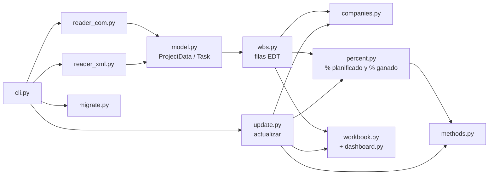

# Desarrollo, pruebas y repositorio

[Inicio](../README.md) › [Documentación](README.md) › Desarrollo

Información para quien modifica el programa o la documentación.

---

## Contenido

1. [Pruebas automáticas](#1-pruebas-automáticas)
2. [Estructura del código](#2-estructura-del-código)
3. [Flujo de trabajo del repositorio](#3-flujo-de-trabajo-del-repositorio) (incluye versiones,
   publicaciones e [instalador de Windows](#32-instalador-de-windows))
4. [Documentación e imágenes](#4-documentación-e-imágenes)
5. [Códigos de errores y advertencias](#5-códigos-de-errores-y-advertencias) (metodología para agregar un
   mensaje)

---

## 1. Pruebas automáticas

```powershell
python -m pip install -r requirements-dev.txt
python -m pytest                          # todas las pruebas
python -m pytest -n 4 --dist loadfile     # en paralelo, en 4 procesos (pytest-xdist): unas 2,5 veces más rápido
python -m pytest -m "not libreoffice"     # sin las que recalculan con LibreOffice
```

| Archivo de pruebas | Contenido |
|---|---|
| `test_calculo_pv_ev.py` | Cálculo del PV y el EV: pesos de tareas e hitos, % planificado por empresa, % ganado por método y empresa, hojas y fórmulas del libro, cambio de BAC, `actualizar`, `--migrar-desde`, varios archivos, libros de versiones anteriores y recálculo de las fórmulas con LibreOffice. |
| `test_robustez_calculo.py` | Estructura EDT y % planificado, métodos de medición, multi-empresa, redondeo, indicadores y configuración. Incluye reglas que se verifican sobre árboles EDT aleatorios. |
| `test_robustez_lectores.py` | Lectura del XML (campos, líneas base, calendarios y excepciones) y del `.mpp` con objetos que simulan MS Project. |
| `test_robustez_libro.py` | `actualizar`, `--migrar-desde`, libros modificados a mano, errores de la línea de comandos y del archivo de configuración. |
| `test_proyectos_aleatorios.py` | Proyectos aleatorios de punta a punta (`generar`, varias fechas de corte, migración y recálculo). |
| `test_analisis_desviaciones.py` | Hoja `Análisis de desviaciones`: lista calculada aparte, texto conservado y copiado al mes siguiente, `analizar` con AC cargado a mano, libros antiguos, `--migrar-desde` y recálculo de sus fórmulas con LibreOffice. |
| `test_validar.py` | Comando `validar` y controles del archivo: códigos EDT (dependencia de la tarea superior, formato, orden, duplicados), fechas y duración, pesos, método frente a la duración, empresas, avance a la fecha de estado y fuera de secuencia, lógica del cronograma y evaluación DCMA (holgura, duración, tareas incumplidas, CPLI y BEI), lectura de duración, vínculos y delimitaciones (XML y COM) y columna `Tema` de la hoja `Validación`. |
| `test_fichas_tareas.py` | Comando `generar-fichas`: fichas de los elementos del libro, vínculos trasladados al elemento con ficha (internos, repetidos y con tareas sin ficha), fechas y duración de la línea base, documento Markdown, varios archivos y lectura de la duración de la línea base, las horas por día y la descripción (XML y COM). |
| `test_plazo_tendencia.py` | Plazo según el cronograma (días laborables, fin previsto, holgura y crítica de cada fila, filas resumen y total), columnas de `Indicadores EDT`, secciones del `Resumen` y del `Cuadro de Mando`, libros de versiones anteriores, tendencia (mes anterior con datos y últimos 3 meses) y recálculo de sus fórmulas con LibreOffice. |
| `test_lista_edt.py` | Lista EDT (`lista_edt`): lectura del archivo, filas definidas por la lista, códigos sin los ceros finales, códigos faltantes, ramas sin elemento listado, lista guardada en el libro y usada por `actualizar`. |
| `test_ceros_intermedios.py` | Ceros del código EDT. Intermedios (`ignorar_ceros_intermedios`): nivel del código, filas del libro y fila `-D`, controles de los códigos, criterio guardado en el libro y usado por `actualizar`, `--migrar-desde` y línea de comandos. Finales (`1.2` = `1.2.0` = `1.2.0.0`): duplicados y asociación por código en `actualizar` y `--migrar-desde`. |
| `test_progreso.py` | Versión en pantalla y barra de progreso (etapas, % de la etapa y del total, tiempo transcurrido, ETA que no sube en una etapa lenta y cuenta hacia atrás en una sin conteo, refresco, tiempo total, consola no interactiva). |
| `test_registro_cambios.py` | Controles del cierre mensual de la norma EIA-748-E: registro de cambios del BAC y de los meses ya informados (referencia, detección, hoja `Registro de cambios`, `--simular` y `--migrar-desde`), coherencia del EV y el AC, análisis de desviaciones incompleto, acciones vencidas, meses sin informe, línea base de MS Project distinta de la del libro, EAC poco realista (TCPI frente al CPI) y peso del LOE en el BAC. |
| `test_codigos.py` | Códigos de errores y advertencias: formato y numeración del catálogo, todo mensaje con un código del catálogo, todo código usado, `docs/codigos.md` al día y silenciar (configuración, `--silenciar`, hoja `Validación` y código de salida de `validar`). |
| `test_varios_archivos.py` | Varios archivos de MS Project (`[[proyectos]]`): el libro combinado coincide, fila por fila, con el libro de cada archivo (también en multi-empresa, con UniqueID repetidos entre archivos); errores de configuración y de la línea de comandos, fechas de estado y `--migrar-desde`. |
| `test_rendimiento.py` | Optimizaciones de la lectura de MS Project y de la escritura del libro: mismos estilos que openpyxl, celdas vacías de las hojas `% PV` y `% EV`, una sola lectura del libro, reparto por meses del calendario y lecturas de MS Project (vínculos y alias de los campos, solo cuando hacen falta). |
| `test_review_fixes.py` | Regresiones de los problemas detectados en las revisiones del código: migración, `actualizar` y `analizar`, análisis de desviaciones, registro de cambios, mensajes y errores de la línea de comandos. |
| `test_workbook_update.py` | Libro del proyecto de ejemplo: disposición de las hojas, ciclo de `actualizar`, respaldo, meses posteriores cargados, `--migrar-desde` y recálculo de las fórmulas con LibreOffice. |
| `test_report_xml.py`, `test_timeline_methods.py` | Lectura del XML de ejemplo, filas EDT y % planificado; calendario, horizonte, fechas, redondeo, métodos de medición e indicadores. |
| Resto | Cuadro de Mando, semáforo, multi-empresa, planificación, campo `Visible`, depuración de costes, calendario y lector COM simulado. |

- **LibreOffice:** si está instalado, las pruebas marcadas `libreoffice` recalculan las fórmulas del
  libro y las comparan con el cálculo en Python. Se usa un perfil propio de LibreOffice, por lo que
  funcionan aunque LibreOffice esté abierto. Si no está instalado, se omiten.
- **Proyectos aleatorios:** la cantidad de proyectos (y de árboles EDT aleatorios) se aumenta con la
  variable de entorno `EVM_SEMILLAS`, por ejemplo `$env:EVM_SEMILLAS = 50` antes de `python -m pytest`.
  Cada caso indica su semilla, de modo que un fallo se puede repetir.
- **Libros compartidos:** generar y actualizar un libro es lo más lento de las pruebas, por eso los libros
  que muchas pruebas necesitan iguales se arman una sola vez y cada prueba recibe una copia en su
  carpeta. En `conftest.py`: `book` (libro del proyecto de ejemplo con el BAC de cada fila), `book_jun`
  (el mismo, con el AC de junio de 2027 cargado y actualizado a esa fecha) y `example_template` (sin
  BAC). Los archivos de pruebas tienen las suyas (`multi_book`, el libro de umbrales propios de
  `test_semaforo.py`, `books` de `test_varios_archivos.py`). Una prueba que revisa la salida de
  `generar` o de `actualizar` ejecuta ese comando ella misma.
- **Problemas conocidos:** las pruebas marcadas `xfail` documentan problemas detectados que aún no se
  corrigieron; aparecen como `xfailed` y no hacen fallar la ejecución. Cuando se corrige el problema,
  la prueba aparece como fallida (`XPASS(strict)`) para que se quite la marca.
- **Cobertura (opcional):** `python -m pip install coverage`, luego
  `python -m coverage run --branch --source=evm -m pytest` y `python -m coverage report -m`.

### 1.1 Pruebas con MS Project real (opcionales)

El lector `.mpp` se prueba con objetos que simulan MS Project. En un PC con MS Project, las pruebas
opcionales de `test_msproject_real.py` (marca `msproject`) leen un proyecto real por automatización COM
y comparan el resultado con el XML que MS Project guarda del mismo proyecto: estructura EDT, métodos,
horizonte, % planificado de cada mes, % ganado acumulado a la fecha de corte (de cada empresa, en
multi-empresa), plazo según el cronograma (fin previsto, holgura total y tareas críticas) y que MS
Project quede como estaba (abierto o cerrado). Los dos libros reciben el mismo
BAC en cada fila.

1. En MS Project se abre el proyecto, se define *Proyecto > Fecha de estado* y se guarda el `.mpp`.
2. Se guarda una copia en XML: *Archivo > Guardar como*, tipo XML.
3. Se ejecutan las pruebas:

```powershell
$env:EVM_MPP = "C:\Proyectos\Programa.mpp"
$env:EVM_MPP_XML = "C:\Proyectos\Programa.xml"
python -m pytest -m msproject -v
```

Opcionales: `EVM_CONFIG` (archivo de configuración; por defecto `config.toml` si existe y, si no,
`config.ejemplo.toml`), `EVM_LINEA_BASE` (línea base N) y `EVM_TOLERANCIA_PV` (diferencia admitida en el
% planificado de cada mes; por defecto 0.005, es decir, 0,5 %). El motor XML reparte la duración de las
tareas con el calendario del proyecto, y el motor COM con lunes a viernes y los `feriados` de la
configuración, por eso se admite una pequeña diferencia. Los mensajes de las pruebas solo muestran
códigos EDT y porcentajes.

El proyecto de ejemplo (`ejemplos/programa_ejemplo.xml`) y su generador se describen en el
[tutorial](ejemplo-paso-a-paso.md). El segundo proyecto de ejemplo (`ejemplos/proyecto2_ejemplo.xml`,
para varios archivos) se genera con `python ejemplos\generar_ejemplo.py --proyecto 2`.

---

## 2. Estructura del código

| Archivo | Función |
|---|---|
| `evm_export.py` | Punto de entrada. |
| `evm/cli.py` | Comandos y opciones. |
| `evm/config.py` | Configuración TOML. |
| `evm/messages.py` | Catálogo de los códigos de errores y advertencias (severidad, explicación y qué hacer), observaciones con código (`Issue`), errores con código que detienen el programa y silenciar ([5](#5-códigos-de-errores-y-advertencias)). |
| `evm/model.py` | Datos comunes: tareas (fechas y duración de la línea base, fechas actuales, avance, duración, vínculos, delimitaciones, campos personalizados y descripción) y proyecto leídos de MS Project. |
| `evm/reader_com.py` | Lectura de `.mpp` con MS Project (COM): fechas, avance, holgura, tareas críticas y campos personalizados. Los costos no se leen. |
| `evm/reader_xml.py`, `evm/workcalendar.py` | Lectura del XML de MS Project (los costos no se leen) y calendario laboral con el que se reparte la duración de las tareas entre los meses. |
| `evm/fields.py` | Identificación de campos personalizados (Texto1..30, Número1..20 y alias). |
| `evm/wbs.py` | Estructura EDT hasta el nivel máximo o el detalle que indique el campo `Visible` (o la lista EDT), % planificado de cada fila, combinación de varios archivos y horizonte. |
| `evm/validation.py` | Controles del archivo de MS Project: códigos EDT, fechas y duración, pesos, método y empresas (hoja `Validación` y `validar`), avance a la fecha de estado y lógica del cronograma con los criterios DCMA (solo `validar`). |
| `evm/percent.py` | Peso de cada tarea (duración de la línea base y `Peso hito`), % planificado y % ganado de cada fila y de cada empresa. |
| `evm/cost_review.py` | Depuración de costes: hojas `PV-depuración`, `Depuración costes` y `_depuracion` (asignación con fórmulas de la previsión pegada) e indicador de alineamiento. |
| `evm/companies.py` | Multi-empresa: parte de cada empresa en cada tarea (columnas `Empresa` y `% Reparto`, con herencia de la tarea superior). |
| `evm/timeline.py` | Horizonte mensual y utilidades de meses. |
| `evm/workbook.py` | Escritura del libro Excel y de sus indicadores. |
| `evm/fast_save.py` | Guardado rápido del libro (`[exportacion] guardado_rapido`): mientras se guarda, reemplaza la función de openpyxl que escribe cada celda por una que arma su XML directamente, con el mismo resultado byte a byte. Solo con la versión de openpyxl probada (3.1.x) y su escritor estándar; si no, guardado normal. |
| `evm/dashboard.py` | Hoja `Cuadro de Mando` y sus tres gráficos. |
| `evm/methods.py` | Métodos de medición: interpretación del texto de la columna C y criterios de tarea comenzada y terminada. |
| `evm/analysis.py` | Hoja `Análisis de desviaciones`: paquetes fuera de umbral, texto conservado, análisis del mes anterior incompleto y acciones vencidas. |
| `evm/changes.py` | Registro de cambios: referencia de la última ejecución (hoja oculta `_registro`), cambios del BAC y de los meses ya informados y hoja `Registro de cambios`. |
| `evm/consistency.py` | Controles del libro en el cierre mensual: coherencia del EV y el AC, meses sin informe, EAC poco realista y peso del LOE en el BAC. |
| `evm/update.py` | Comandos `actualizar` (% ganado del mes) y `analizar`, y lectura y verificación del libro. |
| `evm/migrate.py` | Traslado del BAC, el % ganado, el AC y los métodos al regenerar el libro (`--migrar-desde`). |
| `evm/indicators.py` | Indicadores que se muestran en pantalla (mismos cálculos que la hoja `Resumen`), incluida la tendencia. |
| `evm/schedule.py` | Plazo según el cronograma de MS Project: fin previsto, desvío de fin, holgura y camino crítico de cada fila y del proyecto. |
| `evm/progress.py` | Barra de progreso de la consola (etapas de cada comando, %, tiempo transcurrido y ETA, refresco cada medio segundo). |
| `evm/task_cards.py` | Comando `generar-fichas`: ficha de cada elemento EDT del libro (fechas y duración de la línea base, predecesoras y sucesoras) y documento Markdown. |
| `instalador/` | Instalador de Windows: `construir.py`, especificación de PyInstaller, script de Inno Setup y consola ([3.2](#32-instalador-de-windows)). |



**Rendimiento.** Con proyectos grandes, el tiempo se va en la lectura de MS Project y en leer y guardar
el libro, que tiene cientos de miles de celdas (120 meses por fila en cada hoja mensual). Al modificar el
código se deben mantener estas pautas (las pruebas de `test_rendimiento.py` comprueban que los
resultados no cambian):

- Con `.mpp`, cada propiedad de una tarea que se lee es una llamada a MS Project, en otro proceso: se
  leen solo los datos que usa el comando (por ejemplo, `generar` y `actualizar` no leen los vínculos ni
  las delimitaciones: `links=False`).
- Los estilos de las celdas de las hojas grandes se asignan con `workbook.styled(celda, font=...,
  fill=...)`: openpyxl calcula el hash del objeto de estilo en cada asignación (`celda.font = ...`), y
  `styled` lo calcula una vez por libro. Los objetos de estilo se crean una sola vez (constantes del
  módulo o `workbook.indent(nivel)`), no uno por celda.
- No se escriben celdas vacías solo para darles formato: en las hojas `% PV` y `% EV`, `actualizar` da
  formato a las celdas que carga.
- El libro se lee una sola vez; el libro con los valores calculados (`data_only`) se lee solo si una
  celda de ingreso tiene una fórmula.
- El guardado rápido (`evm/fast_save.py`) depende de funciones internas de openpyxl. Al actualizar
  openpyxl a una versión nueva, se debe comprobar que `tests/test_rendimiento.py` siga pasando (archivo
  idéntico byte a byte con y sin guardado rápido) y agregar la versión a `TESTED_VERSIONS`; hasta
  entonces, el programa guarda en el modo normal.

---

## 3. Flujo de trabajo del repositorio

- La rama `main` contiene solo **versiones estables**. No se hacen commits directos en `main`.
- Todo cambio se hace en una rama propia y se incorpora mediante un **Pull Request**:

```powershell
git switch main
git pull
git switch -c mejora/descripcion-breve
# ... cambios ...
python -m pytest
git add -A
git commit -m "Descripción del cambio"
git push -u origin mejora/descripcion-breve
gh pr create --base main --fill
```

- Antes de abrir el Pull Request, todas las pruebas deben pasar (`python -m pytest`).
- No se deben subir al repositorio libros generados, configuraciones personales (`config.toml`) ni
  archivos de proyectos reales: el repositorio es público.
- Todos los textos (documentación, mensajes y notas del libro) se escriben en forma impersonal, por
  ejemplo "se debe habilitar" en lugar de "habilítelo".

### 3.1 Versiones y publicaciones

Cada cambio de versión (`__version__` en `evm/__init__.py`, con el formato descrito en
[CHANGELOG.md](../CHANGELOG.md)) se acompaña, en el mismo Pull Request, de:

1. La entrada de la versión en [CHANGELOG.md](../CHANGELOG.md): la sección *Sin publicar* pasa a ser
   `## [X.Y.Z] - AAAA-MM-DD · Título`, con las secciones **Nuevas funciones**, **Correcciones** y
   **Otros** (con "Ninguna." si una sección no tiene cambios); arriba se agrega una sección *Sin publicar*
   vacía y al final del archivo se actualizan los enlaces de comparación.
2. La versión en la portada de la presentación y su PDF:

   ```powershell
   python docs\herramientas\version_presentacion.py
   ```

Después de fusionar el Pull Request en `main`, se crea la etiqueta en ese commit y la publicación en
GitHub con el título y las notas de la versión:

```powershell
git switch main
git pull
git tag -a vX.Y.Z -m "Versión X.Y.Z"
git push origin vX.Y.Z
python docs\herramientas\notas_version.py X.Y.Z > notas.md
gh release create vX.Y.Z --title "$(python docs\herramientas\notas_version.py X.Y.Z --titulo)" --notes-file notas.md
```

Mientras no se resuelva el ticket #18, en `notas.md` los enlaces relativos (`docs/...`) se reemplazan
por enlaces completos a la etiqueta (`https://github.com/MarceloSalazar/evm-automation/blob/vX.Y.Z/docs/...`)
antes de `gh release create`. `notas.md` no se sube al repositorio.

Por último, desde ese mismo commit etiquetado, se genera el instalador de Windows y se adjunta a la
publicación ([3.2](#32-instalador-de-windows)):

```powershell
python instalador\construir.py
gh release upload vX.Y.Z dist\ExportadorEVM-X.Y.Z-instalador.exe
```

`notas_version.py` verifica que la versión tenga las tres secciones. Los cambios que no modifican la
versión (por ejemplo, solo documentación) se anotan en la sección *Sin publicar* del CHANGELOG, en el
mismo Pull Request, y forman parte de la entrada de la versión siguiente.

### 3.2 Instalador de Windows

Cada publicación incluye `ExportadorEVM-X.Y.Z-instalador.exe`, que instala el programa sin Python. Lo
genera `instalador\construir.py`:

1. Crea la primera vez un entorno virtual en `build\instalador\venv` con las dependencias de
   `requirements.txt` y PyInstaller. El programa se empaqueta con la versión de Python que ejecuta el
   script.
2. Genera con PyInstaller la carpeta `ExportadorEVM`, con `evm_export.exe` y `generar_ejemplo.exe` y la
   versión del programa en sus propiedades (`instalador\ExportadorEVM.spec`).
3. Prueba los ejecutables con el proyecto de ejemplo: `--version`, `validar`, `generar`, avance
   simulado, `actualizar`, `analizar` y `generar-fichas`. Si una prueba falla, se detiene.
4. Compila con Inno Setup el instalador (`instalador\ExportadorEVM.iss`) en la carpeta `dist`.

Avisa, sin detenerse, si hay cambios sin confirmar o si el commit no tiene la etiqueta `vX.Y.Z`: el
instalador publicado debe corresponder exactamente a la versión. Las carpetas `build` y `dist` no se
suben al repositorio.

Requisitos: Windows con Python 3.11 o posterior, conexión a internet la primera vez (pip) e
[Inno Setup 6](https://jrsoftware.org/isinfo.php), que se puede instalar sin permisos de administrador
con `winget install JRSoftware.InnoSetup --scope user`. Si `ISCC.exe` no está en una carpeta
habitual, su ruta se indica en la variable de entorno `ISCC`.

El instalador:

- se instala para el usuario actual en `%LOCALAPPDATA%\Programs\Exportador EVM`, sin permisos de
  administrador, y aparece en *Configuración > Aplicaciones* para desinstalarlo;
- copia los ejecutables, `config.ejemplo.toml`, `ejemplos\programa_ejemplo.xml`, la licencia y el
  CHANGELOG;
- crea en el menú Inicio la **consola** (`consola.cmd`: abre una consola en Documentos con
  `evm_export` disponible), un enlace a la documentación y el desinstalador;
- ofrece agregar la carpeta del programa al PATH del usuario. Al desinstalar, la quita y deja el PATH
  como estaba;
- al instalar una versión nueva, reemplaza la anterior en la misma carpeta (mismo `AppId`).

El instalador no tiene firma digital, por lo que Windows puede mostrar el aviso de SmartScreen
"Windows protegió su PC". La lectura de `.mpp` por COM necesita MS Project de escritorio, igual que
con Python; sin MS Project se usa el XML.

---

## 4. Documentación e imágenes

- La documentación está en `README.md` (presentación, instalación y uso rápido) y en la carpeta
  [`docs`](README.md). Los diagramas se escriben en [Mermaid](https://mermaid.js.org/), que GitHub
  muestra como imágenes.
- `docs/img/excel/` contiene **capturas del libro** generado con el proyecto de ejemplo. Si cambia el
  formato del libro, se regeneran con:

  ```powershell
  python docs\herramientas\capturas_excel.py
  ```

  El script genera el libro de ejemplo en una carpeta temporal, simula 24 meses de avance, abre el libro
  con Excel (sin mostrarlo y sin guardar cambios), exporta cada zona a PDF y la convierte a PNG con
  `pdftoppm` (Poppler). Con `--solo` se regenera solo un grupo de capturas (`una-empresa`,
  `multiempresa`, `varios` o `depuracion`), por ejemplo
  `python docs\herramientas\capturas_excel.py --solo depuracion`. Requiere Windows, Excel y Poppler (`winget install oschwartz10612.Poppler`, o la
  ruta de `pdftoppm.exe` en la variable de entorno `PDFTOPPM`).
- `docs/img/ms-project/` contiene **esquemas** de pantallas de MS Project en formato SVG (texto
  editable). No son capturas: muestran la ubicación de los campos y opciones. Se pueden reemplazar por
  capturas reales de MS Project en español (formato PNG en la misma carpeta, con el mismo nombre de
  archivo, actualizando el enlace en el documento).
- Las imágenes PNG de `docs/img/` están permitidas en `.gitignore` (el resto de los PNG del repositorio
  se ignora).

---

## 5. Códigos de errores y advertencias

Cada mensaje del programa (error que detiene el programa, error, advertencia o informativa) tiene un
código `ÁREA-NNN` del catálogo `CATALOG` de `evm/messages.py`, con su severidad, su explicación y qué
hacer. El documento [`docs/codigos.md`](codigos.md) se genera a partir del catálogo; los usuarios lo
consultan para entender un mensaje y para silenciar los códigos que ya revisaron
([Códigos de errores y advertencias](codigos.md#2-silenciar-observaciones)).

### 5.1 Metodología para agregar un mensaje

1. **Elegir el área** del mensaje (las de `AREAS` en `evm/messages.py`: `CFG`, `LEC`, `EDT`, `FEC`...).
   El área define el tema de la hoja `Validación` y del comando `validar`.
2. **Agregar el código al catálogo**, al final de su área, con el **número siguiente** al último de esa
   área: `_code("FEC-013", W, "Título", "Causa.", "Qué hacer.")`. Se indican la severidad (`F` detiene el
   programa, `E` error, `W` advertencia, `I` informativa; una tupla si depende del caso) y, si no son los
   del área, los comandos en que aparece.
3. **Usar el código en el programa**:
   - observación (consola y hoja `Validación`): `Issue("FEC-013", codigo_edt, nombre, mensaje)`; la
     severidad y el tema se toman del catálogo (los códigos de severidad variable la indican);
   - error que detiene el programa: `raise ConfigError("CFG-052", mensaje)`, o la clase de
     `evm/messages.py` que corresponda (`InputError`, `MissingFileError`, `SaveError`...). No se
     lanzan `ValueError` ni `RuntimeError` con un mensaje para el usuario.
4. **Regenerar el documento**: `python docs\herramientas\codigos.py` (con `--comprobar` solo se
   verifica que esté al día).
5. **Probar**: `python -m pytest tests/test_codigos.py` comprueba el formato y la numeración del catálogo,
   que todo mensaje y todo error tenga un código del catálogo, que todo código del catálogo se use y que
   `docs/codigos.md` esté al día.
6. **Anotar en el CHANGELOG** los códigos nuevos, cambiados o retirados.

### 5.2 Reglas

- **Un código no se renumera ni se reutiliza.** Si un mensaje deja de existir, su código queda en el
  catálogo con `retired="X.Y.Z"` (la versión en que se retiró): el documento lo muestra como retirado y
  las configuraciones que lo silencian siguen siendo válidas. La prueba de numeración correlativa
  detecta un código borrado.
- Si cambia el texto o la severidad de un mensaje, el código se mantiene y se actualiza su explicación.
- Un mensaje con otro significado lleva un código nuevo, aunque se parezca a uno existente.
- Los textos del catálogo se escriben en español y sin Markdown: el generador pone en formato de código
  las opciones y las claves, y convierte en enlaces los códigos que se mencionan.

