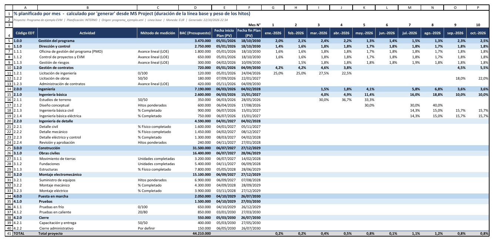
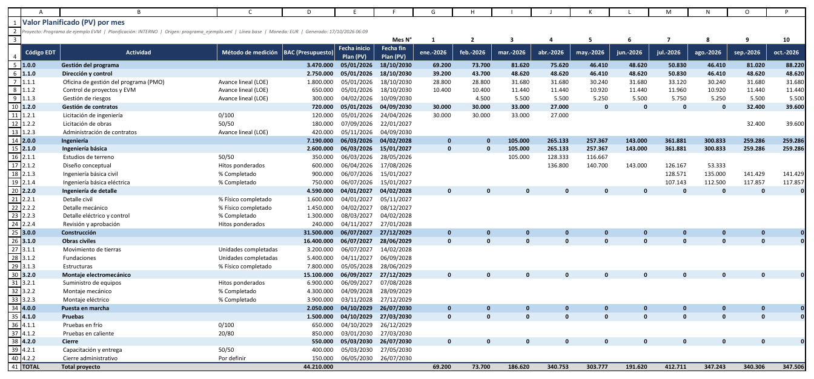
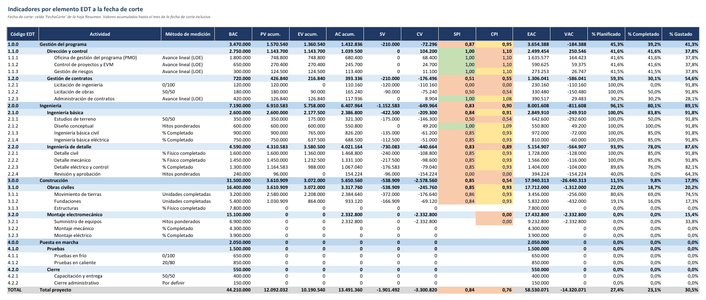
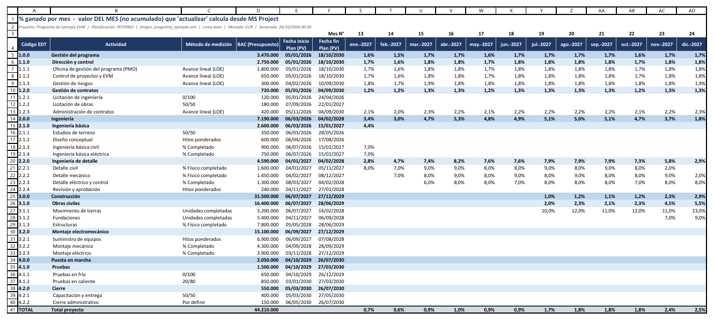

# Tutorial: ciclo completo con el proyecto de ejemplo

[Inicio](../README.md) › [Documentación](README.md) › Tutorial con el proyecto de ejemplo

El repositorio incluye un programa ficticio en formato XML de MS Project para probar el programa sin
MS Project. Este tutorial genera el libro, carga el BAC, simula 24 meses de avance y de costo real, y
recorre el resultado ([Cálculo del PV y el EV](calculo-pv-ev.md)). Las capturas del libro de la
documentación (`docs/img/excel`) se obtuvieron con estos pasos y sus variantes multi-empresa, con dos
archivos y con depuración de costes ([Desarrollo](desarrollo.md#4-documentación-e-imágenes)); las
imágenes de MS Project son esquemas.

---

## Contenido

1. [El proyecto de ejemplo](#1-el-proyecto-de-ejemplo)
2. [Configuración](#2-configuración)
3. [Generar el libro e ingresar el BAC](#3-generar-el-libro-e-ingresar-el-bac)
4. [Simular el avance y actualizar mes a mes](#4-simular-el-avance-y-actualizar-mes-a-mes)
5. [Revisar el resultado](#5-revisar-el-resultado)
6. [Pruebas adicionales](#6-pruebas-adicionales)

---

## 1. El proyecto de ejemplo

`ejemplos/programa_ejemplo.xml` es un programa ficticio de unos 5 años (desde enero de 2026) con dos
planificaciones, `INTERNO` y `CLIENTE` (esta con un presupuesto ficticio un 15 % mayor). Cada una tiene
4 elementos de nivel 1:

| Código | Elemento | Paquetes y métodos de medición |
|---|---|---|
| `1.0.0` | Gestión del programa | PMO, control de proyectos y riesgos (`Avance lineal (LOE)`); licitaciones (`0/100`, `50/50`). |
| `2.0.0` | Ingeniería | Estudios (`50/50`), diseño conceptual y revisión (`Hitos ponderados`), ingeniería básica y de detalle (`% Completado`, `% Físico completado`). |
| `3.0.0` | Construcción | Obras civiles (`Unidades completadas`, `% Físico completado`), suministro de equipos (`Hitos ponderados`), montaje (`% Completado`). |
| `4.0.0` | Puesta en marcha | Pruebas (`0/100`, `20/80`), capacitación (`50/50`) y un paquete sin método (`Por definir`). |

- Los códigos EDT son del tipo `1.0.0`, `1.1.0`, `1.1.1` y `1.1.1.1`, y están también en el campo
  personalizado `Item EDT`, el que indica `config.ejemplo.toml`.
- Los hitos de los paquetes y la reunión de arranque no tienen código EDT.
- El método está en el campo `Método EVM` (*Texto10*) y el peso de los hitos en `Peso hito`
  (*Número1*). En los paquetes de `Hitos ponderados` los pesos suman 100.
- Los campos `Empresa` y `% Reparto` permiten probar multi-empresa: gestión compartida 60/40,
  ingeniería de EmpresaA (salvo los estudios de terreno, de EmpresaB), construcción de EmpresaB y puesta
  en marcha compartida al 50 %.
- El XML contiene también costos, que escribe el generador del ejemplo: el programa no los usa. El BAC y
  el AC se ingresan en el libro.

`ejemplos/generar_ejemplo.py` vuelve a crear el XML y, con `--fecha-estado`, genera una versión con
**avance simulado** a esa fecha: un atraso del 15 % y un sobrecosto del 8 % en todas las tareas. Con
`--libro`, además escribe en el libro los datos ficticios que en un proyecto real se ingresan a mano:

| Comando | Qué escribe en el libro |
|---|---|
| `generar_ejemplo.py --libro ejemplo.xlsx` | El **BAC** de cada fila, en las celdas de la columna D que están vacías: el presupuesto ficticio del paquete (en multi-empresa, el de cada empresa). Con depuración de costes, también una previsión ficticia en la hoja `PV-depuración`, si está vacía. |
| `generar_ejemplo.py --fecha-estado AAAA-MM-DD --salida avance.xml --libro ejemplo.xlsx` | Crea el XML con el avance a esa fecha y escribe el **AC** de ese mes: el costo real simulado acumulado menos el AC ya cargado en los meses anteriores, como si viniera del ERP. También el BAC de las filas que no lo tienen. |

> En la simulación las tareas avanzan como máximo hasta el 85 % (nunca se marcan terminadas) y los
> hitos se cumplen 20 días después de su fecha prevista. Por eso los paquetes `0/100` y algunos de
> `Hitos ponderados` muestran costo real sin valor ganado: es el comportamiento esperado de esos métodos
> cuando un paquete no termina.

---

## 2. Configuración

```powershell
copy config.ejemplo.toml config.toml
```

En `config.toml` se definen los campos de método y de peso de los hitos:

```toml
[campos]
edt = "Item EDT"
metodo = "Método EVM"
peso_hito = "Peso hito"
```

El resto de los valores del archivo de ejemplo se deja igual (`planificacion = "INTERNO"`,
`mes_inicio = "2026-01"`).

---

## 3. Generar el libro e ingresar el BAC

Antes de generar el libro se puede revisar el archivo de MS Project, sin crear ningún archivo
([`validar`](comandos.md#validar-revisa-el-archivo-de-ms-project)):

```powershell
python evm_export.py validar --origen ejemplos\programa_ejemplo.xml --config config.toml
```

En el ejemplo no hay errores: informa las mismas advertencias de método que `generar` (más abajo) y que el
cronograma no tiene vínculos entre tareas. Luego se genera el libro:

```powershell
python evm_export.py generar --origen ejemplos\programa_ejemplo.xml --config config.toml --salida ejemplo.xlsx
```

```text
Exportador EVM 2.4.0
Leyendo ejemplos\programa_ejemplo.xml ...
Proyecto: Programa de ejemplo EVM
  Planificación: INTERNO
  Línea base  |  PV: % planificado de MS Project (duración de la línea base de las tareas y peso de los hitos) × BAC ingresado en el libro
  Filas EDT: 36 (24 de ingreso)  |  Nivel máximo: 3
  Horizonte: 01/2026 a 12/2035 (120 meses)
  BAC: se debe ingresar el BAC de cada fila en la columna D de PV (celdas amarillas).
  [i] LIB-001 El PV y el EV de cada fila son el BAC × el % planificado y el % ganado (hojas % PV y % EV), ...
  [i] EDT-017 INTERNO Planificación interna: Planificación 'INTERNO': se exportan las 51 tareas que dependen de 'Planificación interna'.
  [i] EDT-020 Se omitió 1 tarea sin código EDT que no depende de ningún elemento EDT: no forma parte de ninguna fila del libro.
  [i] EDT-022 14 tareas sin código EDT o de nivel EDT mayor a 3 se agregaron en su elemento EDT superior.
  [i] MET-005 1 fila sin método de medición definido (columna C).
  [!] MET-004 1.2.1 Licitación de ingeniería: Método 0/100 en un paquete de 3,6 meses (línea base), más de 1: el EV queda en 0 hasta que termina. ...
  [!] MET-004 1.2.2 Licitación de obras: Método 50/50 en un paquete de 4,5 meses (línea base), más de 2: ...
  [!] MET-004 2.1.1 Estudios de terreno: Método 50/50 en un paquete de 2,7 meses (línea base), más de 2: ...
  [!] MET-004 4.1.1 Pruebas en frío: Método 0/100 en un paquete de 2,7 meses (línea base), más de 1: ...
  [!] MET-004 4.1.2 Pruebas en caliente: Método 20/80 en un paquete de 2,7 meses (línea base), más de 2: ...
  [!] MET-004 4.2.1 Capacitación y entrega: Método 50/50 en un paquete de 2,7 meses (línea base), más de 2: ...
Libro generado: ...\ejemplo.xlsx
```

Las observaciones son las esperadas: la reunión de arranque no tiene código EDT, las subtareas y los
hitos sin código se suman en su paquete, y `4.2.2 Cierre administrativo` no tiene método. Las
advertencias indican que seis paquetes con `0/100` o con fórmula fija (`50/50`, `20/80`) duran más de lo
recomendado para esos métodos (1 y 2 meses): su EV queda en 0, o en el % inicial, hasta que terminan. El
ejemplo los mantiene para mostrar cada método; en un proyecto real conviene dividir esos paquetes o
usar un método de avance ([Validaciones](validaciones-y-problemas.md#11-datos-del-libro-generar-y-validar)).

La hoja `% PV` tiene el % planificado de cada paquete y mes, calculado con la duración de la línea base
de sus tareas y el peso de sus hitos:



En un proyecto real, ahora se escribe el **BAC** de cada paquete en las celdas amarillas de la columna D
de la hoja `PV`. En el tutorial se escribe el presupuesto ficticio del ejemplo:

```powershell
python ejemplos\generar_ejemplo.py --libro ejemplo.xlsx
```

```text
Libro ejemplo.xlsx: BAC escrito en 24 celdas.
```

Cada mes de la hoja `PV` es el BAC × el % planificado:



---

## 4. Simular el avance y actualizar mes a mes

Para un mes:

```powershell
python ejemplos\generar_ejemplo.py --fecha-estado 2026-01-31 --salida avance.xml --libro ejemplo.xlsx
python evm_export.py actualizar --origen avance.xml --config config.toml --libro ejemplo.xlsx
```

El primer comando crea el XML con el avance a esa fecha y escribe en la hoja `AC` el costo real
simulado del mes (en un proyecto real, se ingresa a mano); el segundo calcula el % ganado de cada
paquete y lo escribe en la hoja `% EV`.

Para simular 24 cierres mensuales seguidos (enero de 2026 a diciembre de 2027), en PowerShell:

```powershell
foreach ($m in 1..24) {
    $fecha = (Get-Date -Year 2026 -Month 1 -Day 1).AddMonths($m).AddDays(-1).ToString("yyyy-MM-dd")
    python ejemplos\generar_ejemplo.py --fecha-estado $fecha --salida avance.xml --libro ejemplo.xlsx
    python evm_export.py actualizar --origen avance.xml --config config.toml --libro ejemplo.xlsx --sin-respaldo
}
```

Cada `actualizar` usa como fecha de corte la fecha de estado del XML (último día del mes), calcula el %
ganado acumulado y escribe la diferencia en el mes correspondiente. Como la simulación no completa la
hoja `Análisis de desviaciones`, cada mes avisa de los paquetes del mes anterior que quedaron sin
analizar ([ACT-044](codigos.md#act-044)); en un proyecto real, ese análisis se completa antes del cierre
siguiente. Al final de cada ejecución muestra los indicadores; el último mes:

```text
Fecha de corte: 31/12/2027 (mes 24 del horizonte)
...
BAC (EUR)              44.210.000
PV acumulado             12.092.032   % planificado 27,4 %
EV acumulado             10.190.540   % completado  23,1 %
AC acumulado             13.491.360   % gastado     30,5 %
SV = EV - PV             -1.901.492   SPI = 0,84
CV = EV - AC             -3.300.820   CPI = 0,76
EAC = BAC/CPI            58.530.071   VAC = -14.320.071
TCPI                           1,11
ES (meses)                    22,56   AT = 24  SV(t) = -1,44  SPI(t) = 0,94
Últimos 3 meses                CPI = 0,58  SPI = 0,84
Mes anterior                   CPI = 0,78  SPI = 0,85  EAC = 56.398.662  (variación del EAC: +2.131.409)

Plazo según MS Project: fin de línea base 18/10/2030  |  fin previsto 09/12/2030 (desvío +36 días laborables)
  Paquetes críticos sin terminar: 5 (5 con fin atrasado)
```

El CPI de los últimos 3 meses (0,58) es mucho menor que el acumulado (0,76): el sobrecosto se acelera, y
el EAC subió 2,1 millones respecto de noviembre. El cronograma vigente del ejemplo termina 36 días
laborables después de la línea base, con 5 paquetes críticos atrasados: el atraso afecta la fecha de
fin.

En los dos últimos meses, con más del 20 % completado, `actualizar` avisa además que el EAC es poco
realista ([ACT-048](codigos.md#act-048)): terminar dentro del BAC exige un TCPI de 1,11 frente al CPI de
0,76 logrado hasta ahora.

> `--sin-respaldo` evita crear 24 copias de respaldo durante la prueba. En el uso real conviene
> conservar el respaldo.

---

## 5. Revisar el resultado

Al abrir `ejemplo.xlsx` en Excel, el `Cuadro de Mando` muestra diciembre de 2027:


Puntos para observar (detalle en [Cuadro de Mando e indicadores](cuadro-de-mando.md)):

1. **Curva S:** EV por debajo de PV (atraso) y AC por encima de EV (sobrecosto).
2. **CPI y SPI:** en los primeros meses oscilan mucho porque los importes son pequeños; desde septiembre
   de 2026 se estabilizan cerca de 0,91 y 0,84. El CPI cae al final de 2027, cuando comienza el
   suministro de equipos: tiene costo real, pero sus hitos (con pesos 40 y 60) todavía no se cumplieron,
   y su PV está en los meses de esos hitos.
3. **CPI vs SPI por elemento:** `1.1.0 Dirección y control` (LOE) está en SPI = 1, porque el LOE no
   genera variación de cronograma; `3.0.0 Construcción` tiene un CPI de 0,54 por el suministro de
   equipos.
4. **Indicadores EDT:** identifica los paquetes que explican la desviación.
5. **Análisis de desviaciones:** lista los 17 paquetes fuera del rango verde en diciembre de 2027: los
   atrasados y con sobrecosto, y también los que tienen CPI mayor que 1,05 (por ejemplo, los de nivel
   de esfuerzo, cuyo costo real es menor que el planificado). Tiene columnas
   para explicar cada uno ([Análisis de desviaciones](analisis-desviaciones.md)).



La hoja `% EV` muestra el % ganado de cada paquete en cada mes; la hoja `EV`, ese % × el BAC:



---

## 6. Pruebas adicionales

**Ver un mes anterior.** En la celda amarilla `E5` del `Cuadro de Mando` se elige, por ejemplo,
junio de 2027.

**Cambiar el método EAC.** En la celda amarilla `R5` se elige `AC + (BAC - EV) / (CPI × SPI)`.

**Cambiar el BAC de un paquete.** En la hoja `PV` se cambia el BAC de un paquete (por ejemplo, de
`2.2.1 Detalle civil`): el PV y el EV de todos sus meses se recalculan al instante.

**Cambiar el método de un paquete.** En la hoja `PV` se cambia el método de `4.2.2 Cierre
administrativo` o de `1.2.1 Licitación de ingeniería` (por ejemplo, de `0/100` a `% Completado`), se
guarda el libro y se repite `actualizar` para el último mes. Con `--simular` se ve el nuevo EV de la
fila sin modificar el libro; sin esa opción, el valor de ese mes se reemplaza con el nuevo cálculo.

```powershell
python ejemplos\generar_ejemplo.py --fecha-estado 2027-12-31 --salida avance.xml
python evm_export.py actualizar --origen avance.xml --config config.toml --libro ejemplo.xlsx --simular
```

**Regenerar con historial.** Simula un cambio de línea base conservando el BAC, el % ganado y el AC
cargados:

```powershell
python evm_export.py generar --origen ejemplos\programa_ejemplo.xml --config config.toml --salida ejemplo_lb2.xlsx --migrar-desde ejemplo.xlsx
```

**Planificación del cliente.** Con `--planificacion CLIENTE` se genera el libro de la otra
planificación.

**Multi-empresa.** En `config.toml` se indica `activar = true` en `[multiempresa]`, se genera un libro
nuevo y se repiten los pasos: `generar_ejemplo.py --libro` escribe el BAC y el AC de cada empresa. Ver
[Multi-empresa](multiempresa.md).

**Dos archivos de MS Project.** El segundo proyecto de ejemplo (`ejemplos\proyecto2_ejemplo.xml`, código
EDT `9.0.0`) se combina con el programa de ejemplo en un mismo libro. Ver el ejemplo de
[Varios archivos](varios-archivos.md#9-ejemplo-con-dos-archivos).

**Fichas de tareas.** Este comando crea el documento Markdown con la ficha de cada elemento EDT
([`generar-fichas`](comandos.md#generar-fichas-fichas-de-tareas-para-el-cliente)). El proyecto de
ejemplo no tiene vínculos entre tareas: las fichas no muestran predecesoras ni sucesoras.

```powershell
python evm_export.py generar-fichas --origen ejemplos\programa_ejemplo.xml --config config.toml --salida ejemplo_fichas.md
```

Los archivos `config.toml`, `*.xlsx`, `*_fichas.md` y los XML de la carpeta raíz no se suben al repositorio (están en
`.gitignore`).
