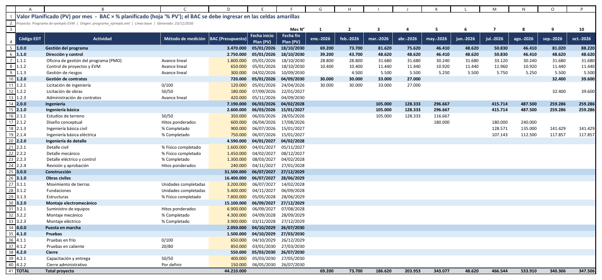
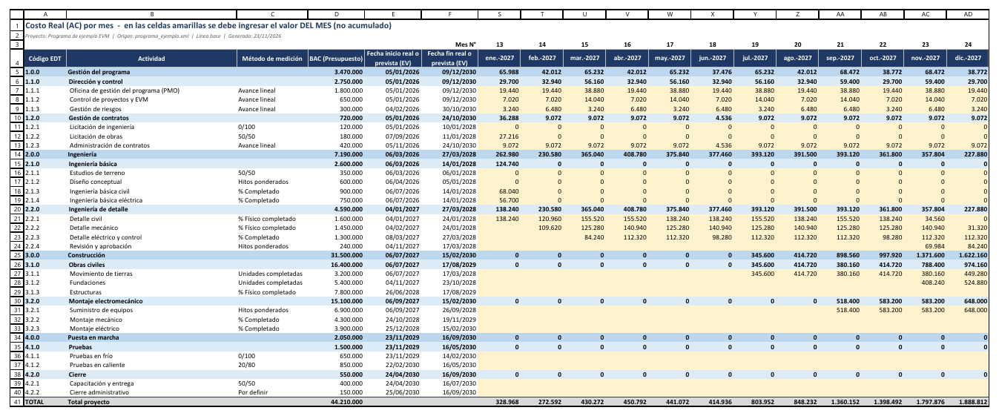
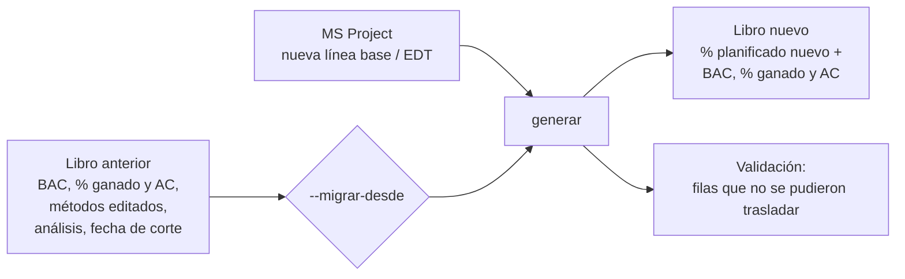
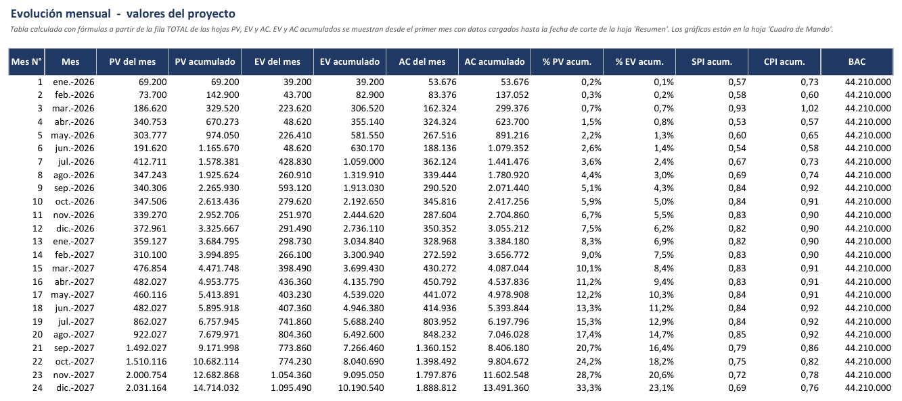
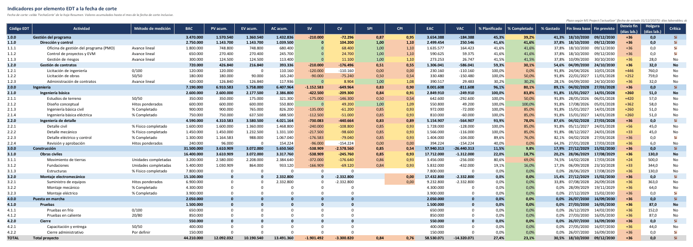
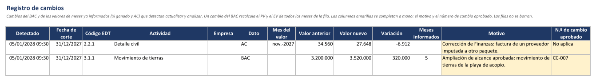
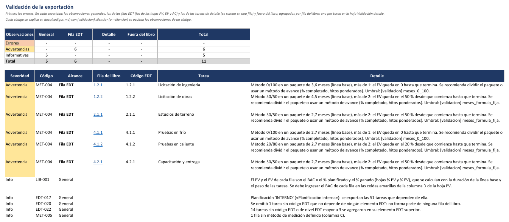
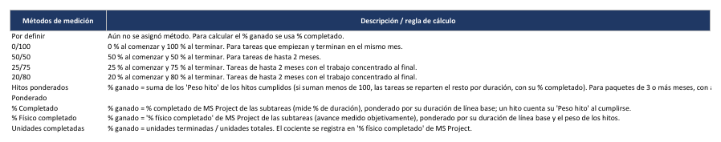

# El libro Excel

[Inicio](../README.md) › [Documentación](README.md) › El libro Excel

`generar` crea un libro `.xlsx` con el % planificado de cada mes para cada elemento de la EDT, hojas
para ingresar el BAC y el AC, y hojas de indicadores y gráficos calculados con fórmulas de Excel.
`actualizar` carga cada mes el % ganado en ese mismo libro.

El BAC de cada fila se ingresa en la hoja `PV`, el PV y el EV son el BAC × el % de las hojas `% PV` y
`% EV`, y el AC se carga a mano en la hoja `AC`
([Cálculo del PV y el EV](calculo-pv-ev.md#11-hojas-del-libro)).

---

## Contenido

1. [Hojas del libro](#1-hojas-del-libro)
2. [Hojas PV, EV y AC](#2-hojas-pv-ev-y-ac)
3. [Reglas de uso](#3-reglas-de-uso)
4. [Cambios de línea base o de EDT (`--migrar-desde`)](#4-cambios-de-línea-base-o-de-edt---migrar-desde)
5. [Hojas de cálculo y control](#5-hojas-de-cálculo-y-control)
6. [Formato del libro y versiones anteriores](#6-formato-del-libro-y-versiones-anteriores)

---

## 1. Hojas del libro

| Hoja | Contenido |
|---|---|
| **Cuadro de Mando** | Tablero del mes de reporte: valores acumulados, desviaciones, índices con sus rangos admisibles, pronósticos y tres gráficos. Ver [Cuadro de Mando e indicadores](cuadro-de-mando.md). |
| **Resumen** | Fecha de corte (celda amarilla `B5`, con nombre `FechaCorte`), parámetros de la exportación e indicadores del proyecto a la fecha de corte, incluidos el Earned Schedule, la tendencia (últimos 3 meses y mes anterior) y el plazo según el cronograma de MS Project. |
| **PV** | Valor planificado: columnas A–F con la EDT y el BAC, y una columna por mes. El BAC se ingresa en la columna D (celdas amarillas) y cada mes es el BAC × el % planificado. |
| **% PV** | % planificado de cada mes, que calcula `generar` desde MS Project. |
| **EV** | Valor ganado de cada mes: el BAC × el % ganado. |
| **% EV** | % ganado de cada mes, que calcula `actualizar`. Con `generar --ev-rellenar` (o `[exportacion] ev_historico = true`; desactivado por defecto), si el archivo de MS Project ya tiene avance y fecha de estado, `generar` carga el de los meses hasta la fecha de estado ([Cálculo del PV y el EV](calculo-pv-ev.md#7-del--acumulado-al--del-mes)). |
| **AC** | Coste real de cada mes (celdas amarillas), que se ingresa a mano. |
| **PV-EmpresaA**, **% PV-EmpresaA**, **EV-EmpresaA**, **% EV-EmpresaA**, **AC-EmpresaA** y las de EmpresaB | Solo en multi-empresa: valores de cada empresa, en lugar de las hojas `% PV` y `% EV`. Las hojas `PV`, `EV` y `AC` son la suma de las dos ([Multi-empresa](multiempresa.md)). |
| **Evolución mensual** | Tabla mensual del proyecto (datos de la curva S). |
| **Indicadores EDT** | Indicadores de cada elemento de la EDT a la fecha de corte y su plazo según el cronograma de MS Project (fin previsto, desvío de fin, holgura y camino crítico). |
| **Análisis de desviaciones** | Paquetes fuera de umbral de cada mes, con causa, impacto, acción correctiva, responsable y fecha ([Análisis de desviaciones](analisis-desviaciones.md)). |
| **Registro de cambios** | Cambios del BAC y de los valores de meses ya informados (% ganado y AC) que detectan `actualizar` y `analizar`, con columnas amarillas para el motivo y el número de cambio aprobado ([Registro de cambios](#registro-de-cambios)). |
| **Validación** | Observaciones de la exportación (errores, advertencias e informativas) con su código, por prioridad: primero las generales y las de las filas EDT; las de las tareas de detalle, agrupadas por fila ([Validaciones](validaciones-y-problemas.md#1-validaciones)). |
| **Validación detalle** | Todas las observaciones, una por tarea, en el mismo orden. |
| **Listas** | Métodos de medición del desplegable de la columna C y su regla de cálculo. |
| **Depuración costes** y **PV-depuración** | Solo con `depuracion_costes = true`: gráfico comparativo y previsión pegada del plan de costes de una empresa; la hoja PV de esa empresa lleva una fila «(coste)» debajo de cada fila, y en las demás hojas esas filas quedan vacías y ocultas ([Depuración de costes](depuracion-costes.md)). |
| `_graficos`, `_estructura`, `_meta`, `_registro` (y `_depuracion`, `_lista_edt`) | Hojas ocultas con los datos de los gráficos, los datos que usan `actualizar` y `--migrar-desde`, la referencia del registro de cambios (los valores de la última ejecución), con depuración de costes, la asignación de la previsión pegada y, con `lista_edt`, la lista EDT con que se generó el libro. **No se deben modificar.** |

---

## 2. Hojas PV, EV y AC

Las tres hojas tienen la misma estructura. El título de la hoja `PV` (y de `PV-EmpresaA` y `PV-EmpresaB`)
indica **Línea base (PMB - Performance Measurement Baseline)**: el PV mensual es la línea base de medida
del rendimiento contra la que se compara el EV.

| Columna | Contenido |
|---|---|
| A | Código EDT (`1.0.0`, `1.1.0`, `1.2.3`...). |
| B | Actividad (nombre de la tarea). |
| C | Método de medición (lista desplegable; solo se edita en la hoja `PV`). |
| D | BAC: presupuesto de la fila. Se ingresa a mano en la hoja `PV` (en multi-empresa, en `PV-EmpresaA` y `PV-EmpresaB`), en las celdas amarillas; las demás hojas lo toman de allí. |
| E | Hojas `PV` y `% PV`: **Fecha inicio Plan (PV)**, comienzo más temprano de la línea base de las tareas que forman el % planificado de la fila: las de detalle con línea base, o la tarea desglosada después en subtareas sin línea base (si ninguna tarea de la fila tiene línea base, la fila no tiene % planificado ni estas fechas, salvo con `generar --pv-fechas-actuales`, que usa sus fechas actuales; [tareas sin línea base](calculo-pv-ev.md#tareas-sin-línea-base-retrabajo-y-trabajo-no-previsto)); en una fila subtotal, el de sus filas. Hojas `EV`, `% EV` y `AC`: **Fecha inicio real o prevista (EV)**, *Comienzo real* más temprano de las tareas de detalle que forman el % ganado de la fila; si ninguna comenzó, el comienzo previsto más temprano. Una vez comenzado el trabajo, queda fija. |
| F | Hojas `PV` y `% PV`: **Fecha fin Plan (PV)**, fin más tardío de esas mismas tareas. Las dos fechas coinciden con los meses del % planificado, aunque la línea base de la tarea resumen no esté resumida (en MS Project la tarea resumen muestra otras fechas de línea base: [FEC-013](codigos.md#fec-013)) o la rama tenga tareas con `Peso` = 0. Hojas `EV`, `% EV` y `AC`: **Fecha fin real o prevista (EV)**, fin más tardío de esas tareas según la columna *Fin* de MS Project: el *Fin real* de las terminadas y el fin previsto de las demás (el mismo *Fin previsto* de la hoja `Indicadores EDT`). Todas las filas tienen las dos fechas, como una tarea resumen de MS Project. |
| G ... DV | Un mes por columna, del mes 1 al último mes del horizonte (`meses`; con 120, el valor por defecto, hasta la columna DV). Fila 3: número de mes; fila 4: fecha del mes. |
| Al final | Columna **Total horizonte** (en la hoja `PV`, en rojo si no coincide con el BAC) y fila **TOTAL**. |

Las fechas de las columnas E y F de las hojas `EV`, `% EV` y `AC` se leen de MS Project en cada `generar`
y `actualizar` (las de la última lectura): el inicio pasa de previsto a real cuando comienza el trabajo y
el fin es el previsto hasta que terminan todas las tareas de la fila. La hoja `EV` tiene los valores; las hojas `% EV` y `AC` (y las
de cada empresa) los toman de ella.



*Hoja `PV`: las filas de nivel 1 y 2 (fondo azul) son subtotales; las de nivel 3 son paquetes de
trabajo, con el BAC ingresado en la columna D.*

Las **celdas amarillas** son de ingreso: el BAC de la hoja `PV` y el AC del mes de la hoja `AC` (en
multi-empresa, los de las hojas de cada empresa). Las hojas `% PV` y `% EV` las calcula el programa desde
MS Project.

El **color de fondo** de cada fila depende del nivel de su código EDT, sea un subtotal o un paquete de
trabajo: azul oscuro el nivel 1, azul claro el nivel 2 y sin fondo los niveles siguientes y las filas
`-D`. Así, `2.7.0` y `2.8.0` tienen el mismo color aunque de una cuelguen actividades con fila propia y
de la otra no. Los subtotales van en **negrita**. Las celdas amarillas conservan su color. El mismo
criterio se usa en las hojas `% PV`, `% EV`, `EV`, `AC` e `Indicadores EDT`.

Los valores mensuales son el **valor del mes**, no el acumulado.



*Hoja `AC` con los meses 13 a 24 del ejemplo (los meses 1 a 12 están ocultos en la imagen).*

---

## 3. Reglas de uso

- Las **filas con subelementos** (las de nivel 1 y 2 y, si el campo `Visible` o la lista EDT agregan
  detalle, también otras) son **subtotales** (fórmulas `SUM` de sus hijos). Los valores se ingresan solo
  en las filas sin subelementos: paquetes de trabajo y filas `-D`.
- Las filas se pueden **contraer por nivel** con los botones de esquema (1, 2, 3) a la izquierda.
- Las hojas de resultados y de datos (`Cuadro de Mando`, `Resumen`, `PV`, `EV`, `AC`, `% PV`, `Indicadores EDT`,
  `Evolución mensual` y las ocultas) están **protegidas sin contraseña**: solo se pueden editar las celdas de
  ingreso (amarillas o con lista desplegable). Se pueden filtrar, ordenar y cambiar el ancho de columnas. Para
  usar los botones de esquema o corregir otra celda, se desprotege la hoja (Revisar > Desproteger hoja) y se
  vuelve a proteger al terminar. `[exportacion] proteger_hojas = false` genera el libro sin protección
  ([Configuración](configuracion.md)).
- **No se deben insertar, eliminar ni ordenar filas o columnas** en `PV`, `% PV`, `EV`, `% EV`, `AC` ni
  en las hojas de cada empresa: `actualizar` ubica cada fila por su posición. Si los códigos EDT de la columna A no
  coinciden con los del libro generado, o si falta una hoja o se modificaron las hojas ocultas,
  `actualizar` se detiene sin modificar el libro. Para cambiar la EDT se modifica MS Project y se
  vuelve a generar el libro con `--migrar-desde`.
- No se debe escribir sobre las celdas con fórmulas (los meses de las hojas `PV` y `EV`, los subtotales,
  la fila TOTAL y, en multi-empresa, la suma de las empresas): `actualizar` informa las que perdieron su
  fórmula para restaurarlas.
- El **método de medición** se puede cambiar en la columna C de la hoja `PV`. Se pueden agregar métodos
  al final de la columna A de la hoja `Listas`, sin dejar filas vacías.
- Los gráficos no requieren ninguna acción: al ingresar el BAC o el AC, al cargar el % ganado, al
  cambiar la fecha de corte en `Resumen!B5` o el mes de reporte del `Cuadro de Mando`, Excel recalcula
  tablas y gráficos.
- `actualizar` vuelve a crear los gráficos del `Cuadro de Mando` (la biblioteca que escribe el libro no
  conserva gráficos). Por eso no se deben agregar gráficos ni imágenes propias en este libro; los
  gráficos adicionales se deben hacer en otro libro que lea estos datos.
- Las fórmulas se calculan al abrir el libro en Excel. En la vista protegida o en vistas previas de
  archivos, los indicadores pueden aparecer vacíos hasta habilitar la edición.
- El PV acumulado a la fecha de corte incluye **el mes completo** de esa fecha. Como fecha de corte se
  debe usar el **último día del mes** (o su último día laborable).
- `actualizar` guarda una **copia de respaldo** antes de modificar el libro
  (`<libro>.respaldo-AAAAMMDD-HHMMSS.xlsx`) y lo guarda primero en un archivo temporal, de modo que un
  error al guardar no daña el libro anterior. Si el libro está abierto en Excel, avisa antes de leer
  MS Project. Se recomienda conservar, además, una copia del libro de cada informe emitido.

---

## 4. Cambios de línea base o de EDT (`--migrar-desde`)

Cuando se aprueba una nueva línea base o cambia la EDT, se genera un libro nuevo y se traslada el
historial del libro anterior:

```powershell
python evm_export.py generar --origen "C:\Programa\Programa.mpp" --config config.toml `
    --salida EVM_Programa_LB2.xlsx --migrar-desde EVM_Programa.xlsx
```



Qué se traslada:

- El **BAC** ingresado, el **% ganado** de cada mes y el **AC** de cada fila, asociados por el
  ***Id. único*** de la tarea en MS Project (o por código EDT si el proyecto cambió de nombre), sin
  duplicarlos.
- Si una tarea quedó dentro de un paquete nuevo o de una fila `-D` (por ejemplo, al bajar `nivel_maximo`,
  al cambiar `ignorar_ceros_intermedios` o al poner `No` en el campo `Visible` de una tarea, o quitarle el
  `Sí`), su historial se suma a esa fila: el BAC y el AC se suman, y el % ganado se combina ponderado
  por el BAC de cada fila anterior.
- El **método** de la columna C se conserva solo si fue **editado en Excel**. Si el método cambió en
  MS Project, se usa el nuevo.
- El texto de la hoja `Análisis de desviaciones`
  ([Análisis de desviaciones](analisis-desviaciones.md#5-cambios-de-línea-base)).
- Las filas de la hoja `Registro de cambios` (también el motivo y el número de cambio) y la referencia con
  la que `actualizar` detecta los cambios siguientes, en las filas que se asocian una a una
  ([Registro de cambios](#registro-de-cambios)).
- La **fecha de corte** de la hoja `Resumen`.
- Con depuración de costes, el contenido de la hoja `PV-depuración` (el plan de costes y los recargos de
  la tabla `Recargos`), si el libro nuevo también depura la misma empresa
  ([Depuración de costes](depuracion-costes.md#9-ciclo-de-ajuste)).
- El % planificado no se traslada: el libro nuevo lo calcula con MS Project.

Lo que no se puede trasladar se informa como **Error** en `Validación` para cargarlo a mano: filas que
se dividieron en varias y tareas eliminadas. Tampoco se admite migrar entre un libro de una sola empresa
y uno multi-empresa, ni desde un libro anterior a la versión 2.7.1
([sección 6](#6-formato-del-libro-y-versiones-anteriores)).

Con varios archivos de MS Project, cada fila se asocia por el nombre del archivo y el *Id. único* de la
tarea; al agregar o quitar archivos, o al pasar de un solo archivo a varios, se aplica lo indicado en
[Varios archivos](varios-archivos.md#7-cambios-de-línea-base-y-de-archivos).

> El % planificado del libro nuevo corresponde a la nueva línea base: la curva PV de los meses ya
> informados cambia (el BAC trasladado se mantiene). Se recomienda conservar el libro anterior como
> registro de lo informado con la línea base previa y documentar la fecha y el motivo del cambio
> ([Proceso de reporte](proceso-reporte-evm.md#5-cambios-de-línea-base)).

---

## 5. Hojas de cálculo y control

### Evolución mensual

Tabla calculada con fórmulas a partir de la fila TOTAL de las hojas `PV`, `EV` y `AC`: PV, EV y AC del
mes y acumulados, % de avance, SPI y CPI acumulados y BAC. Un mes tiene EV cargado cuando `actualizar`
escribió su % ganado. EV y AC acumulados se muestran desde el primer mes con datos hasta la fecha de
corte; fuera de ese tramo aparecen como `#N/A` para que los gráficos no dibujen esos meses.



### Indicadores EDT

Para cada fila de la EDT, a la fecha de corte: BAC, PV, EV y AC acumulados, SV, CV, SPI, CPI, EAC, VAC
y porcentajes planificado, completado y gastado, con los colores de los rangos admisibles en SPI y CPI. Permite identificar qué
paquetes explican la desviación del proyecto. El EAC de cada fila es BAC / CPI; si la fila no tiene CPI
(sin AC cargado), es AC + (BAC − EV). No depende del método EAC elegido en el `Cuadro de Mando`.

Las columnas Q a U muestran el **plazo según el cronograma de MS Project**, con los datos de la última
lectura (`generar` o `actualizar`; la fila 3 indica cuál y su fecha de estado). Se calculan con las
tareas de detalle de cada fila, las mismas del % ganado:

| Columna | Contenido |
|---|---|
| Fin línea base | Fin de la última tarea según la línea base. |
| Fin previsto | Fin de la última tarea según el cronograma vigente (campo *Fin*; fin real si terminó). No es el campo *Fin previsto* de MS Project en español, que es el de la línea base. |
| Desvío fin (días lab.) | Días laborables entre los dos: > 0 = atraso. Se cuentan con el calendario del proyecto (leído del XML o del `.mpp`) y los `feriados` de la configuración. |
| Holgura (días lab.) | Menor holgura total de las tareas sin terminar, como la calcula MS Project. Negativa: la fecha de fin del proyecto está comprometida. |
| Crítica | `Sí` si alguna tarea sin terminar es crítica en MS Project, `No`, o `Terminado`. |

Las filas resumen y la fila TOTAL combinan sus filas. El desvío se marca en rojo si la fila es crítica o
tiene holgura negativa, y en amarillo si no lo es. Como el SPI compara valores y no fechas, estas
columnas indican si un atraso afecta la fecha de fin. Requieren que el cronograma esté actualizado a la
fecha de estado, con el trabajo pendiente reprogramado
([Proceso de reporte](proceso-reporte-evm.md#43-pasos-detallados)).



### Análisis de desviaciones

Paquetes de trabajo con SPI o CPI en amarillo o rojo (por debajo o por encima del rango verde) en el
mes de corte, que `actualizar` (o
`analizar`) agrega cada mes, con columnas amarillas para explicar cada desviación. El texto se conserva
al actualizar y con `--migrar-desde`. Ver [Análisis de desviaciones](analisis-desviaciones.md).

### Registro de cambios

Registro de los cambios de los datos ya informados, que pide la norma EIA-748
([Norma EIA-748-E](evaluacion-eia-748-e.md), guías 24 a 26). `actualizar` y `analizar` guardan al terminar
el BAC, el % ganado y el AC de cada fila hasta la fecha de corte (hoja oculta `_registro`) y, en la
ejecución siguiente, comparan el libro con esos valores:

| Cambio | Se registra | Aviso en pantalla |
|---|---|---|
| BAC de una fila | Sí. *Meses informados afectados* indica cuántos meses anteriores al mes de corte cambiaron su PV o su EV: el PV y el EV de cada mes son el BAC × el %, así que un BAC nuevo los recalcula (cambio retroactivo). | [ACT-036](codigos.md#act-036): advertencia si hay meses informados afectados. |
| % ganado o AC de un mes anterior al mes de corte (valor cambiado, borrado o cargado tarde) | Sí, con el mes del valor. | [ACT-037](codigos.md#act-037) |
| AC del último mes informado cargado después de `actualizar` | No: es la carga habitual del AC del mes. | — |

| Columna | Contenido |
|---|---|
| Detectado, Fecha de corte | Cuándo se detectó el cambio y la fecha de corte de esa ejecución. |
| Código EDT, Actividad, Empresa | Fila del libro (y empresa, en multi-empresa). |
| Dato, Mes del valor | `BAC`, `% ganado` o `AC`, y el mes del valor (vacío en el BAC). |
| Valor anterior, Valor nuevo, Variación | Valores de la ejecución anterior y de esta. |
| Meses informados afectados | En los cambios de BAC: meses anteriores al mes de corte con PV o EV. |
| **Motivo**, **N.º de cambio aprobado** | Celdas amarillas: se completan a mano. |



- Las filas no se borran: el registro es el historial de los cambios del libro. Se conservan con
  `--migrar-desde`.
- La primera ejecución (o la primera de un libro de una versión anterior) solo guarda la referencia
  ([ACT-038](codigos.md#act-038)); una fila nueva, también.
- `actualizar --simular` muestra los cambios sin registrarlos.
- Un cambio que no corresponde (por ejemplo, un valor modificado por error) se corrige restaurando el
  valor anterior en la hoja; la fila del registro queda como constancia, con el motivo.

### Validación

Advertencias y observaciones de la exportación. Arriba, un resumen con la cantidad de observaciones por
severidad y por alcance; debajo, la lista, con estas columnas:

| Columna | Contenido |
|---|---|
| Severidad | `Error`, `Advertencia` o `Info`. |
| Código | Código de la observación, explicado en [Códigos de errores y advertencias](codigos.md). |
| Alcance | `General` (el proyecto, la configuración o el libro), `Fila EDT` (una fila de las hojas `PV`, `EV` y `AC`: paquete de trabajo o tarea resumen), `Detalle` (tarea que se suma en una fila: de nivel mayor al máximo, fuera de la lista EDT o sin código EDT, también en la fila `-D`) o `Fuera del libro` (tarea que no forma parte de ninguna fila: omitida, inactiva, con `Peso` = 0 o de otra planificación). |
| Fila del libro | Código de la fila donde se ve o se suma la tarea, con un enlace a esa fila de la hoja `PV`. |
| Código EDT, Tarea | Código y nombre de la tarea (las tareas sin código, con su Id de MS Project). |
| Detalle | La observación. |
| Tema | Grupo de la observación (*Fechas y duración*, *Método de medición*...), para filtrar. |

Las observaciones van **por prioridad**: primero los errores, después las advertencias y las
informativas; en cada severidad, las generales, las de las filas EDT, las de las tareas de detalle y las
de fuera del libro. Conviene resolver primero las de las filas EDT, que son las que muestran las hojas
mensuales. Las de las tareas de detalle y de fuera del libro se **agrupan** en una línea por código y
fila del libro (por ejemplo, *Duración estimada: 12 tareas de detalle de la fila 2.7.1 (2.7.1.1,
2.7.1.3...)*); la hoja **Validación detalle** tiene todas las observaciones, una por tarea, en el mismo
orden y con las mismas columnas. Ver [Validaciones](validaciones-y-problemas.md#1-validaciones).

El comando `validar` muestra en pantalla las mismas observaciones, con el mismo criterio, y además las
del avance y la lógica del cronograma, sin crear el libro.



### Listas

Métodos de medición del desplegable de la columna C y su regla de cálculo.



---

## 6. Formato del libro y versiones anteriores

La hoja oculta `_meta` guarda el **formato del libro** (`formato_libro`): la estructura de sus hojas,
columnas y datos. La versión 2.7.1 introduce el formato 1. Desde entonces, una versión que cambie el
formato debe poder actualizar y migrar los libros de los formatos anteriores: las pruebas del programa
actualizan, analizan y migran un libro de referencia de cada formato
([Desarrollo](desarrollo.md#1-pruebas-automáticas)). `_meta` guarda también la configuración de cálculo con que se
generó el libro (`config.*`): `actualizar` avisa si cambió ([ACT-052](codigos.md#act-052)).

Los libros generados con versiones anteriores a la 2.7.1 (sin `formato_libro`) **no se admiten**:
`actualizar`, `analizar`, `procesar-costes` y `--migrar-desde` se detienen sin modificarlos
([LIB-018](codigos.md#lib-018)). Se debe generar un libro nuevo con `generar`, ingresar el BAC y cargar a mano
el historial que se necesite: el % ganado de cada mes en la hoja `% EV` y el AC en la hoja `AC`
([Cálculo del PV y el EV](calculo-pv-ev.md#7-del--acumulado-al--del-mes)). Un libro de una versión posterior,
con otro formato, tampoco se admite: se debe usar esa versión del programa.
