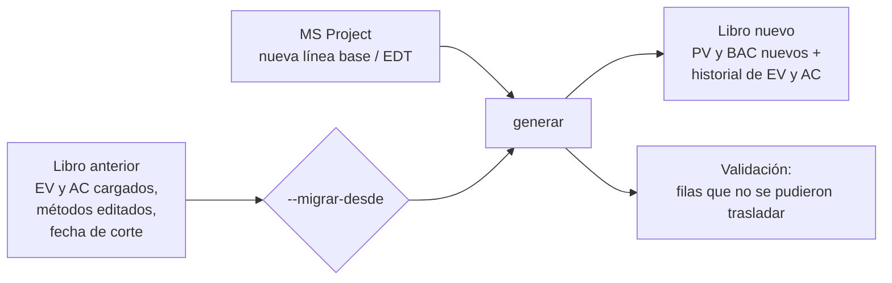

# El libro Excel

[Inicio](../README.md) › [Documentación](README.md) › El libro Excel

`generar` crea un libro `.xlsx` con el PV mensual de cada elemento de la EDT, hojas para cargar el EV y
el AC de cada mes, y hojas de indicadores y gráficos calculados con fórmulas de Excel. `actualizar`
carga el EV y el AC de cada mes en ese mismo libro.

---

## Contenido

1. [Hojas del libro](#1-hojas-del-libro)
2. [Hojas PV, EV y AC](#2-hojas-pv-ev-y-ac)
3. [Reglas de uso](#3-reglas-de-uso)
4. [Cambios de línea base o de EDT (`--migrar-desde`)](#4-cambios-de-línea-base-o-de-edt---migrar-desde)
5. [Hojas de cálculo y control](#5-hojas-de-cálculo-y-control)
6. [Libros de versiones anteriores](#6-libros-de-versiones-anteriores)

---

## 1. Hojas del libro

| Hoja | Contenido |
|---|---|
| **Cuadro de Mando** | Tablero del mes de reporte: valores acumulados, desviaciones, índices con semáforo, pronósticos y tres gráficos. Ver [Cuadro de Mando e indicadores](cuadro-de-mando.md). |
| **Resumen** | Fecha de corte (celda amarilla `B5`, con nombre `FechaCorte`), parámetros de la exportación e indicadores del proyecto a la fecha de corte, incluido el Cronograma Ganado. |
| **PV** | Valor planificado: columnas A–F con la EDT y el BAC, y una columna por mes. |
| **EV** | Valor ganado del mes (celdas amarillas). |
| **AC** | Costo real del mes (celdas amarillas). |
| **PV-EmpresaA**, **EV-EmpresaA**, **AC-EmpresaA** y las de EmpresaB | Solo en modo multi-empresa: valores de cada empresa. Las hojas `PV`, `EV` y `AC` son la suma de las dos ([Multi-empresa](multiempresa.md)). |
| **Evolución mensual** | Tabla mensual del proyecto (datos de la curva S). |
| **Indicadores EDT** | Indicadores de cada elemento de la EDT a la fecha de corte. |
| **Análisis de desviaciones** | Paquetes fuera de umbral de cada mes, con causa, impacto, acción correctiva, responsable y fecha ([Análisis de desviaciones](analisis-desviaciones.md)). |
| **Validación** | Advertencias de la exportación ([Validaciones](validaciones-y-problemas.md#1-validaciones)). |
| **Listas** | Métodos de medición del desplegable de la columna C y su regla de cálculo. |
| `_graficos`, `_estructura`, `_meta` | Hojas ocultas con los datos de los gráficos y los datos que usan `actualizar` y `--migrar-desde`. **No se deben modificar.** |

---

## 2. Hojas PV, EV y AC

Las tres hojas tienen la misma estructura:

| Columna | Contenido |
|---|---|
| A | Código EDT (`1.0.0`, `1.1.0`, `1.2.3`...). |
| B | Actividad (nombre de la tarea). |
| C | Método de medición (lista desplegable; solo se edita en la hoja `PV`). |
| D | BAC: presupuesto (costo de línea base). |
| E | Fecha inicio Plan (PV): inicio de la línea base. |
| F | Fecha fin Plan (PV): fin de la línea base. |
| G ... DV | Un mes por columna, del mes 1 al mes 120. Fila 3: número de mes; fila 4: fecha del mes. |
| Al final | Columna **Total horizonte** (en rojo si no coincide con el BAC) y fila **TOTAL**. |


*Hoja `PV`: las filas de nivel 1 y 2 (fondo azul) son subtotales; las de nivel 3 son paquetes de
trabajo.*

En las hojas `EV` y `AC` las **celdas amarillas** son de ingreso y contienen el **valor del mes**, no
el acumulado. `actualizar` las completa; también se pueden cargar a mano (por ejemplo, el AC del ERP).


*Hoja `AC` con los meses 13 a 24 del ejemplo (los meses 1 a 12 están ocultos en la imagen).*

---

## 3. Reglas de uso

- Las **filas de nivel 1 y 2** con subelementos son **subtotales** (fórmulas `SUM` de sus hijos). Los
  valores se ingresan solo en las filas de nivel 3 o en filas sin hijos.
- Las filas se pueden **contraer por nivel** con los botones de esquema (1, 2, 3) a la izquierda.
- **No se deben insertar, eliminar ni ordenar filas o columnas** en `PV`, `EV`, `AC` ni en las hojas de
  cada empresa: `actualizar` ubica cada fila por su posición. Si los códigos EDT de la columna A no
  coinciden con los del libro generado, o si falta una hoja o se modificaron las hojas ocultas,
  `actualizar` se detiene sin modificar el libro. Para cambiar la EDT se modifica MS Project y se
  vuelve a generar el libro con `--migrar-desde`.
- No se debe escribir sobre las celdas con fórmulas (subtotales, fila TOTAL o, en multi-empresa, la suma
  de las empresas): `actualizar` informa las que perdieron su fórmula para restaurarlas.
- El **método de medición** se puede cambiar en la columna C de la hoja `PV`. Se pueden agregar métodos
  al final de la columna A de la hoja `Listas`, sin dejar filas vacías.
- Los gráficos no requieren ninguna acción: al cargar valores en `EV` o `AC`, al cambiar la fecha de
  corte en `Resumen!B5` o el mes de reporte del `Cuadro de Mando`, Excel recalcula tablas y gráficos.
- `actualizar` vuelve a crear los gráficos del `Cuadro de Mando` (la biblioteca que escribe el libro no
  conserva gráficos). Por eso no se deben agregar gráficos ni imágenes propias en este libro; los
  gráficos adicionales se deben hacer en otro libro que lea estos datos.
- Las fórmulas se calculan al abrir el libro en Excel. En la vista protegida o en vistas previas de
  archivos, los indicadores pueden aparecer vacíos hasta habilitar la edición.
- El PV acumulado a la fecha de corte incluye **el mes completo** de esa fecha. Como fecha de corte se
  debe usar el **último día del mes**.
- `actualizar` guarda una **copia de respaldo** antes de modificar el libro
  (`<libro>.respaldo-AAAAMMDD-HHMMSS.xlsx`) y lo guarda primero en un archivo temporal, de modo que un
  error al guardar no daña el libro anterior. Si el libro está abierto en Excel, avisa antes de leer
  MS Project. Se recomienda conservar, además, una copia del libro de cada informe emitido.

---

## 4. Cambios de línea base o de EDT (`--migrar-desde`)

Cuando se aprueba una nueva línea base o cambia la EDT, se genera un libro nuevo y se traslada el
historial del libro anterior:

```powershell
python evm_export.py generar --origen "C:\Programa\Programa.mpp" --config config.toml `
    --salida EVM_Programa_LB2.xlsx --migrar-desde EVM_Programa.xlsx
```



Qué se traslada:

- Los **EV y AC** cargados en cada fila, asociados por el **UniqueID** de la tarea en MS Project (o por
  código EDT si el proyecto cambió de nombre), sin duplicarlos.
- Si una tarea quedó dentro de un paquete nuevo, su historial se suma a ese paquete.
- El **método** de la columna C se conserva solo si fue **editado en Excel**. Si el método cambió en
  MS Project, se usa el nuevo.
- La **fecha de corte** de la hoja `Resumen`.

Lo que no se puede trasladar se informa como **Error** en `Validación` para cargarlo a mano: filas que
se dividieron en varias y tareas eliminadas. Tampoco se admite migrar entre un libro de una sola empresa
y uno multi-empresa.

Con varios archivos de MS Project, cada fila se asocia por el nombre del archivo y el UniqueID de la
tarea; al agregar o quitar archivos, o al pasar de un solo archivo a varios, se aplica lo indicado en
[Varios archivos](varios-archivos.md#7-cambios-de-línea-base-y-de-archivos).

> El PV del libro nuevo corresponde a la nueva línea base: la curva PV de los meses ya informados
> cambia. Se recomienda conservar el libro anterior como registro de lo informado con la línea base
> previa y documentar la fecha y el motivo del cambio ([Proceso de reporte](proceso-reporte-evm.md#5-cambios-de-línea-base)).

---

## 5. Hojas de cálculo y control

### Evolución mensual

Tabla calculada con fórmulas a partir de la fila TOTAL de las hojas `PV`, `EV` y `AC`: PV, EV y AC del
mes y acumulados, % de avance, SPI y CPI acumulados y BAC. EV y AC acumulados se muestran desde el
primer mes con datos hasta la fecha de corte; después aparecen como `#N/A` para que los gráficos no
dibujen esos meses.


### Indicadores EDT

Para cada fila de la EDT, a la fecha de corte: BAC, PV, EV y AC acumulados, SV, CV, SPI, CPI, EAC, VAC
y porcentajes planificado, completado y gastado, con semáforo en SPI y CPI. Permite identificar qué
paquetes explican la desviación del proyecto.


### Análisis de desviaciones

Paquetes de trabajo con SPI o CPI en amarillo o rojo (por debajo o por encima del rango verde) en el
mes de corte, que `actualizar` (o
`analizar`) agrega cada mes, con columnas amarillas para explicar cada desviación. El texto se conserva
al actualizar y con `--migrar-desde`. Ver [Análisis de desviaciones](analisis-desviaciones.md).

### Validación

Advertencias y observaciones de la exportación, con su severidad (`Info`, `Advertencia`, `Error`), el
código EDT y la tarea afectada. Ver [Validaciones](validaciones-y-problemas.md#1-validaciones).


### Listas

Métodos de medición del desplegable de la columna C y su regla de cálculo.


---

## 6. Libros de versiones anteriores

Los libros generados con versiones anteriores a la 1.3.0 conservan su hoja `Curva S` y `actualizar`
sigue funcionando con ellos. Para obtener el `Cuadro de Mando` se debe generar un libro nuevo con
`--migrar-desde` (se conservan los EV y AC cargados).
