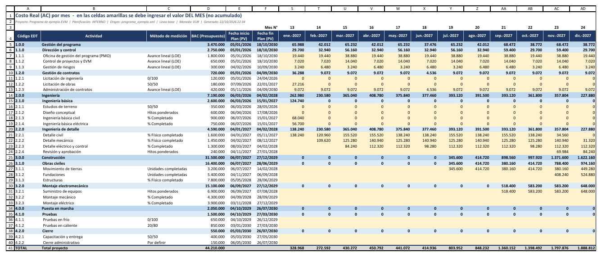
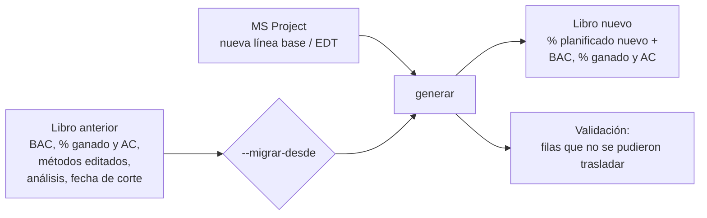
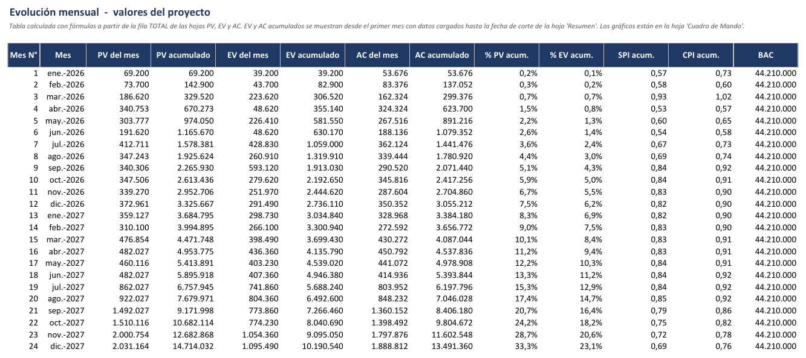
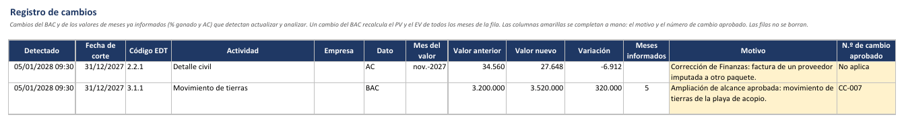
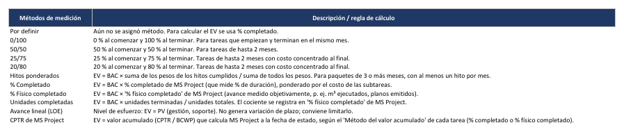

# El libro Excel

[Inicio](../README.md) › [Documentación](README.md) › El libro Excel

`generar` crea un libro `.xlsx` con el % planificado de cada mes para cada elemento de la EDT, hojas
para ingresar el BAC y el AC, y hojas de indicadores y gráficos calculados con fórmulas de Excel.
`actualizar` carga cada mes el % ganado en ese mismo libro.

El BAC de cada fila se ingresa en la hoja `PV`, el PV y el EV son el BAC × el % de las hojas `% PV` y
`% EV`, y el AC se carga a mano en la hoja `AC`
([Cálculo del PV y el EV](calculo-pv-ev.md#11-hojas-del-libro)).

---

## Contenido

1. [Hojas del libro](#1-hojas-del-libro)
2. [Hojas PV, EV y AC](#2-hojas-pv-ev-y-ac)
3. [Reglas de uso](#3-reglas-de-uso)
4. [Cambios de línea base o de EDT (`--migrar-desde`)](#4-cambios-de-línea-base-o-de-edt---migrar-desde)
5. [Hojas de cálculo y control](#5-hojas-de-cálculo-y-control)
6. [Libros de versiones anteriores](#6-libros-de-versiones-anteriores)

---

## 1. Hojas del libro

| Hoja | Contenido |
|---|---|
| **Cuadro de Mando** | Tablero del mes de reporte: valores acumulados, desviaciones, índices con semáforo, pronósticos y tres gráficos. Ver [Cuadro de Mando e indicadores](cuadro-de-mando.md). |
| **Resumen** | Fecha de corte (celda amarilla `B5`, con nombre `FechaCorte`), parámetros de la exportación e indicadores del proyecto a la fecha de corte, incluidos el Cronograma Ganado, la tendencia (últimos 3 meses y mes anterior) y el plazo según el cronograma de MS Project. |
| **PV** | Valor planificado: columnas A–F con la EDT y el BAC, y una columna por mes. El BAC se ingresa en la columna D (celdas amarillas) y cada mes es el BAC × el % planificado. |
| **% PV** | % planificado de cada mes, que calcula `generar`. |
| **EV** | Valor ganado de cada mes: el BAC × el % ganado. |
| **% EV** | % ganado de cada mes, que calcula `actualizar`. |
| **AC** | Costo real de cada mes (celdas amarillas), que se ingresa a mano. |
| **PV-EmpresaA**, **% PV-EmpresaA**, **EV-EmpresaA**, **% EV-EmpresaA**, **AC-EmpresaA** y las de EmpresaB | Solo en multi-empresa: valores de cada empresa, en lugar de las hojas `% PV` y `% EV`. Las hojas `PV`, `EV` y `AC` son la suma de las dos ([Multi-empresa](multiempresa.md)). |
| **Evolución mensual** | Tabla mensual del proyecto (datos de la curva S). |
| **Indicadores EDT** | Indicadores de cada elemento de la EDT a la fecha de corte y su plazo según el cronograma de MS Project (fin previsto, desvío de fin, holgura y camino crítico). |
| **Análisis de desviaciones** | Paquetes fuera de umbral de cada mes, con causa, impacto, acción correctiva, responsable y fecha ([Análisis de desviaciones](analisis-desviaciones.md)). |
| **Registro de cambios** | Cambios del BAC y de los valores de meses ya informados (% ganado y AC) que detectan `actualizar` y `analizar`, con columnas amarillas para el motivo y el número de cambio aprobado ([Registro de cambios](#registro-de-cambios)). |
| **Validación** | Advertencias de la exportación ([Validaciones](validaciones-y-problemas.md#1-validaciones)). |
| **Listas** | Métodos de medición del desplegable de la columna C y su regla de cálculo. |
| **Depuración costes** y **PV-depuración** | Solo con `depuracion_costes = true`: gráfico comparativo y previsión pegada del plan de costes de una empresa; la hoja PV de esa empresa lleva una fila «(coste)» debajo de cada fila, y en las demás hojas esas filas quedan vacías y ocultas ([Depuración de costes](depuracion-costes.md)). |
| `_graficos`, `_estructura`, `_meta`, `_registro` (y `_depuracion`, `_lista_edt`) | Hojas ocultas con los datos de los gráficos, los datos que usan `actualizar` y `--migrar-desde`, la referencia del registro de cambios (los valores de la última ejecución), con depuración de costes, la asignación de la previsión pegada y, con `lista_edt`, la lista EDT con que se generó el libro. **No se deben modificar.** |

---

## 2. Hojas PV, EV y AC

Las tres hojas tienen la misma estructura:

| Columna | Contenido |
|---|---|
| A | Código EDT (`1.0.0`, `1.1.0`, `1.2.3`...). |
| B | Actividad (nombre de la tarea). |
| C | Método de medición (lista desplegable; solo se edita en la hoja `PV`). |
| D | BAC: presupuesto de la fila. Se ingresa a mano en la hoja `PV` (en multi-empresa, en `PV-EmpresaA` y `PV-EmpresaB`), en las celdas amarillas; las demás hojas lo toman de allí. |
| E | Fecha inicio Plan (PV): inicio de la línea base. |
| F | Fecha fin Plan (PV): fin de la línea base. |
| G ... DV | Un mes por columna, del mes 1 al último mes del horizonte (`meses`; con 120, el valor por defecto, hasta la columna DV). Fila 3: número de mes; fila 4: fecha del mes. |
| Al final | Columna **Total horizonte** (en la hoja `PV`, en rojo si no coincide con el BAC) y fila **TOTAL**. |


*Hoja `PV`: las filas de nivel 1 y 2 (fondo azul) son subtotales; las de nivel 3 son paquetes de
trabajo, con el BAC ingresado en la columna D.*

Las **celdas amarillas** son de ingreso: el BAC de la hoja `PV` y el AC del mes de la hoja `AC` (en
multi-empresa, los de las hojas de cada empresa). Las hojas `% PV` y `% EV` las calcula el programa desde
MS Project.

Los valores mensuales son el **valor del mes**, no el acumulado.



*Hoja `AC` con los meses 13 a 24 del ejemplo (los meses 1 a 12 están ocultos en la imagen).*

---

## 3. Reglas de uso

- Las **filas con subelementos** (las de nivel 1 y 2 y, si el campo `Visible` agrega detalle, también
  otras) son **subtotales** (fórmulas `SUM` de sus hijos). Los valores se ingresan solo en las filas sin
  subelementos: paquetes de trabajo y filas `-D`.
- Las filas se pueden **contraer por nivel** con los botones de esquema (1, 2, 3) a la izquierda.
- **No se deben insertar, eliminar ni ordenar filas o columnas** en `PV`, `% PV`, `EV`, `% EV`, `AC` ni
  en las hojas de cada empresa: `actualizar` ubica cada fila por su posición. Si los códigos EDT de la columna A no
  coinciden con los del libro generado, o si falta una hoja o se modificaron las hojas ocultas,
  `actualizar` se detiene sin modificar el libro. Para cambiar la EDT se modifica MS Project y se
  vuelve a generar el libro con `--migrar-desde`.
- No se debe escribir sobre las celdas con fórmulas (los meses de las hojas `PV` y `EV`, los subtotales,
  la fila TOTAL y, en multi-empresa, la suma de las empresas): `actualizar` informa las que perdieron su
  fórmula para restaurarlas.
- El **método de medición** se puede cambiar en la columna C de la hoja `PV`. Se pueden agregar métodos
  al final de la columna A de la hoja `Listas`, sin dejar filas vacías.
- Los gráficos no requieren ninguna acción: al ingresar el BAC o el AC, al cargar el % ganado, al
  cambiar la fecha de corte en `Resumen!B5` o el mes de reporte del `Cuadro de Mando`, Excel recalcula
  tablas y gráficos.
- `actualizar` vuelve a crear los gráficos del `Cuadro de Mando` (la biblioteca que escribe el libro no
  conserva gráficos). Por eso no se deben agregar gráficos ni imágenes propias en este libro; los
  gráficos adicionales se deben hacer en otro libro que lea estos datos.
- Las fórmulas se calculan al abrir el libro en Excel. En la vista protegida o en vistas previas de
  archivos, los indicadores pueden aparecer vacíos hasta habilitar la edición.
- El PV acumulado a la fecha de corte incluye **el mes completo** de esa fecha. Como fecha de corte se
  debe usar el **último día del mes**.
- `actualizar` guarda una **copia de respaldo** antes de modificar el libro
  (`<libro>.respaldo-AAAAMMDD-HHMMSS.xlsx`) y lo guarda primero en un archivo temporal, de modo que un
  error al guardar no daña el libro anterior. Si el libro está abierto en Excel, avisa antes de leer
  MS Project. Se recomienda conservar, además, una copia del libro de cada informe emitido.

---

## 4. Cambios de línea base o de EDT (`--migrar-desde`)

Cuando se aprueba una nueva línea base o cambia la EDT, se genera un libro nuevo y se traslada el
historial del libro anterior:

```powershell
python evm_export.py generar --origen "C:\Programa\Programa.mpp" --config config.toml `
    --salida EVM_Programa_LB2.xlsx --migrar-desde EVM_Programa.xlsx
```



Qué se traslada:

- El **BAC** ingresado, el **% ganado** de cada mes y el **AC** de cada fila, asociados por el
  **UniqueID** de la tarea en MS Project (o por código EDT si el proyecto cambió de nombre), sin
  duplicarlos.
- Si una tarea quedó dentro de un paquete nuevo (por ejemplo, al bajar `nivel_maximo` o al poner `No` en
  el campo `Visible` de todas las subtareas de una tarea), su historial se suma a ese paquete: el BAC y
  el AC se suman, y el % ganado se combina ponderado por el BAC de cada fila anterior.
- El **método** de la columna C se conserva solo si fue **editado en Excel**. Si el método cambió en
  MS Project, se usa el nuevo.
- El texto de la hoja `Análisis de desviaciones`
  ([Análisis de desviaciones](analisis-desviaciones.md#5-cambios-de-línea-base)).
- Las filas de la hoja `Registro de cambios` (también el motivo y el número de cambio) y la referencia con
  la que `actualizar` detecta los cambios siguientes, en las filas que se asocian una a una
  ([Registro de cambios](#registro-de-cambios)).
- La **fecha de corte** de la hoja `Resumen`.
- Con depuración de costes, el contenido de la hoja `PV-depuración`, si el libro nuevo también depura la
  misma empresa ([Depuración de costes](depuracion-costes.md#8-ciclo-de-ajuste)).

Lo que no se puede trasladar se informa como **Error** en `Validación` para cargarlo a mano: filas que
se dividieron en varias y tareas eliminadas. Tampoco se admite migrar entre un libro de una sola empresa
y uno multi-empresa, ni desde un libro de versiones anteriores
([sección 6](#6-libros-de-versiones-anteriores)).

Con varios archivos de MS Project, cada fila se asocia por el nombre del archivo y el UniqueID de la
tarea; al agregar o quitar archivos, o al pasar de un solo archivo a varios, se aplica lo indicado en
[Varios archivos](varios-archivos.md#7-cambios-de-línea-base-y-de-archivos).

> El % planificado del libro nuevo corresponde a la nueva línea base: la curva PV de los meses ya
> informados cambia (el BAC trasladado se mantiene). Se recomienda conservar el libro anterior como
> registro de lo informado con la línea base previa y documentar la fecha y el motivo del cambio
> ([Proceso de reporte](proceso-reporte-evm.md#5-cambios-de-línea-base)).

---

## 5. Hojas de cálculo y control

### Evolución mensual

Tabla calculada con fórmulas a partir de la fila TOTAL de las hojas `PV`, `EV` y `AC`: PV, EV y AC del
mes y acumulados, % de avance, SPI y CPI acumulados y BAC. Un mes tiene EV cargado cuando `actualizar`
escribió su % ganado. EV y AC acumulados se muestran desde el primer mes con datos hasta la fecha de
corte; fuera de ese tramo aparecen como `#N/A` para que los gráficos no dibujen esos meses.



### Indicadores EDT

Para cada fila de la EDT, a la fecha de corte: BAC, PV, EV y AC acumulados, SV, CV, SPI, CPI, EAC, VAC
y porcentajes planificado, completado y gastado, con semáforo en SPI y CPI. Permite identificar qué
paquetes explican la desviación del proyecto. El EAC de cada fila es BAC / CPI; si la fila no tiene CPI
(sin AC cargado), es AC + (BAC − EV). No depende del método EAC elegido en el `Cuadro de Mando`.

Las columnas Q a U muestran el **plazo según el cronograma de MS Project**, con los datos de la última
lectura (`generar` o `actualizar`; la fila 3 indica cuál y su fecha de estado). Se calculan con las
tareas de detalle de cada fila, las mismas del % ganado:

| Columna | Contenido |
|---|---|
| Fin línea base | Fin de la última tarea según la línea base. |
| Fin previsto | Fin de la última tarea según el cronograma vigente (fin real si terminó). |
| Desvío fin (días lab.) | Días laborables entre los dos: > 0 = atraso. Con XML se cuentan con el calendario del proyecto; con `.mpp`, de lunes a viernes con los `feriados` de la configuración. |
| Holgura (días lab.) | Menor holgura total de las tareas sin terminar, como la calcula MS Project. Negativa: la fecha de fin del proyecto está comprometida. |
| Crítica | `Sí` si alguna tarea sin terminar es crítica en MS Project, `No`, o `Terminado`. |

Las filas resumen y la fila TOTAL combinan sus filas. El desvío se marca en rojo si la fila es crítica o
tiene holgura negativa, y en amarillo si no lo es. Como el SPI compara valores y no fechas, estas
columnas indican si un atraso afecta la fecha de fin. Requieren que el cronograma esté actualizado a la
fecha de estado, con el trabajo pendiente reprogramado
([Proceso de reporte](proceso-reporte-evm.md#43-pasos-detallados)).


### Análisis de desviaciones

Paquetes de trabajo con SPI o CPI en amarillo o rojo (por debajo o por encima del rango verde) en el
mes de corte, que `actualizar` (o
`analizar`) agrega cada mes, con columnas amarillas para explicar cada desviación. El texto se conserva
al actualizar y con `--migrar-desde`. Ver [Análisis de desviaciones](analisis-desviaciones.md).

### Registro de cambios

Registro de los cambios de los datos ya informados, que pide la norma EIA-748
([Norma EIA-748-E](evaluacion-eia-748-e.md), guías 24 a 26). `actualizar` y `analizar` guardan al terminar
el BAC, el % ganado y el AC de cada fila hasta la fecha de corte (hoja oculta `_registro`) y, en la
ejecución siguiente, comparan el libro con esos valores:

| Cambio | Se registra | Aviso en pantalla |
|---|---|---|
| BAC de una fila | Sí. *Meses informados afectados* indica cuántos meses anteriores al mes de corte cambiaron su PV o su EV: el PV y el EV de cada mes son el BAC × el %, así que un BAC nuevo los recalcula (cambio retroactivo). | [ACT-036](codigos.md#act-036): advertencia si hay meses informados afectados. |
| % ganado o AC de un mes anterior al mes de corte (valor cambiado, borrado o cargado tarde) | Sí, con el mes del valor. | [ACT-037](codigos.md#act-037) |
| AC del último mes informado cargado después de `actualizar` | No: es la carga habitual del AC del mes. | — |

| Columna | Contenido |
|---|---|
| Detectado, Fecha de corte | Cuándo se detectó el cambio y la fecha de corte de esa ejecución. |
| Código EDT, Actividad, Empresa | Fila del libro (y empresa, en multi-empresa). |
| Dato, Mes del valor | `BAC`, `% ganado` o `AC`, y el mes del valor (vacío en el BAC). |
| Valor anterior, Valor nuevo, Variación | Valores de la ejecución anterior y de esta. |
| Meses informados afectados | En los cambios de BAC: meses anteriores al mes de corte con PV o EV. |
| **Motivo**, **N.º de cambio aprobado** | Celdas amarillas: se completan a mano. |



- Las filas no se borran: el registro es el historial de los cambios del libro. Se conservan con
  `--migrar-desde`.
- La primera ejecución (o la primera de un libro de una versión anterior) solo guarda la referencia
  ([ACT-038](codigos.md#act-038)); una fila nueva, también.
- `actualizar --simular` muestra los cambios sin registrarlos.
- Un cambio que no corresponde (por ejemplo, un valor modificado por error) se corrige restaurando el
  valor anterior en la hoja; la fila del registro queda como constancia, con el motivo.

### Validación

Advertencias y observaciones de la exportación, con su severidad (`Info`, `Advertencia`, `Error`), su
código (columna B, explicado en [Códigos de errores y advertencias](codigos.md)), el código EDT, la tarea
afectada y el tema (columna F, para filtrar). Ver [Validaciones](validaciones-y-problemas.md#1-validaciones). El comando `validar` muestra en pantalla las
mismas observaciones, y además las del avance y la lógica del cronograma, sin crear el libro.


### Listas

Métodos de medición del desplegable de la columna C y su regla de cálculo.



---

## 6. Libros de versiones anteriores

Los libros generados con las versiones 2.0 a 2.2 se siguen actualizando: `actualizar` agrega las columnas
de plazo de `Indicadores EDT`, las secciones de tendencia y de plazo del `Resumen` y las columnas nuevas
del `Análisis de desviaciones`. Las secciones de tendencia y de plazo del `Cuadro de Mando` requieren
regenerar el libro con `--migrar-desde`.

Los libros generados con versiones anteriores a la 2.4.0 reciben la hoja `Registro de cambios` en la primera
ejecución de `actualizar` o `analizar`, que solo guarda la referencia ([ACT-038](codigos.md#act-038)). La hoja
`Validación` la escribe `generar`: conserva sus columnas anteriores, sin la columna `Código`, hasta regenerar el
libro con `--migrar-desde`.

Los libros generados con versiones 1.x del programa, que calculaban el PV y el EV con los costos
de MS Project, no se pueden usar: `actualizar`, `analizar` y `--migrar-desde` se detienen sin
modificarlos. Se debe generar un libro nuevo, ingresar el BAC y cargar a mano el historial que se
necesite: el % ganado de cada mes en la hoja `% EV` y el AC en la hoja `AC`
([Cálculo del PV y el EV](calculo-pv-ev.md#7-del--acumulado-al--del-mes)).
