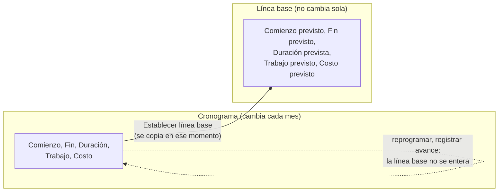
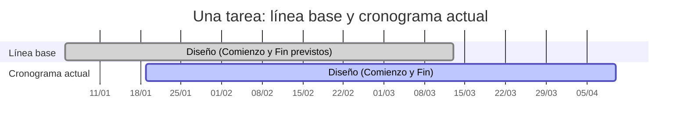
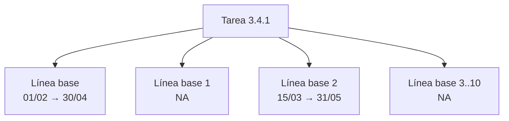
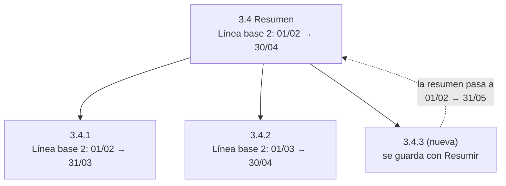
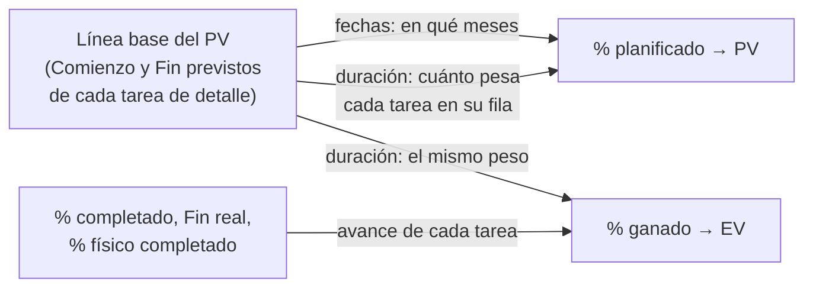
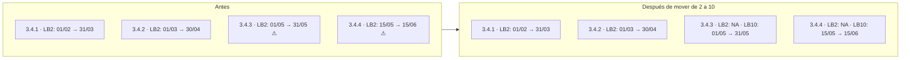
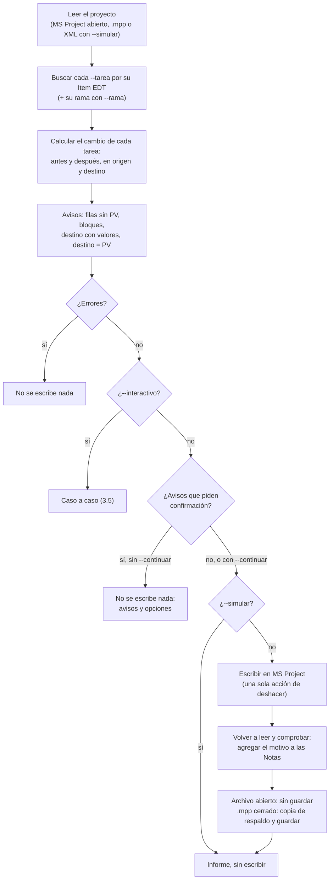

# Líneas base en MS Project y en el programa EVM

Guía para jefes de proyecto y responsables del informe EVM. Tiene tres partes:

1. [Conceptos clave](#parte-1-conceptos-clave): qué es una línea base, qué guarda y cómo la usa el
   programa EVM.
2. [Buenas prácticas](#parte-2-buenas-prácticas): cómo trabajar con las líneas base y qué erratas son
   habituales.
3. [Comando `corregir-linea-base`](#parte-3-comando-corregir-linea-base): cómo mover, borrar o establecer la
   línea base de unas tareas para corregir erratas, por ejemplo tareas nuevas que se guardaron en una línea base sin
   la aprobación del cliente.

Los nombres de MS Project se indican en español y, entre paréntesis, en inglés: el programa funciona con
MS Project en los dos idiomas.

---

## Parte 1. Conceptos clave

### 1.1 Qué es una línea base

Una línea base (*Baseline*) es una **foto del plan** en un momento dado: MS Project copia las fechas, la
duración, el trabajo y el costo de cada tarea a unos campos aparte, que no cambian aunque el cronograma
cambie después.



Al comparar el cronograma con la línea base se ven los desvíos: una tarea que debía terminar en marzo
(*Fin previsto*) y ahora termina en abril (*Fin*) va un mes tarde.



### 1.2 Once líneas base por archivo

Cada archivo de MS Project tiene **11 juegos** de campos de línea base: *Línea base* (la número 0) y
*Línea base 1* a *Línea base 10*. Son independientes: guardar la *Línea base 2* no toca las demás.

| Línea base | Campos de cada tarea en MS Project en español | En inglés | En COM y en el XML |
|---|---|---|---|
| Línea base (0) | Comienzo previsto, Fin previsto, Duración prevista, Trabajo previsto, Costo previsto | Baseline Start, Baseline Finish, Baseline Duration, Baseline Work, Baseline Cost | `BaselineStart`, `BaselineFinish`, `BaselineDuration`, `BaselineWork`, `BaselineCost` |
| Línea base 1 | Comienzo previsto1, Fin previsto1... | Baseline1 Start, Baseline1 Finish... | `Baseline1Start`, `Baseline1Finish`... |
| ... | ... | ... | ... |
| Línea base 10 | Comienzo previsto10... | Baseline10 Start... | `Baseline10Start`... |

Además, cada línea base guarda:

- la **fecha en que se guardó**, que se ve en la lista de líneas base del cuadro *Establecer línea base*
  (*Set Baseline*);
- en cada asignación de recursos, el **trabajo y el costo previstos repartidos en el tiempo** (día a día).
  El programa EVM no los usa: calcula con BAC × %.



**NA** es el valor de una fecha de línea base vacía: la tarea no tiene esa línea base. MS Project en
inglés lo muestra como «NA» y en español como «ND» (no disponible).

### 1.3 Línea base y plan provisional no son lo mismo

MS Project también tiene **planes provisionales** (*Interim plans*: *Comienzo1/Fin1* a *Comienzo10/Fin10*;
en inglés, *Start1/Finish1*...). Solo guardan las fechas, no la duración, el trabajo ni el costo. El
programa EVM no los usa. En el cuadro *Establecer línea base* aparecen como segunda opción (*Establecer
plan provisional*, *Set interim plan*); hay que tener cuidado de no confundirlos.

### 1.4 Qué se puede hacer con la línea base en MS Project

Están en **Proyecto > Establecer línea base** (*Project > Set Baseline*):

| Acción | Dónde | Qué hace |
|---|---|---|
| Establecer línea base del *Proyecto completo* (*Entire project*) | *Establecer línea base* (*Set Baseline*) | Copia el cronograma actual de **todas** las tareas a la línea base elegida (reemplaza la anterior). |
| Establecer línea base de las *Tareas seleccionadas* (*Selected tasks*) | Ídem, con tareas seleccionadas | Copia solo las tareas seleccionadas. Con *Resumir líneas base* (*Roll up baselines*) también actualiza las tareas resumen de encima. |
| Borrar línea base | *Borrar línea base...* (*Clear Baseline...*) | Deja en NA la línea base elegida, del proyecto completo o de las tareas seleccionadas. |
| Copiar una línea base en otra | *Establecer plan provisional* (*Set interim plan*), copiar la *Línea base N* en la *Línea base M* | Copia una línea base en otra, del proyecto completo o de las tareas seleccionadas. No borra la de origen. |

**Resumir líneas base.** Una tarea resumen tiene su propia línea base. Cuando se guarda la línea base solo
de unas subtareas, la de la tarea resumen no cambia, salvo que se marque *Resumir líneas base*:

- *Para todas las tareas de resumen* (*To all summary tasks*): actualiza todas las tareas resumen por
  encima de las seleccionadas;
- la segunda opción (*From subtasks into selected summary task(s)*): solo las tareas resumen que también
  estén seleccionadas.



### 1.5 Qué línea base usa el PV

Un archivo puede tener varias líneas base, pero el PV se calcula con **una sola**:

- la de `[exportacion] linea_base` de la configuración (o `--linea-base`), si se indica;
- si no, la que MS Project usa para el valor acumulado: *Archivo > Opciones > Avanzado*, *Línea base para
  cálculos de valor acumulado* (*File > Options > Advanced*, *Baseline for Earned Value calculations*).

En esta guía se llama **línea base del PV** a esa línea base. Las demás no afectan al informe EVM: sirven
como historial o como copia. Debe ser la **línea base aprobada** por el cliente:
[`corregir-linea-base`](#parte-3-comando-corregir-linea-base) avisa si no coinciden (`LBA-011`).

### 1.6 Cómo usa el programa la línea base



| Situación de la tarea en la línea base del PV | PV | EV |
|---|---|---|
| Con línea base | En los meses de sus fechas de línea base | Su avance, con el peso de su duración de línea base |
| Sin línea base (NA), en una fila con otras tareas con línea base | **No cuenta** (retrabajo o trabajo no previsto) | **Cuenta**, con el peso de su duración actual |
| Tarea resumen con línea base cuyas subtareas no tienen ninguna | Cuenta como **un bloque** con las fechas de la tarea resumen (una tarea que se desglosó después de guardar la línea base) | Cuentan sus subtareas |
| **Ninguna** tarea de la fila tiene línea base | La fila **no tiene PV**; su BAC debe ser 0 (aviso `FEC-019`) | Si el BAC es 0, el EV también es 0 |
| El proyecto no tiene ninguna línea base | Provisional, con las fechas actuales (aviso) | Su avance |

Tres consecuencias importantes:

1. **La línea base también pesa en el EV.** Mover o borrar la línea base de una tarea cambia su peso
   dentro de la fila, y por tanto el % ganado de las filas medidas con `% Completado`, `% Físico
   completado`, `Hitos` (con tareas) o `Ponderado`. Con `0/100`, `X/Y` y `Avance lineal` no cambia. Por
   eso conviene corregir las erratas **antes de generar el libro EVM oficial**: después, la corrección
   cambiaría el PV y el EV de meses ya informados.
2. **Sacar las subtareas no basta si la tarea resumen conserva su línea base.** Si todas las subtareas de
   una resumen quedan en NA y la resumen no, la resumen entra en el PV como un bloque.
3. **Una fila entera sin línea base no tiene PV.** El trabajo nuevo no aprobado no tiene presupuesto
   aprobado: su BAC debe ser 0 hasta que el cliente lo apruebe.

---

## Parte 2. Buenas prácticas

### 2.1 Reglas generales

1. **La línea base del PV es el plan aprobado por el cliente.** Solo se guarda (o se amplía) con su
   aprobación. Sin aprobación, el proyecto no tiene línea base y el PV es provisional.
2. **Una convención fija para el uso de las 11 líneas base**, conocida por todos. Una habitual:

   | Línea base | Uso |
   |---|---|
   | Línea base (0) | Plan original aprobado |
   | Línea base 1, 2... | Cada replanificación aprobada, en orden; la configuración (`linea_base`) apunta a la vigente |
   | Una línea base libre (por ejemplo, la 10) | Propuesta pendiente de aprobar (no se usa para el PV) |

3. **Tareas nuevas de un cambio aprobado:** línea base de las *Tareas seleccionadas*, con *Resumir líneas
   base: para todas las tareas de resumen*. Nunca el proyecto completo: eso movería el plan de todas las
   demás tareas a sus fechas actuales.
4. **Retrabajo o trabajo no previsto, sin cambio aprobado:** la tarea se agrega **sin línea base**.
5. **La línea base no se edita a mano** (escribiendo en *Comienzo previsto*): se pierde la trazabilidad.
   Para moverla o borrarla se usa `corregir-linea-base`, que deja constancia en las Notas.
6. **Cada cambio se justifica en las Notas** (*Notes*) de las tareas afectadas, con la fecha y el motivo (o
   la referencia a la aprobación del cliente).
7. **Revisar la fecha de guardado** de cada línea base en el cuadro *Establecer línea base*: una fecha
   inesperada indica un guardado por error. `corregir-linea-base` y `validar --informe` la muestran.

### 2.2 Erratas habituales y cómo detectarlas

| Errata | Efecto en el informe EVM | Cómo se detecta | Corrección |
|---|---|---|---|
| Tareas nuevas guardadas en la línea base del PV sin aprobación | El PV incluye trabajo no aprobado: el plan «persigue» a la realidad | `validar --informe` (análisis de las líneas base); columna *Comienzo previsto* con fechas recientes; fecha de guardado reciente | `corregir-linea-base`: mover a una línea base libre o borrar |
| Tareas aprobadas que faltan en la línea base aprobada | Faltan en el PV | Tareas con la línea base de una replanificación y sin la aprobada | `corregir-linea-base`: mover a la línea base aprobada |
| Tareas aprobadas que no se guardaron en ninguna línea base (por ejemplo, el desglose de una tarea aprobada) | Faltan en el PV; si su tarea resumen tiene la línea base, el PV la cuenta como un bloque | `validar --informe` (tareas sin la línea base que usa el % planificado, al final de la sección 4); columna *Comienzo previsto* en NA; `FEC-019` | `corregir-linea-base --establecer N`: establecer la línea base con los valores actuales |
| Tareas guardadas en otra línea base (no la del PV) | Ninguno en el PV, pero confunde el historial | Columnas *Comienzo previstoN* | `corregir-linea-base`: mover a la línea base correcta |
| Línea base del proyecto completo guardada por error | Todo el PV pasa a las fechas actuales | Fecha de guardado del día; desvíos que desaparecen | Recuperar de una copia del `.mpp` o de otra línea base (fuera del alcance del comando) |
| Resumen sin actualizar tras guardar subtareas | Normalmente ninguno; puede formar un bloque en el PV | Fechas previstas de la resumen distintas de las de sus subtareas (`LBA-017`) | Resumir líneas base |
| Línea base editada a mano en una tarea | PV distinto del aprobado | Difícil: solo comparando con una copia | Volver al valor aprobado |

---

## Parte 3. Comando `corregir-linea-base`

### 3.1 El caso

Antes de generar el libro EVM oficial se detecta que unas tareas nuevas se guardaron en una línea base
(por ejemplo, la 1 o la 2) **sin haberlo comunicado al cliente**. Hay que sacarlas de esa línea base, sin
perder sus fechas si conviene conservarlas como propuesta.

Ejemplo: la línea base del PV es la 2. Las tareas `3.4.3` y `3.4.4` se agregaron y se guardaron en la
línea base 2 (con *Resumir*, que amplió las fechas de `3.4`), sin aprobación.



Resultado en el informe EVM: el PV de la fila `3.4` vuelve a ser el aprobado (solo `3.4.1` y `3.4.2`). Las
tareas `3.4.3` y `3.4.4` cuentan en el EV como trabajo no previsto: el paquete avanza menos hasta que
terminan. Si el cliente aprueba el cambio, se mueven de la 10 a la 2 con el mismo comando y entran en el PV
con las fechas que se propusieron.

### 3.2 Las tres acciones

| Acción | Origen | Destino | Uso |
|---|---|---|---|
| **Mover** (`--de N --a M`) | Queda en NA | Recibe una copia exacta de la línea base N de cada tarea | Sacar tareas de la línea base del PV sin perder sus fechas (propuesta pendiente), o pasarlas a la línea base correcta |
| **Borrar** (`--borrar N`) | Queda en NA | — | Sacar tareas de una línea base sin conservar sus fechas |
| **Establecer** (`--establecer N`) | Los valores actuales de la tarea | La línea base N, solo en las tareas que no la tienen | Dar una línea base a tareas que no tienen ninguna (o no tienen la N): por ejemplo, el desglose de una tarea aprobada que no se guardó en la línea base aprobada |

Campos de cada tarea que se copian o se borran: *Comienzo previsto*, *Fin previsto*, *Duración prevista*,
*Trabajo previsto* y *Costo previsto* de la línea base indicada. Al mover, si el destino ya tiene valores,
se reemplazan y el informe guarda los anteriores. Una tarea que no tiene la línea base de origen no cambia
(ni en el destino) y se informa (`LBA-016`).

**Establecer** copia a la línea base N los valores actuales de cada tarea (*Comienzo*, *Fin*, *Duración*,
*Trabajo* y *Costo*), como *Establecer línea base* de MS Project con *Tareas seleccionadas*, pero solo en
las tareas que no tienen esa línea base: las que ya la tienen conservan sus valores y se informa
(`LBA-016`). Para reemplazar la línea base de una tarea que ya la tiene, se hace en MS Project. Si una tarea
resumen de encima tenía la línea base N y ninguna de sus subtareas la tenía (el PV la contaba como un
bloque), deja de ser un bloque: el PV pasa a contar solo las subtareas con línea base, y el aviso `LBA-021`
indica las que siguen sin ella (se incluyen con `--tarea <resumen> --rama`).

Desde el punto de vista del PV, **mover y borrar tienen el mismo efecto** cuando el origen es la línea
base del PV: la tarea sale del PV y sigue contando en el EV. La diferencia es que mover conserva sus fechas
en otra línea base.

### 3.3 Uso

```powershell
# Simular: muestra qué cambia, sin escribir (admite el XML)
python evm_export.py corregir-linea-base --origen activo --tarea 3.4.3 --tarea 3.4.4 --de 2 --a 10 --simular

# Una tarea resumen con toda su rama (la resumen y todas sus subtareas, a cualquier nivel)
python evm_export.py corregir-linea-base --origen activo --tarea 3.4.5 --rama --de 2 --a 10 --motivo "Tareas no comunicadas al cliente"

# Borrar la línea base 2 de una rama
python evm_export.py corregir-linea-base --origen activo --tarea 3.4.5 --rama --borrar 2 --motivo "Guardada por error"

# Establecer la línea base 0 (la aprobada) en el desglose de 1.1.0, que no se guardó en ella
python evm_export.py corregir-linea-base --origen activo --tarea 1.1.0 --rama --establecer 0 --motivo "Desglose aprobado no guardado"

# Borrar una línea base entera, rama a rama (cada rama es un caso, con un resumen de sus tareas)
python evm_export.py corregir-linea-base --origen activo --todas --borrar 2 --motivo "Línea base 2 sin uso" --interactivo

# Decidir caso a caso, un cambio cada vez (3.5); también con --borrar o --establecer
python evm_export.py corregir-linea-base --origen activo --tarea 3.4.5 --rama --de 2 --a 10 --interactivo
python evm_export.py corregir-linea-base --origen activo --tarea 1.1.0.1 --establecer 0 --interactivo
```

| Opción | Uso |
|---|---|
| `--tarea CODIGO` | Código `Item EDT` de la tarea. Se puede repetir. Se indica `--tarea` o `--todas` (`LBA-022`). |
| `--todas` | Todas las tareas de la planificación a las que afecta la acción, **rama a rama**: cada rama es un caso, con la primera tarea de la rama (como en el informe de `validar`) y todas sus subtareas. Al mover o borrar, las ramas con la línea base de origen; al establecer, las que no tienen la de destino. El motivo queda en el informe y no en las Notas, salvo con `--notas`. |
| `--notas` | Con `--todas`, agrega también el motivo a las Notas de cada tarea que cambia. |
| `--rama` | Incluye también todas las subtareas de cada `--tarea` (a cualquier nivel). Una tarea resumen sin `--rama` es un error (`LBA-004`): se movería sin sus subtareas. |
| `--de N --a M` | Mover de la línea base N a la M (0 a 10, distintas). |
| `--borrar N` | Borrar la línea base N. Excluye `--de` y `--a`. |
| `--establecer N` | Establecer la línea base N con los valores actuales en las tareas que no la tienen. Excluye las otras acciones. |
| `--motivo "texto"` | Texto que queda en el informe y se agrega a las Notas de cada tarea que cambia (3.7; con `--todas`, solo con `--notas`). **Obligatoria** al escribir; con `--interactivo`, si no se indica, se pregunta. |
| `--aprobada N` | Línea base aprobada por el cliente. Si no es la del PV, avisa (`LBA-011`). Con `--interactivo`, si no se indica, se pregunta. |
| `--interactivo` | Pregunta qué hacer con cada caso y escribe un cambio cada vez, que se puede deshacer (3.5). |
| `--continuar` | Escribe aunque haya avisos que piden confirmación (3.6). |
| `--simular` | Muestra los cambios y escribe el informe, sin escribir en MS Project. Admite el XML. |
| `--origen`, `--proyecto`, `--planificacion`, `--linea-base`, `--config`, `--informe`, `--sobrescribir`, `--sin-respaldo`, `--visible` | Como en `actualizar-edt` ([Comandos](comandos.md#actualizar-edt-numera-los-códigos-edt-de-una-rama)). Con `[[proyectos]]`, `--proyecto NOMBRE` indica el archivo. |

Al empezar, el comando muestra las líneas base del proyecto: cuántas tareas tienen fechas en cada una, la
fecha de guardado (leyendo el `.mpp`; el XML no la incluye), cuál usa el PV y cuál está configurada en MS
Project para el valor acumulado.

```text
Líneas base del proyecto:
   0  412 tareas      guardada el 10/03/2026
   1  430 tareas      guardada el 02/07/2026    <- la usa el PV; configurada en MS Project para el valor acumulado
  10  5 tareas        guardada el 21/11/2026
```

### 3.4 Qué hace el comando, paso a paso



Como en `actualizar-edt`:

- con el archivo abierto en MS Project (o `--origen activo`) los cambios quedan **sin guardar**, en una
  sola acción de deshacer: se revisan y se guarda, o se deshacen con un Ctrl+Z;
- con un `.mpp` cerrado, se hace una copia de respaldo antes de guardarlo;
- si MS Project da un error o un valor no coincide al volver a leerlo, el comando vuelve a escribir los
  valores anteriores y termina con `LBA-010`.

Si un aviso pide confirmación, el comando termina con código de salida 1 sin escribir nada; se vuelve a
ejecutar con la opción elegida.

### 3.5 Modo interactivo (`--interactivo`)

Para decidir caso a caso, sin volver a ejecutar el comando por cada aviso, y para revisar cada cambio en MS
Project antes de seguir:

1. **Al empezar**, muestra las líneas base del proyecto (3.3) y pregunta cuál es la **línea base aprobada**
   (Intro = la del PV). Si no es la del PV, avisa (`LBA-011`) y pregunta si seguir. Si no se indicó
   `--motivo`, lo pregunta.
2. **Cada `--tarea` (con su rama) es un caso; con `--todas`, cada rama de la planificación.** Muestra los
   cambios de cada tarea y los avisos, y pregunta: `s` aplicar, `o` omitir este caso, `x` salir. Si el caso
   cambia más de 30 tareas, en lugar de listarlas una a una muestra un **resumen**: cuántas cambian
   (resumen y de detalle) y cuántas de la rama no, las fechas de la línea base de origen, cuántas tienen
   las mismas fechas en la línea base del PV (posibles duplicados) y las tareas que cambian por rama, con
   sangría y las ramas completas plegadas. Todas las tareas están en el informe.
3. **Un cambio cada vez.** Al aplicar, escribe el caso en MS Project (sin guardar), con el motivo en las
   Notas, y pregunta cómo quedó: `s` correcto, seguir; `d` deshacer este cambio (el programa vuelve a
   escribir los valores y las Notas anteriores, y pregunta otra vez el caso); `x` salir.
4. **Tareas resumen de encima** (al mover o borrar). Después de cada caso escrito, si una tarea resumen de
   encima conserva la línea base de origen y ninguna de sus subtareas la tiene (`LBA-015`), pregunta qué
   hacer con ella:

   | Opción | Cuándo |
   |---|---|
   | `a` mover a la línea base aprobada | La resumen debió estar en la aprobada: no se incluyó antes por error |
   | `b` borrar de la línea base de origen (queda en NA/ND) | La resumen se incluyó por error |
   | `m` mover a otra línea base (se indica el número) | Otro destino |
   | `c` omitir: dejarla como está | Su línea base está aprobada (se desglosó después en subtareas): el PV la cuenta como un bloque |
   | `x` salir | |

   Si se mueve o se borra, se revisa la siguiente tarea resumen hacia arriba; si se conserva, las de encima
   ya tienen una subtarea con la línea base.

   Con `--establecer` no queda ninguna tarea resumen como bloque, así que no hay esta pregunta: si una
   tarea resumen de encima deja de ser un bloque, el caso lo muestra (`LBA-021`) antes de aplicarlo, con
   las subtareas que seguirían sin la línea base.
5. **Al salir** (`x`, o al terminar los casos) los cambios hechos se conservan **sin guardar** y el archivo
   queda abierto y visible en MS Project: se revisan y se guarda, o se cierra sin guardar para
   descartarlos. El informe recoge cada caso con la decisión tomada.

`--interactivo` necesita MS Project (el archivo abierto o un `.mpp`, que abre visible) y una consola en la
que responder; no se combina con `--simular` (`LBA-009`).

Ejemplo:

```text
Caso 1 de 1: 3.4.5 «Ensayos» y su rama (3 tareas): mover de la línea base 2 a la línea base 10
    3.4.5          Ensayos                     LB 2: 04/05/2026 – 12/06/2026 (30 d) -> NA | LB 10: NA -> 04/05/2026 – 12/06/2026 (30 d)
    3.4.5.1        Preparación                 LB 2: 04/05/2026 – 22/05/2026 (15 d) -> NA | LB 10: NA -> 04/05/2026 – 22/05/2026 (15 d)
    3.4.5.2        Ejecución                   LB 2: 25/05/2026 – 12/06/2026 (15 d) -> NA | LB 10: NA -> 25/05/2026 – 12/06/2026 (15 d)
  [i] LBA-018: Cambia el PV de la fila 3.4.
    s: aplicar
    o: omitir este caso
    x: salir
  ¿Aplicar este cambio? [s/o/x]: s
  Escrito en MS Project (3 tareas, sin guardar), con el motivo en las Notas. Se puede revisar en MS Project antes de seguir.
    s: correcto, seguir
    d: deshacer este cambio
    x: salir (se conservan los cambios hechos, sin guardar)
  ¿Cómo quedó? [s/d/x]: s
```

### 3.6 Tareas resumen y avisos que piden confirmación

**Tareas resumen dentro de la rama.** Con `--rama`, la tarea resumen se mueve, se borra o se establece
junto con sus subtareas.

**Tareas resumen de encima.** El comando no las modifica sin decidirlo:

| La resumen de encima, en la línea base de origen... | Qué significa | Lo correcto | Cómo se consigue |
|---|---|---|---|
| Tiene línea base aprobada y ninguna subtarea la conserva | Se aprobó como una tarea y se desglosó después | Que siga en el PV como un bloque | `--continuar`, o `c` en `--interactivo` |
| Tiene línea base y también es nueva | Forma parte de la errata | Que salga del PV | Incluirla: `--tarea <resumen> --rama`, o `a`/`b`/`m` en `--interactivo` |
| No tiene línea base | Solo las subtareas la tenían | Que salga del PV con las subtareas | Nada más que hacer |
| Tiene línea base y conserva otras subtareas con ella | Sus fechas pueden quedar más amplias que las de sus subtareas (`LBA-017`) | No cambia el PV: lo forman las subtareas | Si se quiere, *Resumir líneas base* en MS Project |

**Avisos que piden confirmación.** Si el cambio deja una situación que conviene decidir, el comando no
escribe y muestra el aviso con sus opciones (en `--interactivo`, se decide en el momento):

| Aviso | Por qué importa | Opciones |
|---|---|---|
| `LBA-011` La línea base aprobada no es la del PV | El PV no sería el aprobado | Corregir `linea_base` en la configuración o la línea base del valor acumulado en MS Project; `--continuar` sigue igualmente. |
| `LBA-012` El destino ya tiene valores | Se reemplazan (los anteriores quedan en el informe) | `--continuar` los reemplaza. |
| `LBA-013` El destino es la línea base del PV | Las tareas entran en el PV: equivale a aprobar el cambio | `--continuar` si el cliente lo aprobó. |
| `LBA-014` Una fila del libro se queda sin ninguna tarea con la línea base del PV | La fila no tendrá PV y su BAC debe ser 0 (el trabajo no está aprobado) | 1. `--continuar`: la fila queda sin PV; se pone su BAC en 0 hasta la aprobación. 2. Ubicar las tareas nuevas en MS Project dentro de una fila existente, como trabajo no previsto de ese paquete. 3. No corregir, si el trabajo sí estaba aprobado. |
| `LBA-015` Una tarea resumen de encima quedaría como un bloque | Ver la tabla anterior | `--continuar` la conserva; o incluirla con `--tarea <resumen> --rama`; o decidir con `--interactivo`. |

Estos avisos no se pueden silenciar. **Errores (no se escribe nada):** código inexistente o repetido
(`LBA-001`, `LBA-002`), tareas de dos `--tarea` que se solapan (`LBA-003`), tarea resumen sin `--rama`
(`LBA-004`), acción no válida (`LBA-005`), escritura con un XML (`LBA-007`), falta el motivo
(`LBA-008`). Todos los códigos están en [Códigos de errores y advertencias](codigos.md).

### 3.7 Notas de la tarea (`--motivo`)

El motivo siempre queda en el informe. Además, a cada tarea que cambia se le agrega **al final** de sus
Notas una línea como la siguiente; con `--todas`, solo si se indica `--notas` (al borrar una línea base
entera no hace falta repetir el motivo en cientos de tareas):

```text
21/11/2026 · Línea base 2 movida a línea base 10: Tareas no comunicadas al cliente
21/11/2026 · Línea base 2 borrada: Guardada por error
22/11/2026 · Línea base 0 establecida con los valores actuales: Desglose aprobado no guardado
```

**Limitación de MS Project:** desde el programa, las Notas se leen y escriben como **texto sin formato**.
Si una nota tiene negritas, colores, tablas u objetos incrustados, al agregar la línea se pierde ese
formato (el texto se conserva). El informe guarda la nota anterior de cada tarea.

### 3.8 Informe

Cada ejecución deja un informe en Markdown (`<origen>_linea-base-AAAAMMDD-HHMMSS.md`, o el de
`--informe`) con:

- la acción, el motivo, la línea base del PV, la aprobada, el modo y el resultado;
- las líneas base del proyecto (tareas, fecha de guardado y marcas);
- las observaciones, con las opciones de los avisos que piden confirmación;
- cada caso: la decisión (en `--interactivo`), el resultado, las filas cuyo PV cambia, las tareas que no
  cambian (sin la línea base de origen o, al establecer, que ya la tenían), una tabla con los cinco campos antes y después en cada línea base, y las Notas
  anteriores.

El informe lleva nombres de tareas: es de uso interno.

### 3.9 MS Project en inglés y en español

- Los campos se escriben por sus nombres de COM (`Baseline2Start`...), que son los mismos en los dos
  idiomas, y como fechas y números, no como texto.
- Para dejar una fecha vacía, el comando prueba «NA» (inglés) y «ND» (español), y vuelve a leer el campo
  para comprobar que quedó vacía.
- Si MS Project recalcula la duración, el trabajo o el costo previstos al escribir las fechas (por ejemplo,
  en una tarea con recursos asignados), se informa (`LBA-020`): las fechas son las copiadas.

La prueba con MS Project real está en `tests/test_msproject_linea_base.py` ([Desarrollo](desarrollo.md)).

### 3.10 Fuera del alcance

- Recuperar una línea base del proyecto completo guardada por error (se recupera de una copia del `.mpp`).
- Cambiar la línea base del PV del proyecto (se hace con `linea_base` en la configuración o en las
  opciones de MS Project).
- Los planes provisionales (*Comienzo1/Fin1*...).
- El trabajo y el costo previstos repartidos en el tiempo de los recursos asignados (no se usan en el libro).
- Modificar un libro EVM ya generado: tras la corrección, se genera el libro (o se regenera con
  `--migrar-desde`).
