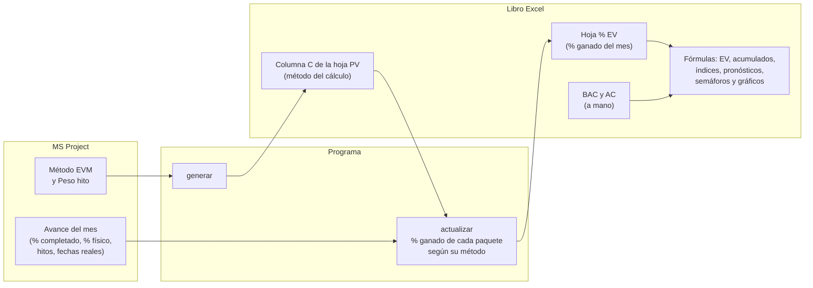
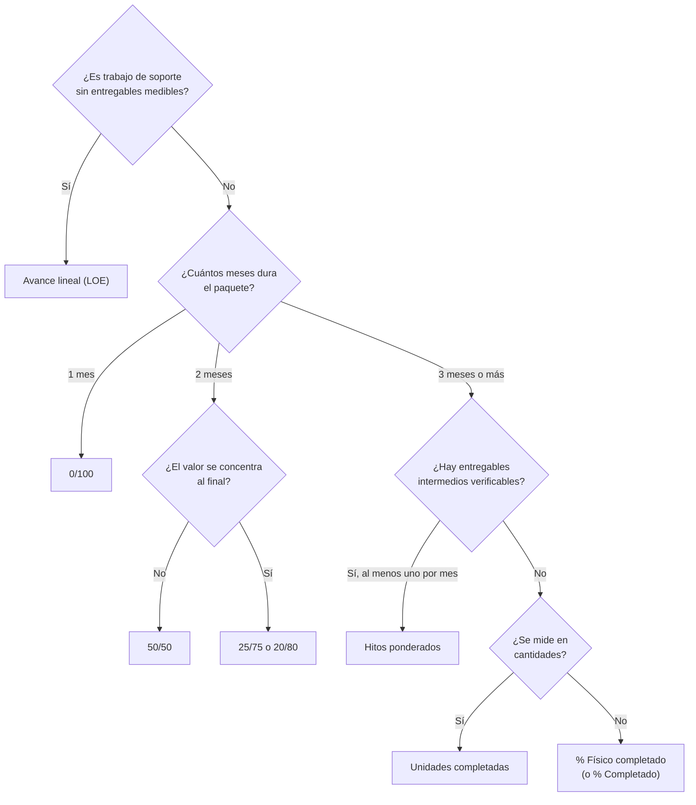
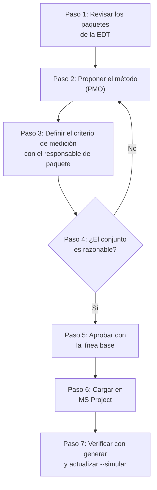

# Métodos de medición del valor ganado

[Inicio](../README.md) › [Documentación](README.md) › Métodos de medición

El **método de medición** (técnica de valor ganado) define cómo se convierte el avance de un paquete de
trabajo en **valor ganado (EV)**. Se elige uno por paquete al planificar y se mantiene durante toda su
ejecución. Este documento describe los métodos que admite el programa, dónde se define el método y
dónde se calcula el EV, cómo se configuran y cómo se registra el avance en MS Project para cada uno,
cómo elegir y aprobar el método de cada paquete, y su relación con el valor acumulado propio de
MS Project.

> Las imágenes de MS Project son **esquemas ilustrativos**, no capturas. Los nombres de menú
> corresponden a MS Project en español 2016 a 2024 y a la versión de suscripción; pueden variar
> levemente según la versión.

> **Ponderación de las subtareas.** En un paquete con subtareas, cada tarea pesa según su **duración de
> línea base** y cada hito según su `Peso hito`, que es un % del BAC del paquete: son los mismos pesos
> del % planificado ([Cálculo del PV y el EV](calculo-pv-ev.md#4--planificado-peso-de-cada-tarea)).

---

## Contenido

1. [Resumen de los métodos](#1-resumen-de-los-métodos)
2. [Configurar el método de cada paquete](#2-configurar-el-método-de-cada-paquete)
   - [2.1 Dónde se define y dónde se calcula](#21-dónde-se-define-y-dónde-se-calcula)
   - [2.2 En MS Project: campo personalizado «Método EVM»](#22-en-ms-project-campo-personalizado-método-evm)
   - [2.3 En Excel: columna C de la hoja PV](#23-en-excel-columna-c-de-la-hoja-pv)
3. [Los métodos en detalle](#3-los-métodos-en-detalle)
   - [3.1 0/100](#31-0100)
   - [3.2 Fórmulas fijas 50/50, 25/75 y 20/80](#32-fórmulas-fijas-5050-2575-y-2080)
   - [3.3 Hitos ponderados](#33-hitos-ponderados)
   - [3.4 % Completado](#34--completado)
   - [3.5 % Físico completado](#35--físico-completado)
   - [3.6 Unidades completadas](#36-unidades-completadas)
   - [3.7 Avance lineal (LOE)](#37-avance-lineal-loe)
4. [Guía para elegir el método](#4-guía-para-elegir-el-método)
5. [Proceso para definir el método de cada paquete](#5-proceso-para-definir-el-método-de-cada-paquete)
   - [5.1 Roles](#51-roles)
   - [5.2 Pasos](#52-pasos)
   - [5.3 Cambios de método](#53-cambios-de-método)
   - [5.4 Registro de los métodos](#54-registro-de-los-métodos)
6. [Valor acumulado de MS Project](#6-valor-acumulado-de-ms-project)
7. [Buenas prácticas](#7-buenas-prácticas)

---

## 1. Resumen de los métodos

| Método (columna C) | EV acumulado | Qué se registra en MS Project cada mes |
|---|---|---|
| `0/100` | 0 hasta terminar; BAC al terminar. | Paquete al 100 % (o *Fin real*) al terminar. |
| `50/50`, `25/75`, `20/80` (`X/Y`) | X % del BAC al comenzar; 100 % al terminar. | *Comienzo real* (o cualquier avance) al comenzar; 100 % al terminar. |
| `Hitos ponderados` | BAC × Σ pesos de los hitos cumplidos / Σ pesos. | Cada hito al 100 % cuando se cumple. |
| `% Completado` | BAC × *% completado* de las subtareas, ponderado por su duración de línea base (un hito cumplido cuenta su `Peso hito`). | *% completado* (o duración real) de las tareas. |
| `% Físico completado` | BAC × *% físico completado* de las subtareas, con la misma ponderación. | *% físico completado* estimado o medido. |
| `Unidades completadas` | BAC × unidades hechas / unidades totales. | El cociente, en *% físico completado*. |
| `Avance lineal (LOE)` | EV = PV acumulado de la fila. | Nada específico (fechas reales recomendables). |
| `Por definir` u otro texto | Se usa `% Completado` y se informa. | — |

El detalle del cálculo (pesos, % del mes, controles) está en
[Cálculo del PV y el EV](calculo-pv-ev.md#6--ganado-métodos-de-medición). En multi-empresa, cada método
se mide por empresa, con las tareas en las que participa.

---

## 2. Configurar el método de cada paquete

El método se puede definir en MS Project (recomendado: queda junto al cronograma y se traslada a cada
libro nuevo) o directamente en Excel, en la columna C de la hoja `PV`.

### 2.1 Dónde se define y dónde se calcula

Con la configuración recomendada, el método de cada paquete se define en MS Project, pero el EV no lo
calcula MS Project ni Excel: lo calcula el programa al ejecutar `actualizar`, con el avance registrado
en MS Project y la regla del método. Excel recibe el % ganado de cada mes y calcula con fórmulas el EV
(BAC × %) y el resto del informe; el BAC y el AC se ingresan a mano en el libro.

| Qué | Dónde |
|---|---|
| Método de cada paquete (dato de referencia) | MS Project: campo `Método EVM` y, en los hitos, `Peso hito` ([2.2](#22-en-ms-project-campo-personalizado-método-evm)). |
| Avance del mes | MS Project: *% completado*, *% físico completado*, hitos al 100 % y fechas reales, en las tareas de detalle y los hitos ([Preparación en MS Project](preparacion-ms-project.md#7-fecha-de-estado-y-registro-del-avance)). |
| Método que usa el cálculo | Excel: columna C de la hoja `PV`, que `generar` copia de MS Project ([2.3](#23-en-excel-columna-c-de-la-hoja-pv)). |
| % ganado acumulado de cada paquete | El programa, al ejecutar `actualizar`, que escribe el % del mes en la hoja `% EV` ([Cálculo del PV y el EV](calculo-pv-ev.md#6--ganado-métodos-de-medición)). |
| BAC y AC | Excel: se ingresan a mano en la columna D de la hoja `PV` y en la hoja `AC`. |
| EV, acumulados, índices, pronósticos, semáforos y gráficos | Excel, con fórmulas ([Cuadro de Mando e indicadores](cuadro-de-mando.md)). |
| Valor acumulado de MS Project (*CPTR*) | No se usa ([sección 6](#6-valor-acumulado-de-ms-project)). |

El reparto responde a los datos que tiene cada herramienta:

- **MS Project** ofrece solo dos métodos de valor acumulado, *% completado* y *% físico completado*,
  que se calculan con costos: no tiene `0/100`, fórmulas fijas ni hitos ponderados.
- **Excel** tiene una fila por paquete: no tiene las subtareas, los hitos cumplidos, los pesos ni las
  fechas reales que necesita la regla del método.
- **El programa** lee ese detalle de MS Project y escribe en Excel el resultado de cada paquete. En un
  paquete con subtareas, el avance es el promedio de las subtareas ponderado por su duración de línea
  base, y cada hito cuenta su `Peso hito`
  ([Cálculo del PV y el EV](calculo-pv-ev.md#6--ganado-métodos-de-medición)).

> **Importante:** `actualizar` usa el método de la **columna C**, no el de MS Project, y no compara los
> dos. Un cambio de método en MS Project posterior a `generar` no se aplica hasta regenerar el libro con
> `--migrar-desde`, y un método editado en la columna C prevalece sobre el de MS Project al regenerar.
> Para que no difieran, MS Project es la referencia: la columna C solo se edita para aplicar un cambio
> aprobado, que se escribe también en MS Project con el mismo valor
> ([5.3 Cambios de método](#53-cambios-de-método)).

### 2.2 En MS Project: campo personalizado «Método EVM»

1. Clic derecho en el encabezado de una columna > **Campos personalizados** (también en *Proyecto >
   Campos personalizados*).
2. **Campo: Tarea**, **Tipo: Texto**. Se selecciona un campo libre, por ejemplo *Texto10*, y con
   **Cambiar nombre...** se le asigna el nombre `Método EVM`.
3. En **Atributos personalizados** se elige **Búsqueda...** y se escriben los valores de la lista:
   `0/100`, `50/50`, `25/75`, `20/80`, `Hitos ponderados`, `% Completado`, `% Físico completado`,
   `Unidades completadas`, `Avance lineal (LOE)`. Se recomienda **desmarcar**
   *Permitir introducir elementos adicionales en los campos*, para que solo se admitan valores de la
   lista.
4. Se inserta la columna `Método EVM` (clic derecho en un encabezado > *Insertar columna*) y se completa
   en las tareas de **nivel 3** (paquetes de trabajo) y en las de nivel 1 o 2 que no tengan
   subelementos.
5. En `config.toml` se indica `metodo = "Método EVM"` (o `metodo = "Text10"`).

Para el peso de los hitos (el % del BAC del paquete que vale cada hito) se crea, de la misma forma, un
campo **Número** (por ejemplo *Número1*) con el nombre `Peso hito`, y en `config.toml` se indica
`peso_hito = "Peso hito"`.

### 2.3 En Excel: columna C de la hoja `PV`

La columna C tiene una lista desplegable con los métodos de la hoja `Listas`, y es el método que usa
`actualizar`. Se puede cambiar en cualquier momento, pero el cambio queda solo en el libro: si el
método se define en MS Project, un cambio en la columna C se escribe también allí
([2.1](#21-dónde-se-define-y-dónde-se-calcula)). Al regenerar el libro con `--migrar-desde`, el método
se conserva solo si fue **editado en Excel**; si no, se toma el de MS Project. Si el proyecto no usa el
campo `Método EVM`, la columna C es la única referencia del método.

Las filas sin método reciben `metodo_por_defecto` (`Por definir`) y se informan en `Validación`. Las
filas `-D Otras tareas` no tienen tarea propia en MS Project: siempre reciben `metodo_por_defecto` y su
método se define en la columna C.
También se reconocen otros textos: fórmulas con `%` (`50%/50%`), cualquier `X/Y` con X + Y = 100
(`40/60`), o textos que contengan "hito", "físico", "unidad", "lineal" o "LOE". Un texto no reconocido
(por ejemplo, `CPTR de MS Project`) se calcula como `% Completado` y `actualizar` lo informa en
pantalla.

---

## 3. Los métodos en detalle

### 3.1 0/100

**Regla:** el paquete no gana valor hasta que termina; al terminar gana el 100 % del BAC.

**Cuándo usarlo:** paquetes cortos que empiezan y terminan dentro del mismo período de informe (un
mes), o entregas puntuales (un suministro que solo tiene valor al recibirse).

**En MS Project:** al terminar el paquete se marca al **100 %** (botón *100%* de la pestaña *Tarea*, o
*% completado* = 100 en la tabla *Seguimiento*). Se considera terminado con *% completado* = 100, o con
*Fin real* y *% completado* ≥ 99,5.

**Precaución:** si el paquete dura varios meses, el EV es 0 durante toda su ejecución mientras se
acumula costo real: el CPI y el SPI del paquete aparecen muy bajos hasta el final (es lo que muestra el
paquete `1.2.1` del [ejemplo](ejemplo-paso-a-paso.md)).

### 3.2 Fórmulas fijas 50/50, 25/75 y 20/80

**Regla:** X % del BAC al comenzar y el resto al terminar. Se admite cualquier par `X/Y` que sume 100.

**Cuándo usarlo:** paquetes de hasta dos períodos. `25/75` o `20/80` cuando el valor se concentra al
final (por ejemplo, una prueba cuyo resultado es lo que importa).

**En MS Project:** al comenzar, se registra el *Comienzo real* (o cualquier *% completado* o *% físico
completado* mayor que 0); al terminar, 100 %.

**Ejemplo:** paquete de 400.000 € con `50/50`: 200.000 € el mes en que comienza y 200.000 € el mes en
que termina. Si comienza y termina el mismo mes, 400.000 € ese mes.

### 3.3 Hitos ponderados

**Regla:** el paquete se divide en hitos con un **peso**; el EV es el BAC multiplicado por la suma de
los pesos de los hitos cumplidos dividida por la suma de todos los pesos. Un hito está cumplido cuando
su *% completado* es 100.

**Cuándo usarlo:** paquetes de 3 meses o más con entregables intermedios verificables (ingeniería con
revisiones, fabricación con pruebas en fábrica, obras con certificaciones parciales). Es el método más
recomendado para paquetes largos porque es **objetivo**.

**Implementación en MS Project, paso a paso:**

1. **Estructura:** el paquete es una tarea de nivel 3 (con código EDT) cuyas subtareas son las
   actividades de trabajo y los **hitos** (tareas de duración 0, o marcadas con *Marcar tarea como hito*
   en *Información de la tarea > Avanzado*). Los hitos no necesitan código EDT: el programa los incluye
   en su paquete.
2. **Vínculos:** cada hito se vincula como sucesor de las actividades que producen su entregable, para
   que su fecha se mueva con el trabajo.
3. **Pesos:** campo `Peso hito` (*Número1*) en cada hito: es el % del BAC del paquete que se planifica
   en el mes del hito ([Cálculo del PV y el EV](calculo-pv-ev.md#4--planificado-peso-de-cada-tarea)).
   Los pesos deben sumar 100 y ser proporcionales al presupuesto del trabajo que lleva a cada hito: así
   el PV del paquete se concentra en los meses de sus hitos. Si suman menos de 100, el resto del %
   planificado se reparte entre las actividades según su duración, pero el % ganado solo cuenta los
   hitos. Un peso negativo se toma como 0; si ningún hito tiene peso positivo, en el % ganado todos
   pesan igual.
4. **Método:** `Hitos ponderados` en el campo `Método EVM` del paquete.
5. **Criterio de cumplimiento:** en las *Notas* de cada hito se escribe la evidencia que lo da por
   cumplido (por ejemplo, "plano aprobado por el cliente", "acta de prueba FAT firmada").
6. **Cada mes:** se marca al **100 %** cada hito cumplido en el mes, con su *Fin real*. Un hito no
   cumplido no se marca parcialmente: se reprograma.

**Ejemplo** (paquete de 600.000 € con tres hitos, como `2.1.2 Diseño conceptual` del ejemplo):

| Hito | Peso | Cumplido en | EV acumulado al final del mes |
|---|---:|---|---:|
| Bases aprobadas | 30 | mayo | 180.000 |
| Alternativa seleccionada | 30 | julio | 360.000 |
| Informe aprobado | 40 | septiembre | 600.000 |

**Respaldo:** si la fila no tiene hitos, se usa *% físico completado* (si alguna subtarea lo tiene
registrado) o *% completado*, y se informa. Se consideran todos los hitos que dependen de la fila, en
cualquier nivel.

**Recomendaciones:**

- Al menos un hito por período de informe: si entre dos hitos pasan muchos meses, el SPI del paquete
  oscila (cero avance durante meses y un salto al cumplirse el hito).
- Los pesos se fijan al guardar la línea base y solo se cambian por control de cambios.
- Si un entregable se puede medir parcialmente (por ejemplo, planos emitidos), se puede combinar con
  `% Físico completado` dividiendo el paquete en dos.

### 3.4 % Completado

**Regla:** BAC × *% completado* de las subtareas, ponderado por su duración de línea base; un hito
cumplido cuenta su `Peso hito`.

**Cuándo usarlo:** cuando no hay una medida física mejor y la duración transcurrida es un indicador
razonable del avance.

**En MS Project:** se registra el *% completado* de cada tarea de detalle (botones *0%* a *100%* de la
pestaña *Tarea*, tabla *Seguimiento*, o *Proyecto > Actualizar proyecto*), o la *Duración real* y la
*Duración restante*.

**Ejemplo:** paquete de 900.000 € con dos tareas de 30 y 10 días de línea base, sin hitos con peso: pesan
75 % y 25 %. Con la primera al 60 % y la segunda sin comenzar, el % ganado es 75 % × 60 % = 45 % y el EV
405.000 €.

**Precaución:** el *% completado* de MS Project mide el **% de la duración** transcurrida, no del
trabajo realizado: una tarea al 50 % de su duración puede tener mucho menos trabajo hecho. Para medir
el avance físico se recomienda `% Físico completado` o `Hitos ponderados`.

### 3.5 % Físico completado

**Regla:** BAC × *% físico completado* de las subtareas, con la misma ponderación que `% Completado`.

**Cuándo usarlo:** trabajo cuyo avance se puede estimar o medir con independencia de la duración
(planos emitidos sobre el total, metros de cañería montados, porcentaje de una obra certificado).

**En MS Project:** el campo *% físico completado* se escribe siempre a mano: se inserta la columna
*% físico completado* o se usa la tabla *Seguimiento* (columna *% físico comp.*). No modifica la
duración ni el *% completado*.

**Recomendación:** definir para cada paquete **cómo** se mide (qué unidad, qué evidencia) y registrar el
criterio en las *Notas* de la tarea, para que la medición sea reproducible mes a mes.

### 3.6 Unidades completadas

**Regla:** BAC × unidades hechas / unidades totales. El cociente se registra en *% físico completado*.

**Cuándo usarlo:** trabajo repetitivo en unidades homogéneas (m³ excavados, t de acero montadas,
equipos instalados).

**En MS Project:**

1. Se recomienda crear dos campos *Número* para registrar las cantidades, por ejemplo `Unidades
   totales` y `Unidades hechas`, y un tercer campo con una **fórmula** que calcule el porcentaje (unidades
   hechas / unidades totales × 100) como referencia.
2. Cada mes se actualiza `Unidades hechas` y se copia el porcentaje calculado en *% físico completado*
   (el campo *% físico completado* no admite fórmulas).

**Ejemplo:** movimiento de tierras de 40.000 m³ con BAC 3.200.000 €; al cierre de mes se excavaron
18.000 m³ → 45 % → EV = 1.440.000 €.

### 3.7 Avance lineal (LOE)

**Regla:** EV = PV acumulado de la fila (nivel de esfuerzo, *Level of Effort*). El paquete nunca tiene
variación de cronograma (SV = 0, SPI = 1); sí puede tener variación de costo.

**Cuándo usarlo:** actividades de soporte sin entregables medibles que duran lo que dura el proyecto:
dirección, oficina de proyecto (PMO), control de proyectos, administración de contratos.

**En MS Project:** no requiere un dato específico; se recomienda registrar las fechas reales para que el
cronograma sea coherente.

**Precaución:** el LOE "diluye" los índices del proyecto (aporta SPI = 1). Se debe limitar a lo
indispensable y no mezclar en el mismo paquete trabajo de soporte con trabajo medible. `actualizar` y
`analizar` avisan si las filas LOE superan el `loe_maximo` del BAC total (15 % por defecto,
[configuración](configuracion.md#claves); [ACT-049](codigos.md#act-049)).

---

## 4. Guía para elegir el método

| Duración del paquete o tipo de trabajo | Método sugerido |
|---|---|
| Empieza y termina en el mismo mes | `0/100` |
| Hasta 2 meses | `50/50` (o `25/75`, `20/80` si el valor se concentra al final) |
| 3 meses o más, con entregables intermedios | `Hitos ponderados` (al menos un hito por mes) |
| Trabajo medible en cantidades (m³, planos, equipos) | `% Físico completado` o `Unidades completadas` |
| Gestión, soporte, supervisión | `Avance lineal (LOE)`, limitado a lo indispensable |

---

## 5. Proceso para definir el método de cada paquete

El método de cada paquete se define durante la planificación, antes de guardar la línea base, y se
aprueba con ella: forma parte del plan contra el que se mide el avance y, como la línea base, solo se
cambia por control de cambios.

### 5.1 Roles

Los roles son los del [Proceso de reporte EVM](proceso-reporte-evm.md#2-roles):

| Rol | Participación |
|---|---|
| **Planificador / Control de proyectos (PMO)** | Propone el método de cada paquete con la [guía](#4-guía-para-elegir-el-método), lo carga en MS Project y verifica el libro. |
| **Responsable de paquete** | Confirma el método y define el criterio de medición de su paquete. |
| **Jefe de Proyecto / Jefe de Programa** | Revisa el conjunto y aprueba los métodos junto con la línea base. |
| **Cliente** | Conoce los criterios de medición de los paquetes que se le informan y, si el contrato lo prevé, los acepta. |

### 5.2 Pasos

1. **Revisar los paquetes de la EDT.** El método se asigna a cada paquete de trabajo (nivel 3 del código
   EDT, o nivel 1 o 2 sin subelementos), no a sus tareas de detalle ni a sus hitos. Cada paquete debe
   tener un responsable, su presupuesto y una duración acotada. Un paquete largo sin entregables
   intermedios conviene dividirlo antes de recurrir a un método subjetivo.
2. **Proponer el método.** El Planificador propone un método por paquete con la
   [guía para elegir el método](#4-guía-para-elegir-el-método), según la duración y el tipo de trabajo.
3. **Definir el criterio de medición.** Con cada responsable de paquete se confirma el método y se
   define cómo se mide:

   | Método | Qué se define |
   |---|---|
   | `0/100` y fórmulas fijas | Qué hecho marca el comienzo del paquete y qué evidencia lo da por terminado. |
   | `Hitos ponderados` | Los hitos, su peso (que sumen 100, proporcionales al presupuesto del trabajo que lleva a cada hito) y la evidencia que da cada hito por cumplido. |
   | `% Físico completado` | Qué se mide (por ejemplo, planos emitidos sobre el total) y de dónde sale la medición. |
   | `Unidades completadas` | La unidad, la cantidad total y la fuente de la medición mensual. |
   | `% Completado` | Por qué no hay una medida física mejor. |
   | `Avance lineal (LOE)` | Por qué el paquete no tiene entregables medibles. |

4. **Revisar el conjunto.** Antes de aprobar se revisa:
   - la parte del BAC medida con `Avance lineal (LOE)` y con `% Completado`. Conviene acordar un tope:
     el LOE aporta SPI = 1 y diluye los índices del proyecto, y el *% completado* mide la duración
     transcurrida, no el trabajo realizado;
   - que los paquetes con `Hitos ponderados` tengan al menos un hito por mes;
   - que ningún paquete de varios meses quede con `0/100`.

   Si ya se generó un libro de prueba, filtrando la columna C de la hoja `PV` por método, la barra de
   estado de Excel muestra la suma del BAC (columna D) de ese método.
5. **Aprobar.** El Jefe de Proyecto o de Programa aprueba los métodos junto con la línea base, y se
   registran en el plan de gestión ([5.4](#54-registro-de-los-métodos)). Si el EVM se informa al
   cliente, es buena práctica acordar con él los criterios de medición, sobre todo en la planificación
   que se le informa (por ejemplo, `CLIENTE`).
6. **Cargar en MS Project** el método en el campo `Método EVM`, con lista cerrada
   ([2.2](#22-en-ms-project-campo-personalizado-método-evm)); los pesos en `Peso hito`; y el criterio de
   medición en las *Notas* del paquete o de cada hito. Si se exportan dos planificaciones (`INTERNO` y
   `CLIENTE`), se completa en los paquetes de las dos.
7. **Verificar con el programa.** Después de `generar`, la hoja `Validación` no debe informar filas sin
   método de medición, y la columna C de la hoja `PV` debe coincidir con los métodos aprobados. En el
   primer cierre, `actualizar --simular` muestra las observaciones por fila; por ejemplo, un paquete con
   `Hitos ponderados` sin hitos, que se mide con *% físico completado* o *% completado*.

### 5.3 Cambios de método

El método se mantiene durante toda la ejecución del paquete. Un cambio se trata como un cambio de línea
base: se justifica y se aprueba por control de cambios, preferentemente antes de que el paquete
comience. Para aplicar un cambio aprobado:

1. Se cambia el método en MS Project (campo `Método EVM`) y se actualiza el criterio en las *Notas*.
2. Se escribe el mismo método en la columna C de la hoja `PV`, para que se aplique en el próximo
   `actualizar` sin regenerar el libro. Si en el mismo cambio se regenera el libro con
   `--migrar-desde` (por ejemplo, por una nueva línea base), este paso no es necesario.
3. En el próximo `actualizar`, el % ganado acumulado del paquete se recalcula con el método nuevo y
   toda la diferencia queda en el mes de corte: puede resultar un % del mes negativo o mayor que el
   habitual ([Cálculo del PV y el EV](calculo-pv-ev.md#7-del--acumulado-al--del-mes)). El salto se
   explica en el informe y, si el paquete queda fuera de umbral, en
   [Análisis de desviaciones](analisis-desviaciones.md).

### 5.4 Registro de los métodos

Los métodos aprobados se registran en una tabla del plan de gestión del proyecto (o en un anexo), que
sirve de referencia para medir el avance cada mes y para explicar el informe. Ejemplo con paquetes del
[proyecto de ejemplo](ejemplo-paso-a-paso.md):

| Paquete | Responsable | BAC (€) | Método | Criterio de medición |
|---|---|---:|---|---|
| 1.1.1 Oficina de gestión del programa (PMO) | Jefe de Programa | 1.800.000 | `Avance lineal (LOE)` | Soporte durante todo el programa, sin entregables medibles. |
| 2.1.2 Diseño conceptual | Jefe de ingeniería | 600.000 | `Hitos ponderados` | Bases aprobadas (30), alternativa seleccionada (30) e informe aprobado por el cliente (40). |
| 2.2.1 Detalle civil | Jefe de ingeniería | 1.600.000 | `% Físico completado` | Planos emitidos para construcción sobre el total del listado de planos. |
| 3.1.1 Movimiento de tierras | Jefe de obra | 3.200.000 | `Unidades completadas` | m³ excavados según la medición topográfica mensual, sobre 40.000 m³. |

---

## 6. Valor acumulado de MS Project

MS Project calcula su propio valor ganado, que llama **valor acumulado** (campo *CPTR*), con el costo
de la línea base y el *Método de valor acumulado* de cada tarea (*% completado* o *% físico
completado*). El programa no lo usa: el cronograma no necesita costos, y el % ganado de cada paquete se
calcula con el método de la columna C y el avance registrado ([sección 3](#3-los-métodos-en-detalle)).
Por eso no hace falta configurar el *Método de valor acumulado* de las tareas, y las tablas de valor
acumulado de MS Project (*CPTP*, *CPTR*, *CRTR*, ver el [glosario](glosario.md)) no coinciden con el
libro.

De las opciones de valor acumulado del proyecto (*Archivo > Opciones > Avanzadas > Opciones de valor
acumulado para este proyecto*), el programa usa solo la **línea base para el cálculo del valor
acumulado**: es la línea base cuyas fechas definen el % planificado, salvo que se indique otra con
`linea_base` en la [configuración](configuracion.md) o con `--linea-base N`.

---

## 7. Buenas prácticas

- Definir el método de cada paquete **antes** de comenzarlo, aprobarlo con la línea base y mantenerlo
  durante toda su ejecución ([sección 5](#5-proceso-para-definir-el-método-de-cada-paquete)).
- Preferir métodos **objetivos**: hitos con criterio de aceptación, cantidades medidas, fórmulas fijas
  para paquetes cortos. Evitar porcentajes estimados sin evidencia.
- Paquetes de duración acotada: un paquete muy largo con `% Completado` esconde los problemas hasta el
  final.
- Limitar el `Avance lineal (LOE)` a las actividades de soporte.
- Documentar el criterio de medición de cada paquete (en las *Notas* de la tarea o en un anexo del plan
  de gestión, [5.4](#54-registro-de-los-métodos)) y revisarlo con los responsables de paquete.
- Mantener MS Project como referencia del método: la columna C de la hoja `PV` solo se edita para
  aplicar un cambio aprobado, que se escribe también en MS Project.
- Revisar cada mes, con `actualizar --simular`, las observaciones por fila: métodos no definidos,
  respaldo por falta de hitos, % del mes negativos.

Más información de Microsoft: [Cambiar el tipo de porcentaje completado para el análisis del valor
acumulado](https://support.microsoft.com/es-es/project/change-complete-type-for-earned-value-analysis),
[Análisis de valor acumulado](https://support.microsoft.com/es-es/project/earned-value-analysis-for-the-rest-of-us).
Ver también [Recursos externos](recursos-externos.md).
