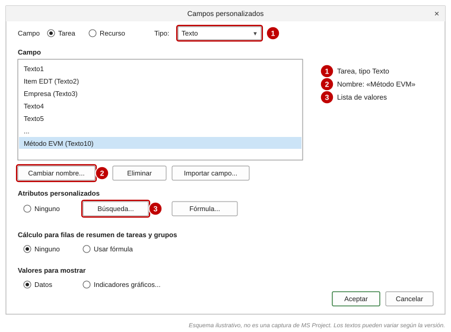
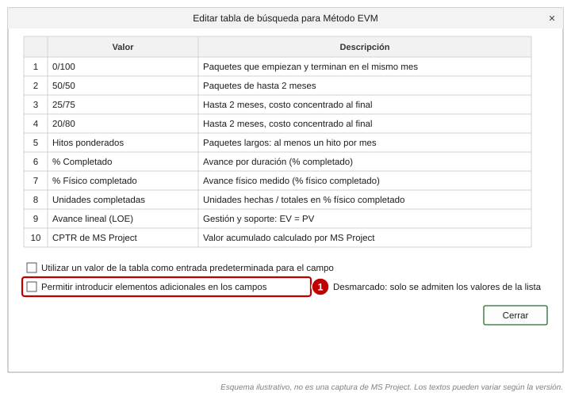
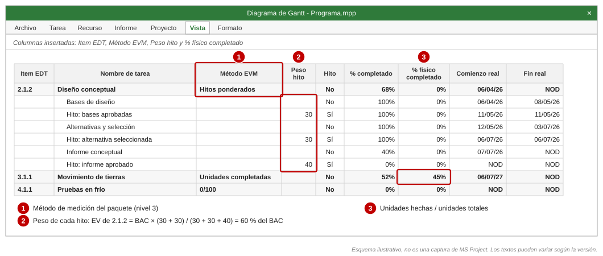
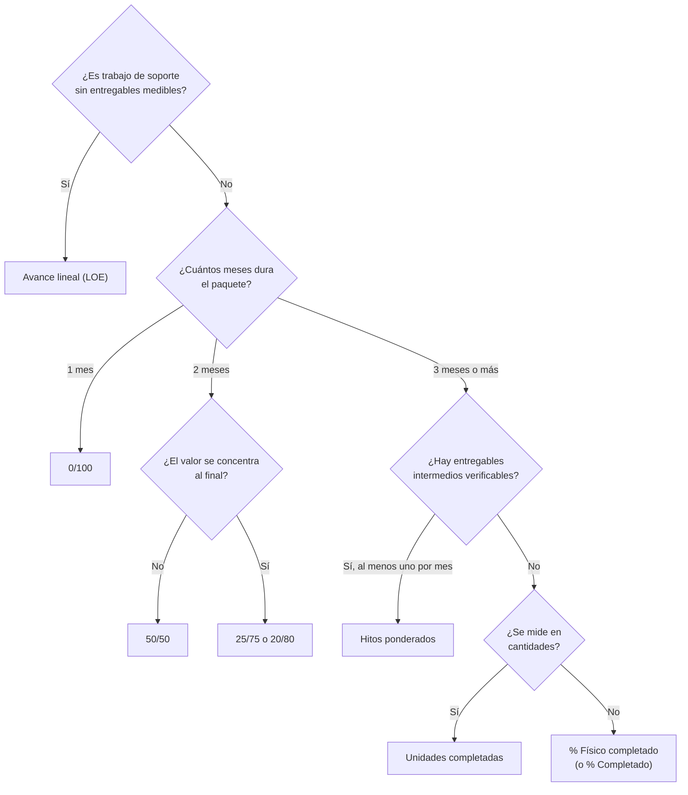
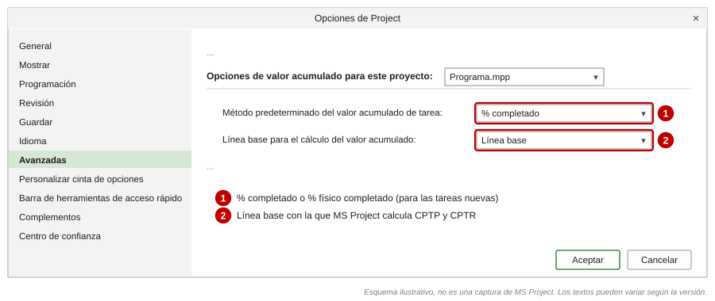
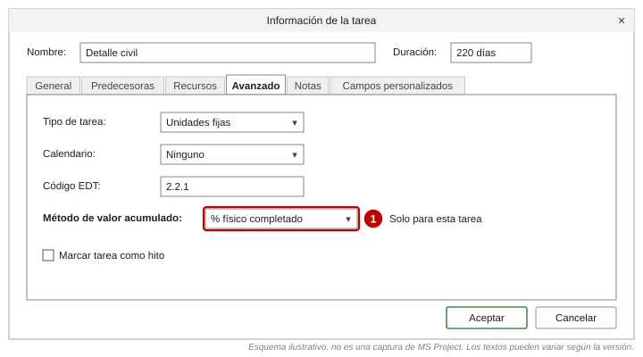

# Métodos de medición del valor ganado

[Inicio](../README.md) › [Documentación](README.md) › Métodos de medición

El **método de medición** (técnica de valor ganado) define cómo se convierte el avance de un paquete de
trabajo en **valor ganado (EV)**. Se elige uno por paquete al planificar y se mantiene durante toda su
ejecución. Este documento describe los métodos que admite el programa, cómo se configuran y cómo se
registra el avance en MS Project para cada uno, y cómo usar el método de valor acumulado propio de
MS Project.

> Las imágenes de MS Project son **esquemas ilustrativos**, no capturas. Los nombres de menú
> corresponden a MS Project en español 2016 a 2024 y a la versión de suscripción; pueden variar
> levemente según la versión.

---

## Contenido

1. [Resumen de los métodos](#1-resumen-de-los-métodos)
2. [Configurar el método de cada paquete](#2-configurar-el-método-de-cada-paquete)
3. [Los métodos en detalle](#3-los-métodos-en-detalle)
   - [3.1 0/100](#31-0100)
   - [3.2 Fórmulas fijas 50/50, 25/75 y 20/80](#32-fórmulas-fijas-5050-2575-y-2080)
   - [3.3 Hitos ponderados](#33-hitos-ponderados)
   - [3.4 % Completado](#34--completado)
   - [3.5 % Físico completado](#35--físico-completado)
   - [3.6 Unidades completadas](#36-unidades-completadas)
   - [3.7 Avance lineal (LOE)](#37-avance-lineal-loe)
   - [3.8 CPTR de MS Project](#38-cptr-de-ms-project)
4. [Guía para elegir el método](#4-guía-para-elegir-el-método)
5. [Método del valor acumulado de MS Project (opcional)](#5-método-del-valor-acumulado-de-ms-project-opcional)
6. [Buenas prácticas](#6-buenas-prácticas)

---

## 1. Resumen de los métodos

| Método (columna C) | EV acumulado | Qué se registra en MS Project cada mes |
|---|---|---|
| `0/100` | 0 hasta terminar; BAC al terminar. | Paquete al 100 % (o *Fin real*) al terminar. |
| `50/50`, `25/75`, `20/80` (`X/Y`) | X % del BAC al comenzar; 100 % al terminar. | *Comienzo real* (o cualquier avance) al comenzar; 100 % al terminar. |
| `Hitos ponderados` | BAC × Σ pesos de los hitos cumplidos / Σ pesos. | Cada hito al 100 % cuando se cumple. |
| `% Completado` | BAC × *% completado* de las subtareas, ponderado por su costo de línea base. | *% completado* (o duración real) de las tareas. |
| `% Físico completado` | BAC × *% físico completado* de las subtareas, ponderado por su costo de línea base. | *% físico completado* estimado o medido. |
| `Unidades completadas` | BAC × unidades hechas / unidades totales. | El cociente, en *% físico completado*. |
| `Avance lineal (LOE)` | EV = PV acumulado de la fila. | Nada específico (fechas reales recomendables). |
| `CPTR de MS Project` | EV = CPTR (valor acumulado) de MS Project, limitado al BAC. | Según el *Método de valor acumulado* de cada tarea. |
| `Por definir` u otro texto | Se usa `% Completado` y se informa. | — |

El detalle del cálculo (ponderación por costo, valor del mes, controles) está en
[Cálculo de EV y AC](calculo-ev-ac.md#3-ev-acumulado-de-cada-fila).

---

## 2. Configurar el método de cada paquete

El método se puede definir en MS Project (recomendado: queda junto al cronograma y se traslada a cada
libro nuevo) o directamente en Excel, en la columna C de la hoja `PV`.

### 2.1 En MS Project: campo personalizado «Método EVM»

1. Clic derecho en el encabezado de una columna > **Campos personalizados** (también en *Proyecto >
   Campos personalizados*).
2. **Campo: Tarea**, **Tipo: Texto**. Se selecciona un campo libre, por ejemplo *Texto10*, y con
   **Cambiar nombre...** se le asigna el nombre `Método EVM`.
3. En **Atributos personalizados** se elige **Búsqueda...** y se escriben los valores de la lista:
   `0/100`, `50/50`, `25/75`, `20/80`, `Hitos ponderados`, `% Completado`, `% Físico completado`,
   `Unidades completadas`, `Avance lineal (LOE)`, `CPTR de MS Project`. Se recomienda **desmarcar**
   *Permitir introducir elementos adicionales en los campos*, para que solo se admitan valores de la
   lista.
4. Se inserta la columna `Método EVM` (clic derecho en un encabezado > *Insertar columna*) y se completa
   en las tareas de **nivel 3** (paquetes de trabajo) y en las de nivel 1 o 2 que no tengan
   subelementos.
5. En `config.toml` se indica `metodo = "Método EVM"` (o `metodo = "Text10"`).

Para el método `Hitos ponderados` se crea, de la misma forma, un campo **Número** (por ejemplo
*Número1*) con el nombre `Peso hito`, y en `config.toml` se indica `peso_hito = "Peso hito"`.

### 2.2 En Excel: columna C de la hoja `PV`

La columna C tiene una lista desplegable con los métodos de la hoja `Listas`. Se puede cambiar en
cualquier momento; `actualizar` usa el valor de la columna C. Al regenerar el libro con
`--migrar-desde`, el método se conserva solo si fue **editado en Excel**; si no, se toma el de
MS Project.

Las filas sin método reciben `metodo_por_defecto` (`Por definir`) y se informan en `Validación`.
También se reconocen otros textos: fórmulas con `%` (`50%/50%`), cualquier `X/Y` con X + Y = 100
(`40/60`), o textos que contengan "hito", "físico", "unidad", "lineal" o "LOE".

---

## 3. Los métodos en detalle

### 3.1 0/100

**Regla:** el paquete no gana valor hasta que termina; al terminar gana el 100 % del BAC.

**Cuándo usarlo:** paquetes cortos que empiezan y terminan dentro del mismo período de informe (un
mes), o entregas puntuales (un suministro que solo tiene valor al recibirse).

**En MS Project:** al terminar el paquete se marca al **100 %** (botón *100%* de la pestaña *Tarea*, o
*% completado* = 100 en la tabla *Seguimiento*). Se considera terminado con *% completado* = 100, o con
*Fin real* y *% completado* ≥ 99,5.

**Precaución:** si el paquete dura varios meses, el EV es 0 durante toda su ejecución mientras se
acumula costo real: el CPI y el SPI del paquete aparecen muy bajos hasta el final (es lo que muestra el
paquete `1.2.1` del [ejemplo](ejemplo-paso-a-paso.md)).

### 3.2 Fórmulas fijas 50/50, 25/75 y 20/80

**Regla:** X % del BAC al comenzar y el resto al terminar. Se admite cualquier par `X/Y` que sume 100.

**Cuándo usarlo:** paquetes de hasta dos períodos. `25/75` o `20/80` cuando el valor se concentra al
final (por ejemplo, una prueba cuyo resultado es lo que importa).

**En MS Project:** al comenzar, se registra el *Comienzo real* (o cualquier *% completado* o *% físico
completado* mayor que 0); al terminar, 100 %.

**Ejemplo:** paquete de 400.000 € con `50/50`: 200.000 € el mes en que comienza y 200.000 € el mes en
que termina. Si comienza y termina el mismo mes, 400.000 € ese mes.

### 3.3 Hitos ponderados

**Regla:** el paquete se divide en hitos con un **peso**; el EV es el BAC multiplicado por la suma de
los pesos de los hitos cumplidos dividida por la suma de todos los pesos. Un hito está cumplido cuando
su *% completado* es 100.

**Cuándo usarlo:** paquetes de 3 meses o más con entregables intermedios verificables (ingeniería con
revisiones, fabricación con pruebas en fábrica, obras con certificaciones parciales). Es el método más
recomendado para paquetes largos porque es **objetivo**.

**Implementación en MS Project, paso a paso:**

1. **Estructura:** el paquete es una tarea de nivel 3 (con código EDT) cuyas subtareas son las
   actividades de trabajo y los **hitos** (tareas de duración 0, o marcadas con *Marcar tarea como hito*
   en *Información de la tarea > Avanzado*). Los hitos no necesitan código EDT: el programa los suma en
   su paquete.
2. **Vínculos:** cada hito se vincula como sucesor de las actividades que producen su entregable, para
   que su fecha se mueva con el trabajo.
3. **Costos:** el presupuesto se carga en las actividades de trabajo, no en los hitos
   ([Presupuesto](presupuesto-bac.md)). El EV del paquete depende de los pesos, no de qué actividad
   tiene el costo.
4. **Pesos:** campo `Peso hito` (*Número1*) en cada hito. Se recomienda que sumen 100 y que sean
   proporcionales al presupuesto del trabajo que lleva a cada hito. Si ningún hito tiene peso, todos
   pesan igual.
5. **Método:** `Hitos ponderados` en el campo `Método EVM` del paquete.
6. **Criterio de cumplimiento:** en las *Notas* de cada hito se escribe la evidencia que lo da por
   cumplido (por ejemplo, "plano aprobado por el cliente", "acta de prueba FAT firmada").
7. **Cada mes:** se marca al **100 %** cada hito cumplido en el mes, con su *Fin real*. Un hito no
   cumplido no se marca parcialmente: se reprograma.

**Ejemplo** (paquete de 600.000 € con tres hitos, como `2.1.2 Diseño conceptual` del ejemplo):

| Hito | Peso | Cumplido en | EV acumulado al final del mes |
|---|---:|---|---:|
| Bases aprobadas | 30 | mayo | 180.000 |
| Alternativa seleccionada | 30 | julio | 360.000 |
| Informe aprobado | 40 | septiembre | 600.000 |

**Respaldo:** si la fila no tiene hitos, se usa *% físico completado* (si alguna subtarea lo tiene
registrado) o *% completado*, y se informa. Se consideran todos los hitos que dependen de la fila, en
cualquier nivel.

**Recomendaciones:**

- Al menos un hito por período de informe: si entre dos hitos pasan muchos meses, el SPI del paquete
  oscila (cero avance durante meses y un salto al cumplirse el hito).
- Los pesos se fijan al guardar la línea base y solo se cambian por control de cambios.
- Si un entregable se puede medir parcialmente (por ejemplo, planos emitidos), se puede combinar con
  `% Físico completado` dividiendo el paquete en dos.

### 3.4 % Completado

**Regla:** BAC × *% completado* de las subtareas, ponderado por su costo de línea base.

**Cuándo usarlo:** cuando no hay una medida física mejor y la duración transcurrida es un indicador
razonable del avance.

**En MS Project:** se registra el *% completado* de cada tarea de detalle (botones *0%* a *100%* de la
pestaña *Tarea*, tabla *Seguimiento*, o *Proyecto > Actualizar proyecto*), o la *Duración real* y la
*Duración restante*.

**Precaución:** el *% completado* de MS Project mide el **% de la duración** transcurrida, no del
trabajo realizado: una tarea al 50 % de su duración puede tener mucho menos trabajo hecho. Para medir
el avance físico se recomienda `% Físico completado` o `Hitos ponderados`.

### 3.5 % Físico completado

**Regla:** BAC × *% físico completado* de las subtareas, ponderado por su costo de línea base.

**Cuándo usarlo:** trabajo cuyo avance se puede estimar o medir con independencia de la duración
(planos emitidos sobre el total, metros de cañería montados, porcentaje de una obra certificado).

**En MS Project:** el campo *% físico completado* se escribe siempre a mano: se inserta la columna
*% físico completado* o se usa la tabla *Seguimiento* (columna *% físico comp.*). No modifica la
duración ni el *% completado*.

**Recomendación:** definir para cada paquete **cómo** se mide (qué unidad, qué evidencia) y registrar el
criterio en las *Notas* de la tarea, para que la medición sea reproducible mes a mes.

### 3.6 Unidades completadas

**Regla:** BAC × unidades hechas / unidades totales. El cociente se registra en *% físico completado*.

**Cuándo usarlo:** trabajo repetitivo en unidades homogéneas (m³ excavados, t de acero montadas,
equipos instalados).

**En MS Project:**

1. Se recomienda crear dos campos *Número* para registrar las cantidades, por ejemplo `Unidades
   totales` y `Unidades hechas`, y un tercer campo con una **fórmula** que calcule el porcentaje (unidades
   hechas / unidades totales × 100) como referencia.
2. Cada mes se actualiza `Unidades hechas` y se copia el porcentaje calculado en *% físico completado*
   (el campo *% físico completado* no admite fórmulas).
3. Si el presupuesto se cargó con un **recurso material** ([Presupuesto](presupuesto-bac.md#3-opción-b-recursos-materiales)),
   las unidades totales son las de la asignación.

**Ejemplo:** movimiento de tierras de 40.000 m³ con BAC 3.200.000 €; al cierre de mes se excavaron
18.000 m³ → 45 % → EV = 1.440.000 €.

### 3.7 Avance lineal (LOE)

**Regla:** EV = PV acumulado de la fila (nivel de esfuerzo, *Level of Effort*). El paquete nunca tiene
variación de cronograma (SV = 0, SPI = 1); sí puede tener variación de costo.

**Cuándo usarlo:** actividades de soporte sin entregables medibles que duran lo que dura el proyecto:
dirección, oficina de proyecto (PMO), control de proyectos, administración de contratos.

**En MS Project:** no requiere un dato específico; se recomienda registrar las fechas reales para que el
cronograma sea coherente.

**Precaución:** el LOE "diluye" los índices del proyecto (aporta SPI = 1). Se debe limitar a lo
indispensable y no mezclar en el mismo paquete trabajo de soporte con trabajo medible.

### 3.8 CPTR de MS Project

**Regla:** EV = CPTR (*BCWP*, valor acumulado) que calcula MS Project a la fecha de estado, limitado al
BAC de la fila.

**Cuándo usarlo:** cuando el avance se gestiona con el método de valor acumulado de MS Project y se
quiere que el libro coincida exactamente con las tablas de valor acumulado de MS Project
([sección 5](#5-método-del-valor-acumulado-de-ms-project-opcional)).

**Cómo calcula MS Project el CPTR** (según el *Método de valor acumulado* de la tarea):

- **% completado:** aplica el *% completado* sobre la duración de la línea base y suma el costo previsto
  escalonado hasta ese punto. Si la línea base no es lineal (por ejemplo, con costos al comienzo), el
  resultado difiere de BAC × % completado.
- **% físico completado:** usa el *% físico completado* registrado, con independencia de la duración.

**Requisitos y comportamiento del programa:**

- La línea base del informe debe ser la misma que MS Project usa para el valor acumulado. Si no lo es,
  el programa usa la fracción CPTR / costo de esa línea base y lo advierte.
- Si el CPTR supera el BAC de la fila, se limita y se informa. Si MS Project no informa el CPTR, se usa
  `% Completado`.
- Con archivos XML, el CPTR es el calculado al guardar el archivo: se debe guardar después de fijar la
  fecha de estado.

---

## 4. Guía para elegir el método

| Duración del paquete o tipo de trabajo | Método sugerido |
|---|---|
| Empieza y termina en el mismo mes | `0/100` |
| Hasta 2 meses | `50/50` (o `25/75`, `20/80` si el valor se concentra al final) |
| 3 meses o más, con entregables intermedios | `Hitos ponderados` (al menos un hito por mes) |
| Trabajo medible en cantidades (m³, planos, equipos) | `% Físico completado` o `Unidades completadas` |
| Gestión, soporte, supervisión | `Avance lineal (LOE)`, limitado a lo indispensable |
| Gestión del avance con el valor acumulado de MS Project | `CPTR de MS Project` |

---

## 5. Método del valor acumulado de MS Project (opcional)

MS Project calcula su propio valor ganado, que llama **valor acumulado** (campo **CPTR**), con el
campo **Método de valor acumulado** de cada tarea: **% completado** (por defecto) o **% físico
completado**. Usarlo es opcional: el programa calcula los métodos de la sección 3 por su cuenta a partir
del avance registrado.

### 5.1 Configuración

1. **Para el proyecto** (valor por defecto de las tareas nuevas y línea base del valor acumulado):
   *Archivo > Opciones > Avanzadas > Opciones de valor acumulado para este proyecto*:
   - *Método predeterminado del valor acumulado de tarea*: `% completado` o `% físico completado`;
   - la **línea base** con la que MS Project calcula el valor acumulado. Debe ser la misma que la del
     informe (`linea_base` en la [configuración](configuracion.md)); por defecto el programa usa esta.

   

2. **Para una tarea:** *Información de la tarea* > pestaña *Avanzado* (*Avanzada* en algunas versiones)
   > *Método de valor acumulado*. Se pueden seleccionar varias tareas y cambiarlas juntas.

   

3. **Para consultar** el valor acumulado de MS Project: *Vista > Tablas > Más tablas* > **Valor
   acumulado**, **Indicadores de costo del valor acumulado** o **Indicadores de programación del valor
   acumulado**. MS Project usa la [terminología en español](glosario.md) CPTP (PV), CPTR (EV) y CRTR
   (AC).

### 5.2 Formas de trabajo

| Forma | Configuración | Ventajas | Desventajas |
|---|---|---|---|
| **A. El programa calcula el EV** (recomendada) | MS Project con el método por defecto. Cada paquete con su método en `Método EVM` (0/100, hitos, % físico...). | Métodos que MS Project no tiene (0/100, 50/50, hitos ponderados); un solo dato de avance por tarea. | Las tablas de valor acumulado de MS Project no coinciden con el libro. |
| **B. MS Project calcula el EV** | *% físico completado* como método de valor acumulado; `CPTR de MS Project` en `Método EVM`. El *% físico completado* se registra **según la regla** de cada paquete (ver abajo). | El libro coincide con las tablas de valor acumulado de MS Project. | La regla de cada método se aplica a mano; más propenso a errores. |
| **C. Mixta** | `CPTR de MS Project` solo en algunos paquetes. | Flexibilidad. | Dos criterios en el mismo informe: se debe documentar. |

**Registro del *% físico completado* según la regla de cada método (forma B):**

| Método del paquete | *% físico completado* que se registra |
|---|---|
| 0/100 | 0 hasta terminar; 100 al terminar. |
| 50/50 (X/Y) | 50 (X) al comenzar; 100 al terminar. |
| Hitos ponderados | Suma de los pesos de los hitos cumplidos (si suman 100). |
| Unidades completadas | Unidades hechas / unidades totales × 100. |
| % físico | El avance medido. |

MS Project calcula el CPTR de una tarea resumen sumando el de sus subtareas: el *% físico completado*
se registra en las tareas de detalle. Por eso la forma B es práctica cuando cada paquete es una sola
tarea; para paquetes con subtareas e hitos se recomienda la forma A.

---

## 6. Buenas prácticas

- Definir el método de cada paquete **antes** de comenzarlo y mantenerlo durante toda su ejecución.
- Preferir métodos **objetivos**: hitos con criterio de aceptación, cantidades medidas, fórmulas fijas
  para paquetes cortos. Evitar porcentajes estimados sin evidencia.
- Paquetes de duración acotada: un paquete muy largo con `% Completado` esconde los problemas hasta el
  final.
- Limitar el `Avance lineal (LOE)` a las actividades de soporte.
- Documentar el criterio de medición de cada paquete (en las *Notas* de la tarea o en un anexo del plan
  de gestión) y revisarlo con los responsables de paquete.
- Revisar cada mes, con `actualizar --simular`, las observaciones por fila: métodos no definidos,
  respaldo por falta de hitos o de CPTR, valores del mes negativos.

Más información de Microsoft: [Cambiar el tipo de porcentaje completado para el análisis del valor
acumulado](https://support.microsoft.com/es-es/project/change-complete-type-for-earned-value-analysis),
[Análisis de valor acumulado](https://support.microsoft.com/es-es/project/earned-value-analysis-for-the-rest-of-us).
Ver también [Recursos externos](recursos-externos.md).
