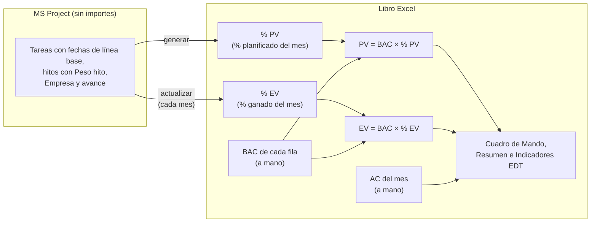
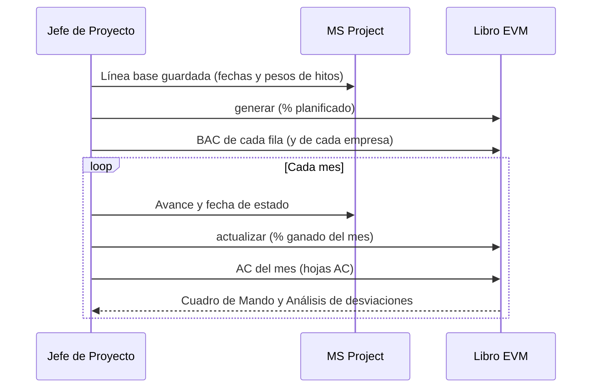

# Modo porcentaje (por defecto)

[Inicio](../README.md) › [Documentación](README.md) › Modo porcentaje

En el **modo porcentaje**, que es el modo por defecto, el cronograma de MS Project **no necesita
importes**. Para cada fila del libro (paquete de trabajo), el programa calcula desde MS Project el
**% planificado** de cada mes y el **% ganado** a la fecha de corte. El importe es el **BAC que se
ingresa en el libro** multiplicado por ese %. El AC se carga a mano.

El otro modo, el **modo costo** (`modo = "costo"`), toma el PV y el BAC del costo de línea base de
MS Project ([Cálculo del PV](calculo-pv.md), [Presupuesto (BAC)](presupuesto-bac.md)).

---

## Contenido

1. [Cuándo usarlo](#1-cuándo-usarlo)
2. [Cómo funciona](#2-cómo-funciona)
3. [Preparación en MS Project](#3-preparación-en-ms-project)
4. [Configuración](#4-configuración)
5. [Curva planificada: peso de cada tarea](#5-curva-planificada-peso-de-cada-tarea)
6. [Avance ganado: métodos de medición](#6-avance-ganado-métodos-de-medición)
7. [Multi-empresa](#7-multi-empresa)
8. [Hojas del libro](#8-hojas-del-libro)
9. [Puesta en marcha y cierre mensual](#9-puesta-en-marcha-y-cierre-mensual)
10. [Cambios de BAC y de línea base](#10-cambios-de-bac-y-de-línea-base)
11. [Validaciones](#11-validaciones)
12. [Diferencias con el modo costo](#12-diferencias-con-el-modo-costo)
13. [Preguntas frecuentes](#13-preguntas-frecuentes)

---

## 1. Cuándo usarlo

- El cronograma se **comparte** (con el cliente o entre las empresas de una unión temporal) y no debe
  tener importes: los costos y precios de detalle quedan fuera de MS Project.
- El presupuesto de cada paquete viene de **otra fuente** (contrato, oferta, presupuesto de cada
  empresa) y se quiere la curva S con el mismo cronograma que se entrega.
- El cronograma no tiene recursos ni costos cargados.

El modo costo conviene cuando el cronograma ya tiene los costos cargados (recursos o costos fijos) y el
PV debe seguir exactamente su distribución en el tiempo.

---

## 2. Cómo funciona



```text
PV del mes = BAC de la fila × % planificado del mes   (hoja % PV)
EV del mes = BAC de la fila × % ganado del mes        (hoja % EV)
AC del mes = se ingresa a mano                        (hoja AC)
```

- `generar` calcula el % planificado de cada fila con las **fechas de la línea base** de sus tareas y el
  **peso** de sus hitos. La suma del % planificado de una fila es 100 %.
- `actualizar` calcula el % ganado acumulado de cada fila a la fecha de corte, según su método de
  medición, y escribe el **% del mes**: la diferencia con lo cargado en los meses anteriores.
- El PV y el EV son **fórmulas de Excel**: al escribir o cambiar el BAC de una fila, se recalculan
  todos sus meses.
- El BAC y el AC deben estar en la **misma base** (por ejemplo, ambos a precio de contrato), para que el
  CPI compare valores comparables.

---

## 3. Preparación en MS Project

La preparación es la de [Preparación en MS Project](preparacion-ms-project.md), sin la carga de costos:

| Paso | Modo porcentaje |
|---|---|
| Código EDT | Igual que en el modo costo: cada fila del libro es un elemento EDT hasta el nivel máximo. |
| Costos | **No hacen falta.** No se asignan recursos ni costos fijos. Si el proyecto tiene costos, no se usan y se informa en `Validación`. |
| Línea base | Se guarda igual (*Proyecto > Establecer línea base*): el % planificado usa sus **fechas**. |
| Tareas de detalle | Su **duración** define su peso dentro del paquete: conviene que las tareas representen el trabajo del paquete. Una tarea larga de poco valor pesa más que una corta de mucho valor. |
| Hitos | Con el campo `Peso hito` (*Número1*): el % del BAC del paquete que se gana al cumplir el hito ([sección 5](#5-curva-planificada-peso-de-cada-tarea)). |
| Método de medición | Campo `Método EVM` (*Texto10*), como en el modo costo ([Métodos de medición](metodos-de-medicion.md)). |
| Avance | *% completado*, *% físico completado*, comienzo y fin reales, y la fecha de estado. |
| Multi-empresa | Columnas `Empresa` y `% Reparto` ([sección 7](#7-multi-empresa)). |

> **Pesos visibles.** El cronograma no tiene importes, pero sí los `Peso hito`. Si quien recibe el
> cronograma conoce también el BAC del paquete, puede calcular el valor de cada hito. Cuando eso no se
> debe saber, se deja el peso vacío: los hitos no tienen valor propio y, con el método
> `Hitos ponderados`, pesan igual.

---

## 4. Configuración

```toml
[campos]
metodo = "Método EVM"
peso_hito = "Peso hito"

[exportacion]
modo = "porcentaje"        # por defecto; "costo" para usar los costos de MS Project
distribucion = "habiles"   # reparto de la duración de cada tarea: tiempo laborable o "calendario"
```

- El modo se fija al generar el libro y se guarda en la hoja oculta `_meta`: `actualizar` usa siempre el
  modo con el que se generó el libro.
- La lista de métodos por defecto no incluye `CPTR de MS Project`, que necesita costos.
- El calendario es el del proyecto (XML) o de lunes a viernes con los `feriados` de la configuración
  (`.mpp`).

Ver todas las claves en [Configuración](configuracion.md).

---

## 5. Curva planificada: peso de cada tarea

Cada tarea de detalle de la fila recibe un peso (una fracción del BAC de la fila):

| Tarea | Peso | Reparto en el tiempo |
|---|---|---|
| Tarea con duración | Su **duración laborable de la línea base**. Los pesos de las tareas se reparten el % que no tienen los hitos. | Proporcional al tiempo laborable de cada mes entre su comienzo y su fin. |
| Hito con `Peso hito` | Ese **% del BAC** de la fila. | Entero en el mes de su fecha. |
| Hito sin peso | Ninguno: es solo un evento. | — |

Casos especiales (se informan en `Validación`):

| Caso | Tratamiento |
|---|---|
| Los pesos de los hitos suman 100 | Los hitos se reparten todo el BAC; las tareas no reciben % planificado (sin aviso). |
| Los pesos de los hitos suman más de 100 | Se escalan a 100 % y las tareas no reciben % planificado. |
| Los pesos suman menos de 100 y la fila no tiene tareas con duración | Se escalan a 100 %. |
| `Peso hito` negativo | Se toma como 0. |
| Ninguna tarea con duración ni hito con peso | Todas las tareas pesan igual. |
| Tarea sin fechas de línea base (agregada después de guardarla) | Se usan sus fechas actuales y se advierte. |
| % planificado antes del mes 1 o después del último mes | Se acumula en el mes 1 o no aparece (se debe aumentar `meses`), y se advierte. |

**Ejemplo.** Paquete `3.2.1 Suministro de equipos`, BAC 1.000.000:

| Tarea | Duración | Peso hito | Peso | PV |
|---|---:|---:|---:|---:|
| Fabricación | 200 días | – | 70 % × 200 / 240 = 58,3 % | 583.333, repartido en sus meses |
| Transporte | 40 días | – | 70 % × 40 / 240 = 11,7 % | 116.667, repartido en sus meses |
| Hito FAT | – | 10 | 10 % | 100.000 en el mes del hito |
| Hito equipos en obra | – | 20 | 20 % | 200.000 en el mes del hito |
| **Total** | | **30** | **100 %** | **1.000.000** |

Con pesos 40 y 60 (suman 100), los hitos se reparten todo el BAC: 400.000 en el mes del FAT y 600.000
en el de la llegada a obra, y la fabricación y el transporte no tienen PV.

---

## 6. Avance ganado: métodos de medición

El método de cada fila es el de la columna C de la hoja `PV`, como en el modo costo
([Métodos de medición](metodos-de-medicion.md)). Los pesos son los del % planificado:

| Método | % ganado acumulado |
|---|---|
| `0/100`, `50/50`, `X/Y` | X % cuando comienza alguna tarea; 100 % cuando terminan todas. |
| `Hitos ponderados` | Σ `Peso hito` de los hitos cumplidos / Σ pesos de todos los hitos de la fila. Si ningún hito tiene peso, pesan igual. |
| `% Completado` | Σ peso de cada tarea × su *% completado*. Un hito cuenta su peso cuando está cumplido. |
| `% Físico completado`, `Unidades completadas` | Igual, con el *% físico completado*. |
| `Avance lineal (LOE)` | El % planificado acumulado (EV = PV). |
| `CPTR de MS Project` | No disponible: se usa `% Completado` y se informa. |
| `Por definir` u otro texto | Se usa `% Completado` y se informa. |

**Ejemplo** con el suministro anterior (pesos 10 y 20), a la fecha de corte: FAT cumplido, fabricación
terminada y transporte al 50 %, método `% Completado`:

```text
% ganado = 10 % (FAT) + 58,3 % × 100 % + 11,7 % × 50 % = 74,2 %
EV       = 1.000.000 × 74,2 % = 741.667
```

---

## 7. Multi-empresa

Con `[multiempresa] activar = true` ([Multi-empresa](multiempresa.md)):

- El **BAC de cada empresa** se ingresa en su hoja (`PV-EmpresaA` y `PV-EmpresaB`); el BAC de la hoja
  `PV` es la suma.
- Cada empresa tiene **su % planificado y su % ganado** en cada fila, con las tareas en las que
  participa según la columna `Empresa`:

  | Columna `Empresa` | Peso de la tarea para la empresa A (la empresa B recibe el resto) |
  |---|---|
  | Empresa A | Toda su duración. |
  | Empresa B | Nada. |
  | `Ambas` | Su duración × `% Reparto`; si está vacío, 50 %. |
  | Vacía | La de su tarea superior. |

- Un **hito** vale su `Peso hito` para cada empresa que participa en él: el `% Reparto` reparte la
  duración de las tareas, no el peso de los hitos.
- Los métodos `0/100`, `X/Y` y `Hitos ponderados` también se miden **por empresa**, con sus tareas y sus
  hitos: una empresa que terminó su parte no espera a la otra.
- Si una empresa **no participa** en ninguna tarea de la fila y se le asigna BAC, se usan el % planificado
  y el avance de la fila completa (se informa en `Validación` y en `actualizar`).
- El **AC** de cada empresa se carga a mano en `AC-EmpresaA` y `AC-EmpresaB` (no se usa
  `ac_desde_project`).

**Ejemplo.** Paquete `3.1.1 Movimiento de tierras`:

- Excavación, de la empresa A: 20 días hábiles en febrero.
- Estructura, `Ambas` con `% Reparto` = 40: 30 días hábiles, 10 en marzo y 20 en abril.

| | Pesos (días) | Febrero | Marzo | Abril |
|---|---|---:|---:|---:|
| % planificado A | Excavación 20, Estructura 30 × 40 % = 12 | 62,5 % | 12,5 % | 25 % |
| % planificado B | Estructura 30 × 60 % = 18 | – | 33,3 % | 66,7 % |
| PV A (BAC 300.000) | | 187.500 | 37.500 | 75.000 |
| PV B (BAC 700.000) | | – | 233.333 | 466.667 |

A 31 de marzo, con la excavación al 100 % y la estructura al 30 % (método `% Completado`):

| Empresa | % ganado | EV | PV acumulado | SPI |
|---|---:|---:|---:|---:|
| A | (20 × 100 % + 12 × 30 %) / 32 = 73,75 % | 221.250 | 225.000 | 0,98 |
| B | 30 % | 210.000 | 233.333 | 0,90 |
| **Total** | | **431.250** | **458.333** | **0,94** |

---

## 8. Hojas del libro

| Hoja | Contenido | Celdas amarillas |
|---|---|---|
| `PV` (o `PV-EmpresaA` y `PV-EmpresaB`) | Columna D: BAC de cada fila. Meses: BAC × % planificado. | **El BAC** |
| `% PV` (o `% PV-EmpresaA` y `% PV-EmpresaB`) | % planificado de cada mes, que calcula `generar`. No se edita. | — |
| `EV` (o `EV-EmpresaA` y `EV-EmpresaB`) | Meses: BAC × % ganado. | — |
| `% EV` (o `% EV-EmpresaA` y `% EV-EmpresaB`) | % ganado de cada mes (no acumulado), que calcula `actualizar`. La columna final es el % ganado acumulado. | — |
| `AC` (o `AC-EmpresaA` y `AC-EmpresaB`) | AC de cada mes. | **El AC del mes** |
| `PV`, `EV` y `AC` en multi-empresa | Suma de las dos empresas. | — |

- En las hojas `%`, las filas de nivel 1 y 2 y la fila TOTAL muestran el % ponderado por el BAC (importe
  / BAC).
- La columna *Total horizonte* de la hoja `PV` se muestra en rojo si no coincide con el BAC, y la de la
  hoja `% PV` si una fila de ingreso no suma 100 %.
- El Cuadro de Mando, el Resumen, los Indicadores EDT, la Evolución mensual y el Análisis de
  desviaciones son los mismos del modo costo ([El libro Excel](libro-excel.md)).


*Hoja `% PV` del [proyecto de ejemplo](ejemplo-paso-a-paso.md): % planificado de cada paquete y mes.
Las filas de nivel 1 y 2 muestran el % ponderado por el BAC.*


*Hoja `PV`: el BAC de cada paquete (columna D, celdas amarillas) se ingresa a mano; los meses son el
BAC × el % de la hoja `% PV`.*

---

## 9. Puesta en marcha y cierre mensual



1. **Una vez:** `generar` y escribir el BAC de cada fila en la columna D de la hoja `PV` (o de
   `PV-EmpresaA` y `PV-EmpresaB`).
2. **Cada mes:**
   - Registrar el avance en MS Project y fijar la fecha de estado.
   - Ejecutar `actualizar`, que escribe el % ganado del mes.
   - Cargar el AC del mes en las celdas amarillas de la hoja `AC`.
   - Si el AC se carga después de `actualizar`, ejecutar `analizar` para actualizar el Análisis de
     desviaciones con el AC cargado ([Comandos](comandos.md)).

El AC y el % ganado se pueden cargar en cualquier orden. `actualizar` no modifica el AC.

---

## 10. Cambios de BAC y de línea base

| Cambio | Qué hacer | Efecto |
|---|---|---|
| Cambio aprobado del BAC de una fila | Escribir el nuevo BAC en la columna D. | El PV y el EV de **todos los meses** de la fila se recalculan con el nuevo BAC (el SPI de la fila en los meses anteriores no cambia). El AC no cambia. Lo informado en cada mes queda en la copia de respaldo de cada `actualizar`. |
| Nueva línea base o cambio de EDT en MS Project | Generar un libro nuevo con `--migrar-desde` ([El libro Excel](libro-excel.md#4-cambios-de-línea-base-o-de-edt---migrar-desde)). | Se traslada el **BAC escrito**, el % ganado, el AC, los métodos y el análisis de desviaciones. Si varias filas anteriores pasan a una, el % ganado se combina ponderado por su BAC. |

`--migrar-desde` solo se admite entre libros del mismo modo.

---

## 11. Validaciones

`generar` informa en la hoja `Validación`, además de las [validaciones comunes](validaciones-y-problemas.md):

| Mensaje | Significado |
|---|---|
| Modo porcentaje: ... se debe ingresar el BAC | Recordatorio de dónde se ingresa el BAC. |
| N tareas tienen costo en MS Project | El proyecto tiene costos; en este modo no se usan. Para usarlos: `modo = "costo"`. |
| N tareas no tienen fechas de línea base | Se agregaron después de guardar la línea base: se usaron sus fechas actuales. |
| Los pesos de los hitos suman X % | Pesos mayores que 100, o menores sin tareas con duración: se escalaron a 100 %. |
| Las tareas no tienen duración ni hitos con peso | Todas las tareas de la fila pesan igual. |
| Ninguna tarea de la fila tiene fechas | La fila no tiene % planificado: su BAC no se puede repartir. |
| EmpresaX no participa en las tareas de N filas | Si se le asigna BAC en esas filas, se usa la curva de la fila completa. |
| % planificado anterior al mes 1 / posterior al último mes | Revisar `mes_inicio` y `meses`. |

`actualizar` informa además las filas con % ganado y **sin BAC** (su EV no se puede valorar) y, si
ninguna fila tiene BAC, que los indicadores quedan en 0.

---

## 12. Diferencias con el modo costo

| Aspecto | Modo porcentaje (por defecto) | Modo costo |
|---|---|---|
| Importes en MS Project | No hacen falta | Recursos y costos fijos |
| BAC | Se ingresa en el libro | Costo de línea base de MS Project |
| PV del mes | BAC × % planificado (duración de la línea base y peso de los hitos) | Costo de línea base escalonado de MS Project |
| Peso de las tareas en el avance | Duración de la línea base | Costo de línea base |
| `Peso hito` | % del BAC de la fila | Peso relativo entre los hitos (`Hitos ponderados`) |
| EV | BAC × % ganado (fórmula) | BAC × fracción ganada (valor) |
| AC | A mano | CRTR de MS Project o a mano |
| `CPTR de MS Project` | No disponible | Disponible |
| Hojas adicionales | `% PV` y `% EV` | — |

---

## 13. Preguntas frecuentes

**¿Se puede ver el avance en % en lugar de importes?** Sí: las hojas `% PV` y `% EV` muestran el % de
cada mes, y su última columna el total o el acumulado.

**¿Qué pasa si no se ingresa el BAC?** El PV y el EV de la fila quedan en 0. `actualizar` carga igual el
% ganado y advierte; al ingresar el BAC, los importes se calculan solos.

**¿Sirven los pesos relativos de hitos (1, 2, 3)?** En este modo el `Peso hito` es un % del BAC: pesos
1, 2 y 3 suman 6 % y el 94 % restante se reparte entre las tareas por duración. Para un paquete medido
con `Hitos ponderados`, los pesos deben sumar 100.

**¿Se pueden usar los costos de MS Project?** Sí, con `modo = "costo"` en `[exportacion]` y generando un
libro nuevo.
