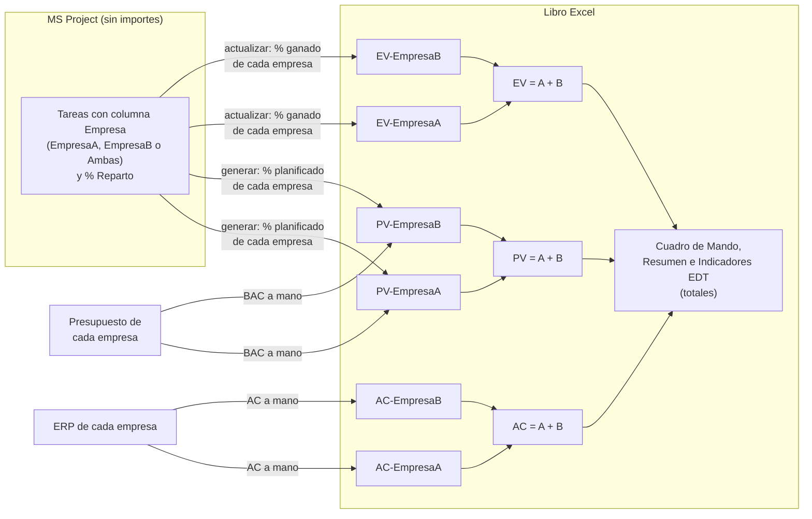
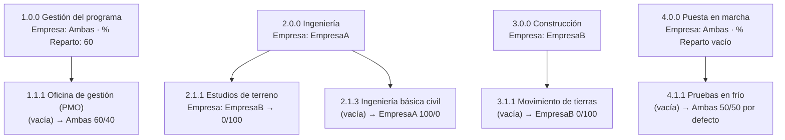
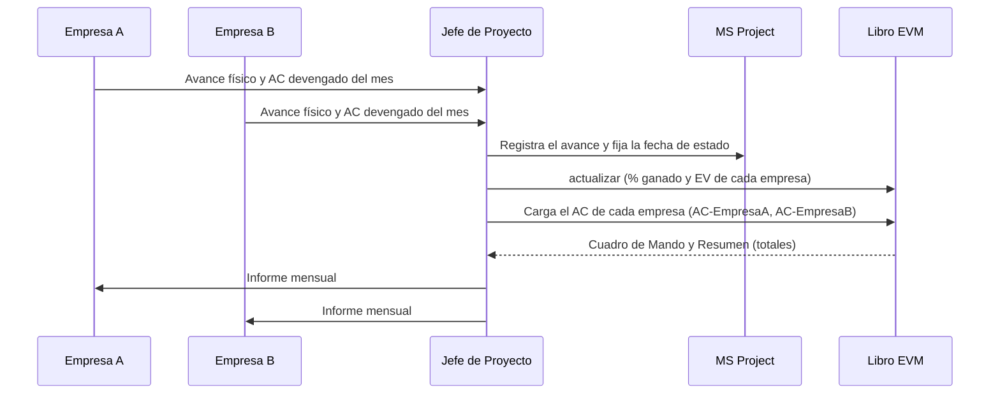

# Multi-empresa (opcional)

[Inicio](../README.md) › [Documentación](README.md) › Multi-empresa

Cuando el proyecto se ejecuta entre **dos empresas** (por ejemplo, dos empresas que ejecutan juntas un
contrato, o una empresa y su socio tecnológico), el libro puede separar el PV, el EV y el AC de cada una,
además del total del proyecto. La opción está **desactivada por defecto**.

Para cada empresa:

- el **BAC** de cada fila se ingresa a mano en su hoja PV (`PV-EmpresaA` o `PV-EmpresaB`);
- el **% planificado** y el **% ganado** de cada fila se calculan con las tareas en las que participa,
  según las columnas `Empresa` y `% Reparto` ([sección 5](#5-parte-de-cada-empresa-en-cada-tarea));
- el PV y el EV son su BAC × su % planificado y su % ganado;
- el **AC** se ingresa a mano en su hoja AC (`AC-EmpresaA` o `AC-EmpresaB`).

El cálculo de cada fila, con un ejemplo, se detalla en
[Cálculo del PV y el EV](calculo-pv-ev.md#10-multi-empresa).

---

## Contenido

1. [Cuándo usarlo](#1-cuándo-usarlo)
2. [Cómo funciona](#2-cómo-funciona)
3. [Preparación en MS Project](#3-preparación-en-ms-project)
4. [Configuración](#4-configuración)
5. [Parte de cada empresa en cada tarea](#5-parte-de-cada-empresa-en-cada-tarea)
6. [PV, EV y AC de cada empresa](#6-pv-ev-y-ac-de-cada-empresa)
7. [Validaciones y controles](#7-validaciones-y-controles)
8. [Hojas del libro](#8-hojas-del-libro)
9. [Ciclo mensual con dos empresas](#9-ciclo-mensual-con-dos-empresas)
10. [Preguntas frecuentes](#10-preguntas-frecuentes)

---

## 1. Cuándo usarlo

- Cada empresa es responsable de una parte del alcance y se necesita conocer el **desempeño de cada
  una** (CPI y SPI por empresa) además del total.
- Hay paquetes compartidos en los que cada empresa ejecuta una parte acordada del trabajo (por
  ejemplo, la gestión del programa 60/40).
- Cada empresa registra sus **costos reales en su propio sistema** (ERP) y el AC del proyecto es la suma
  de ambos.
- Cada empresa conoce el **presupuesto de su parte** de cada paquete, que no se carga en el cronograma
  compartido.

Si el proyecto lo ejecuta una sola empresa, no se necesita multi-empresa.

---

## 2. Cómo funciona



- Cada empresa tiene su propio % planificado y % ganado en cada fila, calculados con las tareas en las
  que participa, y su propio BAC. Su PV y su EV son su BAC × esos %.
- Una fila de nivel 3 puede incluir tareas de las dos empresas.
- En las hojas `PV`, `EV` y `AC` cada celda es la **suma** de las dos empresas (fórmula), también el
  BAC de la hoja `PV`.
- **Cuadro de Mando, Resumen e Indicadores EDT** usan los totales.

---

## 3. Preparación en MS Project

1. Se crea un campo personalizado de tarea de tipo *Texto* (por ejemplo *Texto3*) con el nombre
   `Empresa` y, en *Atributos personalizados > Búsqueda*, los valores `EmpresaA`, `EmpresaB` y `Ambas`
   ([Campos personalizados](preparacion-ms-project.md#3-campos-personalizados)). La tabla de búsqueda
   evita errores de escritura; los valores deben coincidir con `empresa_a`, `empresa_b` y `ambas` de la
   configuración (sin distinguir mayúsculas ni tildes).
2. Se crea un campo de tipo *Número* (por ejemplo *Número2*) con el nombre `% Reparto`: porcentaje de la
   empresa A en las tareas `Ambas` (por ejemplo, 80 = 80 % para la empresa A y 20 % para la empresa B).
3. Se insertan las dos columnas en la vista *Diagrama de Gantt* y se completa la columna `Empresa`. Una
   tarea sin empresa **hereda** la de su tarea superior (con su `% Reparto`): basta con completarla en
   las tareas resumen y en las subtareas que sean de otra empresa.


*Esquema ilustrativo (no es una captura de MS Project): la empresa se indica en las tareas resumen y
solo se repite en las subtareas que son de otra empresa.*

> **Recomendación:** acordar el reparto de los paquetes `Ambas` antes de guardar la línea base y
> documentarlo (por ejemplo, en el acuerdo entre las empresas). Cambiar la empresa o el `% Reparto` de una
> tarea después de generar el libro cambia el % ganado de cada empresa en el siguiente `actualizar`, pero
> su % planificado solo al regenerar el libro.

---

## 4. Configuración

```toml
[multiempresa]
activar = true
campo_empresa = "Empresa"        # campo de texto (Text3) o su alias
empresa_a = "EmpresaA"           # valor de la columna y sufijo de las hojas
empresa_b = "EmpresaB"
ambas = "Ambas"
campo_reparto = "% Reparto"      # campo numérico (Number2) o su alias
reparto_por_defecto = 50         # % de A si % Reparto está vacío, es 0 o está fuera de rango
```

Los nombres de las empresas se usan en los nombres de las hojas: máximo 15 caracteres, sin
`[ ] : * ? / \ '`. Ver todas las claves en [Configuración](configuracion.md).

`actualizar` usa los nombres de las empresas y los campos con los que se **generó** el libro (guardados
en la hoja oculta `_meta`), aunque la configuración no tenga la sección `[multiempresa]`.

---

## 5. Parte de cada empresa en cada tarea

La parte de cada empresa multiplica la **duración** de la tarea: es el peso que la tarea tiene en el %
planificado y en el % ganado de esa empresa ([sección 6](#6-pv-ev-y-ac-de-cada-empresa)). No reparte el
`Peso hito` de los hitos.

| Columna `Empresa` | Parte de la empresa A (la empresa B recibe el resto) |
|---|---|
| Empresa A | 100 % |
| Empresa B | 0 % |
| `Ambas` | El valor de `% Reparto`. Si está vacío o es 0, el reparto por defecto (`reparto_por_defecto`, 50 %). Si es negativo o mayor que 100, el reparto por defecto, y se informa en `Validación`. |
| Vacía | La de la tarea superior. Si ninguna tarea superior tiene empresa, se trata como `Ambas` con el reparto por defecto y se informa en `Validación`. |
| Otro valor | Se trata como `Ambas` con el reparto por defecto y se informa en `Validación`. |

- `% Reparto` solo se usa en las tareas `Ambas`; en las demás se ignora.
- En MS Project un campo numérico vacío vale 0, por eso 0 equivale a vacío. Para asignar el 100 % a una
  empresa se indica su nombre en `Empresa`.
- Una subtarea marcada `Ambas` sin `% Reparto` usa el reparto por defecto, **no** el de su tarea
  superior. Para heredar el reparto de la tarea superior, la columna `Empresa` de la subtarea se deja
  vacía.
- La herencia también llega desde las tareas que están por encima de la planificación exportada (por
  ejemplo, si la tarea `INTERNO` tiene empresa).

**Ejemplo de herencia** (proyecto de ejemplo):



*Entre paréntesis, el valor de la columna `Empresa` de la tarea; después de la flecha, el reparto A/B
resultante.*

---

## 6. PV, EV y AC de cada empresa

| Valor de cada empresa | Cálculo |
|---|---|
| BAC | Se ingresa a mano en la columna D de su hoja PV (`PV-EmpresaA` o `PV-EmpresaB`, celdas amarillas). |
| % planificado | Con las tareas de la fila en las que participa: cada tarea pesa su duración de la línea base × la parte de la empresa. Un hito vale su `Peso hito` para cada empresa que participa en él. `generar` lo escribe en `% PV-EmpresaA` y `% PV-EmpresaB`. |
| PV del mes | BAC de la empresa × su % planificado del mes. |
| % ganado | Según el método de la fila (columna C), con las tareas y los hitos de la empresa (tabla siguiente). `actualizar` escribe el % del mes en `% EV-EmpresaA` y `% EV-EmpresaB`. |
| EV del mes | BAC de la empresa × su % ganado del mes. |
| AC del mes | Se ingresa a mano en `AC-EmpresaA` y `AC-EmpresaB` (celdas amarillas). `actualizar` no lo modifica. |

| Método (columna C) | % ganado de cada empresa |
|---|---|
| `% Completado`, `% Físico completado`, `Unidades completadas` | Avance de sus tareas, ponderado por el peso que cada tarea tiene para la empresa. |
| `0/100`, `X/Y` | Según comiencen y terminen **sus** tareas: una empresa que terminó su parte no espera a la otra. |
| `Hitos ponderados` | Sus hitos cumplidos, ponderados por su `Peso hito`. |
| `Avance lineal (LOE)` | Su % planificado acumulado a la fecha de corte. |

Si una empresa **no participa** en ninguna tarea de la fila y se le asigna BAC, se usan el % planificado
y el avance de la fila completa (se informa en `Validación` y en `actualizar`).

**Ejemplo.** Paquete `3.1.1` con método `0/100`: la excavación (EmpresaA) terminó y el relleno compactado
(EmpresaB) está al 50 %. El % ganado de la empresa A es 100 %, porque terminaron todas sus tareas, y su EV
es todo su BAC; el de la empresa B es 0 % hasta que termine el relleno. Con el método `% Completado`, el
de la empresa B sería 50 %. Un ejemplo completo, con el % planificado, el PV y el SPI de cada empresa,
está en [Cálculo del PV y el EV](calculo-pv-ev.md#10-multi-empresa).

---

## 7. Validaciones y controles

`generar` (hoja `Validación`) y `validar` (en pantalla) informan:

- Las filas en las que una empresa **no participa** en ninguna tarea: si se le asigna BAC, su PV se
  reparte con el % planificado de la fila completa.
- Tareas **sin empresa** (ni propia ni heredada): se reparten con el reparto por defecto.
- Valores de empresa **no reconocidos** (por ejemplo, un error de escritura).
- `% Reparto` **fuera de rango** (negativo o mayor que 100).
- `% Reparto` en una tarea que no es `Ambas` (informativo: se ignora).
- Campo de empresa que existe, pero está vacío en todas las tareas (revisar `campo_empresa`).

`actualizar` indica en las observaciones de la fila cuándo una empresa con BAC no participa en sus
tareas y se usó el avance de la fila completa.


`--migrar-desde` traslada el BAC, el % ganado y el AC de cada empresa entre libros multi-empresa. No se
admite entre un libro de una sola empresa y uno multi-empresa, porque el historial no se puede repartir
entre las empresas.

---

## 8. Hojas del libro

Además de `PV`, `EV` y `AC`, se crean `PV-EmpresaA`, `PV-EmpresaB`, `EV-EmpresaA`, `EV-EmpresaB`,
`AC-EmpresaA` y `AC-EmpresaB` (con los nombres configurados), con el mismo formato, y `% PV-EmpresaA`,
`% PV-EmpresaB`, `% EV-EmpresaA` y `% EV-EmpresaB`, con el % de cada empresa. El BAC de cada empresa se
ingresa en la columna D de `PV-EmpresaA` y `PV-EmpresaB`.


*`PV-EmpresaA` del ejemplo: el BAC de la empresa A, en las celdas amarillas, es el 60 % de la gestión,
toda la ingeniería salvo los estudios de terreno y nada de la construcción; los meses son ese BAC × el %
planificado de la empresa A.*


*`% PV-EmpresaA`: % planificado de la empresa A en cada paquete y mes.*


*`EV-EmpresaB` (meses 13 a 24): el EV del mes de la empresa B, BAC × % ganado.*

Cada empresa puede comparar su PV planificado con la previsión de su plan de costes, una a la vez, con la
[depuración de costes](depuracion-costes.md) (`depuracion_empresa`).

---

## 9. Ciclo mensual con dos empresas



Se recomienda acordar con ambas empresas la **misma fecha de corte**, la misma base para el BAC y el AC
(por ejemplo, ambos a precio de contrato) y el mismo criterio de costo real (devengado), y que cada una
revise su EV antes de emitir el informe. El BAC de cada empresa se ingresa una vez, después de
`generar`, y se cambia solo con los cambios aprobados.

---

## 10. Preguntas frecuentes

**¿Se pueden ver los indicadores de cada empresa por separado?** El `Cuadro de Mando`, `Resumen` e
`Indicadores EDT` muestran los totales. Los valores de cada empresa están en sus hojas `PV-`, `EV-` y
`AC-`; el CPI y el SPI de cada empresa se pueden calcular a partir de la fila TOTAL de esas hojas.

**¿Se admiten más de dos empresas?** No. Con más socios, se puede agrupar a los socios menores en una
de las dos empresas.

**¿Qué pasa si se cambia la empresa de una tarea después de generar el libro?** El % planificado de cada
empresa no cambia hasta regenerar el libro, pero `actualizar` calcula el % ganado con la empresa actual
de cada tarea. Si el cambio es definitivo, se recomienda regenerar el libro con `--migrar-desde` y revisar
el BAC de cada empresa.

**¿El cronograma compartido debe tener los importes de cada empresa?** No: el cronograma solo tiene las
tareas, sus fechas, la empresa y el avance. El BAC de cada empresa está solo en el libro.
