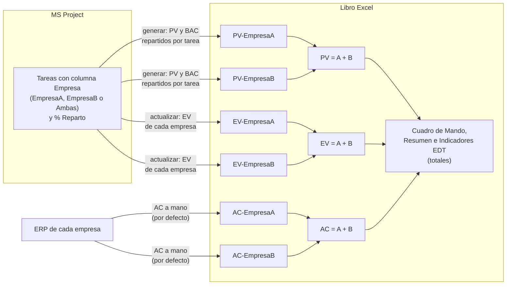
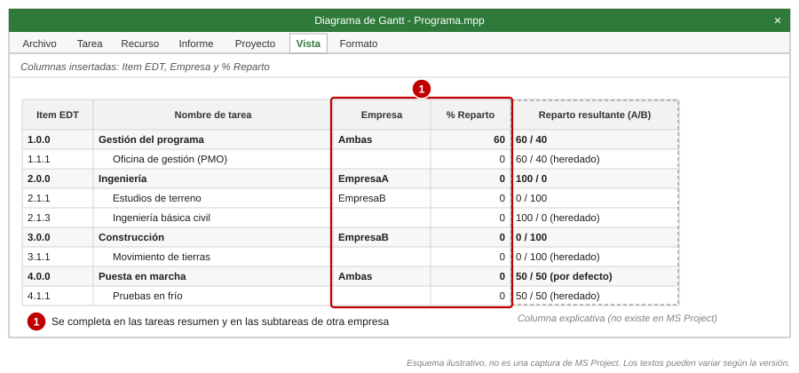
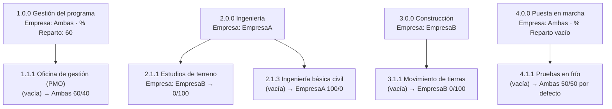
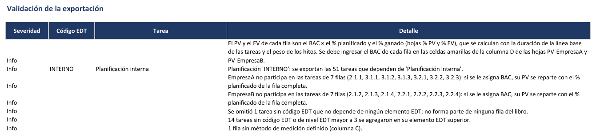
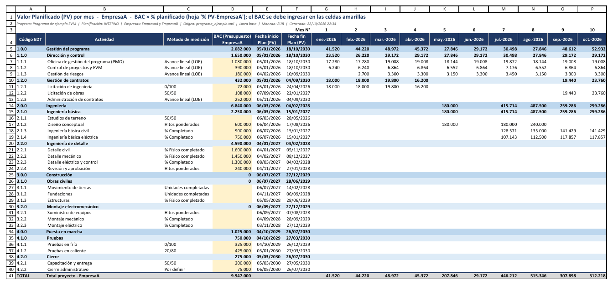
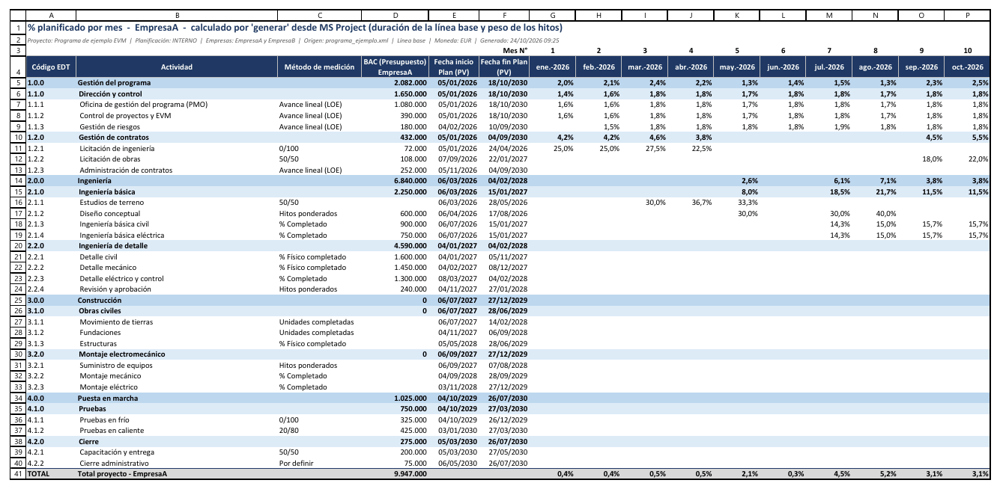
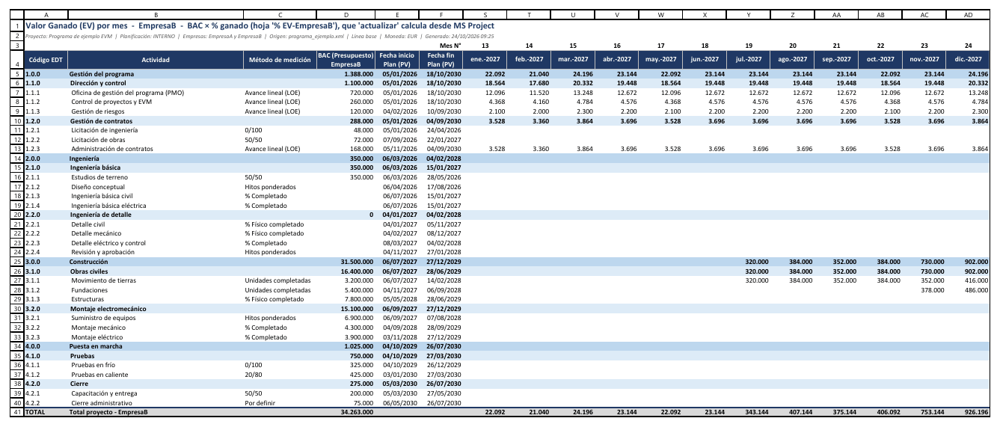
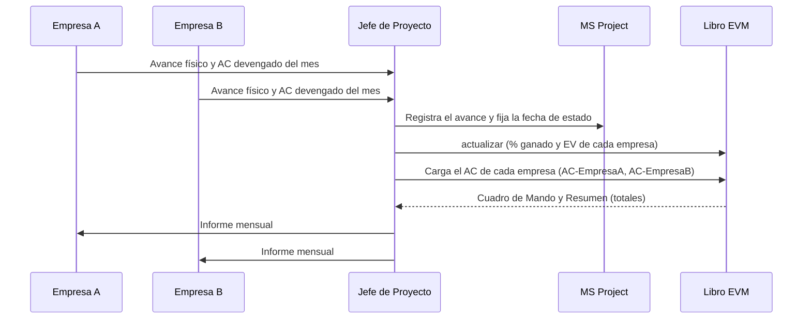

# Multi-empresa (opcional)

[Inicio](../README.md) › [Documentación](README.md) › Multi-empresa

Cuando el proyecto se ejecuta entre **dos empresas** (por ejemplo, dos empresas que ejecutan juntas un
contrato, o una empresa y su socio tecnológico), el libro puede separar el PV, el EV y el AC de cada una,
además del total del proyecto. Este modo está **desactivado por defecto**.

| Modo de cálculo | BAC y PV de cada empresa | EV de cada empresa | AC de cada empresa |
|---|---|---|---|
| **Porcentaje** (por defecto) | El BAC de cada empresa se ingresa en su hoja `PV`; el PV es ese BAC × el % planificado de la empresa. | BAC de la empresa × su % ganado. | A mano. |
| Costo | El costo de línea base de cada tarea, repartido según la parte de cada empresa. | BAC de la empresa × su avance. | A mano o desde MS Project. |

En los dos modos, la parte de cada empresa en cada tarea sale de las columnas `Empresa` y `% Reparto`
([sección 5](#5-parte-de-cada-empresa-en-cada-tarea)). El modo porcentaje se detalla en
[Modo porcentaje](modo-porcentaje.md#7-multi-empresa); las secciones 6.1 a 6.4 describen el modo costo.

---

## Contenido

1. [Cuándo usarlo](#1-cuándo-usarlo)
2. [Cómo funciona](#2-cómo-funciona)
3. [Preparación en MS Project](#3-preparación-en-ms-project)
4. [Configuración](#4-configuración)
5. [Parte de cada empresa en cada tarea](#5-parte-de-cada-empresa-en-cada-tarea)
6. [Cálculo del EV y el AC por empresa](#6-cálculo-del-ev-y-el-ac-por-empresa)
7. [Validaciones y controles](#7-validaciones-y-controles)
8. [Hojas del libro](#8-hojas-del-libro)
9. [Ciclo mensual con dos empresas](#9-ciclo-mensual-con-dos-empresas)
10. [Preguntas frecuentes](#10-preguntas-frecuentes)

---

## 1. Cuándo usarlo

- Cada empresa es responsable de una parte del alcance y se necesita conocer el **desempeño de cada
  una** (CPI y SPI por empresa) además del total.
- Hay paquetes compartidos cuyo presupuesto se reparte en un porcentaje acordado (por ejemplo, la
  gestión del programa 60/40).
- Cada empresa registra sus **costos reales en su propio sistema** (ERP) y el AC del proyecto es la suma
  de ambos.
- Cada empresa conoce el **presupuesto de su parte** de cada paquete, que no se carga en el cronograma
  compartido (modo porcentaje).

Si el proyecto lo ejecuta una sola empresa, este modo no es necesario.

---

## 2. Cómo funciona



- **Modo porcentaje:** el BAC de cada empresa se ingresa en su hoja `PV` y cada empresa tiene su propio %
  planificado y % ganado, calculados con las tareas en las que participa.
- **Modo costo:** el **PV y el BAC** se reparten **tarea por tarea** según la parte de cada empresa.
- Una fila de nivel 3 puede incluir tareas de las dos empresas.
- En las hojas `PV`, `EV` y `AC` cada celda es la **suma** de las dos empresas (fórmula).
- **Cuadro de Mando, Resumen e Indicadores EDT** usan los totales.

---

## 3. Preparación en MS Project

1. Se crea un campo personalizado de tarea de tipo *Texto* (por ejemplo *Texto3*) con el nombre
   `Empresa` y, en *Atributos personalizados > Búsqueda*, los valores `EmpresaA`, `EmpresaB` y `Ambas`
   ([Campos personalizados](preparacion-ms-project.md#3-campos-personalizados)). La tabla de búsqueda
   evita errores de escritura; los valores deben coincidir con `empresa_a`, `empresa_b` y `ambas` de la
   configuración (sin distinguir mayúsculas ni tildes).
2. Se crea un campo de tipo *Número* (por ejemplo *Número2*) con el nombre `% Reparto`: porcentaje de la
   empresa A en las tareas `Ambas` (por ejemplo, 80 = 80 % para la empresa A y 20 % para la empresa B).
3. Se insertan las dos columnas en la vista *Diagrama de Gantt* y se completa la columna `Empresa`. Una
   tarea sin empresa **hereda** la de su tarea superior (con su `% Reparto`): basta con completarla en
   las tareas resumen y en las subtareas que sean de otra empresa.



*Esquema ilustrativo (no es una captura de MS Project): la empresa se indica en las tareas resumen y
solo se repite en las subtareas que son de otra empresa.*

> **Recomendación:** acordar el reparto de los paquetes `Ambas` antes de guardar la línea base y
> documentarlo (por ejemplo, en el acuerdo entre las empresas). Cambiar la empresa o el `% Reparto` de una
> tarea después de guardar la línea base cambia el BAC de cada empresa en el siguiente `generar`.

---

## 4. Configuración

```toml
[multiempresa]
activar = true
campo_empresa = "Empresa"        # campo de texto (Text3) o su alias
empresa_a = "EmpresaA"           # valor de la columna y sufijo de las hojas
empresa_b = "EmpresaB"
ambas = "Ambas"
campo_reparto = "% Reparto"      # campo numérico (Number2) o su alias
reparto_por_defecto = 50         # % de A si % Reparto está vacío, es 0 o está fuera de rango
ac_desde_project = false         # modo costo: false = AC a mano; true = AC desde MS Project
```

Los nombres de las empresas se usan en los nombres de las hojas: máximo 15 caracteres, sin
`[ ] : * ? / \ '`. Ver todas las claves en [Configuración](configuracion.md).

`actualizar` usa los nombres de las empresas y los campos con los que se **generó** el libro (guardados
en la hoja oculta `_meta`), aunque la configuración no tenga la sección `[multiempresa]`. La opción
`ac_desde_project` se toma de la configuración actual y solo se usa en el modo costo.

---

## 5. Parte de cada empresa en cada tarea

En el modo costo, la parte de cada empresa multiplica el costo de la tarea; en el modo porcentaje,
multiplica la duración de la tarea para calcular el peso que tiene en el % de cada empresa.

| Columna `Empresa` | Parte de la empresa A (la empresa B recibe el resto) |
|---|---|
| Empresa A | 100 % |
| Empresa B | 0 % |
| `Ambas` | El valor de `% Reparto`. Si está vacío o es 0, el reparto por defecto (`reparto_por_defecto`, 50 %). Si es negativo o mayor que 100, el reparto por defecto, y se informa en `Validación`. |
| Vacía | La de la tarea superior. Si ninguna tarea superior tiene empresa, se trata como `Ambas` con el reparto por defecto y se informa en `Validación`. |
| Otro valor | Se trata como `Ambas` con el reparto por defecto y se informa en `Validación`. |

- `% Reparto` solo se usa en las tareas `Ambas`; en las demás se ignora.
- En MS Project un campo numérico vacío vale 0, por eso 0 equivale a vacío. Para asignar el 100 % a una
  empresa se indica su nombre en `Empresa`.
- Una subtarea marcada `Ambas` sin `% Reparto` usa el reparto por defecto, **no** el de su tarea
  superior. Para heredar el reparto de la tarea superior, la columna `Empresa` de la subtarea se deja
  vacía.
- La herencia también llega desde las tareas que están por encima de la planificación exportada (por
  ejemplo, si la tarea `INTERNO` tiene empresa).

**Ejemplo de herencia** (proyecto de ejemplo):



*Entre paréntesis, el valor de la columna `Empresa` de la tarea; después de la flecha, el reparto A/B
resultante.*

---

## 6. Cálculo del EV y el AC por empresa

**Modo porcentaje:** cada empresa tiene su % planificado y su % ganado en cada fila, con las tareas en las
que participa; los métodos `0/100`, `X/Y` y `Hitos ponderados` también se miden por empresa. Un hito
vale su `Peso hito` para cada empresa que participa en él. El AC se carga a mano. Detalle y ejemplo en
[Modo porcentaje](modo-porcentaje.md#7-multi-empresa).

Las secciones siguientes describen el **modo costo**.

### 6.1 PV y BAC

Cada tarea aporta al PV y al BAC de cada empresa su costo de línea base multiplicado por la parte de
esa empresa. El BAC de una fila para la empresa A es:

```text
BAC_A de la fila = Σ (costo de línea base de cada tarea de la fila × parte de A en esa tarea)
BAC_B de la fila = BAC de la fila − BAC_A
```

### 6.2 EV

`actualizar` escribe el EV del mes en `EV-EmpresaA` y `EV-EmpresaB`. El EV de cada empresa se calcula
con **su BAC en la fila** y **su propio avance**:

| Método (columna C) | EV acumulado de cada empresa |
|---|---|
| `% Completado`, `% Físico completado`, `Unidades completadas` | BAC de la empresa × avance de sus tareas, ponderado por el costo de línea base que le corresponde en cada tarea. |
| `CPTR de MS Project` | CPTR de las tareas de la fila, repartido según la parte de cada empresa en cada tarea. |
| `Avance lineal (LOE)` | PV acumulado de la empresa. |
| `0/100`, `X/Y`, `Hitos ponderados` | BAC de la empresa × avance del paquete completo. |

### 6.3 AC

| `ac_desde_project` | AC de cada empresa |
|---|---|
| `false` (por defecto, y siempre en el modo porcentaje) | Se carga **a mano** en `AC-EmpresaA` y `AC-EmpresaB` (celdas amarillas). `actualizar` no lo modifica y no admite `--solo ac`. |
| `true` | `actualizar` reparte el CRTR de cada tarea según su parte y lo escribe en las hojas de cada empresa. |

### 6.4 Ejemplo

Paquete `3.1.1`, BAC 1.000.000 €, con dos tareas:

| Tarea | Empresa | Costo previsto | Parte de A | BAC A | BAC B | % completado | CRTR |
|---|---|---:|---:|---:|---:|---:|---:|
| Excavación | EmpresaA | 600.000 | 100 % | 600.000 | 0 | 40 % | 250.000 |
| Relleno compactado | Ambas, 70 | 400.000 | 70 % | 280.000 | 120.000 | 50 % | 210.000 |
| **Fila 3.1.1** | | **1.000.000** | | **880.000** | **120.000** | | **460.000** |

| Método | EV empresa A | EV empresa B | EV total |
|---|---:|---:|---:|
| `% Completado` | 880.000 × (600.000 × 40 % + 280.000 × 50 %) / 880.000 = **380.000** | 120.000 × 50 % = **60.000** | 440.000 |
| `50/50` (paquete comenzado) | 880.000 × 50 % = **440.000** | 120.000 × 50 % = **60.000** | 500.000 |

AC con `ac_desde_project = true`: empresa A = 250.000 + 70 % × 210.000 = **397.000**; empresa B =
30 % × 210.000 = **63.000**.

---

## 7. Validaciones y controles

`generar` informa en `Validación`:

- En el modo costo, el **BAC de cada empresa**. En el modo porcentaje, las filas en las que una empresa no
  participa en ninguna tarea (si se le asigna BAC, su PV se reparte con la curva de la fila completa).
- Tareas **sin empresa** (ni propia ni heredada): se reparten con el reparto por defecto.
- Valores de empresa **no reconocidos** (por ejemplo, un error de escritura).
- `% Reparto` **fuera de rango** (negativo o mayor que 100).



Restricciones:

- `--solo ac` requiere `ac_desde_project = true`.
- `--migrar-desde` traslada el historial de cada empresa entre libros multi-empresa. No se admite entre
  un libro de una sola empresa y uno multi-empresa, porque el historial no se puede repartir entre las
  empresas.

---

## 8. Hojas del libro

Además de `PV`, `EV` y `AC`, se crean `PV-EmpresaA`, `PV-EmpresaB`, `EV-EmpresaA`, `EV-EmpresaB`,
`AC-EmpresaA` y `AC-EmpresaB` (con los nombres configurados), con el mismo formato. En el modo
porcentaje se agregan `% PV-EmpresaA`, `% PV-EmpresaB`, `% EV-EmpresaA` y `% EV-EmpresaB`, con el % de
cada empresa, y el BAC de cada empresa se ingresa en la columna D de `PV-EmpresaA` y `PV-EmpresaB`.



*`PV-EmpresaA` del ejemplo (modo porcentaje): el BAC de la empresa A, en las celdas amarillas, es el
60 % de la gestión, toda la ingeniería salvo los estudios de terreno y nada de la construcción; los meses
son ese BAC × el % planificado de la empresa A.*



*`% PV-EmpresaA`: % planificado de la empresa A en cada paquete y mes.*



*`EV-EmpresaB` (meses 13 a 24): el EV del mes de la empresa B, BAC × % ganado.*

---

## 9. Ciclo mensual con dos empresas



Se recomienda acordar con ambas empresas la **misma fecha de corte**, la misma base para el BAC y el AC
(por ejemplo, ambos a precio de contrato) y el mismo criterio de costo real (devengado), y que cada una
revise su EV antes de emitir el informe. En el modo porcentaje, el BAC de cada empresa se ingresa una vez,
después de `generar`, y se cambia solo con los cambios aprobados.

---

## 10. Preguntas frecuentes

**¿Se pueden ver los indicadores de cada empresa por separado?** El `Cuadro de Mando`, `Resumen` e
`Indicadores EDT` muestran los totales. Los valores de cada empresa están en sus hojas `PV-`, `EV-` y
`AC-`; el CPI y el SPI de cada empresa se pueden calcular a partir de la fila TOTAL de esas hojas.

**¿Se admiten más de dos empresas?** No. Con más socios, se puede agrupar a los socios menores en una
de las dos empresas.

**¿Qué pasa si cambio la empresa de una tarea después de generar el libro?** El PV del libro no cambia
hasta regenerarlo. `actualizar` reparte el EV con la empresa actual de cada tarea, por lo que se
recomienda regenerar el libro con `--migrar-desde` si el cambio es definitivo.

**¿El cronograma compartido debe tener los importes de cada empresa?** No en el modo porcentaje: el
cronograma solo tiene las tareas, sus fechas, la empresa y el avance. El BAC de cada empresa está solo en
el libro.
