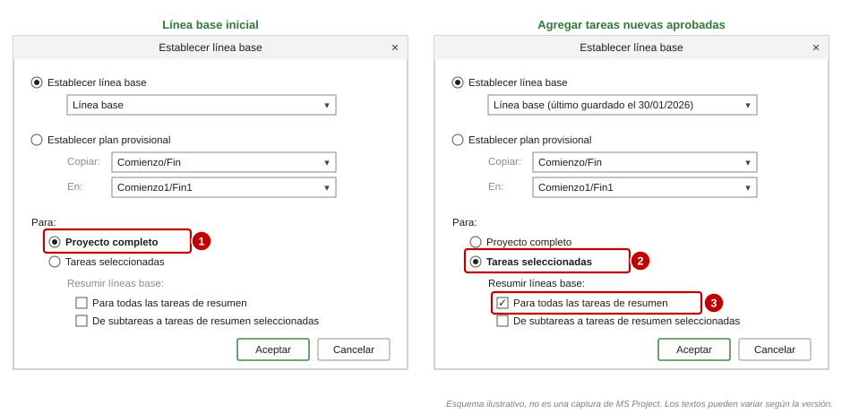

# Preparación del proyecto en MS Project

[Inicio](../README.md) › [Documentación](README.md) › Preparación en MS Project

Este documento reúne lo que se debe configurar en MS Project para que el programa calcule correctamente
el % planificado y el % ganado de cada fila del libro: la estructura y el código EDT, los campos
personalizados, el método de medición, la línea base, el registro del avance y la exportación a XML. El
cálculo se explica en [Cálculo del PV y el EV](calculo-pv-ev.md) y los métodos en
[Métodos de medición](metodos-de-medicion.md).

MS Project **no necesita costos ni recursos**: el BAC de cada fila se ingresa en el libro
([sección 4](#4-presupuesto-bac)).

> Los nombres de menú corresponden a MS Project en español 2016 a 2024 y a la versión de suscripción
> (*Project Online Desktop Client*); pueden variar levemente según la versión. Las imágenes son
> **esquemas ilustrativos**, no capturas.

---

## Contenido

1. [Lista de control](#1-lista-de-control)
2. [Estructura y código EDT](#2-estructura-y-código-edt)
3. [Campos personalizados](#3-campos-personalizados)
4. [Presupuesto (BAC)](#4-presupuesto-bac)
5. [Método de medición e hitos](#5-método-de-medición-e-hitos)
6. [Línea base](#6-línea-base)
7. [Fecha de estado y registro del avance](#7-fecha-de-estado-y-registro-del-avance)
8. [Exportación a XML (sin COM)](#8-exportación-a-xml-sin-com)
9. [Proyectos grandes y complejos](#9-proyectos-grandes-y-complejos)

---

## 1. Lista de control

**Una vez, antes del primer `generar`:**

- [ ] Todas las tareas de detalle tienen código EDT o dependen de una tarea con código EDT.
- [ ] Los paquetes de trabajo (nivel 3) agrupan las tareas de detalle.
- [ ] La duración de las tareas de detalle representa su trabajo (define su peso en el paquete).
- [ ] Cada paquete tiene su **método de medición** (`Método EVM`) y, si usa hitos, sus hitos con
      `Peso hito`.
- [ ] Si hay dos planificaciones (`INTERNO`, `CLIENTE`), cada una está bajo una tarea de primer nivel con
      ese código EDT.
- [ ] Multi-empresa (opcional): columnas `Empresa` y `% Reparto` completas ([Multi-empresa](multiempresa.md)).
- [ ] **Línea base guardada** y resumida en las tareas resumen.
- [ ] `config.toml` con los nombres de los campos ([Configuración](configuracion.md)).
- [ ] `validar` sin errores: códigos EDT coherentes con su tarea superior, fechas, duraciones, pesos y
      métodos ([Validaciones](validaciones-y-problemas.md#1-validaciones)).

**Cada mes, antes de `actualizar`:**

- [ ] **Fecha de estado** = último día del mes.
- [ ] Avance registrado (*% completado*, *% físico completado*, fechas reales, hitos cumplidos).
- [ ] Trabajo pendiente reprogramado después de la fecha de estado.
- [ ] Si se usa XML: archivo guardado **después** de fijar la fecha de estado y registrar el avance.
- [ ] `validar` sin errores ni trabajo pendiente antes de la fecha de estado.

---

## 2. Estructura y código EDT

El programa toma el **nivel** de cada tarea de su **código EDT**, no de su posición en el esquema:
`2.0.0` es nivel 1, `2.1.0` nivel 2 y `2.1.1` nivel 3 (los ceros finales no cuentan). Las tareas con
código hasta el nivel 3 tienen fila en el libro; las de nivel inferior y las que no tienen código forman
parte de su elemento superior ([Cálculo del PV y el EV](calculo-pv-ev.md#32-niveles-por-código-edt)).

El código EDT se puede leer de tres campos (clave `[campos] edt`):

| Opción | Cuándo usarla |
|---|---|
| Campo **EDT** de MS Project (`WBS`, por defecto) | Cuando el código EDT de MS Project ya sigue la numeración del proyecto. Se puede definir una máscara en *Proyecto > EDT > Definir código*. |
| **Número de esquema** (`OutlineNumber`) | Proyectos simples en los que el esquema coincide con la EDT. |
| **Campo personalizado de texto** (por ejemplo `Item EDT` en *Texto2*) | Cuando la EDT del contrato no coincide con el esquema (por ejemplo, con dos planificaciones o con tareas auxiliares intercaladas). Es la opción más flexible: el código se escribe solo en las tareas que deben tener fila. |

Recomendaciones:

- Los paquetes de trabajo (nivel 3) son la unidad de medición del EV: cada uno con un responsable, un
  presupuesto y un método.
- Las actividades de detalle y los hitos de un paquete **no necesitan** código EDT.
- Las tareas que no dependen de ningún elemento EDT (por ejemplo, una reunión de arranque bajo la
  planificación) no forman parte del cálculo: se omiten y se informan en `Validación`.
- El código de cada tarea empieza por el de su tarea superior y tiene un nivel más: bajo `1.2.0` van
  `1.2.1`, `1.2.2`... `validar` y la hoja `Validación` informan los códigos que no lo cumplen (por
  ejemplo `1.14.2` bajo `1.2.0`), los niveles salteados, el orden y los duplicados.
- Para insertar un elemento sin renumerar a sus hermanos se puede usar un 0 intermedio: debajo de
  `1.2.0.0`, `1.2.0.1` va antes de `1.2.1.0` y es de su mismo nivel.
- Si las filas del libro deben seguir una EDT acordada, se pueden indicar en un archivo con
  `[exportacion] lista_edt`, sin marcar el campo `Visible` en el cronograma
  ([Lista EDT](calculo-pv-ev.md#34-lista-edt-filas-definidas-en-un-archivo)).

---

## 3. Campos personalizados

El programa puede leer los siguientes campos personalizados de tarea. Se crean con clic derecho en el
encabezado de una columna > **Campos personalizados** (o *Proyecto > Campos personalizados*):

| Campo sugerido | Tipo | Nombre (alias) | Valores | Clave de configuración |
|---|---|---|---|---|
| *Texto2* | Texto | `Item EDT` | Código EDT (`1.0.0`, `1.1.0`, `1.1.1`) | `[campos] edt` |
| *Texto10* | Texto | `Método EVM` | Lista de búsqueda con los métodos | `[campos] metodo` |
| *Número1* | Número | `Peso hito` | Peso de cada hito: % del BAC del paquete | `[campos] peso_hito` |
| *Texto3* | Texto | `Empresa` | Lista: `EmpresaA`, `EmpresaB`, `Ambas` | `[multiempresa] campo_empresa` |
| *Número2* | Número | `% Reparto` | % de la empresa A en tareas `Ambas` | `[multiempresa] campo_reparto` |
| *Texto5* | Texto | `Visible` | Lista: `Sí`, `No` (vacío = según el nivel máximo) | `[campos] visible` |
| *Texto20* | Texto | `Descripción` | Texto de la ficha de cada tarea de `generar-fichas` (opcional; también se pueden usar las *Notas*) | `[campos] descripcion` |

Pasos para cada campo:

1. Se elige **Campo: Tarea** y el **Tipo** (*Texto* o *Número*).
2. Se selecciona un campo libre y con **Cambiar nombre...** se le asigna el nombre.
3. Para listas cerradas (método, empresa, visible): **Atributos personalizados > Búsqueda...**, se
   escriben los valores y se desmarca *Permitir introducir elementos adicionales en los campos*.
4. Se inserta la columna en la vista (clic derecho en un encabezado > *Insertar columna*).

> El campo `Visible` debe ser de **texto** y no una *Marca* (Sí/No): necesita tres estados, `Sí`, `No` y
> vacío ([Campo Visible](calculo-pv-ev.md#33-campo-visible-más-o-menos-detalle-en-cada-rama)).

En la configuración, los campos se indican por su nombre interno en inglés (`Text10`, `Number1`), en
español (`Texto10`, `Número1`) o por su alias (`Método EVM`).

> Se recomienda guardar una vista y una tabla propias (por ejemplo, la tabla *EVM* con las columnas
> `Item EDT`, `Método EVM`, `Peso hito`, *% completado*, *% físico completado*, *Comienzo real* y *Fin
> real*) para el registro mensual del avance. Con el *Organizador* se pueden copiar a otros proyectos o
> a la plantilla global.

---

## 4. Presupuesto (BAC)

No se cargan costos ni recursos en MS Project. El % planificado de cada fila sale de la duración de
línea base de sus tareas y del `Peso hito` de sus hitos
([Cálculo del PV y el EV](calculo-pv-ev.md#4--planificado-peso-de-cada-tarea)), y el **BAC** de cada
fila se ingresa a mano en la columna D de la hoja `PV` del libro (en multi-empresa, en `PV-EmpresaA` y
`PV-EmpresaB`). Si el proyecto tiene recursos o costos cargados, no se usan.

---

## 5. Método de medición e hitos

- Campo `Método EVM` con lista de búsqueda, completado en los paquetes de nivel 3.
- Para `Hitos ponderados`: hitos (duración 0) como subtareas del paquete, con su peso en `Peso hito`. El
  peso es el % del BAC del paquete que se planifica en el mes del hito y que se gana al cumplirlo: para
  un paquete medido solo con hitos, los pesos deben sumar 100.

El método de cada paquete se elige con la
[guía](metodos-de-medicion.md#4-guía-para-elegir-el-método) y se aprueba con la línea base
([proceso para definir el método](metodos-de-medicion.md#5-proceso-para-definir-el-método-de-cada-paquete)).
Detalle y ejemplos en [Métodos de medición](metodos-de-medicion.md).

---

## 6. Línea base

1. *Proyecto > Establecer línea base > Establecer línea base...*, **Línea base**, **Para: Proyecto
   completo**.
2. Tareas nuevas aprobadas: **Tareas seleccionadas** y **Resumir líneas base: Para todas las tareas de
   resumen**.
3. Copia de cada línea base aprobada en *Línea base 1..10* (*Establecer plan provisional*, *Copiar:
   Línea base*, *En: Línea base N*).

Las **fechas** de la línea base de cada tarea (*Comienzo previsto* y *Fin previsto*) definen el %
planificado. Por defecto se usa la línea base que el proyecto tiene configurada para el valor acumulado
(*Archivo > Opciones > Avanzadas*); se puede elegir otra con `linea_base` o `--linea-base N`. Sin línea
base guardada se usan las fechas actuales de las tareas y se advierte
([Proyecto sin línea base](calculo-pv-ev.md#5-horizonte-de-meses-y-proyecto-sin-línea-base)).

---

## 7. Fecha de estado y registro del avance

- Antes de cada `actualizar` se define **Proyecto > Fecha de estado** (grupo *Estado*) = **último día
  del mes** informado. También en *Proyecto > Información del proyecto > Fecha de estado*.
- Sin fecha de estado, el programa exige `--fecha-corte`.
- Con archivos `.mpp`, si se indica `--fecha-corte`, el programa fija esa fecha de estado en la copia
  abierta (no guarda el archivo).

**Registro del avance** (con la fecha de estado ya definida):

| Dato | Dónde se registra | Para qué método |
|---|---|---|
| *% completado* | Botones *0%* a *100%* de la pestaña *Tarea*, tabla *Seguimiento* o *Proyecto > Actualizar proyecto* | `% Completado`, `0/100`, `X/Y`, hitos (100 % al cumplirse) |
| *% físico completado* | Columna *% físico completado* o tabla *Seguimiento* | `% Físico completado`, `Unidades completadas` |
| *Comienzo real* y *Fin real* | Tabla *Seguimiento* o cuadro *Actualizar tareas* | `X/Y` (comienzo); fin de `0/100` y `X/Y` (al registrar el *Fin real*, MS Project pone la tarea al 100 %; una tarea con menos del 100 % no se considera terminada) |

Buenas prácticas del registro:

- Registrar el avance **a la fecha de estado**, no a la fecha en que se hace la actualización.
- **Reprogramar el trabajo pendiente** a partir de la fecha de estado (*Proyecto > Actualizar proyecto >
  Reprogramar trabajo restante para que empiece después de*), para que las fechas futuras sigan siendo
  una previsión realista. El libro toma de ese cronograma el fin previsto, la holgura total y las tareas
  críticas de cada paquete ([Indicadores EDT](libro-excel.md#indicadores-edt)): con vínculos completos
  entre tareas, MS Project calcula una holgura y un camino crítico fiables (criterios que revisa
  `validar`).
- No modificar la línea base al registrar el avance.

El costo real no se registra en MS Project: el AC de cada mes se carga en la hoja `AC` del libro
([AC: costo real](calculo-pv-ev.md#9-ac-costo-real)).

---

## 8. Exportación a XML (sin COM)

Si la PC que ejecuta el programa no tiene MS Project, se guarda el proyecto en formato XML:
*Archivo > Guardar como*, tipo **XML**. El XML se debe guardar **después** de registrar el avance y fijar
la fecha de estado: el programa toma la fecha de estado del archivo como fecha de corte.

Calendario: con XML, la duración de las tareas se reparte entre los meses con el calendario del proyecto;
con `.mpp`, con un calendario de lunes a viernes más los `feriados` de la configuración. En ambos casos
no se usan los calendarios de recursos ni de tareas
([Limitaciones](validaciones-y-problemas.md#2-limitaciones-conocidas)).

---

## 9. Proyectos grandes y complejos

- **Proyectos maestros con subproyectos:** el programa lee el proyecto maestro; el grupo de recursos se
  abre en solo lectura.
- **Proyectos en Project Online, SharePoint u OneDrive:** se abren en MS Project y se usa
  `--origen activo`, o se guarda una copia local `.mpp`.
- **Varias planificaciones en un archivo** (`INTERNO` y `CLIENTE`): se genera un libro por
  planificación con `--planificacion` ([Cálculo del PV y el EV](calculo-pv-ev.md#31-planificación-exportada)).
- **Un programa en varios archivos** (por ejemplo, `1.0.0` a `8.0.0` en un archivo y `9.0.0` en otro):
  se reúnen en un mismo libro con secciones `[[proyectos]]`, siempre que los códigos EDT no se repitan
  entre archivos ([Varios archivos](varios-archivos.md)).
- **Tareas inactivas** (*Tarea > Desactivar*): no se incluyen, salvo `incluir_inactivas = true`. Es útil
  para conservar alcance descartado sin que afecte el % planificado ni el % ganado.
- **Calidad del cronograma:** un cronograma con lógica completa (predecesoras y sucesoras), sin
  restricciones innecesarias y con duraciones acotadas es la base de un PV confiable. Las guías de
  evaluación de cronogramas listadas en [Recursos externos](recursos-externos.md) (por ejemplo, la del
  GAO) describen los controles habituales. `validar` revisa 12 de los 14 puntos de la evaluación DCMA:
  lógica, adelantos y posiciones, delimitaciones, holgura, duración, fechas no válidas, tareas
  incumplidas, CPLI y BEI ([Evaluación DCMA de 14 puntos](evaluacion-dcma.md)). Para que MS Project
  muestre la holgura frente a la fecha de fin comprometida, se recomienda ponerla como **fecha límite**
  del hito de fin, en lugar de una delimitación.
