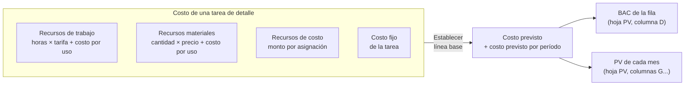
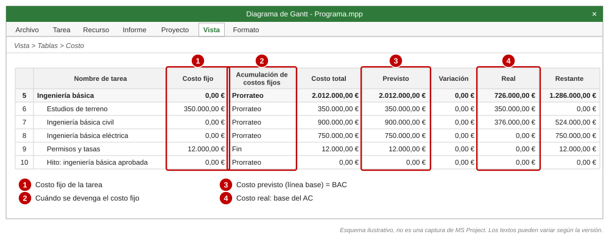
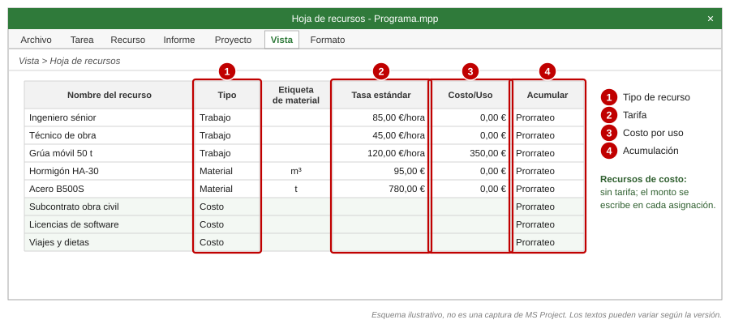
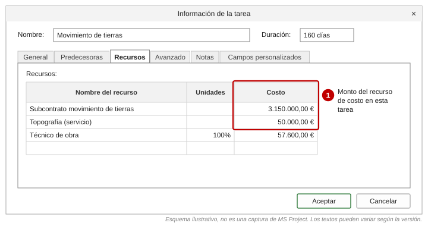
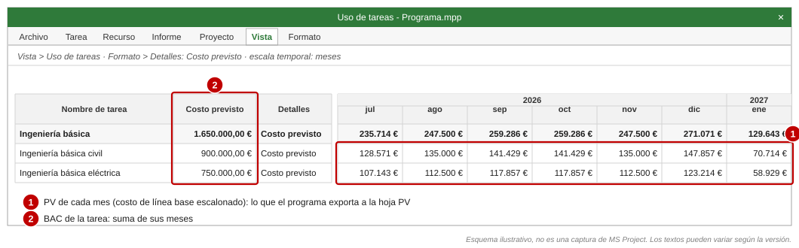

# Presupuesto (BAC) de cada tarea

[Inicio](../README.md) › [Documentación](README.md) › Presupuesto (BAC)

El **BAC** (presupuesto a la conclusión) de cada fila del libro y su **PV mensual** salen del costo de
la **línea base** de MS Project. Este documento explica las formas de cargar el presupuesto en
MS Project, cómo afecta cada una a la distribución del PV en el tiempo y cómo guardar y verificar la
línea base.

> Las imágenes de MS Project de este documento son **esquemas ilustrativos**, no capturas: muestran
> dónde están los campos y opciones. Los nombres de menú corresponden a MS Project en español 2016 a
> 2024 y a la versión de suscripción (*Project Online Desktop Client*); pueden variar levemente según la
> versión.

---

## Contenido

1. [Conceptos: costo, costo previsto, BAC y PV](#1-conceptos-costo-costo-previsto-bac-y-pv)
2. [Opción A: recursos de trabajo con tarifa](#2-opción-a-recursos-de-trabajo-con-tarifa)
3. [Opción B: recursos materiales](#3-opción-b-recursos-materiales)
4. [Opción C: recursos de costo](#4-opción-c-recursos-de-costo)
5. [Opción D: costo fijo de la tarea](#5-opción-d-costo-fijo-de-la-tarea)
6. [Guardar la línea base](#6-guardar-la-línea-base)
7. [Verificar el BAC y el PV en MS Project](#7-verificar-el-bac-y-el-pv-en-ms-project)
8. [Errores frecuentes](#8-errores-frecuentes)
9. [Comparación y recomendaciones](#9-comparación-y-recomendaciones)

---

## 1. Conceptos: costo, costo previsto, BAC y PV

En MS Project el **costo** de una tarea es la suma del costo de sus **asignaciones** de recursos más su
**costo fijo**. Al **guardar la línea base**, MS Project copia ese costo en el campo **Costo previsto**
(*Baseline Cost*) y guarda también su **distribución en el tiempo** (costo previsto por día, semana o
mes).

| Concepto | Campo de MS Project | Uso en el libro |
|---|---|---|
| Costo actual de la tarea | *Costo* (columna *Costo total* de la tabla *Costo*) | No se usa para el PV: cambia con cada reprogramación. |
| Presupuesto de la tarea | *Costo previsto* (columna *Previsto* de la tabla *Costo*) | **BAC** de la fila. |
| Distribución del presupuesto | *Costo previsto* por período (vista *Uso de tareas*) | **PV** de cada mes. |
| Costo real | *Costo real* y *CRTR* | **AC** ([Cálculo de EV y AC](calculo-ev-ac.md#4-ac-acumulado-de-cada-fila)). |

Hay cuatro formas de cargar el costo, que se pueden combinar en una misma tarea. Lo que cambia entre
ellas es **cómo se calcula el monto** y **cómo se distribuye en el tiempo**, es decir, la forma de la
curva PV.

---

## 2. Opción A: recursos de trabajo con tarifa

**Para qué:** personas y equipos que se miden en horas (ingeniería, dirección de obra, equipos
alquilados por hora).

**Costo:** trabajo (horas) × *Tasa estándar* (+ horas extra × su tarifa) + *Costo/Uso*.

**Configuración:**

1. *Vista > Hoja de recursos*: se crea el recurso con *Tipo* = **Trabajo**, su *Tasa estándar* (por
   ejemplo `85 €/hora`) y, si corresponde, un *Costo/Uso* (monto fijo cada vez que se asigna, por
   ejemplo el traslado de una grúa).
2. Se asigna el recurso a las tareas de detalle (*Recurso > Asignar recursos*, o la columna *Nombres de
   los recursos*). MS Project calcula el trabajo con la duración y las unidades asignadas.
3. Si la tarifa cambia en el tiempo (aumentos anuales, revisión de precios), se usan las **tablas de
   tasas de costo**: *Información del recurso > Costos*, pestañas **A (Predeterminado)** a **E**, con una
   fila por cada fecha desde la que rige una tarifa. Cada asignación usa la tabla A, salvo que en la
   información de la asignación se elija otra (por ejemplo, la tabla B para horas facturables a otra
   tarifa).

**Distribución del PV:** sigue al **trabajo** de la asignación: plano a lo largo de la tarea por
defecto, o con la forma del perfil de trabajo de la asignación si se modificó, y respetando los
calendarios. El *Costo/Uso* se imputa siempre al **comienzo** de la tarea.

**Acumulación (*Acumular*):** en la hoja de recursos se elige cuándo se devenga el costo de tarifas:
*Prorrateo* (por defecto: a medida que se realiza el trabajo), al comienzo o al *Fin* de la tarea. Para
el EVM se recomienda *Prorrateo*.

**Ventajas:** el PV refleja el esfuerzo planificado; el costo real se calcula con el trabajo real
registrado; permite nivelar y controlar capacidad.
**Desventajas:** requiere mantener tarifas y asignaciones; el costo real calculado por tarifas puede
diferir del costo contable.

---

## 3. Opción B: recursos materiales

**Para qué:** consumibles y suministros que se miden en cantidades (m³ de hormigón, toneladas de acero,
unidades de equipos).

**Costo:** cantidad × *Tasa estándar* (precio unitario) + *Costo/Uso*.

**Configuración:**

1. En la *Hoja de recursos*: *Tipo* = **Material**, *Etiqueta de material* = unidad (`m³`, `t`, `ud`)
   y *Tasa estándar* = precio por unidad (por ejemplo `95,00 €` por m³).
2. Al asignarlo a la tarea, en *Unidades* se escribe la **cantidad total** (por ejemplo `1.200` m³) o
   una cantidad por período (por ejemplo `10 m³/día`).

**Distribución del PV:** la cantidad se reparte a lo largo de la tarea igual que el trabajo (plano por
defecto) y el costo sigue esa distribución según *Acumular*.

**Ventajas:** el presupuesto queda vinculado a cantidades; facilita usar el método `Unidades
completadas` ([Métodos de medición](metodos-de-medicion.md#36-unidades-completadas)).
**Desventajas:** si el material se compra de una vez (acopio), el PV prorrateado no refleja el momento
del gasto; en ese caso conviene un recurso de costo o un costo fijo con acumulación al comienzo o en
una tarea propia de suministro.

---

## 4. Opción C: recursos de costo

**Para qué:** montos de presupuesto por partida que no dependen de horas ni cantidades: subcontratos,
suministros cerrados, licencias, viajes, servicios. Es la forma más directa de cargar un presupuesto
existente (por ejemplo, el de una oferta o el del ERP) en el cronograma.

**Configuración:**

1. En la *Hoja de recursos*: *Tipo* = **Costo**. No lleva tarifa. Conviene crear un recurso de costo
   por **naturaleza o cuenta de costo** (`Subcontrato obra civil`, `Suministro de equipos`,
   `Licencias`, `Viajes y dietas`), alineado con las cuentas del ERP.
2. Se asigna el recurso a la tarea y el **monto** se escribe en *Información de la tarea > Recursos >
   Costo* (o en la columna *Costo* del formulario de tareas o de la vista *Uso de tareas*). Una tarea
   puede tener varios recursos de costo.

**Distribución del PV:** según *Acumular* del recurso: *Prorrateo* reparte el monto en forma uniforme
a lo largo de la duración de la tarea; al comienzo o al *Fin* lo imputa entero en esa fecha. Para
reflejar hitos de pago (anticipos, certificaciones), se divide la partida en varias tareas o
asignaciones con su propia fecha.

**Ventajas:** simple; el presupuesto por partida queda visible por recurso; el costo real se puede
escribir por partida (con la opción de costos reales manuales, [Preparación](preparacion-ms-project.md#72-costo-real)).
**Desventajas:** no hay relación con el esfuerzo; el monto no cambia si cambia la duración (lo que suele
ser lo deseado en un subcontrato a precio cerrado).

---

## 5. Opción D: costo fijo de la tarea

**Para qué:** un monto único por tarea, sin estructura por recurso (por ejemplo, una tasa, un permiso o
un pequeño servicio).

**Configuración:**

1. *Vista > Tablas > Costo*.
2. Columna **Costo fijo**: se escribe el monto en la tarea de **detalle**.
3. Columna **Acumulación de costos fijos**: *Prorrateo* (uniforme a lo largo de la tarea), al comienzo o
   *Fin*. El valor por defecto para las tareas nuevas se define en las opciones de cálculo del proyecto
   (*Archivo > Opciones > Programación*).

**Distribución del PV:** según la acumulación. Un costo fijo con acumulación al comienzo o al final
aparece entero en el mes del comienzo o del fin.

**Ventajas:** rápido, sin crear recursos.
**Desventajas:** un solo monto por tarea, sin desglose; si se escribe en una **tarea resumen**, el
programa lo registra en una fila `-D Otros costos` (ver [errores frecuentes](#8-errores-frecuentes)).

---

## 6. Guardar la línea base

El *Costo previsto* y su distribución solo existen después de **guardar la línea base**. Mientras no se
guarda, el programa usa el programa actual y lo advierte en `Validación`.

### 6.1 Línea base inicial

1. *Proyecto > Establecer línea base > Establecer línea base...*
2. **Establecer línea base**: `Línea base` (o la *Línea base N* que se vaya a usar para el informe).
3. **Para: Proyecto completo** (esquema, número 1).
4. *Aceptar*.

### 6.2 Tareas nuevas aprobadas

Cuando se aprueba un cambio que agrega tareas, se guarda la línea base **solo de esas tareas** y se
acumula en las tareas resumen:

1. Se seleccionan las tareas nuevas (y las modificadas por el cambio aprobado).
2. *Proyecto > Establecer línea base > Establecer línea base...*
3. **Para: Tareas seleccionadas** (número 2) y **Resumir líneas base: Para todas las tareas de
   resumen** (número 3).
4. *Aceptar*.

Así las tareas resumen y el proyecto incluyen el presupuesto nuevo sin modificar la línea base del resto
de las tareas.

### 6.3 Historial de líneas base

Antes de cambiar la línea base vigente, se recomienda guardar una copia en *Línea base 1..10*:
*Establecer línea base* > **Establecer plan provisional** > *Copiar:* `Línea base` > *En:* `Línea base 1`
(o la siguiente libre). Cada copia conserva el costo y su distribución, y permite comparar versiones.

### 6.4 Qué línea base usa el programa

Por defecto, la que el proyecto usa para el **valor acumulado** (*Archivo > Opciones > Avanzadas >
Opciones de valor acumulado para este proyecto*, ver [Métodos de medición](metodos-de-medicion.md#6-método-del-valor-acumulado-de-ms-project-opcional)).
Se puede elegir otra con `linea_base` en la [configuración](configuracion.md) o con `--linea-base N`.

> **No** se debe volver a guardar la línea base de todo el proyecto cada mes: el PV pasaría a coincidir
> con el programa actual y el SV dejaría de medir el atraso. Los cambios de línea base se gestionan como
> se describe en [Proceso de reporte](proceso-reporte-evm.md#5-cambios-de-línea-base).

---

## 7. Verificar el BAC y el PV en MS Project

1. **BAC:** *Vista > Tablas > Costo*, columna *Previsto* de la tarea resumen del proyecto (o de la
   planificación). Debe coincidir con la fila TOTAL de la hoja `PV`.
2. **PV mensual:** *Vista > Uso de tareas*; en *Formato > Detalles* se agrega el detalle *Costo
   previsto* y la escala temporal se configura en **meses**. Los valores de cada tarea y mes son los que
   el programa exporta a la hoja `PV`.

*Los importes del esquema son los del [proyecto de ejemplo](ejemplo-paso-a-paso.md) (paquetes `2.1.3`
y `2.1.4`) y coinciden con la hoja `PV` del libro generado.*

3. **Validación:** revisar en la hoja `Validación` las tareas con costo sin línea base, las repartidas
   en forma lineal y las diferencias de BAC ([Validaciones](validaciones-y-problemas.md#1-validaciones)).

---

## 8. Errores frecuentes

| Error | Efecto en el libro | Corrección |
|---|---|---|
| Costos asignados a **tareas resumen** (costo fijo o recursos) | Se crea una fila `<código>-D Otros costos` con ese costo, y se informa en `Validación`. | Mover el costo a una tarea de detalle (por ejemplo, una tarea "Gestión del paquete"). |
| Tareas con costo agregadas **después** de guardar la línea base | No tienen costo previsto: no aportan PV ni BAC. Se informan en `Validación`. | Si el cambio está aprobado, guardar la línea base de esas tareas ([6.2](#62-tareas-nuevas-aprobadas)). |
| **Costo previsto escrito a mano** en la tabla | No hay distribución en el tiempo: el programa reparte el BAC en forma lineal y lo informa. Si la distribución existente no suma el nuevo valor, se ajusta en forma proporcional. | Cargar el costo en la tarea y guardar la línea base. |
| Línea base guardada sin **resumir** en las tareas resumen | El costo previsto de la tarea resumen no es la suma de sus subtareas; se informa en `Validación`. | Guardar la línea base con *Resumir líneas base: Para todas las tareas de resumen*. |
| Cambio de **tarifas** después de guardar la línea base | No cambia el BAC (correcto): la diferencia aparece como variación de costo. | Usar tablas de tasas de costo con fechas desde el inicio. |
| Costos en tareas **sin código EDT** fuera de cualquier elemento EDT | Se omiten y se informan en `Validación` con su costo. | Moverlas bajo un elemento EDT o asignarles código. |
| Costos en tareas **inactivas** | No se incluyen (salvo `incluir_inactivas = true`). | Verificar que la inactivación sea intencional. |
| Uso de **recursos presupuestarios** para el presupuesto | Sus montos se asignan a la tarea resumen del proyecto y no forman parte del costo de las tareas: no aportan BAC. | Cargar el presupuesto con las opciones A a D. |

---

## 9. Comparación y recomendaciones

| Opción | Monto | Distribución del PV | Más adecuada para |
|---|---|---|---|
| A. Recursos de trabajo | Horas × tarifa | Sigue al trabajo planificado | Ingeniería, servicios, personal propio |
| B. Recursos materiales | Cantidad × precio | Sigue a la cantidad planificada | Consumibles medidos en unidades |
| C. Recursos de costo | Monto por asignación | Prorrateo, comienzo o fin | Subcontratos, suministros, gastos; presupuesto por partida |
| D. Costo fijo | Monto por tarea | Prorrateo, comienzo o fin | Montos puntuales sin desglose |

Recomendaciones según el tipo de proyecto:

- **Proyectos de ingeniería o servicios** con personal propio: opción A, con tablas de tasas de costo
  para las revisiones de tarifas. El PV refleja el esfuerzo y el AC se calcula con las horas reales.
- **Proyectos de construcción o EPC** con subcontratos y suministros: opción C, con un recurso de costo
  por partida o cuenta del ERP, y opción A para el personal propio. Los suministros con hitos de pago se
  dividen en tareas (fabricación, entrega) para que el PV tenga la forma real.
- **Programas grandes** con varias planificaciones (`INTERNO`, `CLIENTE`): la misma estructura de
  recursos de costo en ambas planificaciones facilita comparar presupuesto de ejecución y precio de
  venta paquete a paquete.
- En todos los casos: costos **solo en tareas de detalle**, línea base **resumida** en las tareas
  resumen y una verificación del BAC y del PV después de cada `generar`.

Más información de Microsoft: [Especificar costos de recursos](https://support.microsoft.com/es-es/project/enter-costs-for-resources),
[Acumulación de costos fijos](https://support.microsoft.com/es-es/project/fixed-cost-accrual-task-field),
[Crear o actualizar una línea base](https://support.microsoft.com/es-es/project/create-or-update-a-baseline-or-an-interim-plan-in-project-desktop).
Ver también [Recursos externos](recursos-externos.md).
