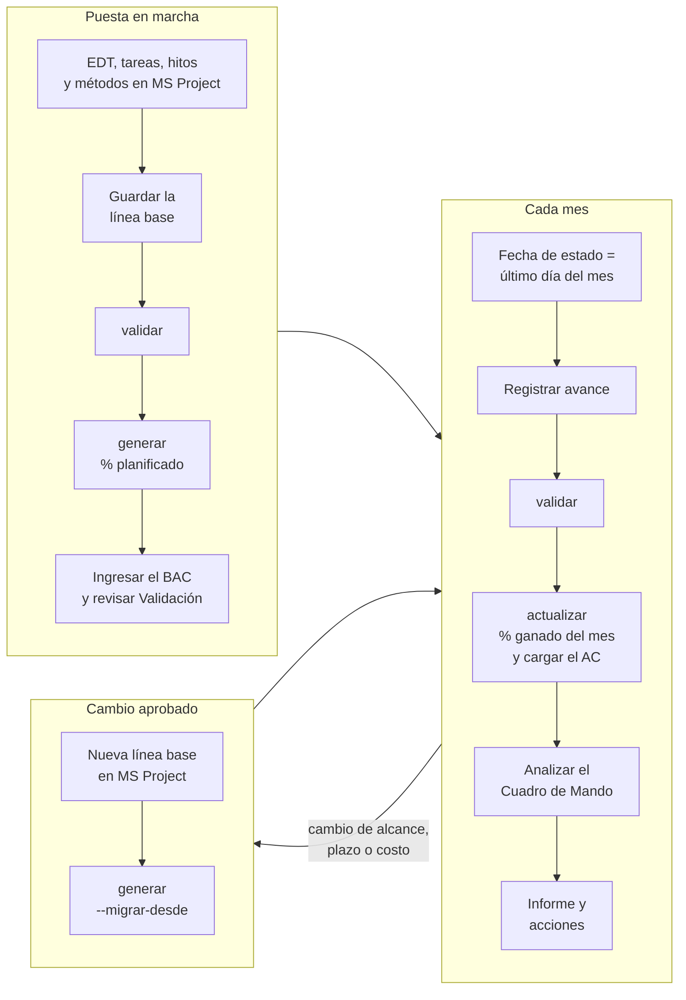
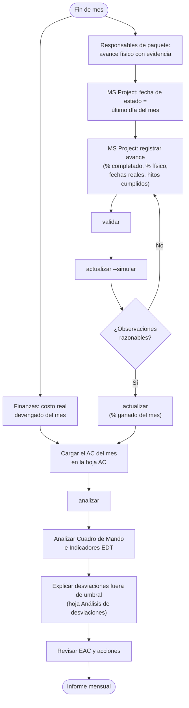
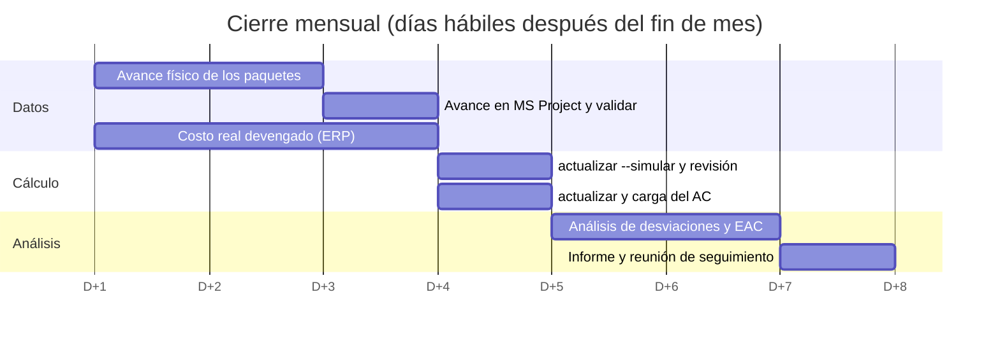
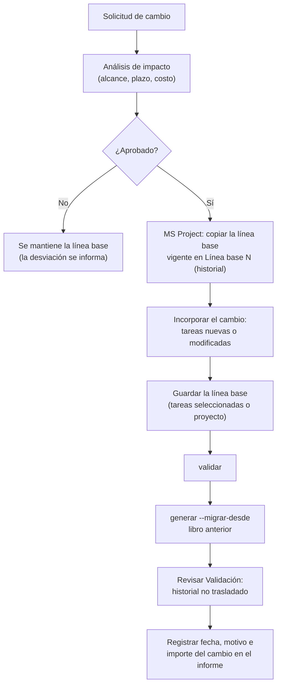

# Proceso de reporte EVM

[Inicio](../README.md) › [Documentación](README.md) › Proceso de reporte EVM

Este documento describe el uso del programa a lo largo de la vida del proyecto: la puesta en marcha, el
ciclo de cierre mensual, los cambios de línea base y las buenas prácticas para que el informe de Valor
Ganado sea confiable y comparable mes a mes.

---

## Contenido

1. [Visión general](#1-visión-general)
2. [Roles](#2-roles)
3. [Puesta en marcha (una vez)](#3-puesta-en-marcha-una-vez)
4. [Cierre mensual](#4-cierre-mensual)
5. [Cambios de línea base](#5-cambios-de-línea-base)
6. [Cierre del proyecto](#6-cierre-del-proyecto)
7. [Buenas prácticas](#7-buenas-prácticas)
8. [Lista de control mensual](#8-lista-de-control-mensual)

---

## 1. Visión general

MS Project aporta las fechas de la línea base, el peso de los hitos y el avance; el BAC de cada paquete
y el AC de cada mes se ingresan en el libro
([Cálculo del PV y el EV](calculo-pv-ev.md#12-puesta-en-marcha-y-cierre-mensual)).

El programa no reemplaza a MS Project ni al análisis del Jefe de Proyecto: automatiza la parte
repetitiva (mensualizar el PV, calcular el EV de cada paquete, cargar el mes y recalcular indicadores y
gráficos) para que el tiempo del cierre se dedique a analizar las desviaciones y decidir acciones.

---

## 2. Roles

| Rol | Responsabilidad en el ciclo EVM |
|---|---|
| **Jefe de Proyecto / Jefe de Programa** | Dueño del informe. Aprueba la línea base y los métodos de medición, ejecuta o supervisa `actualizar`, analiza las desviaciones y propone acciones y EAC. |
| **Responsables de paquete** (cuentas de control) | Confirman el método y definen el criterio de medición de sus paquetes, informan el avance físico con evidencia objetiva (entregables, hitos, cantidades) y explican las desviaciones que superan los umbrales. |
| **Planificador / Control de proyectos (PMO)** | Propone el método de medición de cada paquete. Mantiene el cronograma en MS Project: carga los métodos aprobados, fija la fecha de estado, registra el avance, guarda las líneas base aprobadas, ejecuta `validar` y verifica la hoja `Validación`. |
| **Finanzas / Administración** | Entrega el presupuesto (BAC) de cada paquete al comienzo y el costo real devengado del período (ERP), con la misma fecha de corte y en la misma base que el BAC, y las estimaciones de costos devengados no facturados. |
| **Dirección / Cliente** | Recibe el informe, aprueba los cambios de línea base y las acciones correctivas. |

En proyectos pequeños varios roles los cumple la misma persona; lo importante es que el avance, el
costo real y el análisis tengan un responsable claro.

---

## 3. Puesta en marcha (una vez)

1. **Preparar el proyecto en MS Project** ([Preparación en MS Project](preparacion-ms-project.md)):
   - EDT con códigos hasta el nivel 3 (paquetes de trabajo);
   - tareas de detalle cuya duración represente su trabajo y hitos con `Peso hito`
     ([Cálculo del PV y el EV](calculo-pv-ev.md#2-preparación-en-ms-project));
   - método de medición de cada paquete y, si corresponde, hitos con peso, definidos y aprobados con el
     [proceso de Métodos de medición](metodos-de-medicion.md#5-proceso-para-definir-el-método-de-cada-paquete).
2. **Guardar la línea base** aprobada.
3. **Configurar** `config.toml` ([Configuración](configuracion.md)).
4. **Validar el archivo** con `validar` y corregir en MS Project los errores (códigos EDT, fechas,
   pesos de los hitos, métodos). Luego **generar el libro** y revisar la hoja `Validación`; si se corrige
   algo en MS Project, volver a generar.
5. **Ingresar el BAC** de cada fila en la columna D de la hoja `PV` (o de `PV-EmpresaA` y
   `PV-EmpresaB`) y verificar que la fila TOTAL coincida con el presupuesto aprobado.
6. **Verificar los métodos** de la columna C de la hoja `PV`: deben coincidir con los aprobados, sin
   filas `Por definir`.
7. Si el proyecto ya está en ejecución: cargar el **historial mensual** de % ganado y AC, si existe,
   antes del primer `actualizar` ([Cálculo del PV y el EV](calculo-pv-ev.md#7-del--acumulado-al--del-mes)).
8. Opcional: crear con `generar-fichas` las **fichas de tareas** para el cliente (fechas y duración de la
   línea base, predecesoras y sucesoras de cada elemento EDT del libro)
   ([Comandos](comandos.md#generar-fichas-fichas-de-tareas-para-el-cliente)).

---

## 4. Cierre mensual

### 4.1 Flujo

### 4.2 Calendario orientativo

Los días son hábiles posteriores al cierre de mes (D+n) y se deben adaptar a los plazos de
contabilidad de cada organización.

### 4.3 Pasos detallados

1. **Fijar la fecha de estado** en el último día del mes (*Proyecto > Fecha de estado*).
2. **Registrar el avance** en MS Project a esa fecha de estado: *% completado* o duración real,
   *% físico completado*, fechas de comienzo y fin reales, hitos cumplidos al 100 %
   ([Preparación en MS Project](preparacion-ms-project.md#7-fecha-de-estado-y-registro-del-avance)).
3. **Reprogramar el trabajo pendiente** (mover a después de la fecha de estado el trabajo no realizado)
   para que el cronograma siga siendo una previsión realista. Esto no cambia la línea base ni el PV. Si
   se trabaja con XML, guardar el XML después de este paso.
4. Ejecutar **`validar`** y corregir en MS Project los errores (`[X]`) y el trabajo pendiente programado
   antes de la fecha de estado
   ([Validaciones](validaciones-y-problemas.md#12-avance-a-la-fecha-de-estado-validar)).
5. Ejecutar **`actualizar --simular`** y revisar las observaciones por fila: métodos no definidos,
   valores del mes negativos, tareas con código EDT sin fila en el libro y filas sin BAC.
6. Ejecutar **`actualizar`**, cargar en la hoja `AC` (o en las de cada empresa) el costo real devengado
   del mes que entrega Finanzas (ERP o contabilidad) y ejecutar **`analizar`** para completar la lista de
   paquetes fuera de umbral ([Análisis de desviaciones](analisis-desviaciones.md#3-cierre-mensual)).
   Revisar sus avisos: paquetes con avance y sin costo, con costo y sin avance o con costo después de
   terminar ([ACT-039](codigos.md#act-039) a [ACT-041](codigos.md#act-041)), análisis del mes anterior
   incompleto y acciones vencidas ([ACT-043](codigos.md#act-043) a [ACT-045](codigos.md#act-045)), EAC
   poco realista ([ACT-048](codigos.md#act-048)), y cambios del BAC o de meses ya informados, que se
   agregan a la hoja `Registro de cambios`: indicar su motivo
   ([El libro Excel](libro-excel.md#registro-de-cambios)). Si `actualizar` avisa que la línea base de MS
   Project no coincide con la del libro ([ACT-047](codigos.md#act-047)), ver la
   [sección 5](#5-cambios-de-línea-base).
7. **Abrir el libro** y revisar el `Cuadro de Mando` (mes de reporte = mes de corte) e `Indicadores EDT`:
   la tendencia de los últimos 3 meses y la variación respecto del mes anterior, y el plazo según el
   cronograma de MS Project (desvío de fin y paquetes críticos atrasados).
8. **Analizar las desviaciones** de los paquetes fuera de umbral: causa, impacto en plazo y costo (las
   columnas de tendencia, desvío de fin, holgura y crítica ayudan a priorizar), y acción correctiva con
   responsable y fecha, en la hoja
   [Análisis de desviaciones](analisis-desviaciones.md), que los lista y conserva el texto de cada mes.
9. **Revisar el EAC**: comparar los pronósticos del libro con la estimación de los responsables de
   paquete ([Cuadro de Mando](cuadro-de-mando.md#2-mes-de-reporte-y-método-eac)).
10. **Emitir el informe** (el `Cuadro de Mando` se imprime en una página) y archivar una copia del libro
   del mes.

> Aunque el informe sea bimestral, se recomienda registrar el estado **todos los meses**: la curva S y
> los métodos `0/100` y `50/50` se miden con el período mensual, y las desviaciones se detectan antes. La
> norma EIA-748 pide la información al menos cada mes; si se salta un mes, `actualizar` lo avisa
> ([ACT-046](codigos.md#act-046)).

---

## 5. Cambios de línea base

La línea base solo se modifica por **cambios aprobados** (alcance, plazo o presupuesto), nunca para
"borrar" desviaciones de desempeño.

- Las **tareas nuevas aprobadas** se agregan a la línea base con *Tareas seleccionadas* y *Resumir
  líneas base: Para todas las tareas de resumen*
  ([Preparación en MS Project](preparacion-ms-project.md#6-línea-base)).
- **No** se recomienda volver a guardar la línea base de todo el proyecto cada mes: el PV pasaría a
  coincidir con el avance real y la SV dejaría de tener sentido.
- Si se guarda la línea base en MS Project y no se genera el libro nuevo, `actualizar` lo avisa
  ([ACT-047](codigos.md#act-047)): el libro sigue con el PV de la línea base anterior. Si el cambio no
  estaba aprobado, se restaura la línea base en MS Project (por ejemplo, desde la copia en *Línea base N*).
- El libro nuevo se genera con `--migrar-desde` para conservar el BAC ingresado, el % ganado y el AC
  ([El libro Excel](libro-excel.md#4-cambios-de-línea-base-o-de-edt---migrar-desde)). Si se entregaron
  fichas de tareas al cliente, se vuelven a crear con `generar-fichas`.
- Un cambio aprobado del **presupuesto** de un paquete se registra escribiendo su nuevo BAC en la
  columna D: el PV y el EV de todos sus meses se recalculan
  ([Cálculo del PV y el EV](calculo-pv-ev.md#13-cambios-de-bac-y-de-línea-base)).
- Se recomienda guardar cada línea base aprobada en *Línea base 1..10*. Cada cambio de BAC se agrega
  solo a la hoja `Registro de cambios`, con la fecha y la variación: se completan el motivo y el número de
  cambio aprobado ([El libro Excel](libro-excel.md#registro-de-cambios)).

---

## 6. Cierre del proyecto

- Al terminar todos los paquetes, el EV acumulado debe ser igual al BAC: si no lo es, revisar paquetes
  no marcados al 100 % o hitos pendientes.
- El AC final debe conciliarse con contabilidad (costos devengados tardíos).
- El CPI final y la diferencia entre el BAC y el costo final (VAC real) son la base de las lecciones
  aprendidas y de las estimaciones de proyectos futuros.

---

## 7. Buenas prácticas

**Línea base y presupuesto**

- Una sola línea base vigente, aprobada formalmente; los cambios, por control de cambios.
- BAC de cada paquete en la misma base que el AC (por ejemplo, ambos a precio de contrato), con la fila
  TOTAL igual al presupuesto aprobado.
- Reserva de contingencia y reserva de gestión fuera del BAC de los paquetes (o en paquetes propios, sin
  método de avance físico), para no distorsionar el CPI.

**Medición del avance**

- Método de medición definido **antes** de comenzar cada paquete y mantenido durante toda su ejecución.
- Preferir métodos **objetivos** (hitos con criterio de aceptación, cantidades medidas, fórmulas fijas
  para paquetes cortos) frente a porcentajes estimados.
- `Avance lineal (LOE)` solo para actividades de soporte sin entregables medibles, y limitado a una parte
  pequeña del BAC.
- Paquetes de duración acotada: idealmente no más de 2 o 3 períodos de informe por paquete o por hito.

**Costo real**

- Costo **devengado** del período (no pagos ni compromisos), con la misma fecha de corte que el avance.
- Estructura de cuentas del ERP alineada con la EDT (por paquete o al menos por elemento de nivel 2),
  para poder asignar el costo real a cada fila.

**Análisis e informe**

- Umbrales de variación acordados (por ejemplo, los del `[semaforo]`) y explicación de causas para los
  paquetes fuera de umbral.
- Analizar tendencias (últimos 3 meses), no solo el valor acumulado: el `Cuadro de Mando` y el `Resumen`
  muestran el CPI y el SPI de los últimos 3 meses, y el análisis de desviaciones, la tendencia de cada
  paquete.
- Revisar el EAC al menos trimestralmente con una estimación detallada del trabajo restante.
- Conservar el libro de cada informe emitido: el historial de EV y AC no se debe reescribir.

---

## 8. Lista de control mensual

- [ ] Fecha de estado = último día del mes.
- [ ] Avance de todos los paquetes en curso registrado en MS Project, con evidencia.
- [ ] Hitos cumplidos marcados al 100 %; hitos no cumplidos reprogramados.
- [ ] Trabajo pendiente reprogramado después de la fecha de estado.
- [ ] `validar` sin errores y sin trabajo pendiente antes de la fecha de estado.
- [ ] Costo real devengado del mes recibido de Finanzas (ERP o contabilidad).
- [ ] `actualizar --simular` revisado: sin métodos `Por definir`, sin valores del mes negativos sin
      explicar, sin tareas con código EDT sin fila en el libro ni filas sin BAC.
- [ ] `actualizar` ejecutado; AC del mes cargado en la hoja `AC` y `analizar` ejecutado, sin avisos de
      EV y AC incoherentes sin explicar.
- [ ] Cambios del BAC y de meses ya informados de la hoja `Registro de cambios` con su motivo.
- [ ] Análisis del mes anterior completo (causa y acción) y acciones vencidas revisadas.
- [ ] Cuadro de Mando revisado (tendencia y plazo incluidos); paquetes fuera de umbral explicados en
      `Análisis de desviaciones`.
- [ ] EAC revisado y acciones correctivas definidas.
- [ ] Informe emitido y copia del libro archivada.
