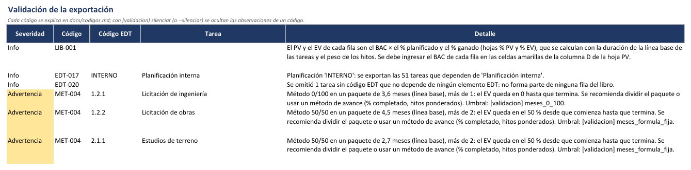

# Validaciones, limitaciones y solución de problemas

[Inicio](../README.md) › [Documentación](README.md) › Validaciones y solución de problemas

---

## Contenido

1. [Validaciones](#1-validaciones)
   1. [Datos del libro (generar y validar)](#11-datos-del-libro-generar-y-validar)
   2. [Avance a la fecha de estado (validar)](#12-avance-a-la-fecha-de-estado-validar)
   3. [Lógica del cronograma (validar)](#13-lógica-del-cronograma-validar)
2. [Limitaciones conocidas](#2-limitaciones-conocidas)
3. [Solución de problemas](#3-solución-de-problemas)

---

## 1. Validaciones

`generar` informa en la hoja **Validación** (y en la consola) las observaciones de la exportación, con
su severidad: `Info` (informativo), `Advertencia` (se debe revisar) o `Error` (dato incorrecto en MS
Project que se debe corregir, o dato que no se pudo trasladar o calcular). Cada observación tiene un
**código** (columna `Código`, por ejemplo `EDT-005`): la lista completa de códigos, con la causa y qué
hacer en cada caso, está en [Códigos de errores y advertencias](codigos.md), y las observaciones ya
revisadas se pueden silenciar con `[validacion] silenciar` o `--silenciar`
([Silenciar observaciones](codigos.md#2-silenciar-observaciones)). La columna `Tema` agrupa las
observaciones (*Estructura y códigos EDT*, *Fechas y duración*, *Hitos y pesos*, *Método de medición*,
*Empresas*...) y permite filtrarlas. Las tareas sin código EDT se identifican por su Id de MS Project
(por ejemplo, `Hito: bases aprobadas (Id 17)`).

El comando [`validar`](comandos.md#validar-revisa-el-archivo-de-ms-project) muestra las mismas
observaciones en pantalla, agrupadas por tema, **sin crear el libro**, y agrega los controles del
cronograma de las secciones [1.2](#12-avance-a-la-fecha-de-estado-validar) y
[1.3](#13-lógica-del-cronograma-validar). Se recomienda ejecutarlo antes de `generar` y antes de cada
`actualizar`.

### 1.1 Datos del libro (generar y validar)

| Observación | Qué revisar |
|---|---|
| Código EDT que no depende del de su tarea superior (`Error`): bajo `1.2.0` solo van `1.2.1`, `1.2.2`...; `1.14.2` o `1.0.0` son errores | Corregir el código en MS Project. La tarea superior es la tarea resumen con código EDT más cercana. |
| Código EDT con formato no válido (`Error`: segmentos vacíos como `1..2`) o no numérico (`Advertencia`: `1.2.A`) | Los códigos son números separados por un punto. Los ceros finales son relleno (`1.2.0`); un 0 intermedio indica un hijo directo del elemento anterior (`1.2.0.1` debajo de `1.2.0.0`, antes de `1.2.1.0`). Los códigos sin puntos como `INTERNO` se admiten como planificaciones. |
| Código EDT que salta un nivel (`1.2.3.1` directamente bajo `1.2.0`) o de nivel 2 o más sin tarea superior con código | Asignar código a la tarea intermedia o corregir el código. |
| Códigos EDT fuera de orden (`1.2.3` antes que `1.2.2`) y saltos en la numeración (`Info`: después de `1.2.2` sigue `1.2.14`) | Revisar si el código tiene un error de escritura. Un salto puede ser intencional (por ejemplo, un paquete eliminado). |
| Códigos EDT duplicados (`Error`) | Por ejemplo, si no se eligió una planificación y ambas usan los mismos códigos. Se revisan todas las tareas exportadas, también las de nivel mayor al máximo. |
| Fin anterior al comienzo (`Error`), en la línea base (*Fin previsto* y *Comienzo previsto*) o en el programa actual (*Fin* y *Comienzo*); tarea sin *Comienzo* o sin *Fin* | Corregir las fechas en MS Project (las tareas programadas manualmente pueden quedar sin fechas). |
| Hito con duración; tarea con duración 0 que no está marcada como hito | Un hito pone todo su % planificado en el mes de su fecha de fin; una tarea con duración 0 que no es hito no pesa en el % planificado. Corregir la marca de hito (*Información de la tarea > Avanzado*) o la duración. Se revisa si MS Project informa la duración (siempre con `.mpp` y con el XML que guarda MS Project). |
| Duraciones estimadas (`Advertencia`; con `?`, por ejemplo `5 días?`) y tareas programadas manualmente (`Info`) | Confirmar la duración: define el % planificado. Las tareas manuales no se reprograman cuando cambian sus predecesoras. |
| `Peso hito` en una tarea que no es un hito o en una tarea resumen; el campo `Peso hito` existe, pero ningún hito tiene peso | El peso solo se usa en los hitos de detalle; si ningún hito tiene peso, revisar `[campos] peso_hito`. |
| Método `Hitos ponderados` en una fila sin hitos (`Advertencia`), con hitos sin peso (`Info`) o con algunos hitos sin peso (`Info`) | Sin hitos, el % ganado se calcula con el *% físico completado* si alguna tarea lo tiene registrado y, si no, con el *% completado*; los hitos sin peso pesan igual o no suman ([Métodos de medición](metodos-de-medicion.md#33-hitos-ponderados)). |
| Método no reconocido (por ejemplo `60/30`); subtareas con otro método en MS Project; fila sin método cuyas subtareas sí tienen | El método se indica en la tarea de la fila (paquete de trabajo) con uno de los métodos admitidos ([Métodos de medición](metodos-de-medicion.md)). |
| Método `0/100` en un paquete de más de `meses_0_100` meses (1 por defecto) o `50/50`, `25/75`, `20/80` en uno de más de `meses_formula_fija` meses (2) | Con esos métodos el EV queda en 0 (o en el % inicial) hasta que el paquete termina. Dividir el paquete o usar un método de avance; los umbrales se ajustan en [`[validacion]`](configuracion.md#claves). |
| Campo de método o de empresa que existe, pero está vacío en todas las tareas | Revisar el nombre o el alias del campo en la configuración. |
| Multi-empresa: `% Reparto` en una tarea que no es `Ambas` (`Info`) | El reparto solo se usa en las tareas `Ambas`; en las demás se ignora. |
| Recordatorio de dónde se ingresa el BAC | Ingresar el BAC de cada fila en la columna D de la hoja `PV` (o de cada empresa) ([Cálculo del PV y el EV](calculo-pv-ev.md#14-controles-y-validaciones)). |
| Tareas sin fechas de línea base | Tareas agregadas después de guardar la línea base: su % planificado usa sus fechas actuales. Si están aprobadas, guardar la línea base de esas tareas. |
| Pesos de hitos que suman más de 100 (o menos, sin tareas con duración), pesos negativos, filas sin pesos o sin fechas | Revisar el `Peso hito` de los hitos de la fila y las fechas de sus tareas ([Cálculo del PV y el EV](calculo-pv-ev.md#4--planificado-peso-de-cada-tarea)). |
| Multi-empresa: empresa que no participa en las tareas de una fila | Si se le asigna BAC en esa fila, su PV y su avance son los de la fila completa. |
| Planificación exportada y cantidad de tareas que dependen de ella | Que sea la planificación correcta. |
| Tareas sin código EDT omitidas | Tareas que no dependen de ningún elemento EDT: no forman parte de ninguna fila. Si tienen duración o son hitos con peso (`Advertencia`), asignarles código EDT o moverlas bajo un elemento. |
| Tareas sin código EDT o de nivel mayor al máximo sumadas en su elemento superior | Informativo: es el comportamiento esperado para subtareas y hitos de un paquete. |
| Lista EDT (`lista_edt`): códigos de la lista sin tarea en MS Project (`Advertencia`); tareas que no están en la lista ni dependen de un elemento listado, que quedan fuera del libro (`Advertencia` si tienen duración o son hitos con peso); código listado cuya tarea superior no está en la lista (`Info`); campo `Visible` con valores, que no se usa (`Info`) | Revisar la lista, el campo EDT y la planificación ([Lista EDT](calculo-pv-ev.md#34-lista-edt-filas-definidas-en-un-archivo)). Si ningún código de la lista existe, `generar` termina con un error. |
| Proyecto sin línea base: se usaron las fechas actuales | Guardar la línea base antes de informar ([Preparación en MS Project](preparacion-ms-project.md#6-línea-base)). |
| Tareas sin código EDT que forman una fila `-D Otras tareas` | Tareas con duración (o hitos con peso) directamente bajo un elemento de nivel 1 o 2: la fila tiene su propio BAC. |
| Excepciones de calendario que no se interpretan (por ejemplo, "primer lunes de mayo") | Se omiten; solo afectan el reparto del % planificado entre meses (motor XML). |
| % planificado anterior al mes 1 o posterior al último mes | Revisar `mes_inicio` y `meses`. |
| Filas sin método de medición | Completar el método en MS Project o en la columna C de la hoja `PV`. |
| Tareas inactivas excluidas | Informativo (con `incluir_inactivas = false`): no forman parte del % planificado. |
| Multi-empresa: tareas sin empresa, valores no reconocidos y `% Reparto` fuera de rango | Completar la columna `Empresa` y revisar los repartos ([Multi-empresa](multiempresa.md#7-validaciones-y-controles)). |
| `--migrar-desde`: historial no trasladado (`Error`) | Cargar a mano el BAC, el % ganado y el AC de esas filas en el libro nuevo. |
| `--migrar-desde`: filas del análisis de desviaciones trasladadas, o cuyo paquete ya no tiene fila | Revisar en `Análisis de desviaciones` el texto que quedó sin valores ([Análisis de desviaciones](analisis-desviaciones.md#5-cambios-de-línea-base)). |
| Campo `Visible`: tareas fuera del cálculo (`No`), tareas que representan a sus subtareas, filas por debajo del nivel máximo (`Sí`), valores no reconocidos, `Sí` sin código EDT o dentro de una rama con `No`, todos los elementos de nivel 1 con `No` | Revisar el campo `Visible` de esas tareas ([Campo Visible](calculo-pv-ev.md#33-campo-visible-más-o-menos-detalle-en-cada-rama)). En `actualizar`: el campo cambió después de generar el libro; regenerarlo con `--migrar-desde`. |
| Depuración de costes: recordatorio de la hoja que se depura, filas con código no numérico o repetido, previsión trasladada o no por `--migrar-desde` | Ver [Depuración de costes](depuracion-costes.md#9-validaciones-y-limitaciones). Los controles de la previsión pegada están en la hoja `PV-depuración`. |
| Varios archivos: observaciones precedidas por el nombre del archivo (`[P1]`, `[P2]`) y monedas distintas | Revisar cada archivo; si las monedas difieren, indicar `moneda` en `[exportacion]` ([Varios archivos](varios-archivos.md#8-validaciones-y-controles)). |

`actualizar` informa sus controles en pantalla: filas con % ganado y sin BAC, filas cuya tarea ya no
existe o está inactiva, tareas con código EDT sin fila en el libro, cambios del campo `Visible` y celdas
sin la fórmula del libro ([Cálculo del PV y el EV](calculo-pv-ev.md#14-controles-y-validaciones)).

Las observaciones de `--migrar-desde` y los recordatorios del BAC y de la depuración de costes solo
aparecen en la hoja `Validación` de `generar`.

### 1.2 Avance a la fecha de estado (validar)

Se revisan las tareas de detalle exportadas con la fecha de estado de MS Project (o `--fecha-corte`).
No afectan al libro de `generar`, pero sí al % ganado que calcula `actualizar`.

| Observación | Qué revisar |
|---|---|
| *Fin real* sin *Comienzo real*, o anterior a él (`Error`) | Corregir las fechas reales. |
| *% completado* mayor que 0 sin *Comienzo real*; 100 % sin *Fin real*; *Fin real* con menos del 100 % | Registrar el avance de forma coherente: para el programa, una tarea con *Fin real* y menos del 100 % no está terminada. |
| *Comienzo real* o *Fin real* posterior a la fecha de estado (`Error`) | Avance registrado en el futuro: corregir la fecha real o la fecha de estado. |
| Trabajo pendiente antes de la fecha de estado: tareas sin terminar con *Fin* anterior a la fecha de estado, o sin avance con *Comienzo* anterior | El cronograma no está actualizado: registrar el avance o reprogramar el trabajo pendiente después de la fecha de estado (*Proyecto > Actualizar proyecto*). |
| Tareas que debían comenzar según la línea base y no comenzaron (`Info`) | Atrasos respecto de la línea base. |
| Índice de ejecución de la línea base (BEI): tareas terminadas / tareas que debían terminar según la línea base (`Advertencia` si es menor que 0,95) | Lista las tareas que debían terminar y no terminaron. |
| Avance cargado sin fecha de estado | `actualizar` necesita la fecha de estado de MS Project (*Proyecto > Información del proyecto*) o `--fecha-corte`. |

### 1.3 Lógica del cronograma (validar)

Se revisan los vínculos y las delimitaciones de las tareas exportadas con los criterios de la evaluación
**DCMA de 14 puntos** (*Defense Contract Management Agency*), una referencia habitual de calidad de
cronogramas. No afectan al cálculo del libro, pero un cronograma sin lógica no reprograma las fechas
cuando cambia el avance.

| Observación | Criterio DCMA | Qué revisar |
|---|---|---|
| El cronograma no tiene vínculos entre tareas | — | Vincular las tareas. |
| Tareas sin terminar sin predecesoras o sin sucesoras (no cuentan la primera y la última tarea del proyecto; el vínculo de una tarea resumen cuenta para sus subtareas) | Hasta 5 % | Agregar los vínculos que faltan. |
| Vínculos con adelanto (posición negativa) | Ninguno | Reemplazar el adelanto por un vínculo comienzo a comienzo o dividir la tarea. |
| Vínculos con posición positiva | Hasta 5 % | Una espera fija oculta trabajo que conviene representar como tarea. |
| Vínculos comienzo a fin (CF) y proporción de vínculos fin a comienzo (FC) | Al menos 90 % FC | Usar vínculos fin a comienzo. |
| Tareas resumen con vínculos | — | Vincular las tareas de detalle. |
| Delimitaciones que fijan fechas: *Debe comenzar el*, *Debe finalizar el*, *No comenzar después del*, *No finalizar después del* | Hasta 5 % | Usar *Lo antes posible* y, si hace falta, una fecha límite. |

---

## 2. Limitaciones conocidas

- La lectura de archivos `.mpp` requiere MS Project de escritorio en Windows. Sin él, se debe usar el XML.
- El programa no guarda cambios en el archivo de MS Project: lo abre en modo solo lectura.
- **Proyectos maestros con subproyectos insertados:** el grupo de recursos se abre en solo lectura; se
  debe verificar que el libro tenga las filas de todos los subproyectos. Para reunir varios archivos en un
  informe se recomiendan las secciones `[[proyectos]]` ([Varios archivos](varios-archivos.md)).
- **Varios archivos:** los códigos EDT no se pueden repetir entre archivos, todos se actualizan con la
  misma fecha de corte y no se admite `--origen activo`.
- **Plazo según MS Project:** la holgura total y la marca de tarea crítica son las que calcula MS
  Project; el desvío de fin se cuenta en días laborables con el mismo calendario que el % planificado.
  Si el cronograma no se actualizó a la fecha de estado (trabajo pendiente reprogramado), el fin previsto
  no es una previsión realista.
- **Calendario:** el % planificado de cada tarea se reparte entre los meses con el calendario del
  proyecto (XML) o con un calendario de lunes a viernes más los `feriados` de la configuración (`.mpp`).
  No se usan los calendarios de recursos ni de tareas. Con XML se ignoran las excepciones recurrentes
  relativas (por ejemplo, "primer lunes del mes" o "último viernes de marzo"), que se informan en
  `Validación`.
- Si la curva PV no alcanza el BAC dentro del horizonte, la duración planificada y el Cronograma Ganado
  quedan vacíos; en ese caso se debe aumentar `meses`.
- Dentro de una fila, el % planificado sigue la duración de las tareas, no su valor: una tarea larga de
  poco valor pesa más que una corta de mucho valor. El total de la fila es siempre el BAC ingresado.
- MS Project no tiene métodos nativos 0/100, 50/50 ni de hitos ponderados: el programa los calcula a
  partir del avance registrado.
- El libro está pensado para Excel. LibreOffice abre las fórmulas correctamente, pero dibuja como cero
  los meses sin datos de EV y AC en los gráficos.
- El lector `.mpp` se prueba con objetos que simulan MS Project y, de forma opcional, con un proyecto
  real ([Desarrollo](desarrollo.md#11-pruebas-con-ms-project-real-opcionales)). En el primer uso con un
  proyecto real se recomienda comparar las fechas de línea base de algunas filas (columnas E y F de la
  hoja `PV`) con las de MS Project, y revisar el resultado de `actualizar --simular`.

---

## 3. Solución de problemas

| Mensaje o síntoma | Solución |
|---|---|
| `No se pudo iniciar MS Project por automatización COM` | Se debe verificar que MS Project de escritorio esté instalado. Alternativa: usar el XML. |
| `Para leer archivos .mpp se necesita pywin32` | Se debe instalar con `python -m pip install pywin32`. |
| Error de atributos de `win32com` o `gen_py` | Se debe borrar la carpeta `%TEMP%\gen_py` y volver a ejecutar. |
| MS Project muestra un diálogo y el programa no avanza | Se recomienda ejecutar con `--visible` para ver el diálogo (inicio de sesión, archivo protegido con contraseña, etc.). |
| Con *Project Online Desktop Client*, MS Project pide elegir una cuenta o un perfil al iniciarse | Se debe abrir MS Project manualmente, elegir la cuenta (por ejemplo *Equipo* para trabajar con archivos locales) y luego ejecutar el programa, que usa esa instancia abierta y no la cierra. |
| El proyecto está en Project Online, SharePoint u OneDrive (se abre desde una dirección web) | Se abre en MS Project y se usa `--origen activo`, o se guarda una copia local `.mpp` y se usa esa ruta. |
| El `.mpp` se descargó de Internet o del correo y MS Project no lo abre | Windows puede haberlo bloqueado: clic derecho en el archivo > *Propiedades* > *Desbloquear*. |
| `No se pudo guardar ...` | Si el libro está abierto en Excel, se debe cerrar y repetir el comando. |
| `Hay valores cargados en meses posteriores a la fecha de corte` | Se deben borrar esos meses en la hoja `% EV` (o en las de cada empresa) o usar `--forzar` (y luego revisar o volver a cargar los meses posteriores que se indican). |
| `... tareas con código EDT no tienen fila en el libro (se agregaron después de generarlo)` | Su avance no se incluye en el % ganado. Se debe regenerar el libro con `--migrar-desde` (se conservan el BAC, el % ganado y el AC) e ingresar el BAC de las filas nuevas ([El libro Excel](libro-excel.md#4-cambios-de-línea-base-o-de-edt---migrar-desde)). |
| `El libro se generó con una versión anterior del programa, que calculaba el PV y el EV con los costos de MS Project ...` | Se debe generar un libro nuevo ([El libro Excel](libro-excel.md#6-libros-de-versiones-anteriores)). |
| `La hoja ... no tiene las filas con las que se generó el libro` | Se insertaron, eliminaron u ordenaron filas: se deben deshacer esos cambios o recuperar el libro desde un respaldo. Para cambiar la EDT, se modifica MS Project y se regenera con `--migrar-desde`. |
| `Falta la hoja ...` o `El dato ... de la hoja oculta _meta no es válido` | Se debe restaurar el nombre original de la hoja o recuperar el libro desde un respaldo. |
| `Hay celdas sin la fórmula del libro` | Se deben restaurar las fórmulas indicadas (por ejemplo, copiándolas de una celda vecina de la misma fila). |
| `El archivo de configuración ... no está guardado en UTF-8` | Se debe guardar con codificación UTF-8 (en el Bloc de notas: *Guardar como*, *Codificación: UTF-8*). |
| `El proyecto no tiene fecha de estado` | Se debe definir la fecha de estado en MS Project o indicar `--fecha-corte`. |
| `contiene el número ... guardado como texto` | Se debe escribir ese valor como número en Excel, o ejecutar `actualizar`, que lo convierte. |
| `La celda ... tiene una fórmula sin valor numérico calculado` | Se debe abrir y guardar el libro en Excel, o reemplazar la fórmula de esa celda de ingreso por un número. |
| La curva no muestra EV/AC | Se debe completar la fecha de corte en `Resumen!B5`. |
| `No se encontró la planificación ...` | El mensaje lista las tareas de nivel superior con su código EDT; se debe indicar en `planificacion` uno de esos códigos. `validar` lo informa y revisa el proyecto completo. |
| `El código EDT no depende del de su tarea superior ...` | El código de la tarea no empieza por el de su tarea resumen con código EDT, o no tiene un nivel más (se esperaba `1.2.x` bajo `1.2.0`). Se debe corregir el código en MS Project. |
| Un comando termina con código 1, 2 o 3 | Código 1: `validar` encontró errores (`[X]`); con solo advertencias termina con código 0. Código 2: el mensaje `ERROR CFG-001: ...` indica la causa (configuración, archivo, libro abierto en Excel, opción mal escrita) y su [código](codigos.md). Código 3: error inesperado (`ERROR SIS-001: error inesperado: ...`); se debe ejecutar de nuevo con `-v` e informarlo en un ticket con ese detalle ([Códigos de salida](comandos.md#códigos-de-salida)). |
| El libro solo muestra los elementos de primer nivel (`1.0.0`, `2.0.0`...) | Se debe revisar que el campo indicado en `[campos] edt` contenga los códigos EDT de todas las tareas. El nivel se toma del código EDT. |
| Todas las filas tienen método `Por definir` | Se debe revisar `[campos] metodo` (nombre del campo o su alias) y que el campo esté completo en las tareas de nivel 3. |
| El EV de una fila con `Hitos ponderados` no avanza | Los hitos deben ser subtareas de la fila con duración 0 y marcarse al 100 % al cumplirse ([Métodos de medición](metodos-de-medicion.md#33-hitos-ponderados)). |
| El PV y el EV de una fila están en 0 | Falta el BAC de la fila en la columna D de la hoja `PV` (o de cada empresa). |
| `Ninguna fila tiene BAC` o `filas tienen % ganado pero no tienen BAC` | Ingresar el BAC en la columna D de la hoja `PV` (o de cada empresa): el PV y el EV se calculan solos. |
| Los indicadores de costo (CV, CPI, EAC...) están vacíos o el CPI es muy alto | Falta cargar el AC del mes en la hoja `AC` (o en las de cada empresa): `actualizar` solo calcula el % ganado. |
| `--migrar-desde no se admite entre un libro de una sola empresa y uno multi-empresa` | Se debe generar el libro nuevo sin `--migrar-desde` y cargar a mano el historial que se necesite. |
| `No se encontró el campo de empresa ...` | Se debe revisar `campo_empresa` en `[multiempresa]`: nombre del campo (`Text3`) o su alias en MS Project. |
| `No se encontró el campo de descripción ...` | Se debe revisar `descripcion` en `[campos]`: `"Notas"` para las notas de la tarea, o el nombre del campo (`Text20`) o su alias en MS Project. Las fichas se crean sin descripción. |
| `generar-fichas`: una ficha no muestra un vínculo que sí está en MS Project | Los vínculos entre tareas del mismo elemento EDT y los vínculos con tareas sin ficha (otra planificación, inactivas, con `Visible = No` u otro proyecto) no se muestran; la consola indica cuántos vínculos se omitieron ([Comandos](comandos.md#generar-fichas-fichas-de-tareas-para-el-cliente)). |
| Los indicadores aparecen vacíos al abrir el libro | El libro se abrió en vista protegida o en una vista previa: se debe habilitar la edición para que Excel calcule las fórmulas. |
| `El código EDT ... está en los archivos ... y ...` | Varios archivos: cada código EDT debe estar en un solo archivo. Se deben corregir los códigos EDT o la planificación de cada archivo en `[[proyectos]]` ([Varios archivos](varios-archivos.md#3-preparación-en-ms-project)). |
| `Los archivos tienen fechas de estado distintas ...` | Se debe definir la misma fecha de estado en todos los archivos o indicar `--fecha-corte`. |
| `El libro se generó con varios archivos de MS Project ...` o `Los archivos de [[proyectos]] ... no coinciden con los del libro` | La configuración debe tener los mismos archivos (y nombres) con que se generó el libro. Para agregar o quitar un archivo se genera un libro nuevo con `--migrar-desde`. |
| `--origen '...': con varios archivos ([[proyectos]]) se indica NOMBRE=RUTA ...` | Con `[[proyectos]]` no se indica `--origen`, salvo para reemplazar la ruta de un archivo: `--origen P2=C:\ruta\archivo.xml`. |
| `El libro no tiene fecha de corte ...: se debe ejecutar 'actualizar' antes de 'analizar'` | `analizar` trabaja sobre el mes de la fecha de corte: se debe cargar al menos un mes con `actualizar`. |
| `Análisis de desviaciones` sin los paquetes con CPI bajo | El AC se cargó a mano después de `actualizar`: se debe ejecutar `analizar` ([Análisis de desviaciones](analisis-desviaciones.md#3-cierre-mensual)). |
| Las tildes se ven mal en la consola | Solo afecta a la consola, no al libro. Se recomienda usar Windows Terminal o ejecutar `chcp 65001`. |
