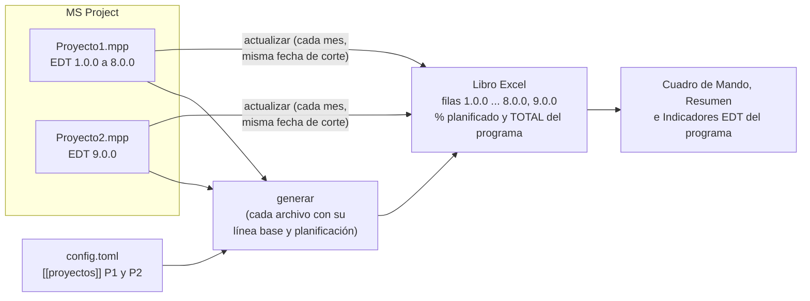
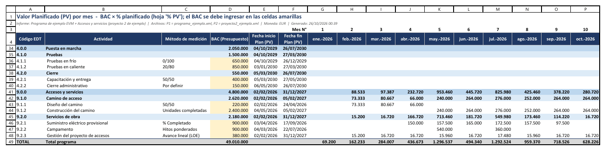
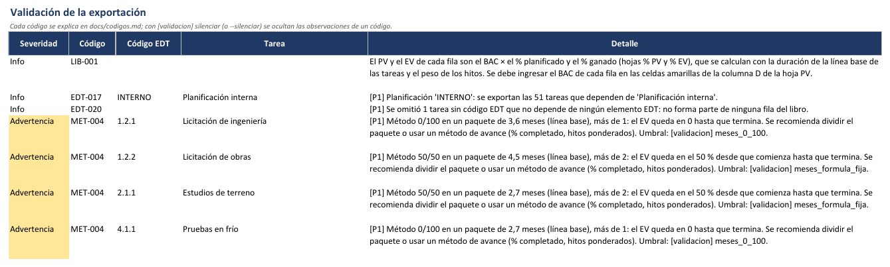
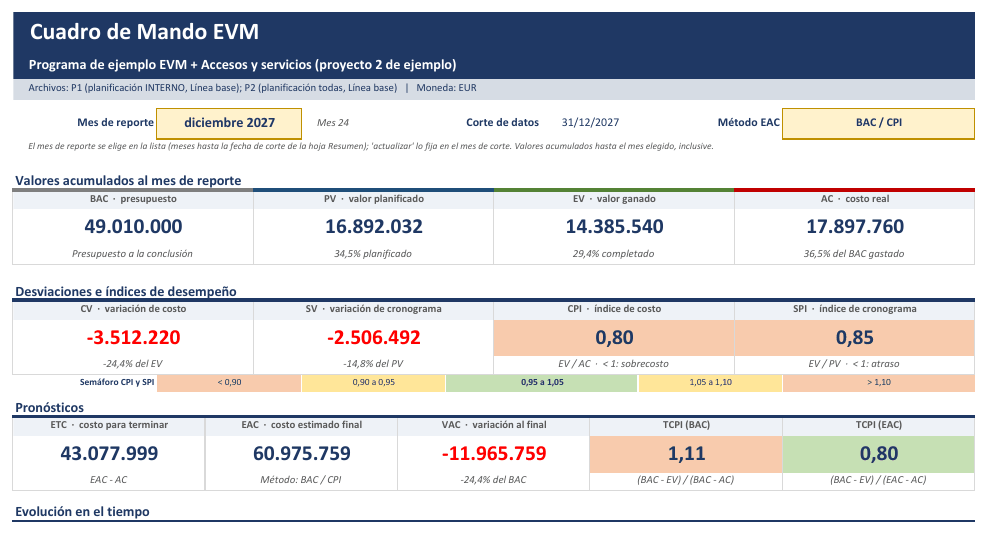

# Varios archivos de MS Project en un informe

[Inicio](../README.md) › [Documentación](README.md) › Varios archivos de MS Project

Cuando un programa se planifica en **varios archivos de MS Project** (por ejemplo, un archivo por
proyecto, por contrato o por equipo), el libro puede reunir los elementos EDT de todos ellos en un único
informe EVM: PV, EV y AC de cada elemento, y los indicadores, la curva S y el Cuadro de Mando del
conjunto. Cada archivo aporta sus propios códigos EDT, por ejemplo `1.0.0` a `8.0.0` en un archivo y
`9.0.0` en otro.

Es **opcional**: sin secciones `[[proyectos]]` en la configuración, el programa trabaja con un solo
archivo, indicado con `--origen`.

---

## Contenido

1. [Cuándo usarlo](#1-cuándo-usarlo)
2. [Cómo funciona](#2-cómo-funciona)
3. [Preparación en MS Project](#3-preparación-en-ms-project)
4. [Configuración](#4-configuración)
5. [Generar el libro](#5-generar-el-libro)
6. [Cierre mensual](#6-cierre-mensual)
7. [Cambios de línea base y de archivos](#7-cambios-de-línea-base-y-de-archivos)
8. [Validaciones y controles](#8-validaciones-y-controles)
9. [Ejemplo con dos archivos](#9-ejemplo-con-dos-archivos)
10. [Preguntas frecuentes](#10-preguntas-frecuentes)

---

## 1. Cuándo usarlo

- El programa tiene varios proyectos, cada uno en su propio archivo de MS Project, y se necesita **un
  solo informe** con el desempeño del conjunto.
- Los archivos usan **códigos EDT distintos**, de modo que sus elementos se pueden reunir en una sola
  EDT (por ejemplo, el archivo del proyecto principal con `1.0.0` a `8.0.0` y el de un proyecto
  asociado con `9.0.0`).

Si todo el programa está en un solo archivo, aunque tenga varias planificaciones (`INTERNO` y
`CLIENTE`), no se necesitan secciones `[[proyectos]]`.

> MS Project también permite insertar varios archivos en un **proyecto maestro**, que el programa lee
> como un solo proyecto. Ese camino no está validado con MS Project real
> ([Limitaciones](validaciones-y-problemas.md#2-limitaciones-conocidas)). Las secciones `[[proyectos]]`
> leen cada archivo por separado y no requieren modificar los archivos ni crear un proyecto maestro.

---

## 2. Cómo funciona



- Cada archivo se lee **por separado**, con su línea base, su calendario y su planificación. El PV, el EV
  y el AC de cada fila se calculan igual que con un solo archivo.
- Las filas se ordenan por **código EDT** (`1.0.0` ... `8.0.0`, `9.0.0`), cualquiera sea el orden de los
  archivos en la configuración.
- El libro tiene las mismas hojas que con un solo archivo. La fila **TOTAL** (*Total programa*), la
  curva S, el `Resumen`, el `Cuadro de Mando` e `Indicadores EDT` corresponden al conjunto de los
  archivos.
- El **horizonte** comienza en el primer mes con % planificado de cualquiera de los archivos (o en
  `mes_inicio`).
- MS Project numera las tareas de cada archivo desde el *Id. único* 1, por lo que los *Id. único* se
  repiten entre archivos. Por eso cada fila guarda, en la hoja oculta `_estructura`, el **nombre del
  archivo** junto con el *Id. único* de su tarea (por ejemplo `P2:15`).

---

## 3. Preparación en MS Project

Cada archivo se prepara como un proyecto individual
([Preparación en MS Project](preparacion-ms-project.md)), con estas condiciones:

| Condición | Motivo |
|---|---|
| **Códigos EDT distintos** en cada archivo: un mismo código no puede estar en dos archivos. | Las hojas identifican cada fila por su código EDT. Si un código se repite, `generar` se detiene sin crear el libro. |
| Los **mismos campos personalizados** (EDT, método de medición, peso de hito y, si se usan, `Visible`, descripción y empresa) con el mismo nombre o alias en todos los archivos. | La sección `[campos]` de la configuración es común a todos los archivos. |
| **Línea base** guardada en cada archivo. | El % planificado de las filas de cada archivo sale de las fechas de su línea base. El BAC de cada fila se ingresa en el libro. |
| Cada mes, la **misma fecha de estado** en todos los archivos. | El informe tiene una sola fecha de corte. |
| La **misma moneda** en todos los archivos. | El libro muestra una sola moneda. |
| Con `lista_edt`, **una sola lista** con los códigos de todos los archivos. | La lista decide las filas de todos los archivos ([Lista EDT](calculo-pv-ev.md#34-lista-edt-filas-definidas-en-un-archivo)); un código se advierte como inexistente solo si no está en ningún archivo. |

Para que los códigos no se repitan, conviene asignar a cada archivo un rango de elementos de nivel 1
(por ejemplo, `1` a `8` al proyecto principal y `9` al proyecto asociado). Con el campo **EDT** de MS
Project, el código del primer elemento de cada archivo es `1`; en ese caso se recomienda el campo
personalizado de texto (por ejemplo `Item EDT`), que permite escribir el código que corresponda
([Estructura y código EDT](preparacion-ms-project.md#2-estructura-y-código-edt)).

---

## 4. Configuración

Cada archivo se indica en una sección `[[proyectos]]` (con **dos corchetes**) del archivo de
configuración. El resto de la configuración (`[campos]`, `[horizonte]`, `[exportacion]`, `[metodos]`,
`[semaforo]`, `[validacion]` y `[multiempresa]`) es común a todos los archivos.

```toml
[campos]
edt = "Item EDT"
metodo = "Método EVM"
peso_hito = "Peso hito"

[exportacion]
planificacion = "INTERNO"        # planificación de los archivos que no indican otra
titulo = "Programa Norte"        # título del informe (opcional)

[[proyectos]]
nombre = "P1"
origen = 'C:\Programa\Proyecto1.mpp'

[[proyectos]]
nombre = "P2"
origen = 'C:\Programa\Proyecto2.mpp'
planificacion = ""               # este archivo no tiene planificaciones: se exportan todas sus tareas
```

| Clave de `[[proyectos]]` | Uso |
|---|---|
| `nombre` | **Obligatoria.** Nombre corto del archivo en el libro (por ejemplo `P1`, `Norte`): hasta 30 caracteres, sin `:` ni `;`, distinto en cada sección. Identifica las filas de ese archivo, por lo que **no se debe cambiar** después de generar el libro. |
| `origen` | **Obligatoria.** Archivo `.mpp` o `.xml`. Una ruta relativa se toma desde la carpeta del archivo de configuración. No se admite `activo`. |
| `planificacion` | Opcional. Planificación de este archivo; reemplaza `[exportacion] planificacion`. `""` exporta todas las tareas del archivo. |
| `linea_base` | Opcional. Línea base de este archivo (`0` = Línea base, `1`..`10` = Línea base N); reemplaza `[exportacion] linea_base`. |

- Las rutas de Windows se escriben entre **comillas simples** (`'C:\Programa\Proyecto1.mpp'`) o con
  barras `/` (`"C:/Programa/Proyecto1.mpp"`). Entre comillas dobles, la barra invertida `\` tiene otro
  significado en TOML.
- `[exportacion] titulo` es el título del `Cuadro de Mando` y del `Resumen`. Si se omite, se usan los
  nombres de los proyectos en MS Project unidos con `+`.
- Para agregar un tercer archivo se agrega otra sección `[[proyectos]]`
  ([Cambios de archivos](#7-cambios-de-línea-base-y-de-archivos)).

Ver todas las claves en [Configuración](configuracion.md).

---

## 5. Generar el libro

```powershell
python evm_export.py generar --config config.toml --salida EVM_Programa.xlsx
```

- No se indica `--origen`: se leen todos los archivos de `[[proyectos]]`, en su orden.
- `--salida` es **obligatoria**.
- La planificación y la línea base de cada archivo se indican en su sección `[[proyectos]]`: no se
  admiten `--planificacion` ni `--linea-base`.
- Con archivos `.mpp`, MS Project abre y cierra cada archivo por turno.

Ejemplo de salida con los dos archivos de ejemplo:

```text
Exportador EVM 2.4.0
Leyendo P1: ...\ejemplos\programa_ejemplo.xml ...
Leyendo P2: ...\ejemplos\proyecto2_ejemplo.xml ...
Informe: Programa de ejemplo con dos proyectos
  P1: Programa de ejemplo EVM  |  Planificación: INTERNO  |  Línea base  |  PV: % planificado de MS Project (duración de la línea base de las tareas y peso de los hitos) × BAC ingresado en el libro
  P2: Accesos y servicios (proyecto 2 de ejemplo)  |  Línea base  |  PV: % planificado de MS Project (duración de la línea base de las tareas y peso de los hitos) × BAC ingresado en el libro
  Filas EDT: 44 (29 de ingreso)  |  Nivel máximo: 3
  Horizonte: 01/2026 a 12/2035 (120 meses)
  BAC: se debe ingresar el BAC de cada fila en la columna D de PV (celdas amarillas).
  [i] LIB-001 El PV y el EV de cada fila son el BAC × el % planificado y el % ganado (hojas % PV y % EV), ...
  [i] EDT-017 INTERNO Planificación interna: [P1] Planificación 'INTERNO': se exportan las 51 tareas que dependen de 'Planificación interna'.
  [i] EDT-020 [P1] Se omitió 1 tarea sin código EDT que no depende de ningún elemento EDT: no forma parte de ninguna fila del libro.
  [i] EDT-022 [P1] 14 tareas sin código EDT o de nivel EDT mayor a 3 se agregaron en su elemento EDT superior.
  [i] EDT-022 [P2] 4 tareas sin código EDT o de nivel EDT mayor a 3 se agregaron en su elemento EDT superior.
  [i] MET-005 1 fila sin método de medición definido (columna C).
  [!] MET-004 1.2.1 Licitación de ingeniería: [P1] Método 0/100 en un paquete de 3,6 meses (línea base), más de 1: el EV queda en 0 hasta que termina. ...
  [!] MET-004 1.2.2 Licitación de obras: [P1] Método 50/50 en un paquete de 4,5 meses (línea base), más de 2: ...
  [!] MET-004 2.1.1 Estudios de terreno: [P1] Método 50/50 en un paquete de 2,7 meses (línea base), más de 2: ...
  [!] MET-004 4.1.1 Pruebas en frío: [P1] Método 0/100 en un paquete de 2,7 meses (línea base), más de 1: ...
  [!] MET-004 4.1.2 Pruebas en caliente: [P1] Método 20/80 en un paquete de 2,7 meses (línea base), más de 2: ...
  [!] MET-004 4.2.1 Capacitación y entrega: [P1] Método 50/50 en un paquete de 2,7 meses (línea base), más de 2: ...
  [!] MET-004 9.1.1 Diseño del camino: [P2] Método 50/50 en un paquete de 2,7 meses (línea base), más de 2: ...
Libro generado: ...\EVM_Programa.xlsx
```



*Hoja `PV` del ejemplo (las filas de los elementos `1.0.0` a `3.0.0` están ocultas en la imagen): los
elementos `4.0.0` del primer archivo y `9.0.0` del segundo, y la fila TOTAL del programa.*

---

## 6. Cierre mensual

1. En **cada archivo** se fija la **misma fecha de estado** (el último día del mes) y se registra el
   avance del mes ([Proceso de reporte](proceso-reporte-evm.md#4-cierre-mensual)).
2. Se ejecuta `validar`, que revisa todos los archivos
   (`python evm_export.py validar --config config.toml`).
3. Se ejecuta `actualizar`, que lee todos los archivos:

```powershell
python evm_export.py actualizar --config config.toml --libro EVM_Programa.xlsx --simular
python evm_export.py actualizar --config config.toml --libro EVM_Programa.xlsx
```

- **Fecha de corte.** Sin `--fecha-corte`, todos los archivos deben tener la misma fecha de estado; si
  difieren, `actualizar` se detiene e indica la fecha de cada archivo. Con `--fecha-corte`, se usa esa
  fecha y se advierte qué archivos tienen otra fecha de estado (con `.mpp`, el programa fija la fecha
  de corte en la copia abierta de cada archivo).
- **Todos los archivos del libro.** La configuración debe tener los mismos archivos (con los mismos
  nombres) con que se generó el libro; si falta uno o sobra otro, `actualizar` se detiene sin modificar
  el libro.
- **Otro archivo para un proyecto.** Con `--origen NOMBRE=RUTA` se reemplaza la ruta de un archivo
  solo para ese comando, por ejemplo para usar el XML exportado al cierre del mes. Se puede repetir:

```powershell
python evm_export.py actualizar --config config.toml --libro EVM_Programa.xlsx `
    --origen P1=C:\Cierres\P1_2026-10.xml --origen P2=C:\Cierres\P2_2026-10.xml
```

- `--simular`, `--forzar` y `--sin-respaldo` funcionan igual que con un solo archivo
  ([Comandos](comandos.md#actualizar-carga-el--ganado-del-mes)).
- Los controles se hacen **por archivo** y cada mensaje indica el archivo, por ejemplo:
  `[P2] 1 tarea con código EDT no tiene fila en el libro (se agregó después de generarlo): ...`.
- El AC de cada fila se carga a mano en la hoja `AC`, como con un solo archivo.

---

## 7. Cambios de línea base y de archivos

- **Nueva línea base** en uno o varios archivos: se genera un libro nuevo con `--migrar-desde`, igual
  que con un solo archivo ([El libro Excel](libro-excel.md#4-cambios-de-línea-base-o-de-edt---migrar-desde)).
  El BAC, el % ganado y el AC de cada fila se asocian por el nombre del archivo y el *Id. único* de la
  tarea.

```powershell
python evm_export.py generar --config config.toml --salida EVM_Programa_LB2.xlsx --migrar-desde EVM_Programa.xlsx
```

- **Agregar un archivo:** se agrega su sección `[[proyectos]]` y se genera un libro nuevo con
  `--migrar-desde`. Se conserva el historial de los archivos que ya estaban; las filas del archivo
  nuevo comienzan vacías.
- **Quitar un archivo:** se elimina su sección y se genera un libro nuevo con `--migrar-desde`. El
  historial de las filas de ese archivo no se traslada y se informa como `Error` en `Validación`.
- **Pasar de un solo archivo a varios:** `--migrar-desde` también acepta un libro de un solo archivo.
  En ese caso el historial se asocia por **código EDT** y se advierte en `Validación`. Lo mismo ocurre
  si se cambia el `nombre` de un archivo.

---

## 8. Validaciones y controles

**`generar`** informa en `Validación` las observaciones de cada archivo, precedidas por su nombre
(`[P1]`, `[P2]`), y además:

| Situación | Resultado |
|---|---|
| Un código EDT está en dos archivos | `generar` se detiene sin crear el libro e indica el código y los archivos. |
| Los archivos tienen monedas distintas en MS Project (y la configuración no indica `moneda`) | Advertencia: el libro muestra la moneda del primer archivo. Se debe indicar `[exportacion] moneda`. |



**`validar`** revisa todos los archivos de `[[proyectos]]` con el mismo prefijo por archivo; un código EDT
repetido entre archivos se informa como `Error`, sin detenerse.

**`actualizar`** se detiene si los archivos de la configuración no son los del libro, o si las fechas de
estado difieren y no se indicó `--fecha-corte`. El resto de los controles se informan por archivo
([Cálculo del PV y el EV](calculo-pv-ev.md#14-controles-y-validaciones)).

---

## 9. Ejemplo con dos archivos

La carpeta `ejemplos` incluye un segundo proyecto, `proyecto2_ejemplo.xml` (*Accesos y servicios*, con
el código EDT `9.0.0` y sin planificaciones), que se combina con el programa de ejemplo. Los dos
archivos numeran sus tareas desde el *Id. único* 1.

Configuración (se guarda como `config_varios.toml` en la carpeta raíz del repositorio, porque las rutas
de `origen` se toman desde la carpeta del archivo de configuración):

```toml
[campos]
edt = "Item EDT"
metodo = "Método EVM"
peso_hito = "Peso hito"

[horizonte]
mes_inicio = "2026-01"

[exportacion]
planificacion = "INTERNO"
titulo = "Programa de ejemplo con dos proyectos"

[[proyectos]]
nombre = "P1"
origen = "ejemplos/programa_ejemplo.xml"

[[proyectos]]
nombre = "P2"
origen = "ejemplos/proyecto2_ejemplo.xml"
planificacion = ""
```

Generar el libro, cargar el BAC ficticio de los dos proyectos, simular el avance a junio de 2027 (con
el AC acumulado hasta esa fecha, que queda cargado en junio) y actualizar:

```powershell
python evm_export.py generar --config config_varios.toml --salida ejemplo_varios.xlsx
python ejemplos\generar_ejemplo.py --libro ejemplo_varios.xlsx
python ejemplos\generar_ejemplo.py --fecha-estado 2027-06-30 --salida avance1.xml --libro ejemplo_varios.xlsx
python ejemplos\generar_ejemplo.py --proyecto 2 --fecha-estado 2027-06-30 --salida avance2.xml
python evm_export.py actualizar --config config_varios.toml --libro ejemplo_varios.xlsx --origen P1=avance1.xml --origen P2=avance2.xml
```

Con `--libro`, `generar_ejemplo.py` escribe en el libro los datos ficticios que en un proyecto real se
ingresan a mano: el BAC de cada fila (el presupuesto de los dos proyectos de ejemplo) y el AC del mes de
la fecha de estado. En un libro con varios archivos, el primero es el programa de ejemplo y el segundo
el proyecto 2. El BAC del programa es la suma de los dos proyectos: 44.210.000 + 4.800.000 =
**49.010.000**.



*Cuadro de Mando del ejemplo combinado con 24 cierres mensuales simulados, como en el tutorial (con los
comandos anteriores, el libro tiene un solo cierre, a junio de 2027): el encabezado indica los archivos, con la planificación y la línea base de cada uno.*

---

## 10. Preguntas frecuentes

**¿Cuántos archivos se pueden combinar?** No hay un límite fijo: una sección `[[proyectos]]` por
archivo. Con archivos `.mpp`, cada archivo agrega el tiempo de abrirlo en MS Project.

**¿Se pueden ver los indicadores de cada archivo por separado?** `Indicadores EDT` muestra los
indicadores de cada elemento EDT. Si un archivo tiene un solo elemento de nivel 1 (por ejemplo
`9.0.0`), esa fila resume todo el archivo. Para el informe de un archivo por separado se puede generar
otro libro con ese archivo solo (con `--origen` y una configuración sin `[[proyectos]]`).

**¿Se puede combinar con multi-empresa?** Sí. La columna `Empresa` se lee en cada archivo con los
mismos campos de `[multiempresa]`. Un archivo sin esa columna se trata como `Ambas`, con el reparto por
defecto, y se informa en `Validación` ([Multi-empresa](multiempresa.md)).

**¿Se puede usar `activo` (el proyecto abierto en MS Project)?** No con varios archivos. Si un archivo
está en Project Online, SharePoint u OneDrive, se guarda una copia local (`.mpp` o `.xml`) y se indica
esa ruta.

**¿Qué pasa si un archivo todavía no tiene el avance del mes?** `actualizar` lee siempre todos los
archivos. Se recomienda esperar a tener el avance de todos, o ejecutar `actualizar` con los datos
disponibles y repetirlo para el mismo mes cuando lleguen los demás: repetir `actualizar` para un mes
**reemplaza** el valor de ese mes, no lo duplica.
